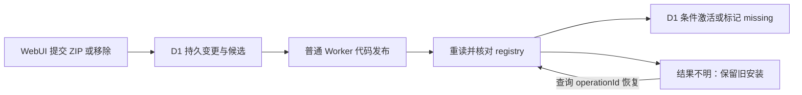

# 普通 Worker 通过代码发布安装插件

日期：2026-10-20。状态：已采用并有本地证据，真实云端验收待完成。延续 [ADR 0002](0002-worker-plugin-installation-by-deployment.md)：用户接受在 WebUI 安装、更新或移除插件时后台重新发布普通 Worker；我们保留这条避免额外付费产品前提的路线，采用固定核心、独立注册表和预构建插件模块，并把外部发布与 D1 安装激活分开确认。

## 发布集合与激活边界

构建物为薄 `worker.mjs`、固定 `core.mjs`、可重组的 `registry.mjs` 和 `plugins/<修订摘要>/…`。核心导出 `createWorker(registrations)` 与 `assertPluginModule`，不导入注册表；注册表静态导入核心检查和插件，并在模块初始化时校验导出。这样可以替换注册表与新增插件模块而无需重新编译核心，也能在平台加载候选代码时拒绝坏插件，没有 core/registry 循环。

注册表表达该发布版本可执行的代码，D1 安装记录表达当前激活的插件。后台先持久化变更、候选模块和操作身份，通过 SQL 条件控制同一部署的变更与恢复；发布后重读平台注册表，核对与持久候选相同，再条件激活 D1。候选保留旧 active 修订直到确认，使代码先行更新时仍能解析旧安装。移除只将安装标为 missing，保留实例及布局，后续发布重组再回收不再使用的修订。

上传响应丢失时保留 verifying，后续查询核对实际注册表，匹配即可完成，避免重复上传。明确的客户端错误立即失败；长期无法核对则在后续恢复执行时失败并保留旧安装。此协议处理已知的外部结果不明，不提供代码发布与 D1 之间的分布式事务，也不承诺更新零中断。

## 采用 Content API 与官方 SDK

采用 `GET …/content/v2` 读取实际模块、`PUT …/content` 替换代码。官方把后者定义为不修改 config/metadata 的接口，因此本项目无需在插件变更时读取并手工重建 Secrets、D1 或 ASSETS 配置；仅发送主模块名和命名模块文件。这是采用该接口的依据，真平台对本部署组合的保留行为仍待实测。[官方 Content API](https://developers.cloudflare.com/api/resources/workers/subresources/scripts/subresources/content/methods/update/)、[固定 SDK 7.3.0 的 Content 实现](https://raw.githubusercontent.com/cloudflare/cloudflare-typescript/v7.3.0/src/resources/workers/scripts/content.ts)

继续使用官方 `cloudflare` SDK 的认证、Fetch、超时和错误处理，并用 tree-shakable 的 `BaseContent` 缩减控制面代码。上传通过 SDK 公开 `client.put` 传入原生 `FormData`，而非直接调用锁定 7.3.0 的生成式 `content.update`：该版本通用 multipart 编码器把对象递归展开为 `metadata[main_module]`，而 Content API 要求一个 JSON 编码的 `metadata` part。原生 FormData 保留该 JSON part 和每个模块的文件名，修正限制在发布 Adapter；没有复制 SDK 或修改 node_modules。[官方公开请求方法](https://github.com/cloudflare/cloudflare-typescript#making-customundocumented-requests)、[7.3.0 multipart 编码源码](https://raw.githubusercontent.com/cloudflare/cloudflare-typescript/v7.3.0/src/internal/uploads.ts)

这项编码取舍依据固定版本源码与本项目请求测试，不声称上游已确认或修复。升级 SDK 时重新核对生成方法的实际 multipart，再决定是否回到生成式接口。

## 取舍与证据

Dynamic Workers 当前有付费计划前提，本路线使用普通 Worker 发布，不采用其运行时 Loader。避免该前提不等于本项目已通过免费计划的包体、CPU、D1 或请求额度验证。[官方 Dynamic Workers 定价](https://developers.cloudflare.com/dynamic-workers/pricing/)

本地 [正式入口探针](../../scripts/probe-worker-service.ts) 已运行实际 core/registry/插件模块、ASSETS、管理 API、DAV 与 D1；[发布集成测试](../../tests/worker-publishing.test.ts) 使用真实本地 D1 和官方 SDK，仅控制平台网络响应，验证 multipart、安装/移除和恢复分支。它们不能证明真实云端部署、完整配置保留、权限、传播时序、免费额度或在途播放行为。部署与当前验收边界见 [Worker 指南](../worker.md)。
