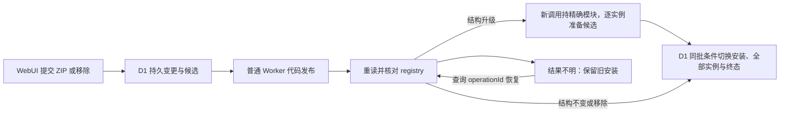

# 普通 Worker 通过代码发布安装插件

日期：2026-10-20。状态：已采用；本地与[真实云端插件生命周期及作者接入](https://github.com/shengyusi-SYS/musicfs/blob/b637d4d19da97e3473942be9ad7925b740afd47a/docs/verification/p4-worker-cloud.md)已有证据，在途切换与免费计划额度仍独立待验。延续 [ADR 0002](0002-worker-plugin-installation-by-deployment.md)：用户接受在 WebUI 安装、更新或移除插件时后台重新发布普通 Worker；我们保留这条避免额外付费产品前提的路线，采用固定核心、独立注册表和预构建插件模块，并把外部发布与 D1 安装激活分开确认。

## 发布集合与激活边界

构建物为薄 `worker.mjs`、固定 `core.mjs`、可重组的 `registry.mjs` 和 `plugins/<修订摘要>/…`。核心导出 `createWorker(registrations)` 与 `assertPluginModule`，不导入注册表；注册表静态导入核心检查和插件，并在模块初始化时校验导出。这样可以替换注册表与新增插件模块而无需重新编译核心，也能在平台加载候选代码时拒绝坏插件，没有 core/registry 循环。

注册表表达该发布版本可执行的代码，D1安装记录表达当前激活的插件。后台先持久化操作、完整候选模块及暂存就绪标记；保存上传意图后发布，再重读平台注册表核对。候选保留旧active修订直到D1激活，使代码先行时仍能服务旧安装。移除只将安装标为missing，保留实例/布局，后续发布再回收不再使用的修订。

配置/私有状态结构升级复用桌面的 `application/change-plugin.ts`：发布前一次冻结完整实例集合及各自数据修订，上传核对只证明代码就绪，**不能证明旧调用已取得新模块**。只有注册了目标 `(pluginId, revision)` 的后续调用可以准备迁移；每次至多一个实例，下一独立调用再整体激活。候选由 `sources` 纯转换、目标状态验证及可取消配置校验产生。安装代际、完整实例集合及各自epoch/stateRevision仍一致时，同一D1 batch切换安装、全部候选及操作终态；失败保留全部活动数据。零实例的升级也等待精确候选模块，避免在不可执行集合下报告完成。

上传响应丢失时保留 verifying，后续查询核对实际注册表，匹配即可完成，避免重复上传。明确的客户端错误立即失败；长期无法核对则在后续恢复执行时失败并保留旧安装。此协议处理已知的外部结果不明，不提供代码发布与 D1 之间的分布式事务，也不承诺更新零中断。

共用操作头由schema迁移 `0006.sql` 从旧Worker表更名，原JSON检查点不重写。旧版可能先激活安装再留下verifying；仅精确目标修订、清单、状态及预期代际+1全部匹配时允许完成原操作，不再次递增。代码块未暂存完成前禁止发布；中断超过两分钟后由后续有租约的调用失败清理，没有新增定时器或通用队列。

## 采用 Content API 与官方 SDK

采用 `GET …/content/v2` 读取实际模块、`PUT …/content` 替换代码。官方把后者定义为不修改 config/metadata 的接口，因此本项目无需在插件变更时读取并手工重建 Secrets、D1 或 ASSETS 配置；仅发送主模块名和命名模块文件。真平台的D1/Secrets/ASSETS及设置保留已由有限生命周期验证。[官方 Content API](https://developers.cloudflare.com/api/resources/workers/subresources/scripts/subresources/content/methods/update/)、[固定 SDK 7.3.0 的 Content 实现](https://raw.githubusercontent.com/cloudflare/cloudflare-typescript/v7.3.0/src/resources/workers/scripts/content.ts)

MusicFS构建、变更发布和下载恢复共用模块命名规则：js/mjs为ESM，json/txt/md为Text，其余为Data。Bun的`Response.formData()`会按文件名重写Blob MIME，JSON文本因此可能变成application/json；下载端不能据此把它误判为Data。现由同一`workerModuleType`恢复本项目模块类型，升级集成测试覆盖JSON文本和二进制保留；不增加multipart解析器或任意Worker克隆能力。核心/WebUI升级另由[组装工具与Wrangler](../worker.md#升级核心与-webui保留云端插件)更新静态资源，保留云端实际注册表，而不是重建为空安装集合。

继续使用官方 `cloudflare` SDK 的认证、Fetch、超时和错误处理，并用 tree-shakable 的 `BaseContent` 缩减控制面代码。上传通过 SDK 公开 `client.put` 传入原生 `FormData`，而非直接调用锁定 7.3.0 的生成式 `content.update`：该版本通用 multipart 编码器把对象递归展开为 `metadata[main_module]`，而 Content API 要求一个 JSON 编码的 `metadata` part。原生 FormData 保留该 JSON part 和每个模块的文件名，修正限制在发布 Adapter；没有复制 SDK 或修改 node_modules。[官方公开请求方法](https://github.com/cloudflare/cloudflare-typescript#making-customundocumented-requests)、[7.3.0 multipart 编码源码](https://raw.githubusercontent.com/cloudflare/cloudflare-typescript/v7.3.0/src/internal/uploads.ts)

这项编码取舍依据固定版本源码与本项目请求测试，不声称上游已确认或修复。升级 SDK 时重新核对生成方法的实际 multipart，再决定是否回到生成式接口。

## 取舍与证据

Dynamic Workers 当前有付费计划前提，本路线使用普通 Worker 发布，不采用其运行时 Loader。避免该前提不等于本项目已通过免费计划的包体、CPU、D1 或请求额度验证。[官方 Dynamic Workers 定价](https://developers.cloudflare.com/dynamic-workers/pricing/)

本地[正式入口探针](../../scripts/probes/worker-service.ts)运行实际core/registry/插件模块、ASSETS、管理API、DAV与D1；[发布集成测试](../../tests/worker-publishing.test.ts)使用真实本地D1和官方SDK，仅控制平台网络，覆盖multipart、安装/移除、响应丢失、精确新调用逐实例迁移/激活和失败保留；[共同持久化测试](../../tests/plugin-change-persistence.test.ts)覆盖两驱动条件事务及重启。它们不能证明真实云端部署、配置保留、权限、传播时序、免费额度或在途播放。部署边界见[Worker指南](../worker.md)，迁移证据见[记录](https://github.com/shengyusi-SYS/musicfs/blob/b637d4d19da97e3473942be9ad7925b740afd47a/docs/verification/p2-plugin-migration.md)。
