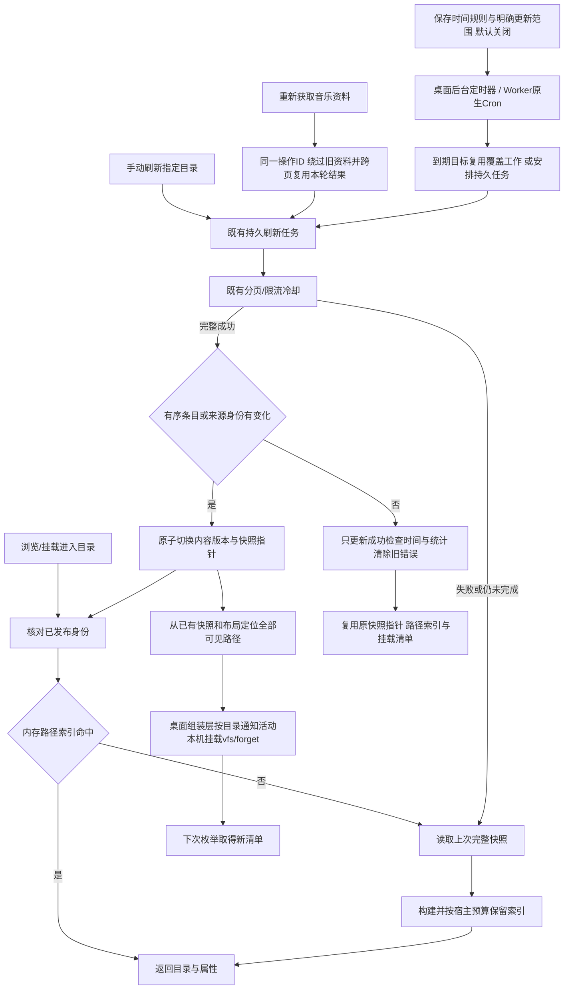

# 分层缓存与目录自动更新

缓存按数据所有者配置，不把音质、账号、封面等来源语义塞进核心，也不把所有缓存统一为一个TTL。

| 数据 | 所属模块 | 当前默认与可配置方式 |
|---|---|---|
| 完整目录快照 | 共享library / SQLite或D1 | 保存到下次成功发布；浏览直接使用。可为选定目录配置手动或15分钟以上周期更新 |
| 已发布目录路径索引 | 共享library / 宿主内存 | 最多32个视图，桌面估算总预算32MiB，Worker为8MiB。按内容版本命中，无变化刷新不重建；LRU淘汰后从持久快照重建，不请求平台 |
| 挂载目录清单/文件属性 | 桌面mounts / rclone VFS | 本机默认365天、远程30天；每挂载可指定期限，0保留到手动刷新；本机发布实际变化后主动forget |
| 封面、歌词、补充专辑/歌曲资料 | 对应来源插件 | 网易云与QQ均365天；实例配置metadataCacheDays，0长期保留。空/缺失结果最多30天，显式短期设置优先 |
| 稳定歌曲详情 | 网易云插件 | 跨歌单/扫描复用，默认365天，遵从metadataCacheDays；不再跟随临时扫描资料1天过期 |
| 临时扫描、推荐名单、播放版本 | 来源插件 | 保持原短期策略；更新名单仍向平台确认，播放定位受原生期限约束 |
| 网易云未准备文件的预留代次 | 网易云插件 | 跟随实例metadataCacheDays，重刷不续期；只存代次/时间，不生成计划，首次准备后由真实资料期限接管 |
| 标签表示计划及其共享字节 | 来源插件 | 同一已公布表示长期保留，读取仍取得同一字节；ready索引跟随依赖资料期限 |
| 临时音频URL与会话 | 来源插件 | 平台期限与既有续期/核对，不能被“长期缓存”设置延长 |
| App挂载已读文件片段 | 桌面rclone VFS | 默认原生稀疏磁盘缓存，每挂载8GiB软上限、未访问365天淘汰，可配置或关闭；128KiB内存预读、1MiB起步递增。仅缓存实际读取区段；缓存管理可查询实际模式/占用与清理 |
| 直接DAV的音频正文 | 桌面rclone共享VFS / Worker来源流 | 桌面默认共享16GiB软上限/365天，可配置、关闭与清理；内部固定键目录也保留365天；App本机挂载绕过此层重复落盘。Worker保持流式读取 |

## 更新过程

“即时”对应App已确认的变更与显式刷新，不意味着每次进入目录都请求音乐平台。来源平台外部修改由手动或所选周期发现；没有假设平台提供变更推送。更新尚未完成和失败时都不抹去旧成功快照。

路径索引只保留投影条目与名称查找表，不再附带一份完整原始快照；来源入口也从同一投影读取。同一目录的新版本进入缓存时移除旧版本，避免旧索引挤掉其他目录；保留旧条目对象的在途调用仍可继续使用。预算按发布字符串和条目开销估算，不是堆内存硬上限。单项超过预算仍可读取但不保留；桌面提高预算服务大目录和多目录轮换，Worker保留原预算。两者使用相同发布身份、来源代际和完整成功后失效的语义。

`core/library/schedules`管理间隔/日历时间与明确目标，复用原刷新分页。schema13将旧周期迁移为`automatic_update_rules`，保留原范围与首次触发点；到期消费与持久任务原子关联，活跃同实例工作及429等待仍由原刷新模块负责。关闭网页不停止任务，退出后台则暂停，重启仅补一次；Worker沿用原生Cron且每次最多推进一项工作。[调度与命名职责](updates-and-naming.md)

稳定资料的过期后重取仍发生在插件需要它时，不为所有歌曲额外建立定时器。已发布音频的字节冻结不随资料TTL变化；下次目录刷新可生成新表示。长期缓存受当前实例/代际/插件修订隔离，换号、内容配置变更、插件升级和删除实例沿用现有失效/清理规则，不承诺跨修订迁移。

SQLite/D1在末页写入后的同一发布事务内，对照完整候选与上一版有序条目，仅比较一次，不把两份完整目录载入进程。来源身份、顺序、文件引用及属性完全相同时，保留原`Snapshot.id`与`published_attempt_id`，随后回收本轮候选行；`completedAt`、统计和错误状态仍按本次成功结果更新。分页边界不参与内容身份，空目录同样可复用。比较只发生在完整刷新末尾，使用已有`attempt_id/ordinal`索引；D1会增加这一轮的索引行读取，没有新增远端往返或每次浏览的全目录比较。

`contentModifiedAt`记录当前内容版本的时间，来源缺少修改时间时据此投影，避免成功检查时间变化触发播放器重新扫描；旧快照缺少此字段时沿用原`completedAt`。路径索引及其已计算文件ETag按内容版本复用，冷启动也使用相同时间。实际目录变化只失效其全部可见挂载路径，覆盖默认布局、分组、别名和嵌套目录；路径定位只读已有快照，复用本次查找结果，不拉取平台内容。桌面仅比较发布前后的内容ID，不再另做全量条目比较。布局变更、换号等仍整体失效。

## 少量增删与文件缓存

目录发生变化后，下一次访问仍完整读取该目录的持久快照并建立名称索引，不请求逐曲标签或音频。完整命名要处理同名碰撞；目前不引入第二套增量路径索引。4,000项离线样本的重建约11—13ms、完整属性投影约8—16ms，仅用于评估这部分本机计算，不代表真实平台刷新或Windows资源管理器耗时。[有界证据与ROI决定](../verification/partial-directory-update.md)

直接DAV共享缓存登记新键时，使用rclone1.75.2的`vfs/forget file=<固定桶>/<新键>`，只把桶清单标为过期，保留其他文件节点；通知不提前取目录或预热。桶内只有不可变文件键，可以直接复用这个原生机制。App本机挂载仍对变化目录执行原来的递归目录失效：其中可能包含同名但已换目标的子目录，不能仅按名字保留旧内容。本轮没有为此增加目录差异跟踪或新的持久状态。[上游文件通知与目录通知的区别](https://github.com/rclone/rclone/blob/v1.75.2/vfs/dir.go#L274)

清单失效不清理音频片段：App挂载按路径及原生文件属性复用，直接桌面DAV按最终表示键复用。网易云/QQ的有效文件索引保留原引用及修改时间；未改名、大小和时间不变的文件可继续命中。保留序号的名称在前部增删或换序时仍可能变化；可选不含序号的模板减少这种改名，同名身份也脱离全歌单位置。命名策略独立参与展示索引键，不改变最终字节身份；首次应用模板仍可能导致App路径缓存和播放器索引未命中。Worker不新增字节缓存，远程DAV/自行挂载继续由对应客户端管理。

第三方插件不提供文件修改时间时仍使用目录内容时间：目录实际变化可能使其他文件的缺省时间变化。两现有平台示例已提供稳定文件时间，本轮不为这一通用回退增加逐文件持久化与迁移；也不以固定假日期掩盖实际更新。插件应按最终文件表示提供稳定`info.modifiedAt`。来源过期、真实资料更新、换号和升级仍按原合同处理。

## 保留策略与主动更新资料

插件可用API0.1.10的纯函数`contentConfiguration`声明影响内容的配置。两示例仅排除`metadataCacheDays`：只改保留策略且私有状态未变时，原实例代际、授权、目录与缓存保持有效；持久化仍核对状态修订。音质、账号等变化继续失效，旧插件保持原行为。新期限用于后续取得的资料，既有记录继续按取得时的期限复用，不为调整设置整库重取。

普通“更新”确认目录，继续使用有效资料；目录更多菜单的“重新获取音乐资料”显式绕过此前封面、歌词、补充资料及准备索引，以原持久任务分页执行。`Context.metadataRefresh`携带同一操作ID，插件在不同页复用本轮已取资料，避免同专辑封面重复下载；任务照常可取消、续步及限流冷却。仅完整成功才发布新文件描述，原计划及原文件引用不改写。范围是当前目录的文件，不递归刷新子目录，也不自动加入周期更新。

网易云的按需预留文件在此显式准备过程中可能改为精确标签表示；普通浏览、更新与按需读取仍沿用原预留策略。音乐资料刷新不清理音频片段、不改变编码音质；桌面与Worker共用相同语义，Worker仍按原单次预算推进。

## 升级与不同入口

旧默认值按用户选择迁移一次：挂载目录300秒改为本机365天/远程30天，字节缓存168小时改为8760小时；容量、自定义期限和0长期保留不变。保存迁移版本后，用户仍可重新选择原短期限。来源插件配置版本2将旧默认网易云7天、QQ1天改为365天；其余配置与私有授权状态由既有迁移流程保留。插件修订仍按正常规则隔离旧缓存，不为这次升级清空整库或账号。

| 使用方式 | 本项目控制的缓存 | 客户端自己控制的缓存 |
|---|---|---|
| App本机挂载，Windows/WSL/Linux/macOS | 挂载VFS目录与已读片段、核心快照、对应插件资料 | 资源管理器/播放器自己的标签索引、缩略图 |
| App挂载远程WebDAV | 本机每挂载VFS；远端为MusicFS时再使用远端快照及插件缓存 | 远端服务的独立刷新策略 |
| 直接连接桌面WebDAV、Windows原生映射 | 桌面共享字节缓存、核心快照与插件资料 | WebClient/播放器的目录与文件缓冲 |
| Worker WebDAV、OpenList | 持久快照、插件资料；音频按需流式读取 | OpenList、挂载器或播放器的目录及字节缓存 |
| 自行运行rclone | 服务端快照/资料与桌面共享读取 | 自行设置rclone的目录TTL、VFS容量和保留时间 |

第三方数据源插件继续拥有自己资料与定位的有效期，核心不覆盖插件声明的期限。WebUI状态查询保持短期新鲜度；DAV的`private, no-cache`要求按ETag等重新核对，不等于禁用已有音频片段缓存。长TTL解决重复准备和读取，不能代替首次平台取数，也不向Worker新增整曲云存储。[rclone目录与文件缓存](https://rclone.org/commands/rclone_mount/#vfs-directory-cache)

rclone目录缓存不等于音频字节缓存。容量按已读工作集评估，软上限可能在原生清理前暂时超出；长期保留不能防止容量淘汰，统计也可能滞后。挂载设置与清理见[挂载设计](desktop-mounts.md#文件头扫描与读取范围)，共享字节的身份、回环Adapter和资源所有权见[共享读取](shared-read-cache.md)。已缓存范围可复用，首次或新增范围仍可取源，不以一次热请求代表整曲已保存。
