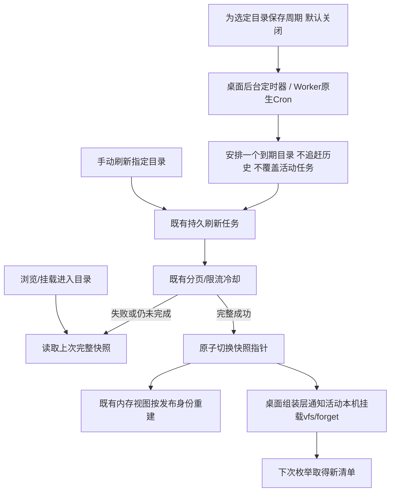

# 分层缓存与目录自动更新

缓存按数据所有者配置，不把音质、账号、封面等来源语义塞进核心，也不把所有缓存统一为一个TTL。

| 数据 | 所属模块 | 当前默认与可配置方式 |
|---|---|---|
| 完整目录快照 | 共享library / SQLite或D1 | 保存到下次成功发布；浏览直接使用。可为选定目录配置手动或15分钟以上周期更新 |
| 挂载目录清单/文件属性 | 桌面mounts / rclone VFS | 默认5分钟；每挂载可指定秒数，0保留到手动刷新；成功本机发布后主动forget |
| 封面、歌词、补充专辑/歌曲资料 | 对应来源插件 | 网易云7天、QQ1天；实例配置metadataCacheDays，0长期保留。空/缺失结果1天后可重试 |
| 基本歌曲详情/推荐/播放版本 | 来源插件 | 继续原有独立短期策略，未暴露为一组通用旋钮 |
| 标签表示计划及其共享字节 | 来源插件 | 同一已公布表示长期保留，读取仍取得同一字节；ready索引跟随依赖资料期限 |
| 临时音频URL与会话 | 来源插件 | 平台期限与既有续期/核对，不能被“长期缓存”设置延长 |
| App挂载已读文件片段 | 桌面rclone VFS | 默认原生稀疏磁盘缓存，每挂载8GiB软上限、未访问7天淘汰，可配置或关闭；128KiB内存预读、1MiB起步递增。仅缓存实际读取区段；缓存管理可查询实际模式/占用与清理 |
| 直接DAV的音频正文 | 桌面rclone共享VFS / Worker来源流 | 桌面dev.11默认共享16GiB软上限/7天，可配置、关闭与清理；App本机挂载绕过此层重复落盘。Worker保持流式读取 |

## 更新过程

“即时”对应App已确认的变更与显式刷新，不意味着每次进入目录都请求音乐平台。来源平台外部修改由手动或所选周期发现；没有假设平台提供变更推送。更新尚未完成和失败时都不抹去旧成功快照。

`core/library/schedules`只管理固定周期与到期建队，依赖小型持久存储Interface，不取平台资料、不执行另一套分页。SQLite/D1共用SQL，schema10新增`refresh_schedules`；活跃同实例任务与429等待继续由原刷新模块负责，调度器不覆盖它们。关闭桌面网页不停止任务，退出后台则暂停，重启仅补一次；Worker沿用现有Cron且每次最多推进一项工作，执行时间可以晚于计划时间。

稳定资料的过期后重取仍发生在插件需要它时，不为所有歌曲额外建立定时器。已发布音频的字节冻结不随资料TTL变化；下次目录刷新可生成新表示。长期缓存受当前实例/代际/插件修订隔离，变更配置、换号、插件升级和删除实例沿用现有失效/清理规则，不承诺跨修订迁移。

rclone目录缓存不等于音频字节缓存。真实流量截图确认存在公网下载；本地HTTP/FUSE已复现默认预读放大及未缓存正文，现采用小范围读取和原生稀疏缓存，跨重挂重复头尾为0次GET。边界与直接DAV的差异统一见[挂载读取策略与证据](desktop-mounts.md#文件头扫描与读取范围)，没有增加自制缓存框架或全曲预抓取。

桌面直接DAV的身份、回环Adapter和资源所有权见[共享读取缓存](shared-read-cache.md)。已缓存范围可跨直接客户端复用，开放GET新增范围仍可取源；不以一次热请求代表全曲已缓存。
