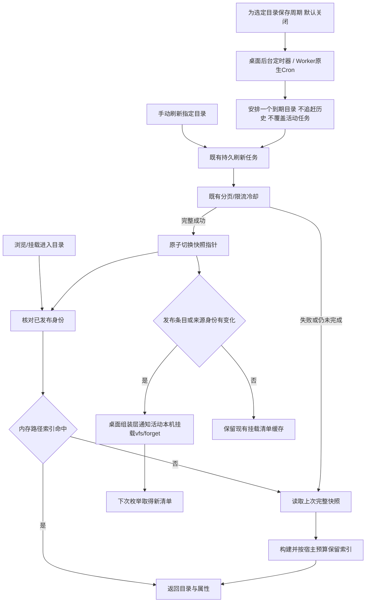

# 分层缓存与目录自动更新

缓存按数据所有者配置，不把音质、账号、封面等来源语义塞进核心，也不把所有缓存统一为一个TTL。

| 数据 | 所属模块 | 当前默认与可配置方式 |
|---|---|---|
| 完整目录快照 | 共享library / SQLite或D1 | 保存到下次成功发布；浏览直接使用。可为选定目录配置手动或15分钟以上周期更新 |
| 已发布目录路径索引 | 共享library / 宿主内存 | 最多32个视图，桌面估算总预算32MiB，Worker为8MiB。按发布身份命中；LRU淘汰后从持久快照重建，不请求平台 |
| 挂载目录清单/文件属性 | 桌面mounts / rclone VFS | 本机默认365天、远程30天；每挂载可指定期限，0保留到手动刷新；本机发布实际变化后主动forget |
| 封面、歌词、补充专辑/歌曲资料 | 对应来源插件 | 网易云与QQ均365天；实例配置metadataCacheDays，0长期保留。空/缺失结果最多30天，显式短期设置优先 |
| 稳定歌曲详情 | 网易云插件 | 跨歌单/扫描复用，默认365天，遵从metadataCacheDays；不再跟随临时扫描资料1天过期 |
| 临时扫描、推荐名单、播放版本 | 来源插件 | 保持原短期策略；更新名单仍向平台确认，播放定位受原生期限约束 |
| 网易云未准备文件的预留代次 | 网易云插件 | 跟随实例metadataCacheDays，重刷不续期；只存代次/时间，不生成计划，首次准备后由真实资料期限接管 |
| 标签表示计划及其共享字节 | 来源插件 | 同一已公布表示长期保留，读取仍取得同一字节；ready索引跟随依赖资料期限 |
| 临时音频URL与会话 | 来源插件 | 平台期限与既有续期/核对，不能被“长期缓存”设置延长 |
| App挂载已读文件片段 | 桌面rclone VFS | 默认原生稀疏磁盘缓存，每挂载8GiB软上限、未访问365天淘汰，可配置或关闭；128KiB内存预读、1MiB起步递增。仅缓存实际读取区段；缓存管理可查询实际模式/占用与清理 |
| 直接DAV的音频正文 | 桌面rclone共享VFS / Worker来源流 | 桌面默认共享16GiB软上限/365天，可配置、关闭与清理；内部固定键目录也保留365天；App本机挂载绕过此层重复落盘。Worker保持流式读取 |

## 更新过程

“即时”对应App已确认的变更与显式刷新，不意味着每次进入目录都请求音乐平台。来源平台外部修改由手动或所选周期发现；没有假设平台提供变更推送。更新尚未完成和失败时都不抹去旧成功快照。

路径索引只保留投影条目与名称查找表，不再附带一份完整原始快照；来源入口也从同一投影读取。预算按发布字符串和条目开销估算，不是堆内存硬上限。单项超过预算仍可读取但不保留；桌面提高预算服务大目录和多目录轮换，Worker保留原预算。两者使用相同发布身份、来源代际和完整成功后失效的语义。

`core/library/schedules`只管理固定周期与到期建队，依赖小型持久存储Interface，不取平台资料、不执行另一套分页。SQLite/D1共用SQL，schema10新增`refresh_schedules`；活跃同实例任务与429等待继续由原刷新模块负责，调度器不覆盖它们。关闭桌面网页不停止任务，退出后台则暂停，重启仅补一次；Worker沿用现有Cron且每次最多推进一项工作，执行时间可以晚于计划时间。

稳定资料的过期后重取仍发生在插件需要它时，不为所有歌曲额外建立定时器。已发布音频的字节冻结不随资料TTL变化；下次目录刷新可生成新表示。长期缓存受当前实例/代际/插件修订隔离，变更配置、换号、插件升级和删除实例沿用现有失效/清理规则，不承诺跨修订迁移。

桌面在完整发布前由SQLite对照上一版条目和“已暂存页＋末页”，不把两份完整目录载入进程；内容、顺序、文件属性及来源身份未变时，不清除挂载清单。实际变更、布局变更、换号等仍主动失效。此额外比较只用于桌面挂载通知，不增加Worker的D1查询。

## 升级与不同入口

旧默认值按用户选择迁移一次：挂载目录300秒改为本机365天/远程30天，字节缓存168小时改为8760小时；容量、自定义期限和0长期保留不变。保存迁移版本后，用户仍可重新选择原短期限。来源插件配置版本2将旧默认网易云7天、QQ1天改为365天；其余配置与私有授权状态由既有迁移流程保留。插件修订仍按正常规则隔离旧缓存，不为这次升级清空整库或账号。

| 使用方式 | 本项目控制的缓存 | 客户端自己控制的缓存 |
|---|---|---|
| App本机挂载，Windows/WSL/Linux/macOS | 挂载VFS目录与已读片段、核心快照、对应插件资料 | 资源管理器/播放器自己的标签索引、缩略图 |
| App挂载远程WebDAV | 本机每挂载VFS；远端为MusicFS时再使用远端快照及插件缓存 | 远端服务的独立刷新策略 |
| 直接连接桌面WebDAV、Windows原生映射 | 桌面共享字节缓存、核心快照与插件资料 | WebClient/播放器的目录与文件缓冲 |
| Worker WebDAV、OpenList | 持久快照、插件资料；音频按需流式读取 | OpenList、挂载器或播放器的目录及字节缓存 |
| 自行运行rclone | 服务端快照/资料与桌面共享读取 | 自行设置rclone的目录TTL、VFS容量和保留时间 |

第三方数据源插件继续拥有自己资料与定位的有效期，核心不覆盖插件声明的期限。WebUI状态查询保持短期新鲜度；DAV的`private, no-cache`要求按ETag等重新核对，不等于禁用已有音频片段缓存。长TTL解决重复准备和读取，不能代替首次平台取数，也不向Worker新增整曲云存储。[rclone目录与文件缓存](https://rclone.org/commands/rclone_mount/#vfs-directory-cache)

rclone目录缓存不等于音频字节缓存。容量按已读工作集评估，软上限可能在原生清理前暂时超出；长期保留不能防止容量淘汰，统计也可能滞后。挂载设置与清理见[挂载设计](desktop-mounts.md#文件头扫描与读取范围)，共享字节的身份、回环Adapter和资源所有权见[共享读取](shared-read-cache.md)。已缓存范围可复用，首次或新增范围仍可取源，不以一次热请求代表整曲已保存。
