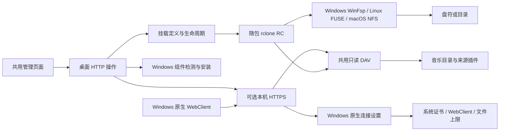

# 桌面挂载与本机 HTTPS

MusicFS 管理页面负责发起操作；实际挂载始终发生在运行桌面后台的系统中。来源插件和音乐目录不感知 WinFsp、盘符或证书。

| 模块 | 负责的状态与操作 |
|---|---|
| `contracts/mounts.ts`、`desktop/mounts.ts` | 保存定义和私有读取凭据；添加、重挂、卸载、移除；确认实际挂载，正常卸载后才移除 |
| `desktop/rclone-control.ts` | 私有 rclone 进程、认证 RC 与配置清理；具体文件系统交互交给 rclone |
| `desktop/mount-prerequisites.ts` | Windows WinFsp 检测、运行安装器、安装结果；不改变 WebDAV 全局认证策略 |
| `desktop/https.ts` | 独立回环 DAV TLS、证书和端口持久化；组装 Windows 连接设置的公开操作，复用既有 DAV |
| `desktop/windows-webdav.ts` | Windows 系统信任、WebClient 与单文件传输上限；按需提权一次应用/重连，保存和恢复此 App 修改前的原值 |
| `desktop/http.ts`、`desktop/launcher.ts` | 桌面操作路由与进程/监听器组装；不拥有音乐来源语义 |

`POST /api/mounts` 添加并挂载，`POST /api/mounts/:id/mount` 重挂，`POST /api/mounts/:id/unmount` 卸载，`DELETE /api/mounts/:id` 移除保存记录。重挂使用服务端保存的私有输入，页面无需取回密码。挂载变更复用现有串行操作机制；忙卸载仍保留条目和可读挂载，不强制终止进程。

采用 `selfsigned` 生成 PEM 和 Bun 原生 TLS，避免自己构造 X.509 或引入反向代理。WinFsp 是系统文件系统桥接依赖，随 Windows 包提供固定官方运行时安装器；已有运行时复用，不为检测安装开发工具。HTTPS 证书是专用自签名叶证书，信任和实际 Windows 原生映射分别核验；Bun 客户端自身的信任行为不能代替 Windows Schannel 的结果。

原生连接设置使用 Windows 内置 PowerShell/注册表接口，无新依赖。`FileSizeLimitInBytes` 是机器全局 DWORD，最大值读取按无符号 32 位处理。`windows-webdav-original.json` 保存原值（包含原先不存在的情况），在提权操作前写入，应用并验证后标记完成；注册表写入后服务重启未完成时，下次明确操作会重新应用。已有最大值不取得恢复所有权；退出不来回改动全局设置。`DELETE /api/desktop/https/file-size-limit` 显式恢复原值，保留证书和 TLS。

## 目录缓存

每个挂载独立保存`directoryCacheSeconds`，默认300，0映射固定rclone1.75.2的`DirCacheTime: off`。缓存设置保存复用正常卸载/重挂，忙时保留旧设置。`refresh(id)`只对该挂载的fs执行`vfs/forget`；`refreshLocal()`仅处理活动本机挂载，没有活动挂载时不启动rclone。没有新增目录副本、文件缓存引擎或挂载守护程序。

桌面组装层在SQLite真正发布完整目录后通知挂载；来源代际/配置、布局及插件激活的成功变更同样失效本机清单。通知与平台刷新分开，不因浏览目录反复刷新平台；Worker不感知本机挂载。rclone进程使用Bun原生`windowsHide: true`，保留原文件日志，不借助PowerShell启动包装。分层策略与定时流程见[缓存设计](cache-policy.md)。
