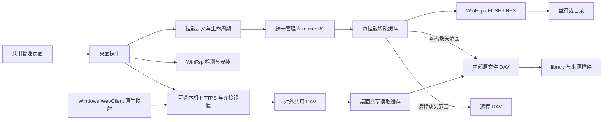

# 桌面挂载与本机 HTTPS

管理页面发起操作，实际挂载发生在运行桌面后台的系统。来源插件和音乐目录不感知 WinFsp、盘符或证书；App rclone 磁盘与 Windows WebClient 原生映射是两种入口。

## 模块与系统适配

| 模块 | 责任 |
|---|---|
| `contracts/mounts.ts`、`desktop/mounts.ts` | 保存定义和私有连接输入；就绪、重挂、卸载、移除与每挂载缓存 |
| `desktop/rclone-control.ts`、`launcher.ts` | 私有 RC 进程与认证；装配层协调挂载和共享缓存的关闭顺序 |
| `desktop/mount-prerequisites.ts` | WinFsp 检测、运行固定官方安装器、核对结果 |
| `desktop/https.ts` | 独立回环 DAV TLS、证书/端口持久化与公开操作 |
| `desktop/windows-webdav.ts` | 系统信任、WebClient、文件上限的按需应用与原值恢复 |
| `desktop/http.ts` | 桌面路由和错误映射，不解释音乐来源 |

WinFsp 是挂载所需系统桥接，已有运行时直接复用。证书由 selfsigned 生成，监听由 Bun TLS 承担，不另建反向代理。证书信任与实际 WebClient 连接分别核验，不能用 Bun 客户端结果代替 Windows Schannel。

Windows 连接设置可能涉及机器全局值：先保存本 App 修改前原值（含不存在），按需提权应用并核对；不在每次退出时反复更改。已有目标值不自动取得恢复所有权，显式恢复文件上限与关闭 TLS 是不同操作。具体用户入口见[桌面说明](../desktop.md)，实际验证查[Windows 记录](../verification/p2-windows-mount.md)。

## 挂载操作与目录缓存

添加、重挂、卸载、移除是不同操作：卸载保留定义与片段，移除须正常卸载后删除定义及所属缓存命名空间。忙卸载保留可操作状态；重挂使用后台保存的私有输入，不要求页面取回密码。[路由及字段](../management-api.md)

状态查询仍向原生控制器核对实际挂载，但定义和状态未变化时不重写配置文件。管理页面在启动/卸载期间每 3 秒查询，稳定挂载每 15 秒查询；页面操作完成后立即刷新。意外挂载消失仍由下一次核对发现并保存。

每挂载目录 TTL 可配置，零表示保留到手动失效。保存设置复用正常卸载/重挂，忙时保留旧设置。手动刷新仅对所选 VFS 执行 `forget`；本机成功发布、来源/布局/插件的有效变更由装配层定向通知活动本机挂载，没有活动挂载不启动原生进程。目录刷新不等于平台内容刷新，远程挂载按自身 TTL 或手动动作更新。

rclone 使用 Bun 原生 `windowsHide: true`，日志写文件，无额外 PowerShell 启动包装。

## 文件头扫描与读取范围

资源管理器和播放器可能在列目录后读取标签、时长、码率，形成回环传输及公网 CDN 请求。进程合计网卡带宽不能直接区分两者；目录缓存命中也不能阻止未缓存的正文读取。

App 挂载使用原生 full 稀疏缓存，只保存已读片段。读取采用 128KiB 内存缓冲、1MiB 起步后递增，保留连续播放合并效果；额外磁盘 ReadAhead 为零，关闭句柄即保存范围记录。只缩小内存缓冲而保留过大的源请求范围，仍可能放大扫描流量。

WebDAV remote 使用支持 Last-Modified 的 rclone 兼容配置参与缓存指纹，避免只比较大小误用同大小更新。默认容量、期限与软上限见[缓存策略](cache-policy.md)。关闭缓存保留旧片段，卸载保留片段，移除才清理所属命名空间。

缓存管理查询实际 VFS 模式、路径、文件数、占用和采样时间，不把配置冒充运行状态；未运行不启动进程或扫描磁盘。清理先正常卸载，再删除该挂载片段并按原设置重挂，失败不删。它与目录清单 `forget` 分开，也不清除来源资料或标签计划。

历史预读对照、播放成本、真实重挂与 Windows 消费证据见[缓存消费记录](../verification/cache-consumption-2026-10-21.md)及[共享读取验证](../verification/shared-read-cache.md)，不在设计页重复运行计数。

## 直接WebDAV与播放器

App 本机挂载使用自身缓存并走内部直读；桌面直接 DAV 客户端使用[共享读取缓存](shared-read-cache.md)，缺失范围才继续取源。Worker 保持流式，是否复用正文取决于其客户端。各入口共用目录、资料及最终表示合同，但没有强制共用同一磁盘后端。

HTTP `no-cache` 允许存储并要求重验证，Range 本身不存字节。ETag/304 只帮助发起条件请求的客户端，不能替代服务端片段缓存。首次、新范围、版本变化和淘汰仍可产生来源请求；开放 GET 再次取消的位置也可能不同。
