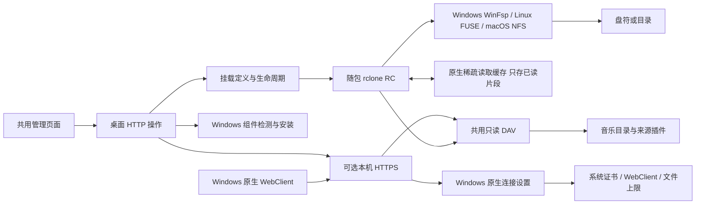

# 桌面挂载与本机 HTTPS

MusicFS 管理页面负责发起操作；实际挂载始终发生在运行桌面后台的系统中。来源插件和音乐目录不感知 WinFsp、盘符或证书。

| 模块 | 负责的状态与操作 |
|---|---|
| `contracts/mounts.ts`、`desktop/mounts.ts` | 保存定义和私有读取凭据；添加、重挂、卸载、移除；确认实际挂载，正常卸载后才移除 |
| `desktop/rclone-control.ts` | 私有 rclone 进程、认证 RC 与配置清理；具体文件系统交互交给 rclone |
| `desktop/mount-prerequisites.ts` | Windows WinFsp 检测、运行安装器、安装结果；不改变 WebDAV 全局认证策略 |
| `desktop/https.ts` | 独立回环 DAV TLS、证书和端口持久化；组装 Windows 连接设置的公开操作，复用既有 DAV |
| `desktop/windows-webdav.ts` | Windows 系统信任、WebClient 与单文件传输上限；按需提权一次应用/重连，保存和恢复此 App 修改前的原值 |
| `desktop/http.ts`、`desktop/launcher.ts` | 桌面操作路由与进程/监听器组装；不拥有音乐来源语义 |

`POST /api/mounts` 添加并挂载，`POST /api/mounts/:id/mount` 重挂，`POST /api/mounts/:id/unmount` 卸载，`DELETE /api/mounts/:id` 移除保存记录。重挂使用服务端保存的私有输入，页面无需取回密码。挂载变更复用现有串行操作机制；忙卸载仍保留条目和可读挂载，不强制终止进程。

采用 `selfsigned` 生成 PEM 和 Bun 原生 TLS，避免自己构造 X.509 或引入反向代理。WinFsp 是系统文件系统桥接依赖，随 Windows 包提供固定官方运行时安装器；已有运行时复用，不为检测安装开发工具。HTTPS 证书是专用自签名叶证书，信任和实际 Windows 原生映射分别核验；Bun 客户端自身的信任行为不能代替 Windows Schannel 的结果。

原生连接设置使用 Windows 内置 PowerShell/注册表接口，无新依赖。`FileSizeLimitInBytes` 是机器全局 DWORD，最大值读取按无符号 32 位处理。`windows-webdav-original.json` 保存原值（包含原先不存在的情况），在提权操作前写入，应用并验证后标记完成；注册表写入后服务重启未完成时，下次明确操作会重新应用。已有最大值不取得恢复所有权；退出不来回改动全局设置。`DELETE /api/desktop/https/file-size-limit` 显式恢复原值，保留证书和 TLS。

## 目录缓存

每个挂载独立保存`directoryCacheSeconds`，默认300，0映射固定rclone1.75.2的`DirCacheTime: off`。缓存设置保存复用正常卸载/重挂，忙时保留旧设置。`refresh(id)`只对该挂载的fs执行`vfs/forget`；`refreshLocal()`仅处理活动本机挂载，没有活动挂载时不启动rclone。没有新增目录副本、文件缓存引擎或挂载守护程序。

桌面组装层在SQLite真正发布完整目录后通知挂载；来源代际/配置、布局及插件激活的成功变更同样失效本机清单。通知与平台刷新分开，不因浏览目录反复刷新平台；Worker不感知本机挂载。rclone进程使用Bun原生`windowsHide: true`，保留原文件日志，不借助PowerShell启动包装。分层策略与定时流程见[缓存设计](cache-policy.md)。

## 文件头扫描与读取范围

目录清单缓存不缓存音频正文。Windows资源管理器和播放器可能在显示目录时额外打开歌曲读取标签、时长或码率；这时既有MusicFS→rclone的回环传输，也可能有CDN→MusicFS的公网下载。不能把进程合计带宽当成单一方向的外网流量，也不能只凭IP确认来源域名。

挂载使用rclone原生设置：每个VFS通过`_config.BufferSize`保留128KiB内存预读，`ChunkSize`从1MiB开始，`ChunkStreams: 0`按连续读取自动倍增，`ChunkSizeLimit: -1`保留上游默认的不限制倍增。dev.9曾采用256KiB，dev.10依据有界播放对照调到1MiB，减少连续播放的SDK/CDN请求，同时保留预留标签区小读零源请求。不同宿主复用同一设置；复用已有RC进程也在新建VFS时取得此策略，已有挂载需正常重挂。

**已读字节默认落入原生`CacheMode: full`稀疏缓存。** 仅保存实际读过的片段，不先下载整曲。每挂载`fileCacheMaxMiB`默认8192（8GiB），0关闭；`fileCacheMaxAgeHours`默认168（未访问7天），0不按时间淘汰。上限是原生定期LRU清理的软上限，活动打开文件可以暂时超出；没有预先分配8GiB。淘汰在VFS活动时运行；卸载保留片段，移除挂载项才删除其`cache/vfs`与`cache/vfsMeta`命名空间。关闭缓存不立即清理旧片段，重新启用可继续核对复用。设置保存沿用正常卸载/重挂，文件占用失败仍保留原值。

`ReadAhead: 0`不增加额外磁盘预取；`HandleCaching: 0s`让关闭时保存稀疏范围记录，避免默认5秒句柄延迟关闭使立即重挂无法复用已读范围。只读WebDAV配置采用rclone的`rclone`兼容配置：读取标准Last-Modified参与原生缓存指纹；1.75.2的`other`配置把时间标记为不支持，会仅按大小判断版本，实际同大小更新探针已发现旧字节被误复用。未伪造文件哈希或把源专属字段加入核心。

默认16MiB内存预读加128MiB初始范围对音乐标签扫描过大。只缩小内存缓冲仍会在源HTTP层请求整曲范围；同时缩小初始范围，才能让仅落在已准备标签区内的请求不打开源音频。来源识别、最终大小、Range及取消仍由原插件/音频工具处理，不取消源响应核验。连续播放使用依次增大的范围请求，不按初始块大小固定切碎整首。

`bun run scripts/probe-mount-reads.ts`在WSL实际FUSE中通过生产挂载管理器、随包rclone1.75.2、Library/DAV/SQLite、标签区段读取器及模拟HTTP CDN做有界对照。旧设置先失败，修复后通过；一个65MiB导出文件（1MiB生成标签区+64MiB生成源）得到：

| 操作 | 旧默认 | 仅缩小内存 | dev.9策略 |
|---|---|---|---|
| 打开文件读取头部64字节并短暂停留 | 请求完整64MiB源范围 | 仍请求完整64MiB源范围 | DAV仅请求256KiB；0次源HTTP请求 |
| 打开后读取尾部64字节 | 初始整曲范围还可能被预取 | — | 仅请求尾部4KiB源数据 |
| 顺序读取完整65MiB | 单次范围 | — | 9次DAV范围、7次源范围，字节逐项一致 |
| 头尾已读，真实卸载/重挂后再读 | 关闭后无字节缓存 | 无字节缓存 | 0次DAV GET、0次源请求，排除了原内核页缓存/句柄复用 |
| 同路径、同大小、Last-Modified更新 | — | — | 旧片段失效，取得新版本字节 |

匿名计数见[原始结果](../verification/data/mount-read-ahead-2026-10-21.json)，受影响挂载测试12项/111断言、三套TypeScript与依赖边界检查通过。探针只生成字节，不验证音频解码、不访问平台，不代表Windows资源管理器整体耗时。dev.10的有效音频播放对照与直接DAV消费模式见[后续缓存验收](../verification/cache-consumption-2026-10-21.md)。首次资料准备、未缓存区段、版本变化和容量/时间淘汰后仍需要请求；不因命中一个范围就宣称整曲已缓存。原生配置语义见[rclone读取缓存说明](https://rclone.org/commands/rclone_mount/#vfs-file-caching)，本项目使用的固定版本见[1.75.2 VFS配置](https://github.com/rclone/rclone/blob/v1.75.2/vfs/vfscommon/options.go)。

“缓存管理”通过`GET /api/mounts/:id/cache`读取所属VFS的原生模式、路径、文件数和占用，不把配置值冒充运行值。仅打开管理窗口或手动查询时取样；原生磁盘统计可能滞后，未运行时不启动rclone或遍历磁盘。`DELETE`同一路径正常卸载所选挂载，删除其`vfs`/`vfsMeta`命名空间，再按原设置重新挂载；占用导致卸载失败时不删除片段。此操作与`POST .../cache/refresh`的目录清单失效分开，不刷新平台目录。

## 直接WebDAV与播放器

| 缓存对象 | 是否跨客户端共享 | 责任 |
|---|---|---|
| 完整目录、文件描述及ETag | 是，复用最近发布结果 | 核心library/持久存储 |
| 歌曲资料、封面、歌词和固定标签计划/字节 | 是，同来源实例内复用 | 来源插件 |
| App挂载已经读取的最终文件片段 | 同一挂载可跨打开、重挂复用；不与其它DAV客户端共享 | 桌面rclone原生稀疏缓存 |
| 直接DAV已经读取的最终文件片段 | 桌面dev.11共享原生VFS；Worker仍依赖客户端自身缓存 | 桌面read-cache Adapter / Worker流式 |

`private, no-cache`允许客户端存储，但再次使用前需验证；GET/HEAD的ETag/304可省去正文读取。Range只限制读取区间，不自动缓存；PROPFIND也不走文件304路径。客户端不发送条件请求且不保存正文时，同范围仍会重新访问CDN。已准备标签内的小范围读取无需源音频，但完整GET或开放尾部Range包含音频时，工具会在返回头前预核对首个源响应，即使客户端之后很快取消。

当前不把延长HTTP新鲜期作为补齐字节缓存，也不新增任意范围缓存框架。实际FFprobe对照使用开放范围GET，热扫描仍读约1.3MiB源音频；只缓存短小头尾Range无法覆盖这个主要读法，故本轮不实施候选小范围缓存。完整共享稀疏缓存仍是独立的5—8人日候选，不能将局部命中当成通用解决。免费Worker维持小资料持久化与流式读取，不默认把音频塞入D1或增加R2资源。[消费证据与取舍](../verification/cache-consumption-2026-10-21.md)

**dev.11续接：** 上述dev.10直接DAV调查保留为当时证据；现已复用rclone服务端VFS提供共享片段缓存，没有实现此前被否决的短Range响应缓存或自制稀疏引擎。App本机挂载走内部直读入口，保留原批量元数据与自身VFS，不同一次两层落盘。[新设计与证据](shared-read-cache.md)
