# MusicFS 架构与流程图

日期：2026-10-20。「当前链路」对应正式代码与本地验证；明确注明设计目标的流程仍含未实现部分，不表示已完成真实云端或目标系统验收。Mermaid 源码在本页维护；模块定义见 [架构设计](README.md)，调用与字节合同见 [插件 Interface](plugin-interface.md)。关系图描述逻辑身份，不等同于 SQL 表结构。

当前已有共用页面、认证、插件/实例、目录快照/布局、管理 HTTP 和 Fetch DAV；QQ 与[网易云](../verification/p2-netease-source.md)有真实来源证据。正式桌面启动/挂载和 Worker 后台发布已接线，完整范围见[台账](../verification.md)。

## 当前链路

描述正式代码与本地请求路径。Worker 模块组装与持久发布在本地 workerd/受控平台网络验证；rclone 完成真实读取及 RC 进程管理，系统挂载尚待对应环境。

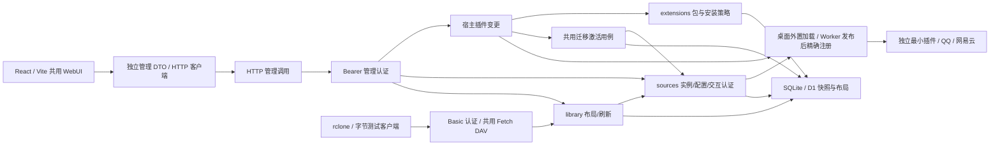

## 当前 Worker 插件发布

发布及迁移已接线；SDK网络使用受控平台响应，D1为本地真实workerd，真实云端仍待验。宿主差异与共用激活见后文“插件变更”。

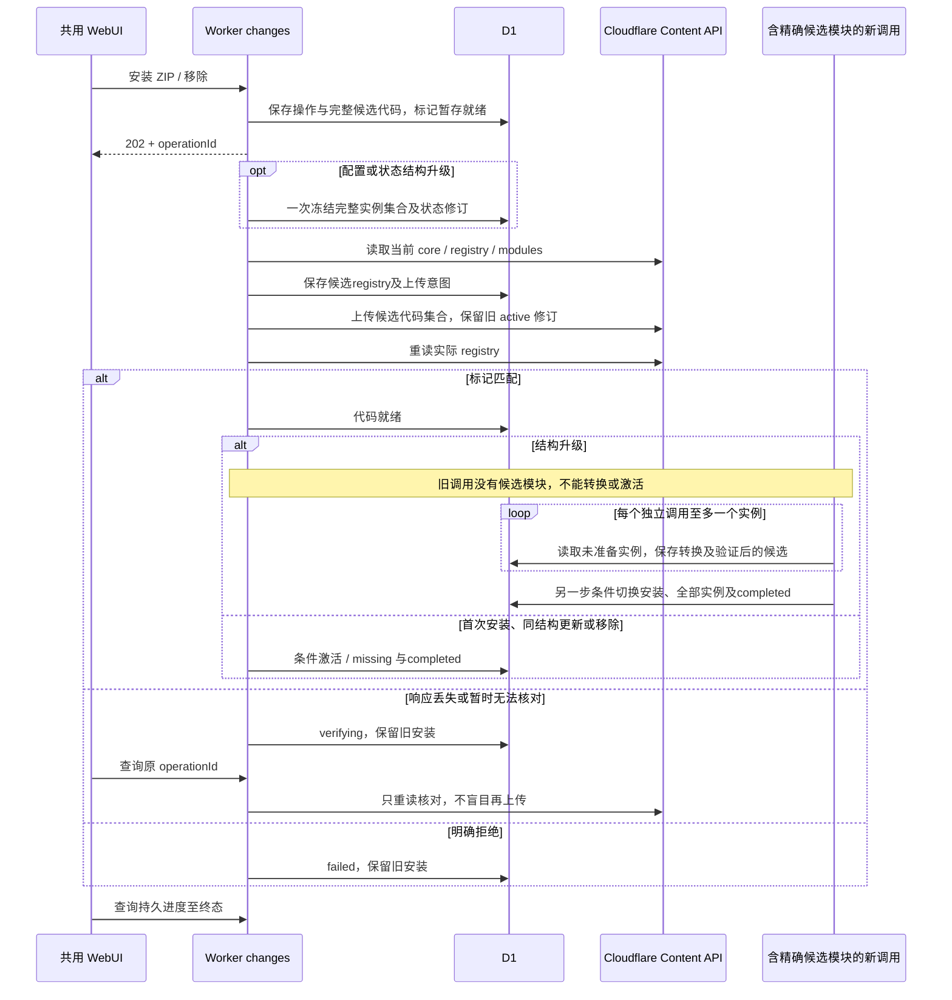

## 当前桌面生命周期

锁、后台、rclone RC及Linux本地/独立远程FUSE读取、忙时保留与退出已实测；其他目标系统挂载和平台弹窗仍待验。

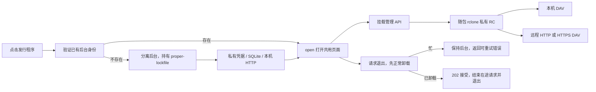

## 当前目录属性读取

属性选择每请求按文件/目录编译一次；快照单查询只在首行携带头，唯一名称不进入冲突散列。请求内的日期/来源戳复用不跨请求缓存，范围见[CPU定位](../verification/p2-read-cpu.md)。

文件条目可随分页提供完整可信的 `Entry.info`；library 校验后暂存，目录完整成功才连同条目发布。已列对象私下关联解析目标及已发布 info，不新增持久路径索引。DAV 需要元数据时才懒调用一次 `statMany`，按不同来源代际在批量前后核对；提供 info 的条目直接描述，旧插件缺 info 时保留实时 stat。该调用次数优化不代表真实免费 Worker 的 CPU 或总体额度已验收。

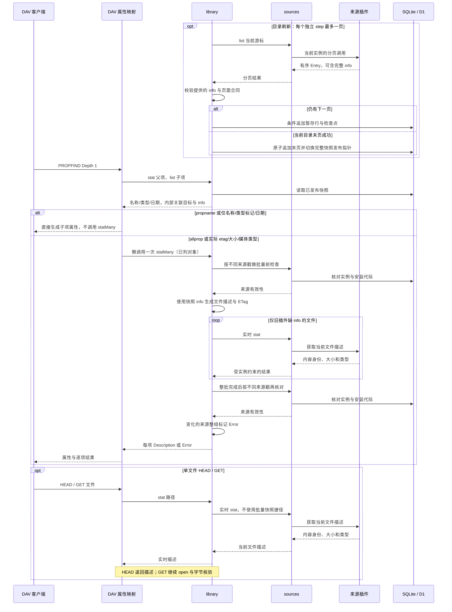

## 当前交互认证

对应本地 SQLite/D1 与共用页面的已实现流程；通用步骤由测试插件验证，QQ 已另行验证真实手机扫码。开始、终态的代际变化与普通状态 CAS 分开处理，取消不会等待旧轮询完成才写入。

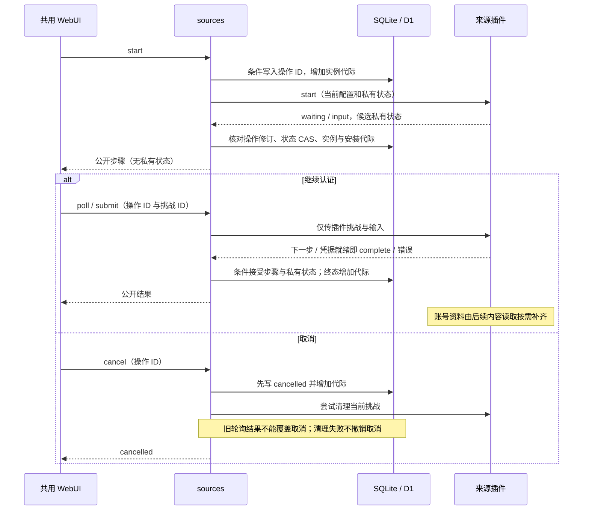

## 当前按需会话续期

插件判断到期和重试时间，sources只协调同一实例的必要续期；普通内容请求在租约之外。SQLite/D1使用同一条件SQL计划，详见[会话验证](../verification/p2-session-lifecycle.md)。

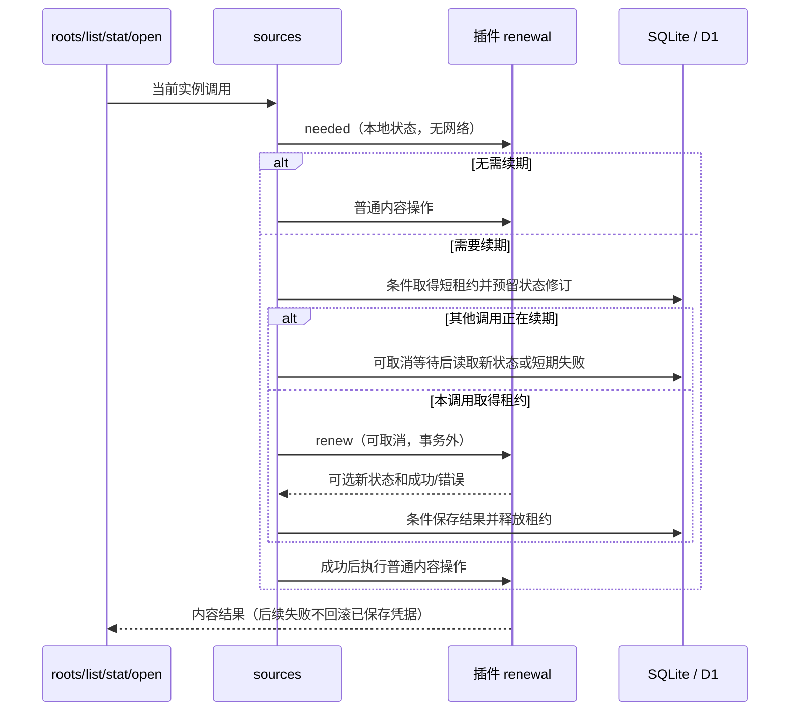

## 当前 QQ 插件内部链路

描述 alpha.9 的已接线责任。自建/收藏、推荐、完整分页、实例音质/回退/去重已接入；SDK续期及凭据就绪即完成授权已通过本地包验证，真实自然到期/失效重登及部分认证facade取消仍待收口。没有把 SDK 的整个路由服务暴露成 MusicFS API。

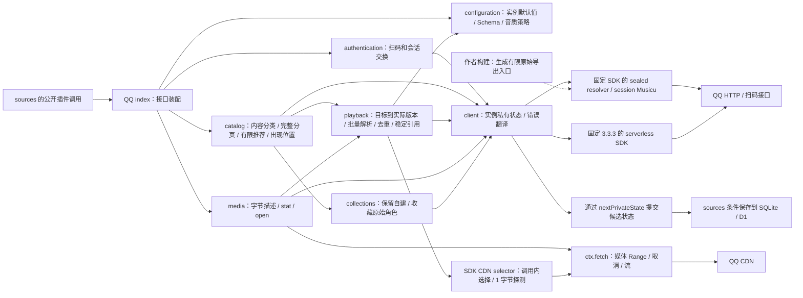

SDK 的签名、加密和传输留在依赖中；生成导出的取舍见 [ADR 0005](../adr/0005-pinned-qq-sdk-read-adapter.md)。媒体的 URL 只在一次调用内使用。公开文件引用包含来源标识与实际文件名，核心不解析其中语义。插件按页报告计数并声明显示标签；library 汇总到完整快照，共用界面仅显示标签与计数。SDK 不进入核心或页面导入图。

## 产品结构

箭头表示运行时调用或内容访问。桌面与 Worker 是独立部署选择，来源兼容性按插件声明决定。

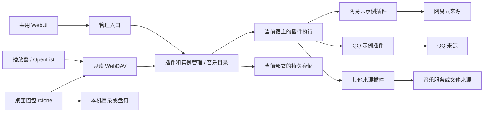

## 模块依赖

箭头表示允许的源码依赖，不表示数据流。实线所示 Module 内仍可拆私有文件；宿主 Adapter 实现领域定义的 Interface，通过装配入口注入。`mounts` 不进入 Worker 导入图。

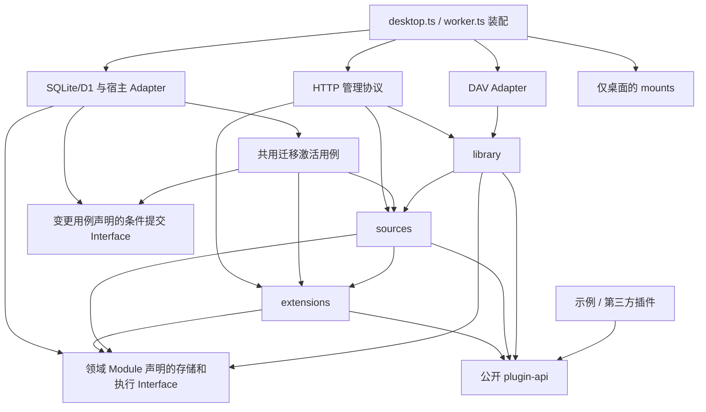

`Ports` 是图中对本地 Interface 的合称，不另建一个无所有者的通用 ports 包。前端只依赖管理数据合同与 HTTP 客户端，不导入上述后台实现。

## 领域关系

插件、安装修订与实例分别存在；一个实际音频可对应多个目录出现位置。目录布局引用内容源，不接管来源内部对象或平台歌单。

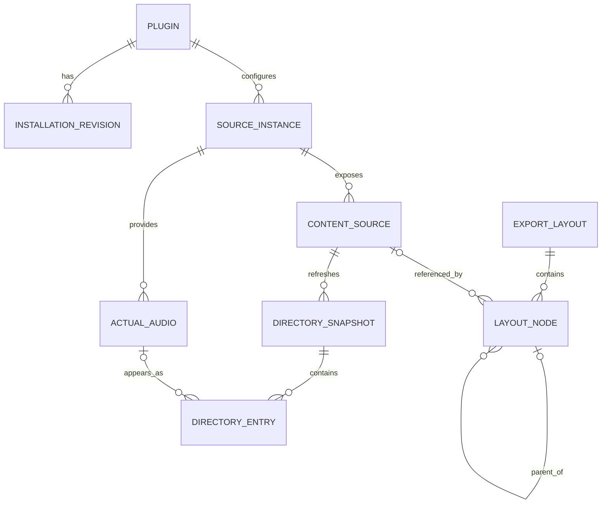

`DIRECTORY_ENTRY` 也可以是目录，因此图中的实际音频关系仅适用于文件条目。文件条目的 `info` 可为兼容旧插件而省略；提供时必须完整且对应确切字节，不能将未知大小写成 0。缺省保留实时 stat，不另建核心元数据准备阶段。历史快照只用于完整提交与恢复内部过程，不是用户历史版本产品。

## 插件变更

当前跨领域用例：`extensions` 解释包/安装策略，`sources` 只准备候选数据，宿主取得精确代码，持久化执行共同SQL计划。迁移验证见[记录](../verification/p2-plugin-migration.md)。数据库条件提交不跨Cloudflare请求，外部结果不明仍由原操作核对。

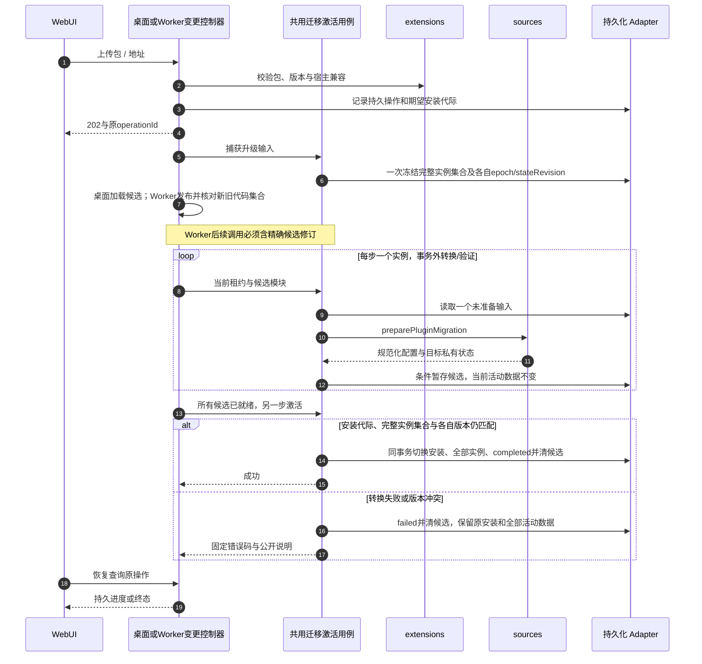

结构不变的桌面安装仍立即完成，移除保留实例/布局；Worker所有变更都异步发布。迁移与目录刷新复用桌面同一后台循环，Worker每次后台/定时调用有界续步。`preparing`、`migrating` 是原变更记录的阶段，不引入通用工作流引擎。真实云端Secrets/D1/静态资源保留与在途播放影响仍待验。

## 内容刷新

当前持久实现由 `library` 拥有操作和完整发布，宿主只负责安排独立的 step。每实例一个活动操作；实例范围先入口、再入口目录及仍可达的已浏览子目录。页面恢复原操作 ID，GET 不推进；桌面后台连续续步，Worker 每次 HTTP 后台或每分钟 scheduled 调用最多一页。详细取舍见 [ADR 0007](../adr/0007-durable-paged-refresh.md)。

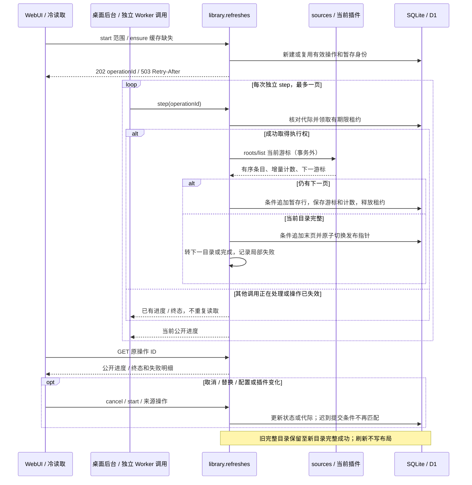

## 音频读取

箭头表示一次读取的真实责任链。临时地址和来源签名留在插件内，协议只依据实际返回的表示和范围输出响应。

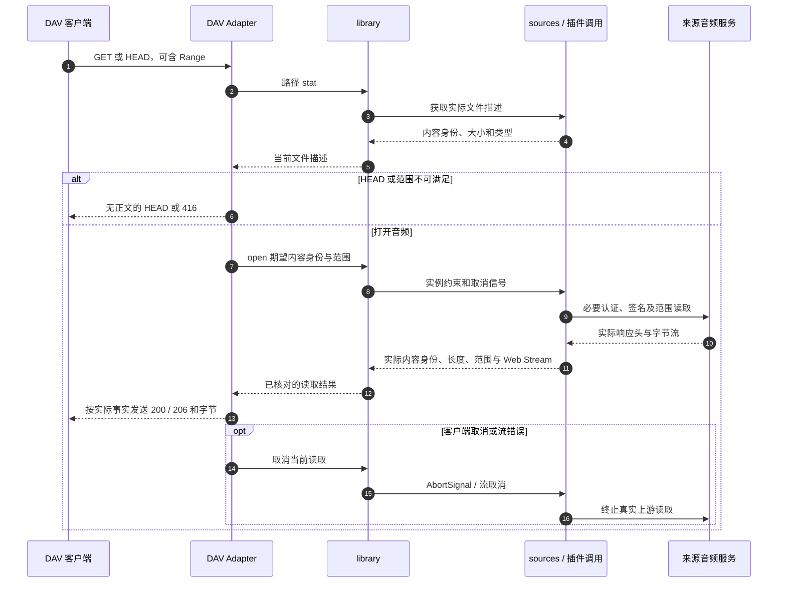

上游完整 200 不得伪装成 206。返回头前发生内容换版时可核对描述；正文开始后不能换编码或从头拼接。图不承诺任何特定 CDN、DAV 库或宿主已满足这些行为。
