# MusicFS 架构与流程图

图示描述现行职责与合同，不证明目标系统或平台验收。模块细节见[架构](README.md)，版本事实见[台账](../verification.md)。专题图只在其设计页维护，避免复制后各自过时。

## 当前链路

箭头表示调用，桌面与 Worker 是两种独立部署。

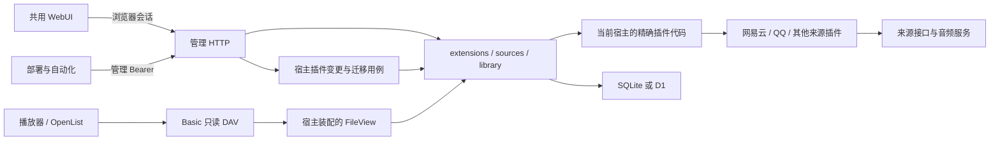

缓存的完整调用链见[共享读取图](shared-read-cache.md#所有权与调用)，App 磁盘与 WebClient 两种入口见[挂载图](desktop-mounts.md)，自动更新与展示策略见[调度和命名图](updates-and-naming.md)。缓存只改变字节读取，不接管目录、认证或 HTTP 条件处理。

管理与 WebDAV 的独立端口、手机管理和播放器导入分别见[访问入口图](management-access.md#桌面访问范围)；浏览器、插件及运行机器的语言归属见[国际化图](i18n.md#职责)。这些入口复用各自认证与领域合同。

## 模块依赖

箭头表示源码依赖。Adapter 实现使用方声明的接口，装配入口注入具体实现；不另设无所有者的通用 ports 包。

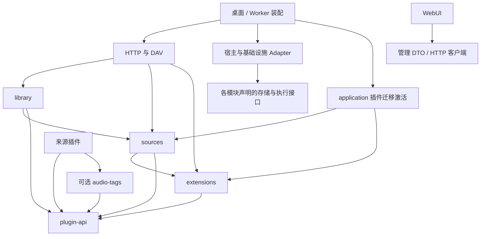

核心不依赖音频工具或平台 SDK，Worker 不导入桌面磁盘/进程能力，前端不导入后台实现。实际规则由 dependency-cruiser 检查。

## 领域关系

这是逻辑概念关系，不等同 SQL 表。目录条目也可以是目录，实际音频关系仅适用于文件条目。

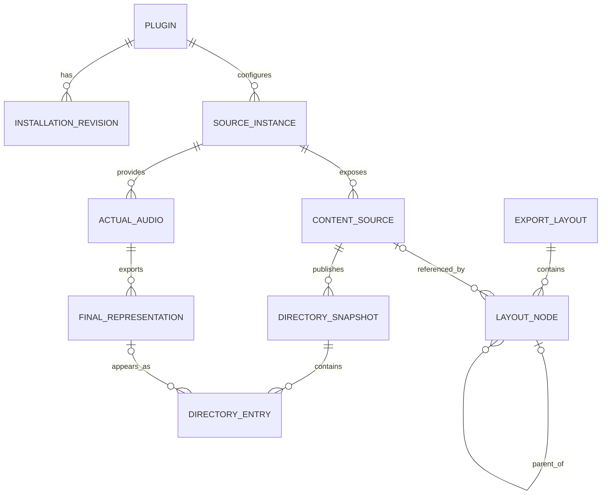

目录出现身份、实际媒体和最终文件表示分别使用；同媒体可因标签变化产生新表示。完整 `info` 必须对应准确最终字节；显式延迟与旧插件实时 stat 是兼容路径，不是未知大小可伪装为零。

## 内容刷新

同一持久分页算法服务两宿主。缓存缺失复用操作，显式刷新可替换；完整成功后按目录发布，失败不抹旧内容。周期安排见[缓存与定时图](cache-policy.md#更新过程)。

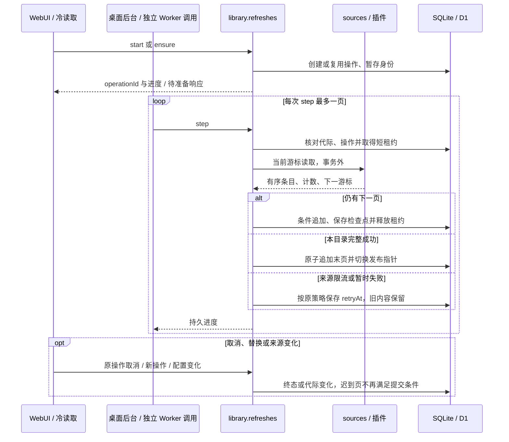

任务终态不替代目录失败标记：A 失败后 B 成功，A 仍显示最近成功内容及失败原因；只有 A 成功发布才清除。刷新不改变用户布局。

## 当前目录属性读取

对应共用 FileView/DAV 合同。准确预留表示已有完整 `info`，因此目录/HEAD 不触发逐曲补标签；显式 `deferredInfo` 才进入文件准备。详见[刷新设计](refresh-performance.md)。

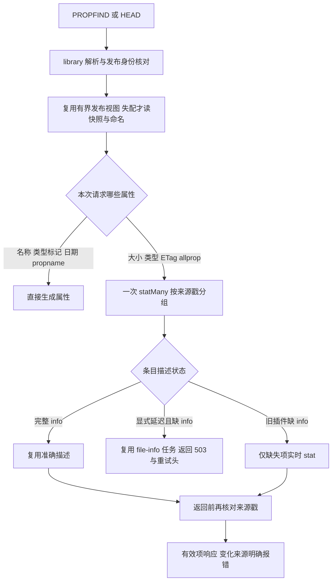

单文件缺少 `info` 时可按需 stat，GET 随后继续 `open` 的身份与字节核验。WeakMap 的已列目标不进入 JSON；Worker 暖视图只加速，D1 发布身份仍是事实源，runtime 不保存旧请求 context 或音频流。

## 可选标签处理设计

核心不强制补标签。来源选择透传、自行补标签或选用共用工具，均输出相同的最终描述与读取合同。格式和预算限制见[音频标签设计](audio-tags.md)。

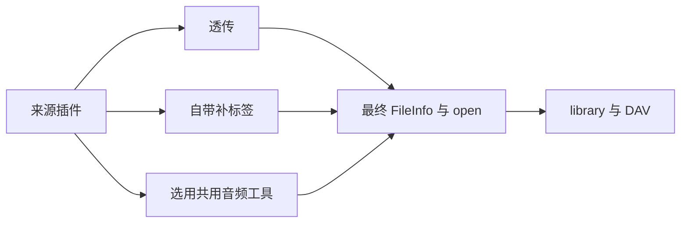

网易云的预留表示是具体插件策略，QQ 保持分页精确准备；APE 不默认预留。目录发布不等待全库封面/歌词准备，首次读取固定该表示的计划。

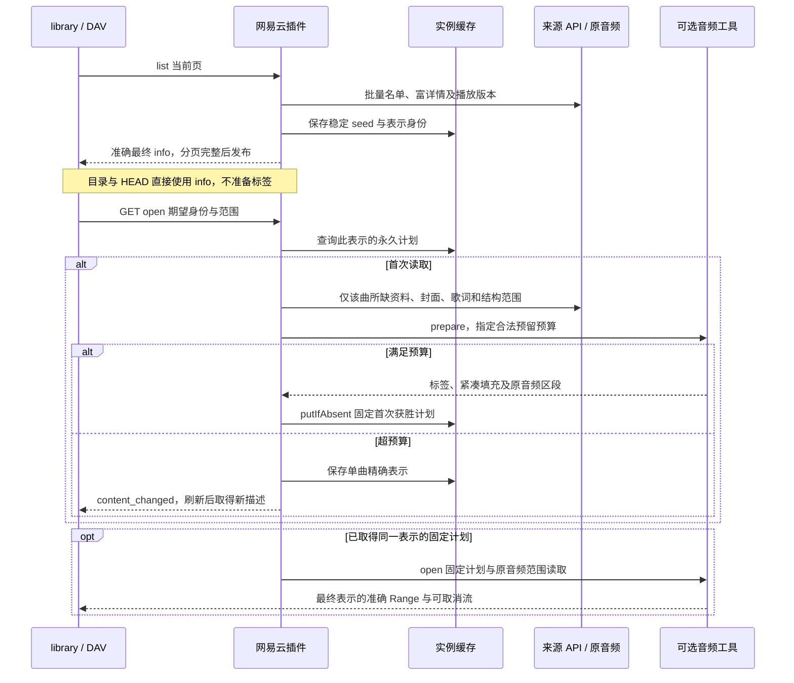

资料期限只影响未来刷新，不能改变旧公开引用的字节。原音频不转码，不为 M4A 整曲缓存；工具隐藏容器偏移和标签编码，平台认证与请求仍归插件。

## 音频读取与挂载缓存管理

| 入口 | 字节路径 | 缓存管理所有者 |
|---|---|---|
| 桌面直接 DAV | 对外 DAV → 共享 VFS → 缺失范围走内部原文件视图 | `desktop/read-cache` |
| App 本机挂载 | 每挂载 VFS → 内部原文件视图，绕过共享落盘 | `desktop/mounts` |
| App 远程挂载 | 每挂载 VFS → 远程 DAV，远端策略独立 | 本地 `mounts` 与远端各自管理 |
| Worker 直接 DAV | 共用 DAV → 原文件视图 → 来源流 | 当前无服务端磁盘正文缓存 |

[共享读取图](shared-read-cache.md#所有权与调用)说明身份及命中门禁，[挂载设计](desktop-mounts.md)说明正常卸载与定向清理。源服务排队、消费者实际读取及缓存实存分别计量；新范围或淘汰后仍可取源。

## 当前交互认证

凭据就绪即完成授权，补充资料由内容操作取得。取消先写终态，不等待旧轮询清理；退出保留实例配置和布局。

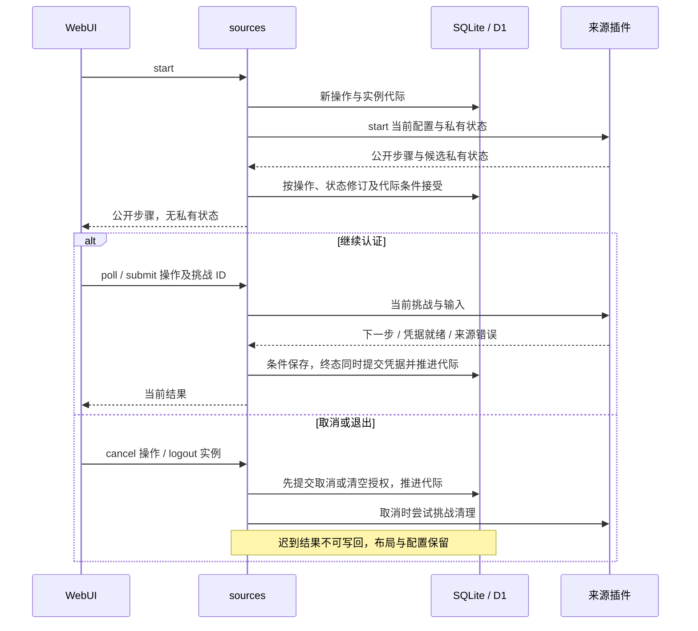

## 当前按需会话续期

插件判断凭据渠道、期限及下次尝试，sources 只协调同实例的必要续期，普通内容操作不排入全局串行队列。

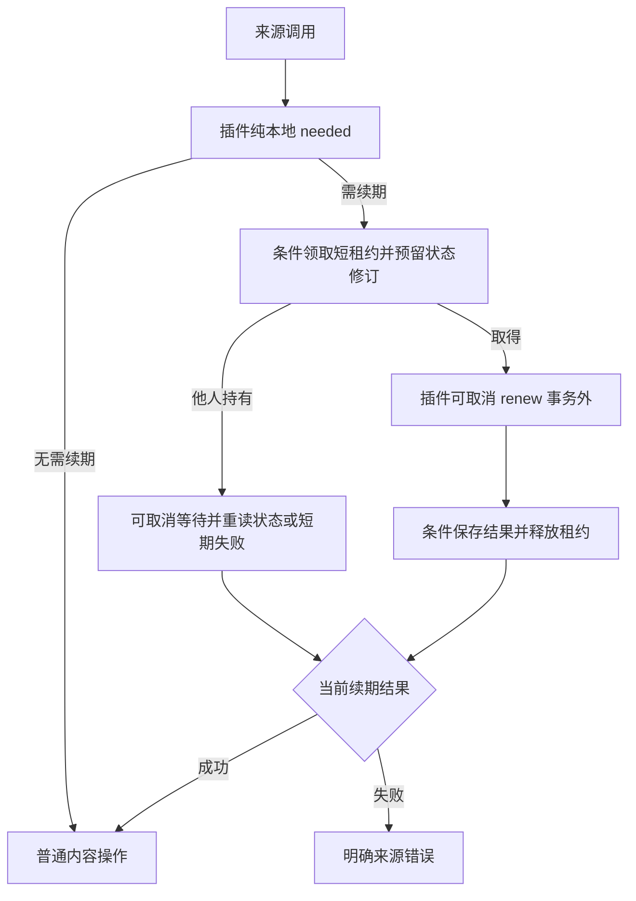

## 插件变更

检查不执行代码；结构升级完整冻结输入、逐个准备候选，最后整体激活。无结构变化的桌面安装可立即完成；Worker 代码变更需后台发布。外部发布与数据库没有全局事务。

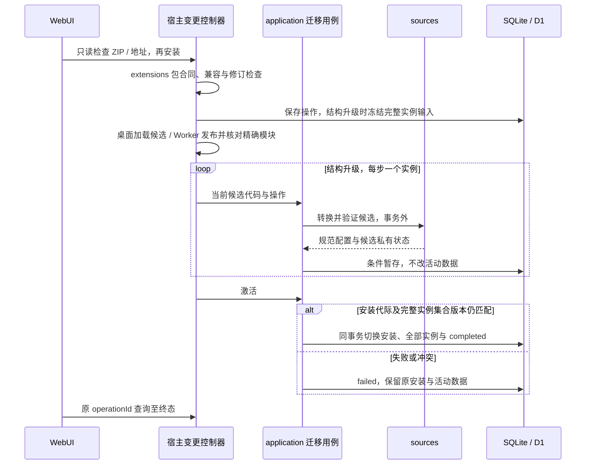

## 当前 Worker 插件发布

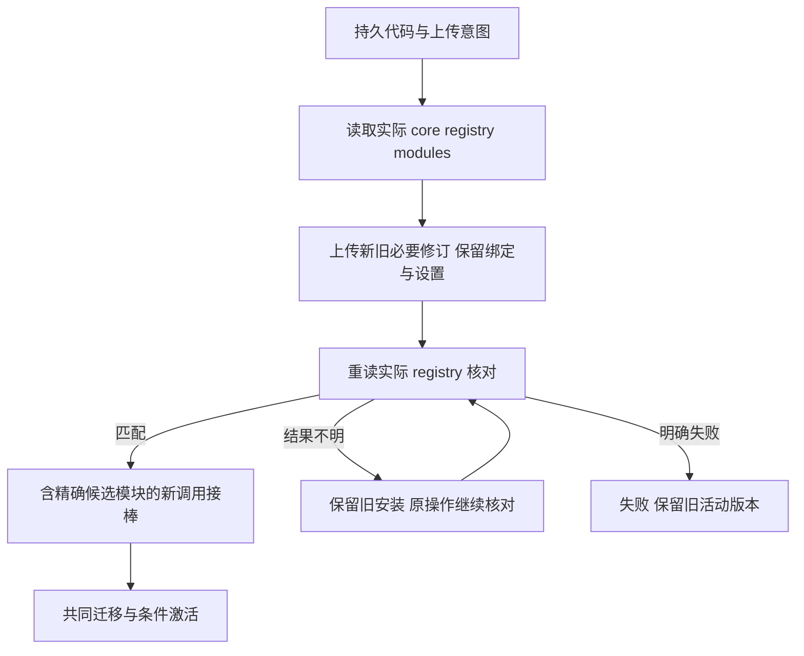

持久恢复与真实云端的证据范围分别见[插件迁移](https://github.com/shengyusi-SYS/musicfs/blob/b637d4d19da97e3473942be9ad7925b740afd47a/docs/verification/p2-plugin-migration.md)与[云端记录](https://github.com/shengyusi-SYS/musicfs/blob/b637d4d19da97e3473942be9ad7925b740afd47a/docs/verification/p4-worker-cloud.md)，不承诺零中断。

## 核心与共用页面升级

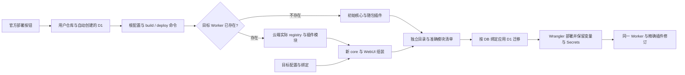

源码按钮入口读取 Cloudflare 已填写的根配置；可携带资源的发行包继续使用包内配置。两者复用同一核心构建与升级组装工具。仅远程 Worker 不存在时采用初始注册表；授权或网络错误直接返回。源码部署额外把随包插件 ZIP 放进静态资源，供浏览器安装；公开下载文件不代表已经在 D1 中激活。

操作以[Worker 部署说明](../worker.md)为准，升级前先完成正在进行的插件变更；只保留 D1 而覆盖可执行插件代码不能完成升级。

## 当前桌面生命周期

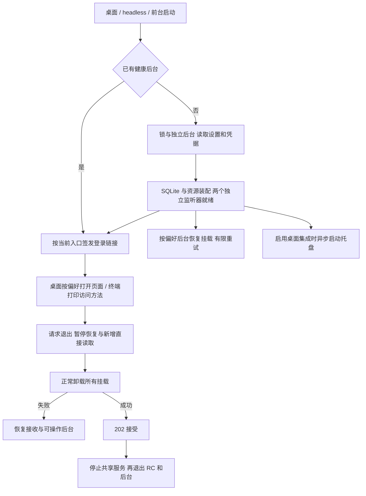

后台就绪不等待自动挂载或托盘完成；未使用的原生缓存进程按需启动。无桌面入口复用同一后台与登录会话，前台模式由外部服务管理器持有进程。关闭网页不卸载后台，退出登录也不退出服务。具体入口见[远程运行](../headless.md)，退出所有权见[桌面架构](desktop-mounts.md)和[共享读取](shared-read-cache.md#生命周期)。
