# MusicFS 架构与流程图

日期：2026-10-20。「当前链路」对应正式代码与本地验证；明确注明设计目标的流程仍含未实现部分，不表示已完成真实云端或目标系统验收。Mermaid 源码在本页维护；模块定义见 [架构设计](README.md)，调用与字节合同见 [插件 Interface](plugin-interface.md)。关系图描述逻辑身份，不等同于 SQL 表结构。

当前已有共用页面、认证、插件/实例、目录快照/布局、管理 HTTP 和 Fetch DAV；QQ 与[网易云](../verification/p2-netease-source.md)有真实来源证据。正式桌面启动/挂载和 Worker 后台发布已接线，完整范围见[台账](../verification.md)。

## 当前链路

描述正式代码与本地请求路径。Worker 模块组装与持久发布在本地 workerd/受控平台网络验证；rclone 完成真实读取及 RC 进程管理，系统挂载尚待对应环境。

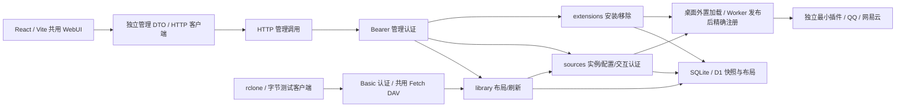

## 当前 Worker 插件发布

仅此图描述已接线的发布实现；SDK 网络编码与恢复测试使用受控平台响应，真实云端仍待验。完整迁移激活目标见后文“插件变更”。

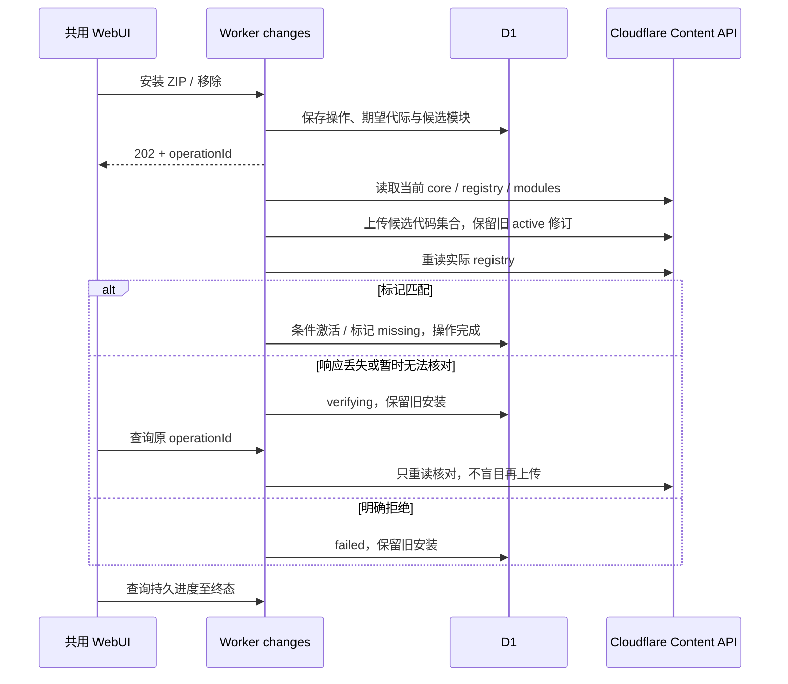

## 当前桌面生命周期

锁、后台、rclone RC及Linux本地/独立远程FUSE读取、忙时保留与退出已实测；其他目标系统挂载和平台弹窗仍待验。

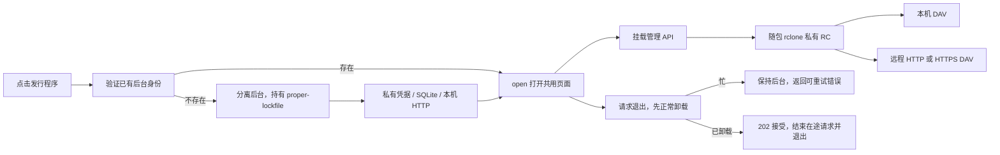

## 当前目录属性读取

这次局部减法复用原有 `list/stat/open`。已列条目只在当前调用者持有该对象时保留私有目标，不新增持久路径索引；allprop 和文件实际元数据仍可能产生上游请求，免费 Worker 资源表现待测。

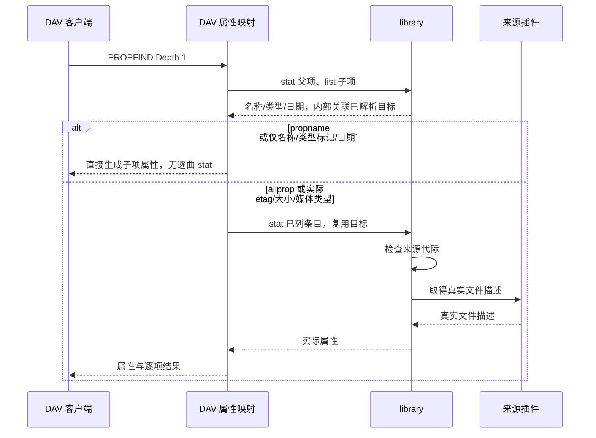

## 当前交互认证

对应本地 SQLite/D1 与共用页面的已实现流程；通用步骤由测试插件验证，QQ 已另行验证真实手机扫码。开始、终态的代际变化与普通状态 CAS 分开处理，取消不会等待旧轮询完成才写入。

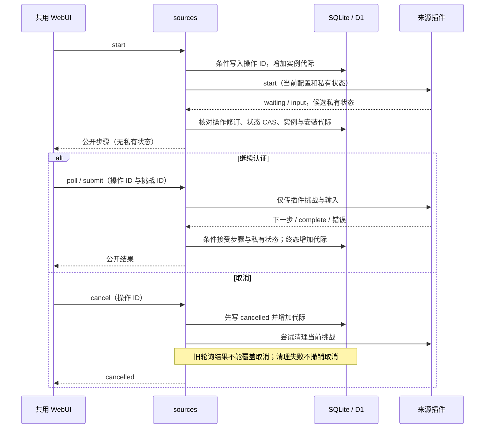

## 当前 QQ 插件内部链路

仅描述 alpha.5 的已接线责任。自建/收藏、推荐、完整分页、实例音质/回退/去重已接入；续期和部分 metadata facade 取消仍待完成。没有把 SDK 的整个路由服务暴露成 MusicFS API。

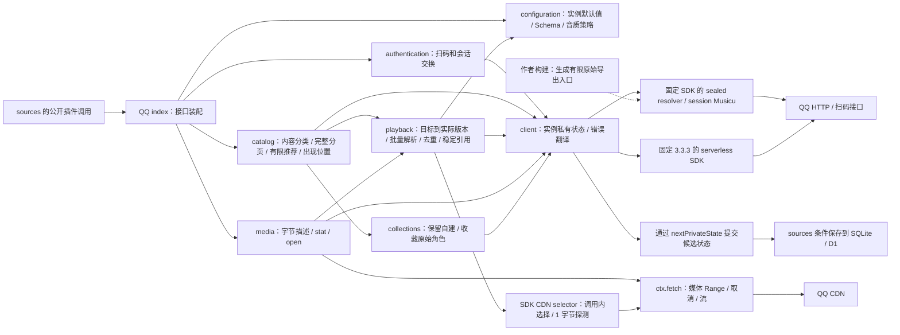

SDK 的签名、加密和传输留在依赖中；生成导出的取舍见 [ADR 0005](../adr/0005-pinned-qq-sdk-read-adapter.md)。媒体的 URL 只在一次调用内使用。公开文件引用包含来源标识与实际文件名，核心不解析其中语义。插件按页报告计数并声明显示标签；library 汇总到完整快照，共用界面仅显示标签与计数。SDK 不进入核心或页面导入图。

## 产品结构

箭头表示运行时调用或内容访问。桌面与 Worker 是独立部署选择，来源兼容性按插件声明决定。

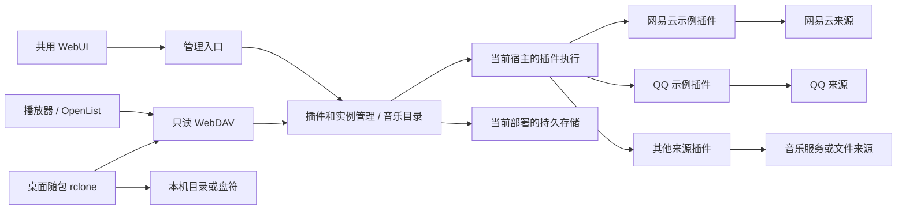

## 模块依赖

箭头表示允许的源码依赖，不表示数据流。实线所示 Module 内仍可拆私有文件；宿主 Adapter 实现领域定义的 Interface，通过装配入口注入。`mounts` 不进入 Worker 导入图。

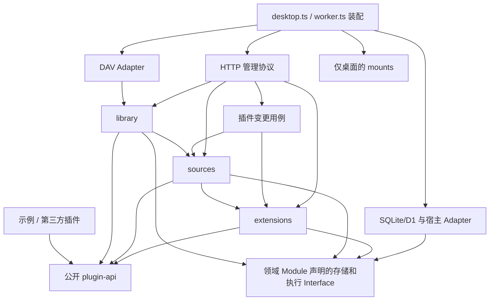

`Ports` 是图中对本地 Interface 的合称，不另建一个无所有者的通用 ports 包。前端只依赖管理数据合同与 HTTP 客户端，不导入上述后台实现。

## 领域关系

插件、安装修订与实例分别存在；一个实际音频可对应多个目录出现位置。目录布局引用内容源，不接管来源内部对象或平台歌单。

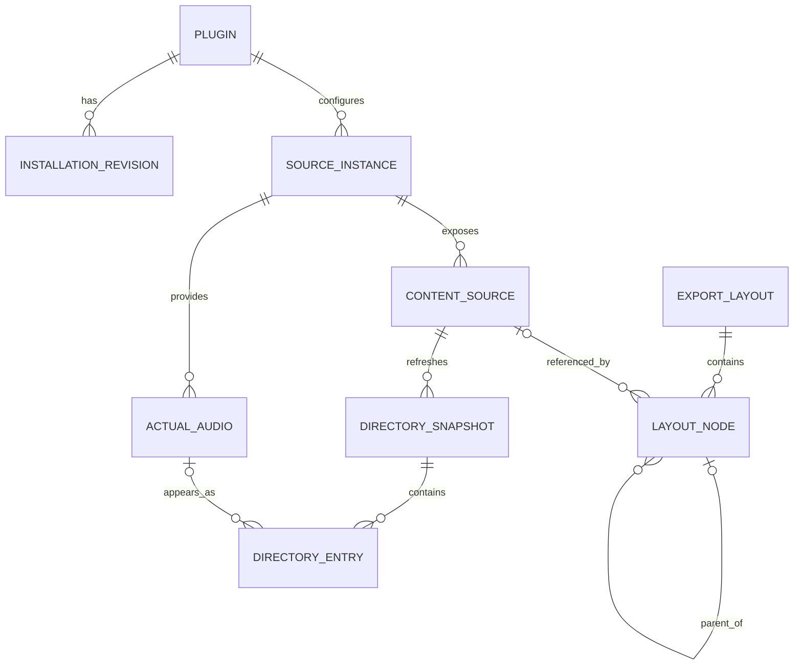

`DIRECTORY_ENTRY` 也可以是目录，因此图中的实际音频关系仅适用于文件条目。快照可以记录未就绪的元数据，但未知大小不表示无权限。历史快照只用于完整提交与恢复内部过程，不是用户历史版本产品。

## 插件变更

这是跨领域用例，`extensions` 解释包，`sources` 准备实例状态，宿主执行代码变化。数据库条件提交不跨 Cloudflare 发布请求；外部结果不明时由同一操作核对。

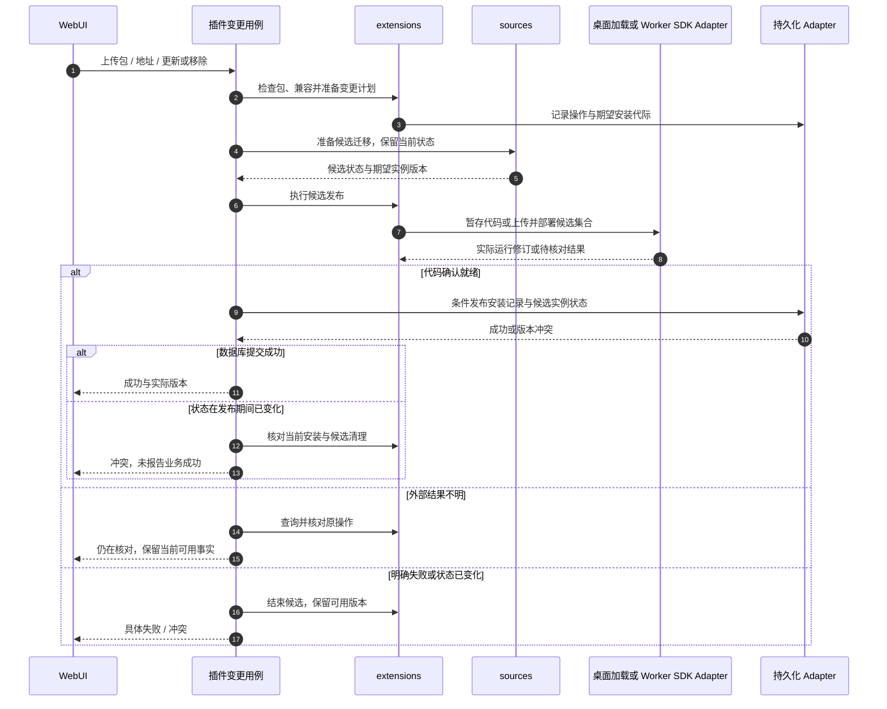

操作状态可描述为准备中、发布中、核对中、完成或失败，不是先引入通用工作流引擎。移除也走此用例，使新调用失效并保留实例/布局引用。新旧注册集合、回退、Secrets/D1/静态资源保留和在途读取须 P0 实测。

## 内容刷新

慢操作在事务外进行，布局始终由用户布局操作更新。完整分页和期望代际同时满足，才能切换该目录最近成功快照。实例刷新先更新内容入口，再处理各入口及仍可达的已浏览子目录；新子目录首次打开时读取。以下为已接线的目录发布路径，[验证范围](../verification/p1-instance-refresh.md)不包含无限后台递归或真实云端资源验收。

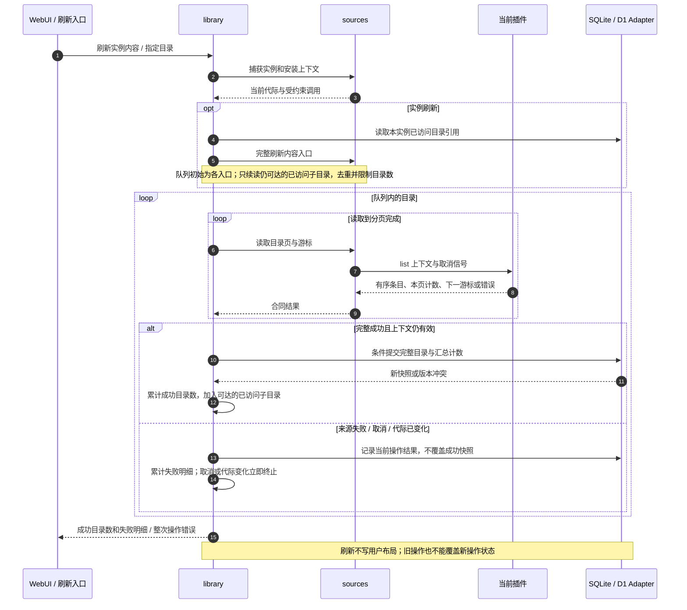

## 音频读取

箭头表示一次读取的真实责任链。临时地址和来源签名留在插件内，协议只依据实际返回的表示和范围输出响应。

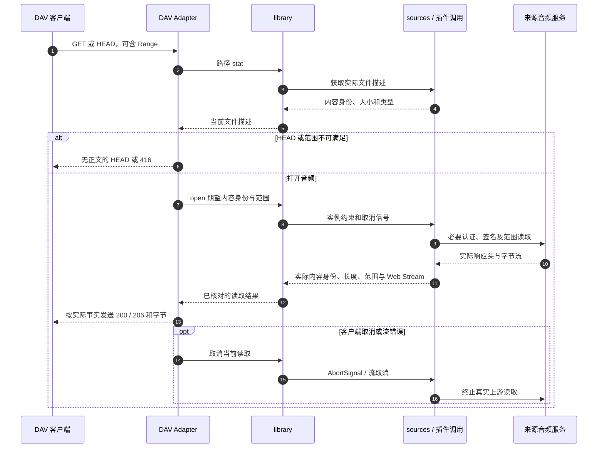

上游完整 200 不得伪装成 206。返回头前发生内容换版时可核对描述；正文开始后不能换编码或从头拼接。图不承诺任何特定 CDN、DAV 库或宿主已满足这些行为。
