# MusicFS 架构与流程图

## 已发布目录视图与单文件访问

2026-10-21源码实现。目录视图属于library，共用命名与路径查找；LRU只加速，SQLite/D1的已发布身份仍是事实源。Worker跨HTTP的runtime生命周期在宿主层单独接线，不能复用旧请求context。细节与受控计数见[性能设计](refresh-performance.md)。

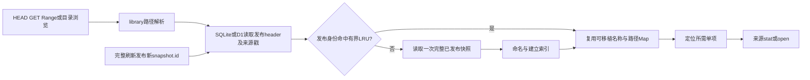

## 音频读取与挂载缓存管理

目录、资料和标签计划的缓存与音频正文分属不同模块。App挂载复用rclone稀疏文件；直接DAV仍是来源流，不假定客户端都有磁盘缓存。缓存管理查询原生采样，不建第二套磁盘索引。证据与适用边界见[缓存消费](../verification/cache-consumption-2026-10-21.md)。

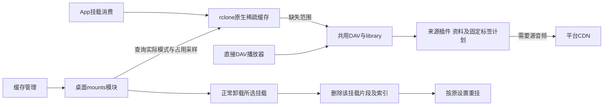

## 核心与共用页面升级

核心/WebUI升级保留云端实际代码集合；插件安装仍沿既有后台发布流程。具体操作见[Worker升级说明](../worker.md#升级核心与-webui保留云端插件)。

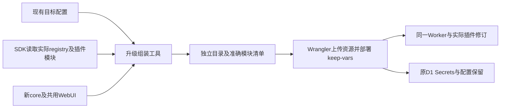

日期：2026-10-20。「当前链路」对应正式代码与本地验证；明确注明设计目标的流程仍含未实现部分，不表示已完成真实云端或目标系统验收。Mermaid 源码在本页维护；模块定义见 [架构设计](README.md)，调用与字节合同见 [插件 Interface](plugin-interface.md)。关系图描述逻辑身份，不等同于 SQL 表结构。

当前已有共用页面、认证、插件/实例、目录快照/布局、管理 HTTP 和 Fetch DAV；QQ 与[网易云](../verification/p2-netease-source.md)有真实来源证据。正式桌面启动/挂载和 Worker 后台发布已接线，完整范围见[台账](../verification.md)。

## 当前链路

描述正式代码与本地请求路径。Worker模块组装与持久发布在本地workerd/受控平台网络验证；rclone已有Linux真实FUSE读取、RC进程管理和活动挂载崩溃恢复证据，其他系统仍待验。

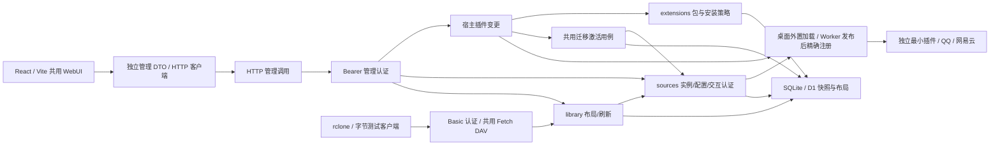

## 当前 Worker 插件发布

发布及迁移已接线；SDK网络使用受控平台响应，D1为本地真实workerd，真实云端仍待验。宿主差异与共用激活见后文“插件变更”。

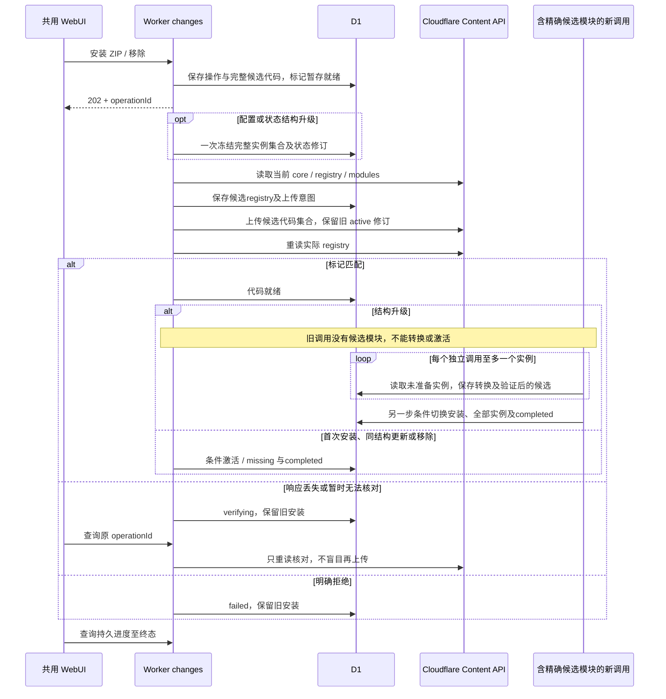

## 当前桌面生命周期

锁、后台、rclone RC及Linux本地/独立远程FUSE读取、忙时保留与退出已实测；其他目标系统挂载和平台弹窗仍待验。

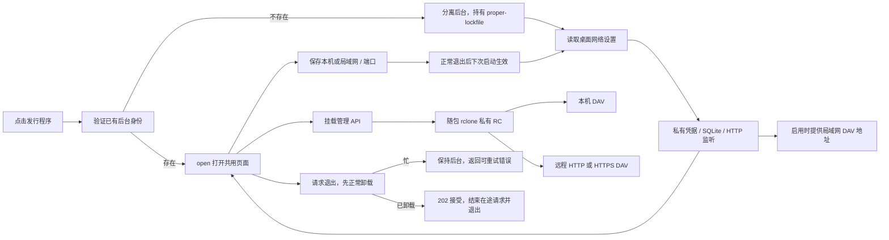

## 当前目录属性读取

属性选择每请求按文件/目录编译一次；快照单查询只在首行携带头，唯一名称不进入冲突散列。请求内的日期/来源戳复用不跨请求缓存，范围见[CPU定位](../verification/p2-read-cpu.md)。

API0.1.9沿用文件条目的完整可信 `Entry.info` 和显式 `deferredInfo: true`；library 校验后暂存，目录完整成功才连同条目及待准备数发布。网易云alpha.14对MP3/FLAC/M4A预定准确N+1MiB，目录与HEAD直接复用已发布info，首GET才准备单曲，见下方标签流程。已列对象私下关联解析目标及已发布 info，不新增持久路径索引。旧的显式延迟条目仍通过持久 `file-info` 刷新准备批量属性，准备期间返回503及重试头；旧插件缺 info 时保留实时 stat。历史流程与证据见[两阶段验证](../verification/deferred-catalogue.md)，不代表所有播放器自动重试或免费 Worker 额度已验收。

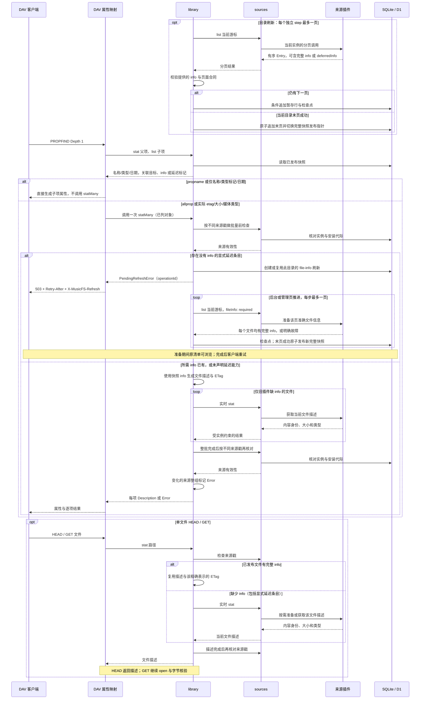

## 当前交互认证

对应本地 SQLite/D1 与共用页面的已实现流程；通用步骤由测试插件验证，QQ 已另行验证真实手机扫码。开始、终态的代际变化与普通状态 CAS 分开处理，取消不会等待旧轮询完成才写入。

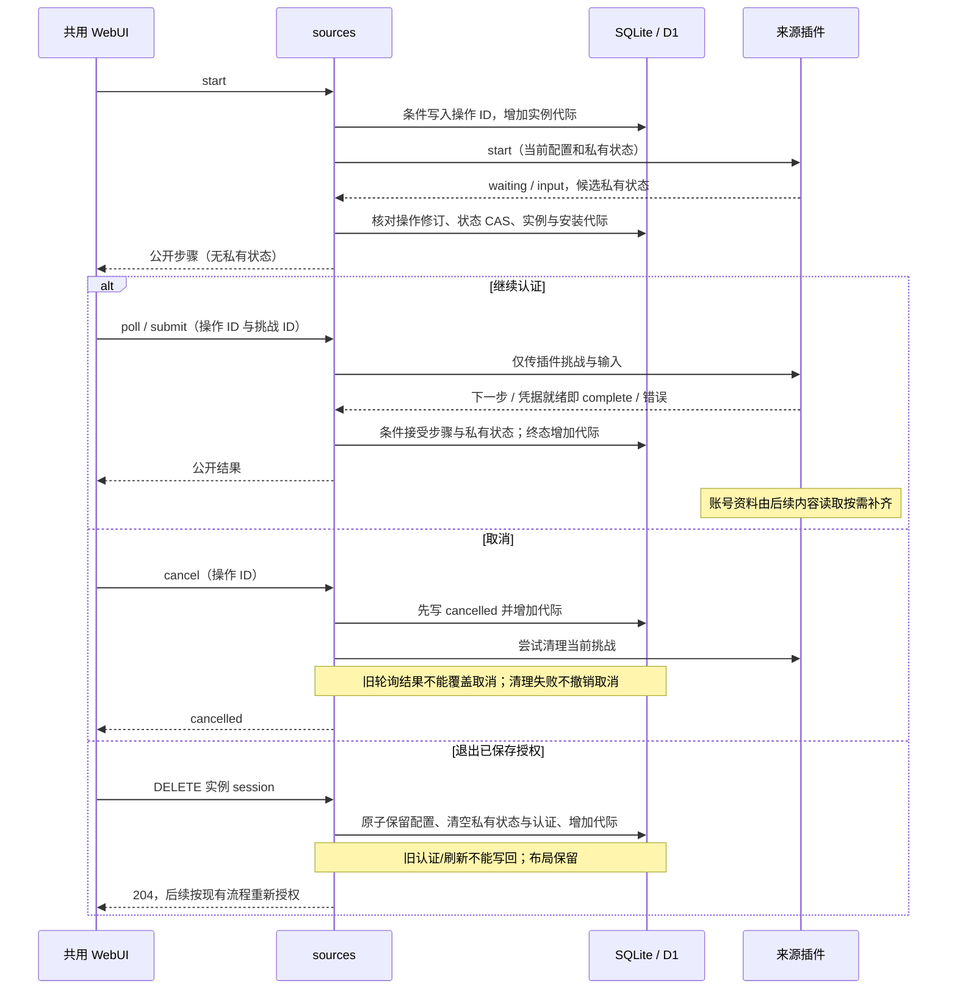

## 当前按需会话续期

插件判断到期和重试时间，sources只协调同一实例的必要续期；普通内容请求在租约之外。SQLite/D1使用同一条件SQL计划，详见[会话验证](../verification/p2-session-lifecycle.md)。

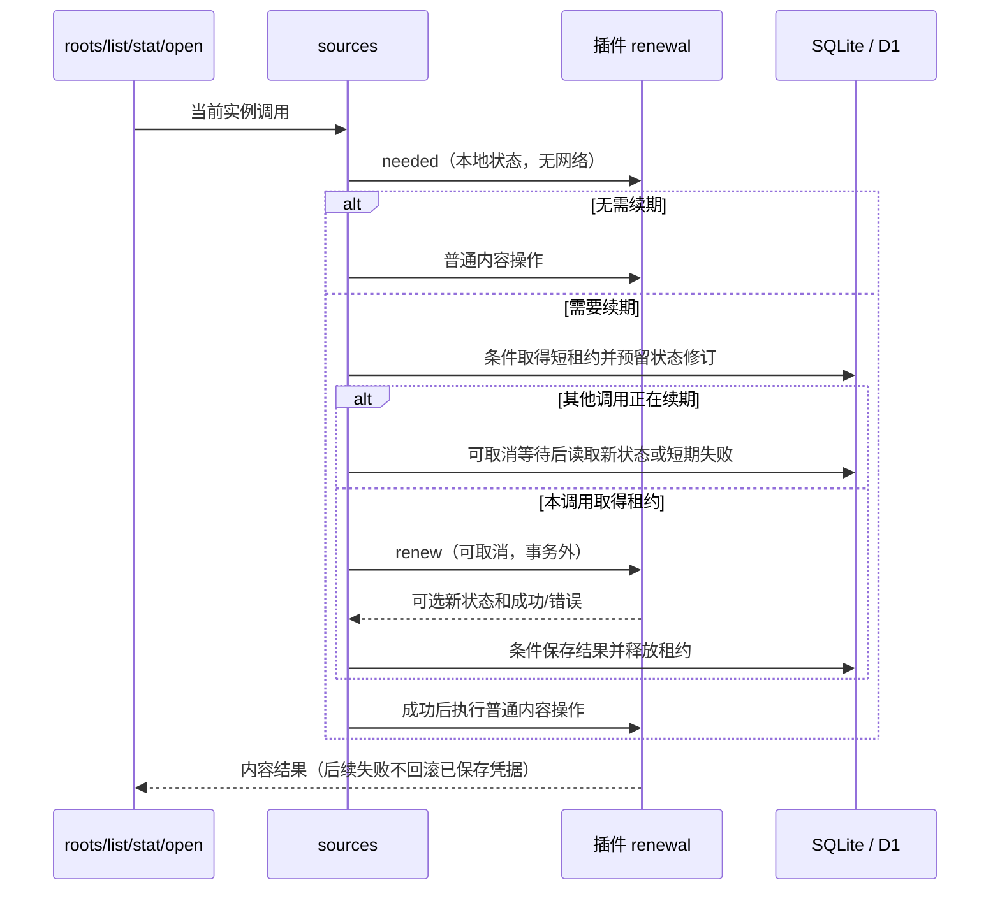

## 当前 QQ 插件内部链路

描述 alpha.10 的已接线责任。自建/收藏、推荐、完整分页、实例音质/回退/去重已接入；SDK续期、凭据就绪即完成授权和认证底层取消已通过本地包验证，真实自然到期/失效重登继续待验。没有把 SDK 的整个路由服务暴露成 MusicFS API。

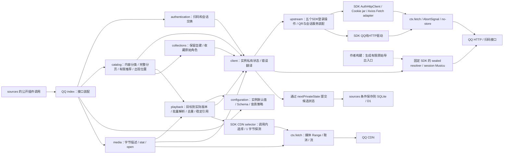

SDK 的签名、加密和传输留在依赖中；生成导出的取舍见 [ADR 0005](../adr/0005-pinned-qq-sdk-read-adapter.md)。媒体的 URL 只在一次调用内使用。公开文件引用包含来源标识与实际文件名，核心不解析其中语义。插件按页报告计数并声明显示标签；library 汇总到完整快照，共用界面仅显示标签与计数。SDK 不进入核心或页面导入图。

## 产品结构

箭头表示运行时调用或内容访问。桌面与 Worker 是独立部署选择，来源兼容性按插件声明决定。

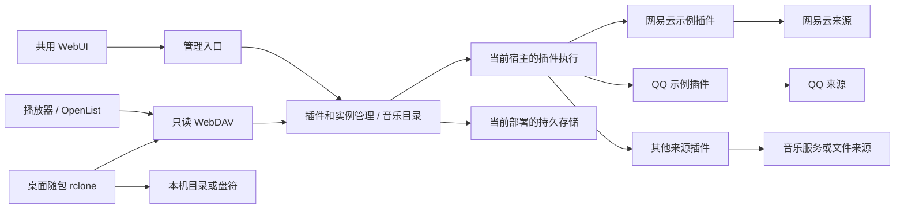

## 模块依赖

箭头表示允许的源码依赖，不表示数据流。实线所示 Module 内仍可拆私有文件；宿主 Adapter 实现领域定义的 Interface，通过装配入口注入。`mounts` 不进入 Worker 导入图。

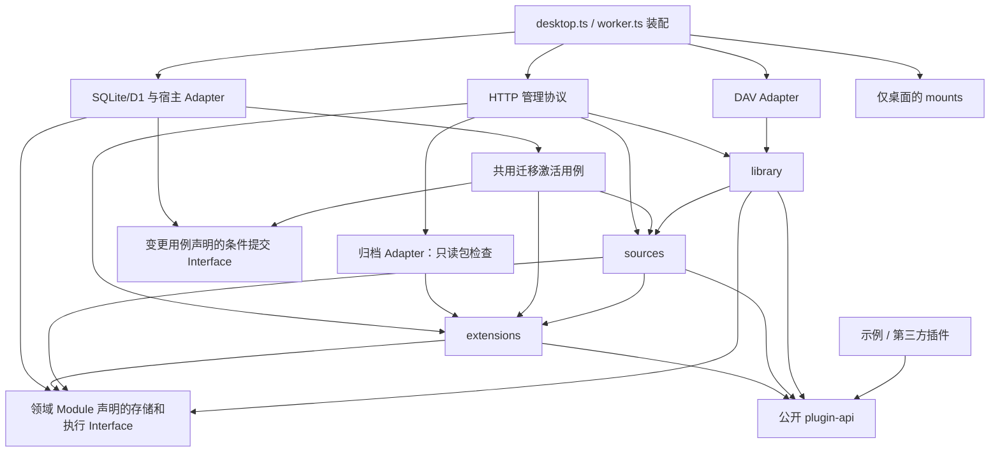

`Ports` 是图中对本地 Interface 的合称，不另建一个无所有者的通用 ports 包。前端只依赖管理数据合同与 HTTP 客户端，不导入上述后台实现。

## 领域关系

Worker的复用边界与桌面保持同一领域算法：

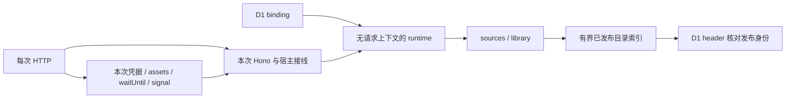

runtime不保存音频Response、stream或HTTP执行上下文。Worker isolate消失只损失暖索引；持久检查点与发布快照仍从D1恢复。短暂失败与限流都沿现有任务retryAt续接，重试本身不形成另一套队列。

插件、安装修订与实例分别存在；一个实际音频可对应多个目录出现位置。目录布局引用内容源，不接管来源内部对象或平台歌单。

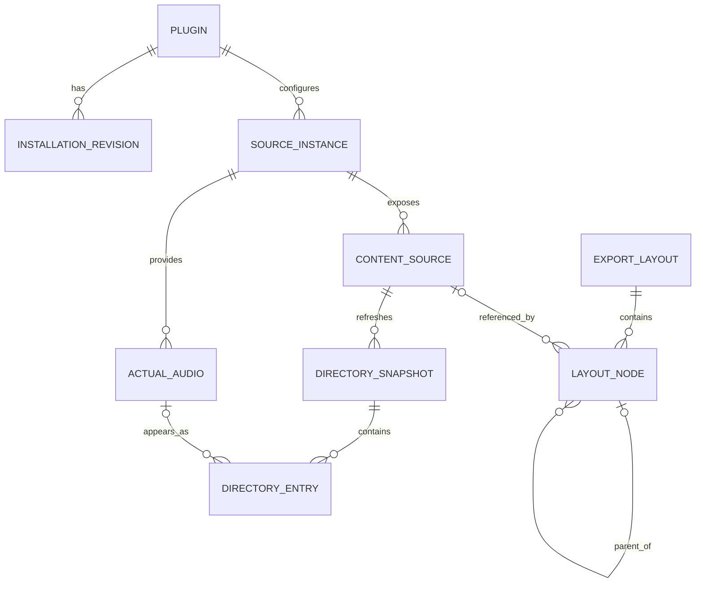

`DIRECTORY_ENTRY` 也可以是目录，因此图中的实际音频关系仅适用于文件条目。文件条目的 `info` 可为兼容旧插件而省略；提供时必须完整且对应确切字节，不能将未知大小写成 0。缺省保留实时 stat，不另建核心元数据准备阶段。历史快照只用于完整提交与恢复内部过程，不是用户历史版本产品。

## 插件变更

当前跨领域用例：`extensions` 解释包/安装策略，`sources` 只准备候选数据，宿主取得精确代码，持久化执行共同SQL计划。迁移验证见[记录](../verification/p2-plugin-migration.md)。数据库条件提交不跨Cloudflare请求，外部结果不明仍由原操作核对。

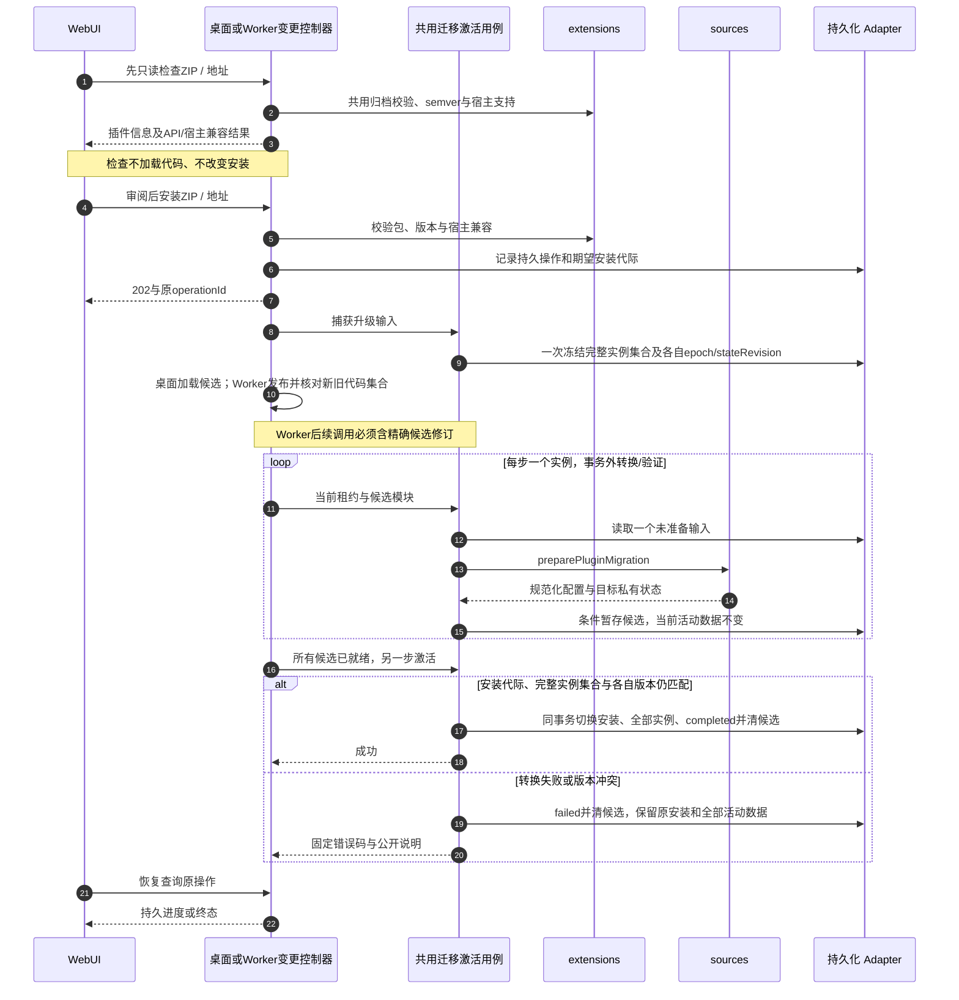

结构不变的桌面安装仍立即完成，移除保留实例/布局；Worker所有变更都异步发布。迁移与目录刷新复用桌面同一后台循环，Worker每次后台/定时调用有界续步。`preparing`、`migrating` 是原变更记录的阶段，不引入通用工作流引擎。真实云端Secrets/D1/静态资源保留与在途播放影响仍待验。

## 内容刷新

当前持久实现由 `library` 拥有操作和完整发布，宿主只负责安排独立的 step。每实例一个活动操作；实例范围先入口、再入口目录及仍可达的已浏览子目录。页面恢复原操作 ID，GET 不推进；桌面后台连续续步，Worker 每次 HTTP 后台或每分钟 scheduled 调用最多一页。详细取舍见 [ADR 0007](../adr/0007-durable-paged-refresh.md)。

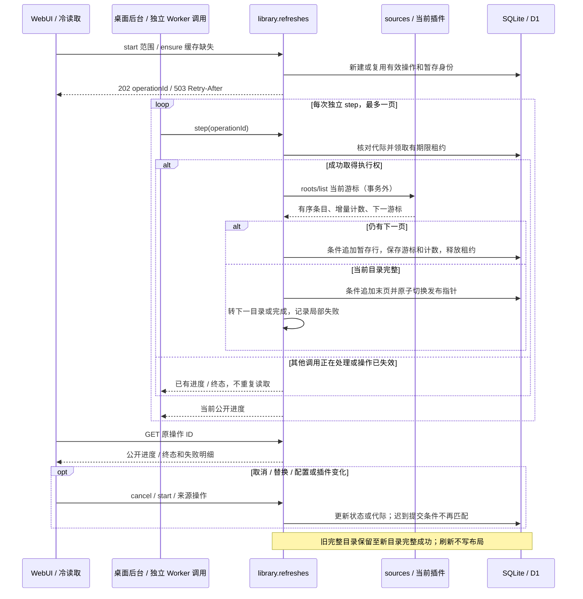

目录失败状态由现有快照记录持有，不以最近一次任务的终态替代：

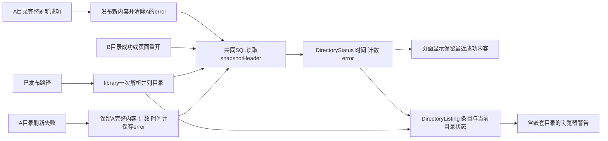

## 音频读取

箭头表示一次读取的真实责任链。临时地址和来源签名留在插件内，协议只依据实际返回的表示和范围输出响应。

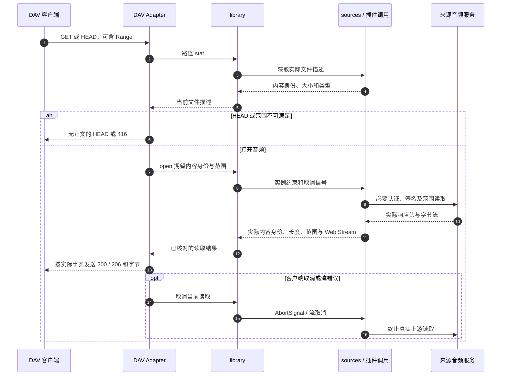

上游完整 200 不得伪装成 206。返回头前发生内容换版时可核对描述；正文开始后不能换编码或从头拼接。图不承诺任何特定 CDN、DAV 库或宿主已满足这些行为。

## 可选标签处理设计

网易云alpha.14默认每页200首先发布完整清单，对MP3/FLAC/M4A预定最终大小N+1MiB，不取全库歌词、封面或音频。目录与HEAD不补标签，首GET才构造所读单曲；API0.1.9可选原子缓存固定首次计划，紧凑零区段在流式读取时生成合法填充。QQ继续在目录分页内准备最终信息，APE不默认预留。富详情批量、共享封面及`ReadRange.readMany?`首尾读取继续用于文件准备，CDN请求和标准MIME解析仍归来源Adapter。[生产接线与原型边界](../verification/lazy-mount-feasibility.md)、历史[两阶段验证](../verification/deferred-catalogue.md)与[冷准备调查](../verification/netease-cold-request-reduction.md)分别保留适用范围。

三种插件实现通过同一个文件 Interface 接入，核心不增加强制处理阶段。QQ、网易云已选用共用工具；其他插件保持自主选择。设计见[可选补标签设计](audio-tags.md)，当前证据见[实现记录](../verification/metadata-implementation.md)。

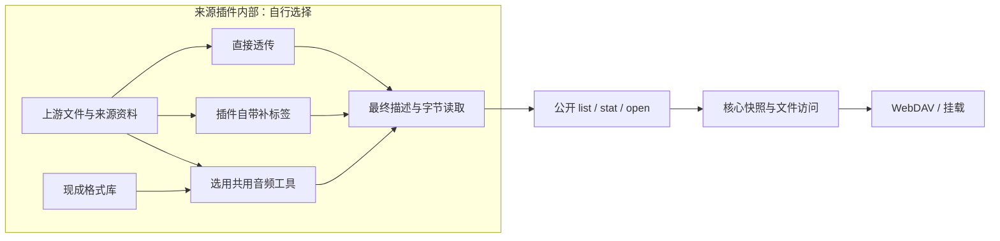

共用工具可以复用准备后的音乐资料，但不解释平台请求或认证；核心只核对最终大小、内容身份和实际范围。未选择补标签的插件不依赖该工具；它的格式集合不限制其他插件。

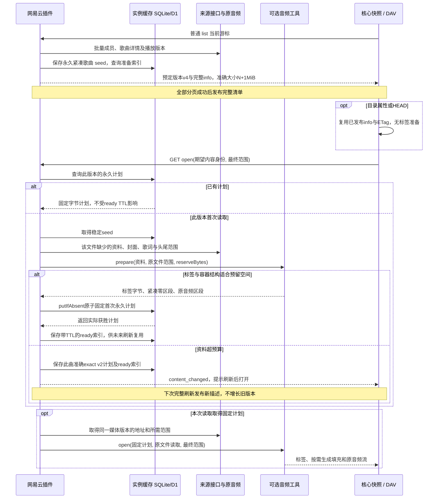
