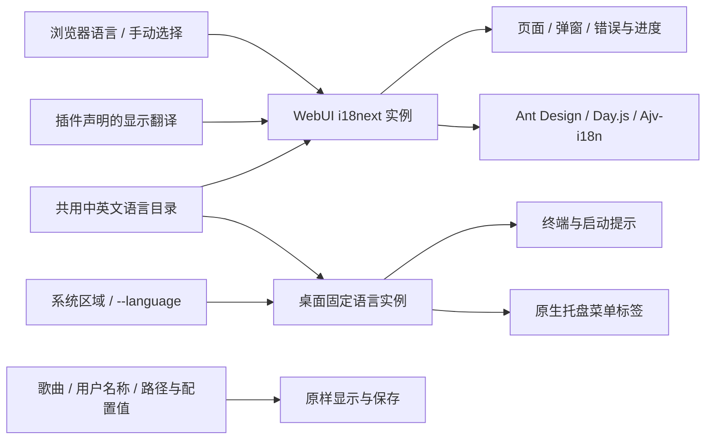

# 中英文与显示文案

MusicFS 使用 i18next、react-i18next 和浏览器语言检测插件。简体中文与英文资源随程序打包，切换不下载语言包，不重新加载音乐来源，也不改变目录、文件名、引用和内容身份。

## 职责

| 模块 | 责任 |
|---|---|
| `src/i18n` | 共用语言资源、语言归一化和独立翻译实例；没有 DOM、进程或音乐领域依赖 |
| `src/web/i18n.ts` | 浏览器偏好、插件命名空间、显示消息及 Schema 注释翻译 |
| `src/web/main.tsx` | 订阅语言变化，联动 Ant Design、Day.js、页面标题与 HTML `lang` |
| `src/hosts/desktop/locale.ts` | 依据系统环境或显式语言取得终端/桌面翻译，不读取浏览器偏好 |
| `native/desktop` | 接收后台传入的菜单文本，保留固定的动作 ID，不维护另一份中英文词典 |
| 来源插件 | 自己声明名称、配置、授权和错误文案的翻译，未声明时保留原文 |

浏览器首次按语言选择，手动选择保存在本浏览器的 `musicfs.language`。登录页和工作区均可切换；通过 React 订阅更新显示，不以重挂载整个应用来换语言，保留当前导航与表单输入。不同设备可使用不同语言。

桌面和终端按 `MUSICFS_LANGUAGE`、`LC_ALL`、`LC_MESSAGES`、`LANG` 与系统区域依次选择。`--language zh-CN` 或 `--language en` 显式覆盖本次启动，传给新后台并保留在重新打开命令中。浏览器切换不修改远程机器的系统语言或托盘语言。

## 文案与数据

采用 i18next 支持的原文键方式，关闭点号和冒号分隔；既有中文/英文错误可以作为稳定的显示键，避免仅为国际化改动领域错误码。中英文在 `src/i18n/locales/` 配对维护。旧记录中已经生成的静态错误可通过词典别名按当前语言显示。

带名称、数量和状态值的句子使用插值；数量由 i18next 的复数规则和 Intl 格式化。保留 Mustache 命名模板的字面内容。日期、时间和数字按当前界面语言格式化，更新时间的实际时区与执行策略保持不变。

错误协议继续提供原有 `message` 和错误码。需要插值时可附带 `translation: { key, values }`，显示层按当前语言渲染，缺少该翻译则显示原消息。核心不依赖 i18next 或浏览器全局语言；保存刷新失败和挂载状态时保留这份可选显示描述，不将语言放入授权或音乐缓存身份。

JSON Schema 只翻译 `title`、`description` 等显示注释；不翻译属性名、`const`、`enum`、`default`、`examples` 或已输入数据。RJSF 控件文本使用其 `translateString` 扩展，Ajv 校验复用 ajv-i18n。第三方服务自行返回且未提供词典的错误保持原文，不猜测翻译。

## 插件合同

API0.1.12增加可选的 `manifest.nameTranslations`、`configuration.translations` 和消息 `translation`。示例见[插件作者指南](../plugin-authoring.md#显示翻译)。旧插件可不声明；使用新的清单字段时应要求宿主API0.1.12及以上。插件包将自己的词典编入配置声明，页面按需取得配置并注册插件命名空间，不为切换语言访问音乐平台。

插件配置的注释优先使用自身命名空间，共用界面词典作为回退。插件名称只影响插件页、选择器和新建来源建议；已经保存的实例名称、来源返回的歌曲/歌单、用户目录和导出路径原样保留。

## 维护与检查

新增文案进入词典，句子整体插值，避免拼接导致英文顺序或标点错误。模块级状态标签显示时求值，日期和 memoized 表单随语言更新。语言名本身使用“简体中文 / English”，便于切换。

`bun run check:i18n` 核对共用词典键、插值变量、插件 Schema 注释和未本地化的界面中文；它包含在 `check` 中。定向测试与实际界面证据见[国际化核对](../verification/i18n.md)。

依赖接口依据：[i18next 配置](https://www.i18next.com/overview/configuration-options)、[React 订阅](https://react.i18next.com/latest/usetranslation-hook)、[浏览器语言检测](https://github.com/i18next/i18next-browser-languageDetector)、[Ajv-i18n](https://github.com/ajv-validator/ajv-i18n)。
