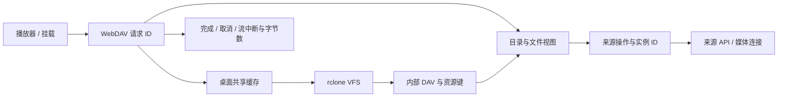

# 日志与 IO 诊断

[English](../en/logging.md)

日志用于解释 WebDAV 访问和核心上下游 IO：播放器请求是否到达、耗时发生在哪一层、缓存是否请求来源字节、音频在何处中断。持久刷新和插件任务仍以已有操作记录为准，日志不建立另一套任务数据库。

## 位置与默认行为

| 范围 | 位置 | 默认记录 |
|---|---|---|
| 桌面应用 | 数据目录 `logs/musicfs.log` | warning 及以上，2 MiB 轮转，保留 3 份备份 |
| rclone 挂载及远程 WebDAV | 数据目录 `mounts/rclone.log` | 原生 JSON ERROR 日志，2 MiB 轮转，保留 3 份备份 |
| 进程启动失败 | 原有 `startup.log`、`launcher.log` | 启动器提示、运行时崩溃输出；与应用 IO 日志分开 |
| Worker | Cloudflare Worker 的 Observability | 应用警告、错误和未捕获异常；模板关闭逐次调用日志和 traces |

需要观察正常请求时，将桌面进程或 Worker 运行变量 `MUSICFS_LOG_LEVEL` 设为 `debug`，重启或部署变量后复现一次。常用级别为 `warning`、`info`、`debug`；缺省和无法识别的值采用 `warning`。

源码开发服务复用相同日志装配。文件日志不可写时回退到进程输出，不让诊断功能阻塞服务启动。

IO 类别的同类记录每分钟最多保留 20 条，超出部分由 LogTape 汇总被抑制数量；最多追踪 128 种事件键。正常请求只在 debug 记录，不逐歌曲、逐 SQL、逐音频块写日志。请求计时表示响应头就绪，音频流计时才表示消费结束，二者不互相替代。

## 关联链路

Hono 负责请求 ID，LogTape 的异步上下文关联同一次调用内的来源操作和上游连接。共享缓存跨原生进程后以不可变资源键辅助关联。`source`、`cache`、`rclone`、`dav` 类别区分平台请求、本机缓存连接、挂载控制和对播放器的输出。

缓存链路记录 `native` 或 `bypass`，内部回源事件表示缓存确实请求了来源字节；不把“经过 VFS”伪称为缓存命中。命中率和原生缓存容量仍查询 rclone 已有状态接口，不为日志追加查询。

音频流只在 EOF、取消或错误时观察一次结果，保留背压和取消；正常 seek 取消不作为警告。HTTP 500 返回可复制的错误编号，来源和流失败按 IO 类别限量，重复故障的详细样本可能被抑制。

## 职责与依赖

采用 [LogTape](https://logtape.org/manual/start) 管理级别、上下文、结构化记录和高频限量；桌面轮转交给 `@logtape/file`，rclone 使用自身轮转参数。它支持 Bun 与边缘运行时，核心包没有传递依赖，避免为 Worker 引入桌面文件日志或另外一套日志实现。Pino、Winston 更适合已有 Node 日志栈的项目，本项目优先统一两宿主。

日志装配归宿主，采集归传输和 IO 适配边界。领域层不导入日志库；来源异常使用标准 Error cause 保留诊断关系，面向用户的错误语义不变。不会读取响应正文来记录日志，也不会因为观测产生额外平台请求。

应用日志选择请求/操作 ID、路由模板、状态、耗时、字节数、错误类型/代码与栈位置；不传入完整 URL、查询参数、凭据、Cookie、请求正文、音乐路径或原始上游错误消息。原生工具日志由工具管理，公开问题记录只保留必要且去标识的信息。

Cloudflare 默认记录应用事件、关闭每次访问的 invocation log，减少扫描和 Range 请求的记录量；没有额外日志服务、Tail Worker 或日志数据库。现有部署自定义配置继续保留。[Workers Logs](https://developers.cloudflare.com/workers/observability/logs/workers-logs/)、[rclone 日志](https://rclone.org/docs/#logging)
