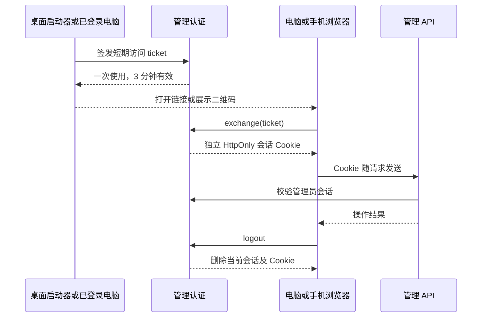

# 管理访问与登录会话

MusicFS 继续使用单管理员。桌面启动、手机扫码和账号密码登录最终都创建浏览器会话，共用同一管理 API。

| 身份 | 用途 | 所有者 |
|---|---|---|
| 管理员账号与浏览器会话 | 配置来源、目录、插件及桌面设置 | 管理认证模块 |
| WebDAV 用户名与密码 | 播放器、rclone 和系统映射读取音乐 | DAV 协议边界 |
| 网易云、QQ 等平台授权 | 来源插件访问平台内容 | `sources` 与对应插件 |

退出管理会话保留服务与挂载；退出音乐来源由来源用例处理。管理账号没有进入音乐核心的实例、内容或授权模型。

## 入口汇入同一会话

首次从桌面程序打开时即可进入，密码在设置中按需创建。启动器先验证现有后台身份，再通过管理凭据申请 ticket；托盘复用同一签发接口。页面消费 URL fragment 后清除它，长期管理凭据留在后台。

手机先由用户手动开启局域网。二维码指向所选网卡上的管理地址，包含同样的短期 ticket；兑换后手机拥有自己的会话。更新二维码只签发新 ticket，二维码过期或已使用时可重新获取。

账号密码登录复用 Better Auth 的密码哈希和会话存储。「记住登录」使用 30 天有效期、按框架策略续期的会话；未勾选时使用浏览器会话 Cookie。退出会删除服务端当前会话，旧 Cookie 随即失效。修改已有密码会撤销旧会话，并为当前操作重新签发会话。

桌面需要恢复账号时，可从程序入口重新进入设置；Worker 可用部署管理令牌进入后修改账号。管理令牌同时保留为脚本与部署工具的 Bearer 接口凭据。

## 模块与存储

| 模块 | 责任 |
|---|---|
| `contracts/management-auth.ts` | 登录状态、账号输入和 ticket 的页面合同 |
| `infrastructure/management-auth` | Better Auth 最小配置；单管理员、产品端点和访问中间件 |
| `hosts/desktop/service.ts` | 打开独立 `auth.sqlite`，组合共用与桌面管理路由 |
| `hosts/desktop/launcher.ts` | 本机入口、后台身份、托盘动作与 ticket 签发 |
| `hosts/worker/service.ts`、`worker.ts` | 绑定 D1，复用当前管理凭据对应的认证实例 |
| `web/shell.tsx`、`pages/settings.tsx` | 登录、退出、账号设置和会话失效后的页面状态 |

桌面音乐库保持 schema10，管理认证单独使用 `auth.sqlite`。Worker D1 通过新增 `0011.sql` 创建 `management_user`、`management_session`、`management_account`、`management_verification` 及必要索引；迁移在部署时执行。两端使用同一份静态认证 schema，测试核对迁移与 schema 一致。

认证路由 `/api/access` 先注册，再将认证中间件交给共用管理 API 和桌面管理路由。密码、bootstrap、ticket、兑换、退出等产品端点由 MusicFS 明确暴露；Better Auth 的其他账号产品功能保持内部状态。浏览器使用 Cookie，原有自动化可继续使用 Bearer；DAV 的 Basic 读取链路独立，音频读取没有增加管理会话查询。

## 宿主差异与验证

Better Auth 负责密码与 Cookie/会话机制，MusicFS 负责单管理员范围、桌面免手输入口和扫码流程。桌面使用 Bun SQLite，Worker 使用原生 D1 binding。Worker 构建通过 `workerd` 条件选择依赖提供的原生 scrypt 实现。

离线测试覆盖 Bun SQLite 与本地 workerd/D1 的账号设置、密码登录、记住登录、ticket、独立会话退出和密码变更；正式 Worker 三模块产物另验共用 API 的 Cookie 接线与退出后的拒绝访问。入口见[开发指南](../development.md)。本地执行结果不代表免费 Worker 的真实计费 CPU 已通过，当前没有为此执行云端部署。
