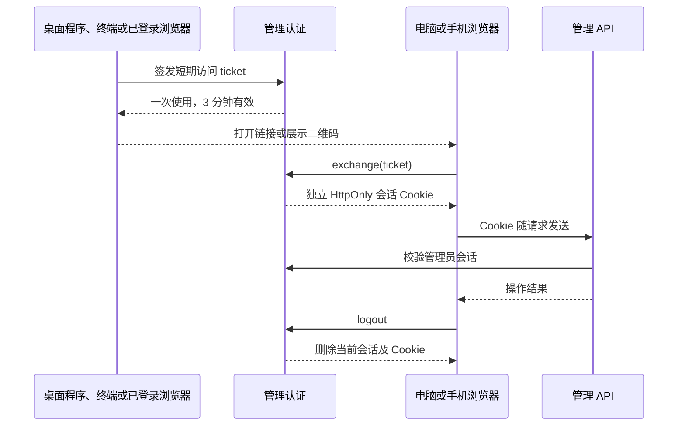
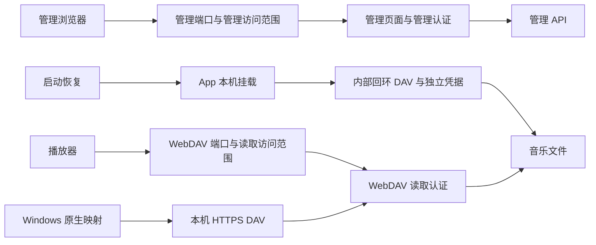
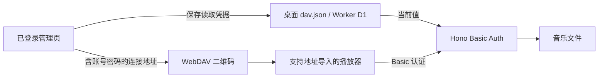

# 管理访问与登录会话

MusicFS 继续使用单管理员。桌面启动、手机扫码和账号密码登录最终都创建浏览器会话，共用同一管理 API。

| 身份 | 用途 | 所有者 |
|---|---|---|
| 管理员账号与浏览器会话 | 配置来源、目录、插件及桌面设置 | 管理认证模块 |
| WebDAV 用户名与密码 | 播放器、rclone 和系统映射读取音乐 | DAV 协议边界 |
| 网易云、QQ 等平台授权 | 来源插件访问平台内容 | `sources` 与对应插件 |

退出管理会话保留服务与挂载；退出音乐来源由来源用例处理。管理账号没有进入音乐核心的实例、内容或授权模型。

## 入口汇入同一会话

首次从桌面程序打开时即可进入，密码在设置中按需创建。启动器先验证现有后台身份，再通过管理凭据申请 ticket；托盘复用同一签发接口。页面消费 URL fragment 后清除它，长期管理凭据留在后台。

终端入口复用身份核对与 ticket，不增加另一套账号或认证模式。SSH/无图形会话自动关闭浏览器、托盘和桌面自启注册，打印当前管理/DAV地址、短期登录链接及 SSH 转发方法；管理默认只监听回环，显式 CLI 参数通过同一网络设置用例分别开放管理或 DAV。重新运行复用已验证后台并签发新 ticket。前台模式由服务管理器持有进程，自动挂载仍在就绪后异步恢复；桌面集成关闭时，页面只显示实际适用的挂载偏好。

手机先由用户手动开启管理页面的局域网访问。二维码指向所选网卡上的管理地址，包含同样的短期 ticket；兑换后手机拥有自己的会话。更新二维码只签发新 ticket，二维码过期或已使用时可重新获取。只开放 WebDAV 不提供管理二维码。

账号密码登录复用 Better Auth 的密码哈希和会话存储。「记住登录」使用 30 天有效期、按框架策略续期的会话；未勾选时使用浏览器会话 Cookie。退出会删除服务端当前会话，旧 Cookie 随即失效。修改已有密码会撤销旧会话，并为当前操作重新签发会话。

桌面需要恢复账号时，可从程序入口重新进入设置；Worker 可用部署管理令牌进入后修改账号。管理令牌同时保留为脚本与部署工具的 Bearer 接口凭据。

## 模块与存储

### 桌面访问范围

管理页面与 WebDAV 使用两个独立 HTTP 监听器，分别设置 `managementAccess` / `managementPort` 与 `davAccess` / `davPort`。各自绑定回环或所有 IPv4 网卡、独立更换端口；管理端口不提供 DAV，DAV 端口不提供管理页面、资源、登录或管理 API，误用端口返回404。

本机回环连接仍需经过各自认证。每个监听器只接受自身所属路径，并按真实套接字来源检查当前访问范围；`Host`、`X-Forwarded-For` 等请求头不授予本机权限。管理凭据不能使 DAV 端口提供管理能力。

运行中修改只更换对应监听器；包括旧连接在内的新请求读取该入口当前范围，已经开始的响应继续完成。准备新端口失败时保留原入口，组合修改失败时恢复两项。本机 HTTPS 仅转发 DAV 路由，App 内部读取连接继续绑定回环，不因局域网开关扩大。局域网 HTTP 沿用现状，没有新增局域网 TLS。

新安装默认两项仅本机，端口可用0自动分配；`network.json` 的私有 `assignedPorts` 记录已分配端口，正常退出后也尽量复用。每项指定端口被占用时仅该项临时换用可用端口，期望配置保留，页面显示实际地址。

旧 `network.json` 的共享 `port` 留给 WebDAV，管理端口重新自动分配；旧 `access` 或已有的独立访问范围保持原意图。旧自动端口从同实例 `runtime.json` 恢复，升级后按新格式保存，不改变管理会话、读取凭据或来源授权。`desktopNetworkView` 按两项实际端口分别生成 `managementUrls` 与 `davUrls`，手机管理二维码和播放器导入使用各自的地址；WebDAV 仅本机时也只显示其本机地址。

设置页的「管理页面访问」设置管理范围与管理端口；「连接与挂载 → WebDAV 播放器」集中设置读取范围、WebDAV 端口、地址、凭据与扫码导入。两个表单通过 `PATCH /api/desktop/network` 仅提交各自字段，桌面 HTTP 入口串行合并最新配置。修改管理端口后，当前浏览器跳转到新管理地址；修改 DAV 端口只更新播放器连接，不移动管理页面。从局域网管理页关闭自身访问后，保存结果提示回到运行 MusicFS 的电脑继续管理，不把手机重定向到手机自己的回环地址。

连接页和播放器二维码共享所选局域网地址；两类二维码打开时重新查询本机网络信息，取得当前端口与网卡后再显示。该查询不访问音乐平台。托盘与启动器使用管理入口；本机挂载由 `readCache.mountConnection` 提供内部读取地址，自动恢复在监听就绪后通过挂载管理器重新取得当前地址，不持久保存某次运行的内部端口。远程挂载则保留用户填写的完整 WebDAV 地址。本机 HTTPS 使用自己的回环端口，不随两个 HTTP 端口改变。

### 播放器凭据与扫码导入

「WebDAV 播放器」通过受管理会话保护的 `GET/PUT /api/connection` 查看和修改读取凭据。桌面用私有 `dav.json` 原子保存，并在内存中保留当前值；Worker 用 `0012.sql` 的单行 `dav_credentials` 表保存，每次 DAV 请求读取一次当前值，避免不同 isolate 继续接受旧密码。未自定义时沿用启动器生成的凭据或部署 Secrets。Worker 升级应先应用随包迁移，再发布代码。

共用 DAV 路由通过动态凭据提供函数复用 [Hono Basic Auth](https://hono.dev/docs/middleware/builtin/basic-auth)，账号密码保存后后续请求立即采用新值；已开始的响应可正常结束。管理账号、启动器身份和来源授权各有自己的生命周期。App 本机挂载使用 `read-cache` 的独立内部连接，无需随公开 DAV 密码改变而重新挂载。

WebDAV 导入二维码与管理页的「手机访问」入口分别提供：前者是 `http(s)://用户名:密码@地址/dav/` 的连接信息，由标准 URL 编码及 [Ant Design QRCode](https://ant.design/components/qr-code/) 生成，不签发管理会话。密码按用户选择明文显示；播放器是否支持扫码导入该地址由客户端决定。桌面扫码入口只列出可供其他设备使用的地址，需先由用户允许 WebDAV 的局域网访问；Worker 使用当前访问域名。

### 管理会话

| 模块 | 责任 |
|---|---|
| `contracts/management-auth.ts` | 登录状态、账号输入和 ticket 的页面合同 |
| `infrastructure/management-auth` | Better Auth 最小配置；单管理员、产品端点和访问中间件 |
| `hosts/desktop/service.ts` | 打开独立 `auth.sqlite`，组合共用与桌面管理路由 |
| `hosts/desktop/entry.ts` | 后台身份核对、当前访问入口与短期登录链接，供 GUI/终端复用 |
| `hosts/desktop/cli.ts`、`desktop.ts` | 终端选项、桌面会话识别、启动反馈与前台生命周期 |
| `hosts/desktop/launcher.ts` | 后台启动/复用、监听及托盘动作的装配 |
| `hosts/worker/service.ts`、`worker.ts` | 绑定 D1，复用当前管理凭据对应的认证实例 |
| `web/shell.tsx`、`pages/settings.tsx` | 登录、退出、账号设置和会话失效后的页面状态 |

桌面音乐库保持 schema10，管理认证单独使用 `auth.sqlite`。Worker D1 通过新增 `0011.sql` 创建 `management_user`、`management_session`、`management_account`、`management_verification` 及必要索引；迁移在部署时执行。两端使用同一份静态认证 schema，测试核对迁移与 schema 一致。

认证路由 `/api/access` 先注册，再将认证中间件交给共用管理 API 和桌面管理路由。密码、bootstrap、ticket、兑换、退出等产品端点由 MusicFS 明确暴露；Better Auth 的其他账号产品功能保持内部状态。浏览器使用 Cookie，原有自动化可继续使用 Bearer；DAV 的 Basic 读取链路独立，音频读取没有增加管理会话查询。

## 宿主差异与验证

Better Auth 负责密码与 Cookie/会话机制，MusicFS 负责单管理员范围、桌面免手输入口和扫码流程。桌面使用 Bun SQLite，Worker 使用原生 D1 binding。Worker 构建通过 `workerd` 条件选择依赖提供的原生 scrypt 实现。

离线测试覆盖 Bun SQLite 与本地 workerd/D1 的账号设置、密码登录、记住登录、ticket、独立会话退出和密码变更；正式 Worker 三模块产物另验共用 API 的 Cookie 接线与退出后的拒绝访问。入口见[开发指南](../development.md)。本地执行结果不代表免费 Worker 的真实计费 CPU 已通过，当前没有为此执行云端部署。
