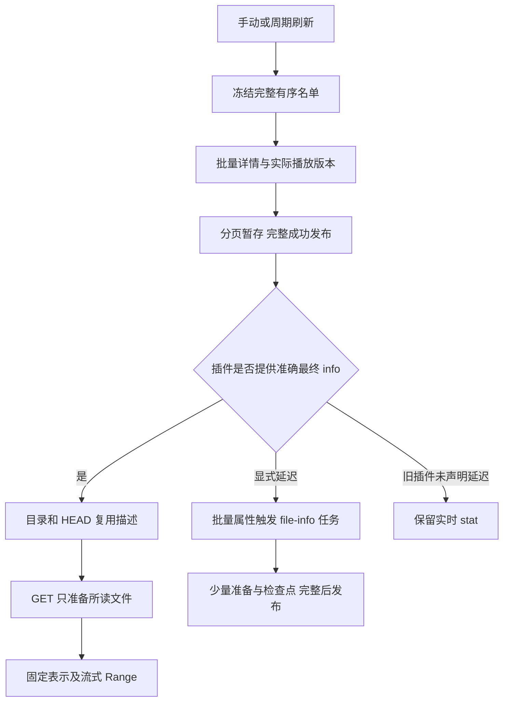

# 大目录刷新与按需读取

本文描述现行路径。来源资料及文件表示见[可选补标签](audio-tags.md)，缓存期限见[缓存策略](cache-policy.md)，候选与停止条件见[实施计划](../planning/implementation.md)。历史耗时均保留版本及适用范围，不作为当前实机速度承诺。

## 清单、属性与正文分开

网易云默认清单每页 200 首，确认完整成员、歌曲详情及实际可播版本，不读取全库歌词、封面或音频结构。MP3/FLAC/M4A 使用准确预留大小，目录及 HEAD 不准备标签，首次 GET 才取得单曲资料并原子固定计划。QQ 继续分页精确准备；不能将网易云的可选策略强加给其他插件。

准确大小仍是协议前提。需要全属性的 rclone 不能使用零、未知值或原音频大小来代替最终大小。显式延迟条目通过已有 `file-info` 持久任务准备，期间整体返回 `503`、重试头与操作 ID，不返回属性失真的成功目录。旧路径要求先准备的限制不再用来描述网易云预留表示。

预留预算使整文件复制额外携带填充，超预算须单曲换成精确表示再刷新；不是所有容器都适合。旧表示不随资料 TTL 改变，具体格式限制见[按需挂载记录](../verification/lazy-mount-feasibility.md)。清单完成也不代表播放器已经逐曲扫描完毕。

## SDK 与来源请求减法

“完整歌单”主要是完整有序 ID 集合，不代表全部资料、权益与媒体位置。固定 SDK 的便捷方法可能在内部继续请求详情，不能按表面方法数估成本。

- 每轮冻结名单并复用，末尾复核，不逐页重新拉全歌单；保留顺序和重复位置。
- 富歌曲详情与播放版本采用原生批量，沿用 SDK 加密、Fetch、取消及限流。仅在实际字段缺失时补专辑资料。
- 已知封面 CDN 分片按同一资源路径和参数共享，保留原请求 URL，不按专辑 ID 盲目合并。
- 可选 `readMany` 合并 MP3 头尾多 Range，由现成 MIME 库解析；来源不支持时回原单段路径，不为 FLAC/M4A 额外预取。
- 网易云后续打开/seek只读复用清单已保存的有效播放版本定位，完整媒体身份与原生期限匹配才使用；沿原5分钟/原生到期取较早的新鲜度，不续期或另写定位缓存。缺失、过期或版本不匹配仍走原SDK解析；每次读取调用新增一次资料缓存查询，调用内多个Range共用该结果。
- HTTP 批次包装不等于逐曲歌词有真批量能力；不通过无证据路径变体、更多并发或叠加重试试探平台。

200 首是已验证默认，不是精确平台上限。真实富详情/版本均返回完整 ID；另一次更大样本 HTTP 成功却截断，因此不继续扩大。端点与 SDK 注释须对应实际调用，另一条 API 的上限不能套用。[SDK 与请求证据](../verification/netease-cold-request-reduction.md)、[批量样本](../verification/data/netease-sdk-batch-200-2026-10-21.json)、[截断样本](../verification/data/netease-sdk-batch-500-2026-10-21.json)

## 持久执行与免费基准

刷新由 `library.refreshes` 编排，页和游标持久化，完整成功才发布；普通缓存缺失复用有效任务，显式刷新可替换。失败时继续提供旧成功快照，不把分页进度当部分成功清单发布。

桌面后台在网页关闭后继续，每个持久步之间适度让步；退出后台则暂停，重启接管。Worker 每次独立后台调用最多推进一页，后续由页面或 Cron 唤醒，不在单次 `waitUntil` 无界循环。

桌面唤醒由持久队列与周期策略的成功写入触发，不依赖入口的 HTTP 中间件；入队、检查点、取消及插件变更共用同一个常驻执行器。后台按各活跃任务最近更新时间取下一页，让不同实例轮流获得执行机会；同一实例仍保持一个活跃刷新，不增加平台请求并发。当前插件页内的等待不被抢占，限流任务按 `retryAt` 到期后再参与调度。

桌面与 Worker 共用清单算法和 200 首批次。精确文件准备按冷热工作量与时间软预算推进，Worker 再参考实际来源/缓存调用余量；这与固定每页极少歌曲不同。预算提示不等于免费 CPU 或全部 SQL 已验，不能以付费云端成功外推免费环境。

429 保存 `retryAt`、已接受游标并释放租约，到期续步；暂时失败有界重试，取消终止后续安排。来源重试归插件，持久续步归刷新模块；不增加进程长睡眠或第二套队列。

## 公共热路径的减法

| 所有者 | 当前优化 |
|---|---|
| library | 按来源戳和发布身份复用路径索引，不附带原始快照；桌面32MiB/Worker8MiB估算预算，准确 info/ETag 共用于单文件与批量属性 |
| DAV | 按实际请求属性取描述；轻量属性不逐文件 stat，完整 XML 的输出成本仍存在 |
| sources | 规范化配置与最终状态等价时不写库、不推进代际；真实变化仍失效 |
| 持久化 | 本页为外层、按完整身份索引去重，避免累计候选与当前页反复比较 |
| 来源插件 | 小准备索引先于大计划/图片，批量缓存与共享封面；QQ 复用有效 CDN 路由偏好 |
| Worker | 按 D1 binding 复用不含请求上下文的 runtime；凭据、assets、signal、waitUntil 每次接线 |

缓存命中不延长临时地址或会话期限；资料、准备索引和永久表示计划分开。浏览和扫描取得哪些字节另由[读取缓存](shared-read-cache.md)处理。

## 历史性能证据

| 证据 | 能确认的结果 | 不能外推的结论 |
|---|---|---|
| [旧真实冷基线](../verification/real-netease-cold-dev5.md)与[两阶段清单](../verification/deferred-catalogue.md) | 首次全量补标签曾近 13 分钟；100 首批次清单约 25 秒，工作范围显著减少 | 不是补标签吞吐提高同样倍数，也不是当前 200 首全库耗时 |
| [SDK 冷准备](../verification/netease-cold-request-reduction.md) | 富详情、封面及 MP3 多 Range 的请求减法 | 不证明平台精确限流阈值或所有格式均受益 |
| [离线热路径计数](../verification/data/performance-round2-2026-10-21.json) | 路径、描述、SQL 和前台等待的局部成本下降 | 不等同真实平台整库刷新 |
| [打包 SDK / 本地 D1 批次](../verification/data/deferred-catalogue-worker-200-2026-10-21.json) | 实际模块的单页存储预算与精确属性 | 不证明真实免费 Worker CPU |
| [Windows / WSL 按需挂载](../verification/lazy-mount-feasibility.md) | 准确预留表示、冷枚举和单曲读取可行，限制明确 | 不代表所有第三方格式、播放器或当前整库 GUI 均重测 |

进一步优化按真实使用收益重开，不因理论上仍有微小空间恢复全账号扫描或平台压力验证。
