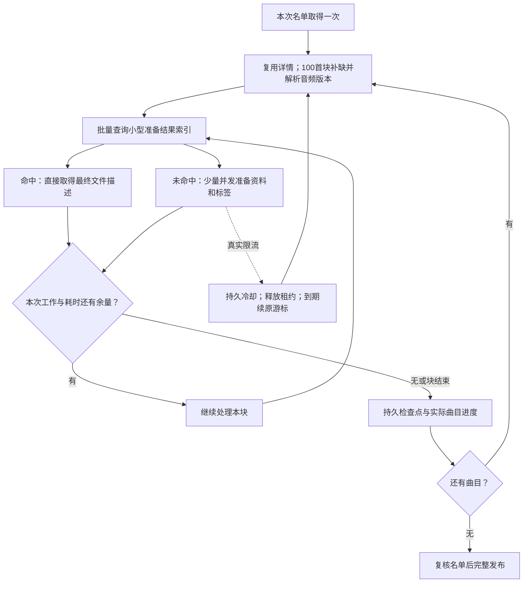

# 大目录刷新：性能实现与验证

日期：2026-10-21。当前源码：应用 `0.1.0-dev.5`、API `0.1.7`、schema 9、网易云 `alpha.11`、QQ `alpha.13`。已发布dev.5仍打包alpha.10；新候选不会改记旧发行包身份。此前 `743ed48` 保存了 alpha.9 的评估；原始计数见[旧基线](../verification/data/refresh-cost-2026-10-21.json)。

用户场景是桌面网易云“喜欢的音乐”约4,000首、一个目标音质。目标是减少实际平台工作量和等待，同时保留基础资料、封面、歌词及准确的大小、内容身份和 Range。没有以平台压力测试换取结果。

**后续真实冷验证**：按用户要求清掉旧派生缓存后，WSL本机的真实“喜欢的音乐”4,159首完成于约12分58秒；导出1,915个完整文件，2,244首因所选音质不可用或试听隐藏。刷新期间管理接口P95约7.18ms，已发布DAV目录53.14ms。首次建库仍有9,266次来源请求，不能把下面离线/缓存有效的毫秒级指标当成真实冷建库时间。完整范围和限制见[真实本机记录](../verification/real-netease-cold-dev5.md)。

## alpha.11：由真实冷等待重新排序

真实等待暴露了先前评估遗漏。当前增加SDK富详情100首真批量，避免逐张专辑补取；已知图片CDN按资源共享；MP3头尾可由一个CDN多Range读取，标准MIME解析由固定依赖负责。原生版本核对、429冷却、最终标签与Range合同不变，不提高平台并发。已有一次真实100首富详情及正式reader单曲8KiB结果，完整范围见[冷准备调查](../verification/netease-cold-request-reduction.md)。预计请求可减少约四成，尚无新真实整库耗时结果。

下一步是完整清单与文件表示准备分阶段，必须同时覆盖App浏览、直接读取和第三方播放器全属性扫描。随包rclone把未知大小当0，不能只把prepare搬到stat或返回原文件大小。该架构调整仍在推进，下文“不默认懒准备”的旧评估已重开；不把dev.5本地热指标当作当前性能收口。

## dev.5：完整使用旅程复核与实现

用户已将主线改为持续全面性能优化，按[目标](../codex-goal.md)与[ROI台账](../../outputs/musicfs-implementation-plan.md)执行。以下为dev.5新增实现，下方网易云4,000首扫描与缓存数据仍保留dev.4时的证据范围。

- **发布目录视图**：`library/published-views`按来源戳、目录键、已发布snapshot.id复用规范化名称与Map索引，每次先核对持久header；使用固定[lru-cache 11.5.3](https://github.com/isaacs/node-lru-cache)管理最多32视图、8MiB估算权重与冷构建合并。超大目录仍能读取，只不留缓存；估算权重不是实际heap硬上限。
- **实际路径效果**：4,000文件的正式Fetch DAV离线夹具，5次独立HEAD从10份完整快照/20,005条目降为冷起2份/4,001条目；随后的GET/Range不再追加整目录装载。换发布id重建，失败保留旧视图，来源戳变化仍检查；新controller可从持久数据恢复。
- **等价配置保存**：sources比较插件规范化配置与最终私态，使用固定fast-deep-equal 3.1.3忽略对象键顺序；均等价则不写库、不推进epoch、不清认证/缓存或运行刷新。真实变化和logout保持原CAS失效机制，无额外store接口。41项相关状态/认证回归通过；实际本地workerd等价保存0次配置写入、变化保存1次。
- **宿主生命周期**：桌面沿用长存library；Worker按D1 binding复用不持有请求上下文的runtime，凭据、assets、插件发布和waitUntil仍每请求创建。实际本地workerd/D1的独立HTTP重复HEAD、GET、Range不再整载目录；两个重叠冷请求合计仍只载入2份/4,001行。isolate重启恢复冷载，正确性由D1与来源戳承担。47项断言通过，不把本地workerd结果当成真实免费云端CPU验收。
- **短暂失败续接**：沿用已有持久任务、认领与retryAt，temporary故障最多等待2秒、8秒重试同页两次，保留已接受游标；成功页清零计数，耗尽才按原失败规则处理。429仍使用独立的来源冷却，认证/配置/内容变化不进入暂时重试，显式取消仍终止任务。没有新增手动恢复模型、队列或进程内睡眠。后页故障、重建controller续接、实例目录推进与取消均以注入时钟验证。
- **QQ读取路由减法**：仅缓存SDK选中的CDN基础地址偏好30分钟，且它必须仍在本次原生候选中；每次open仍获取新vkey并核对同一原生文件，实际音频Range响应代替额外探测并验证表示。偏好路径临时失败可在正文交付前回到原SDK选择一次，额外等待头部最多5秒；429、身份/Range错误与取消不换路。四CDN离线样本“播放＋两次seek”来源调用18→10，单CDN9→7；每次open增加1次小缓存读，首次选择增加1次写。无签名URL持久化。网易云未发现可靠CDN摘要头证据，跨open地址复用暂不实施，避免削弱原生表示核对或增加无净收益查询。
- **QQ热准备**：catalog只组织集合/游标，preparation拥有来源工作边界，tagged拥有最终表示与小准备索引，metadata拥有辅助资料及原到期时间。热命中不再读取/哈希封面与大标签计划；mtime按最终内容保持。单次先用1首观测CDN路径成本，再按剩余预算最多4个目标文件一块解析，冷准备最多4文件/约2秒、最多2项并发；Worker预算提示下逐项准备。内部45次请求预算遇到路径变贵时交付已接受前缀，真实429/故障仍上报，不吞掉故障。

QQ的20首单音质、共用32KiB封面的受控结果见[本轮证据](../verification/data/performance-round2-2026-10-21.json)：热刷新5→1页，来源30→27次、缓存读取120→6次，标签计划装载921,450→0字符；冷刷新保持5页，来源92→97次、缓存读取100→60次。冷调用增加5次是首块成本观测，不宣称冷吞吐提升。24首预算模型、12首复杂CDN完整续接及20首中途路由变贵检查了45次来源/32次插件查询边界；这些模型不等于实际D1全部SQL或免费云端CPU证据。

**桌面刷新与前台公平性。** 实际runner＋SQLite＋Hono的4,000条/40个热检查点夹具发现重复检查的普通JOIN被规划为“累计候选×本页条目”。改为以本页`json_each`为外层，对每项按`(attempt_id,identity)`完整索引查询，保持相同语句数量/参数与原子去重规则，无迁移；同时桌面在成功持久步之间用可取消的原生`setImmediate`让出事件循环。原SQL即使每步让步仍7,491ms，修复后47ms；数据库提交合计7,383→30ms。原始不让步的内存对照前台等待5,244ms，完整修复后约3.9ms。它证明本地重复计算与调度问题，不是上游限流，也不是单纯把工作延后；受控数据不等于真实平台整库耗时。SQLite、本地workerd/D1、跨页/同页重复、旧检查点、取消与宿主公平性共24项/654断言通过。没有新增线程、队列或依赖。

**扫库与单文件描述。** `Entry.info`原本就是精确字节的完整描述，单文件HEAD/GET与`statMany`现统一复用；缺info的旧插件才实时stat。来源戳仍在描述前后检查，GET/open继续校验真实表示和Range。派生ETag仅按已发布target弱引用复用，不缓存带路径的Description，新快照自然重建。4,000条分段夹具中，原metadata首轮380ms、再次369ms；复用后暖轮约2—4ms且不再逐文件hash。两宿主再共用标准`node:crypto.createHash`Adapter，经窄函数注入核心，核心仍拥有JSON/UTF8规则及WebCrypto默认实现；同夹具冷metadata约6.1ms。原生哈希与WebCrypto的中文输入及生产Worker ETag逐字节一致。

Bun的browser默认解析会引入约921KB且在workerd不可用的crypto兼容层，因此构建工具只对`node:crypto`保留原生导入，使用原已要求的`nodejs_compat`。没有放宽核心Node边界，没有手写哈希或更换XML库。XML组装/序列化约57ms、约2.01MB的响应体属于不同阶段，不把6.1ms说成整次PROPFIND。Worker只验证原生导入/正确性，不推算本机倍数或真实免费CPU。

最终受影响集成126项、1,785断言通过，三套类型与依赖边界通过；实际打包网易云SDK＋本地workerd/D1再次取得冷24首最多37SQL、热一页24SQL/3次来源调用，完整标签与尾部Range一致。全轮无真实音乐平台请求、云部署或Windows宿主操作。剩余候选按ROI停止/重开条件见实施计划；不将缓存有效的毫秒结果替代真实首次资料下载与平台等待。

## 当前结果

| 场景（4,000首，单音质） | 新版受控调用 | 是否重新准备旧歌 |
|---|---:|---|
| 缓存有效，短时间再次刷新 | **3**：定位1＋名单2 | 否 |
| 新增1首，旧资料有效 | **7—8**：上述3＋新歌播放/歌词/两个Range；详情缺失时加1 | 仅新歌 |
| 删除刚新增的歌曲 | **3** | 否 |
| 播放信息到期，基本资料及标签仍有效 | **43**：上述3＋40个播放批次 | 否 |
| 基本资料和播放信息均到期，标签仍有效 | **83**：上述3＋详情40＋播放40 | 只有资料/实际表示变动才重做 |

以上都实际执行了完整4,000首受控扫描，保留顺序、重复位置及40个热检查点；不是只测前一小页。新歌样本复用已有专辑，新增了1首后共41页。每批至多100首；无额外音质回退。alpha.9的旧代码模型需要500页、约1,501次基础调用。这里证明请求减少，不能直接换算为真实网络耗时倍数。

同一离线输入的首次冷扫描完成160页；读取歌词4,000次、专辑1次、封面1次、MP3范围8,000次。该样本所有歌曲共用一个专辑，MP3含已有ID3：范围从原来的每文件3次降到2次。真实专辑分布、可用曲目、音质回退和格式会改变这些数量。首次完整资料准备仍有逐曲成本，不承诺瞬间完成。

正式 Worker service + 实际打包SDK + 本地workerd/D1的24首样本：

| 场景 | 页面 | 单次最多SQL | 受控来源请求 |
|---|---:|---:|---:|
| 冷准备，含32KiB封面 | 7 | **37** | 80 |
| 热刷新 | **1** | **24** | **3** |

24份最终计划共55,143字节，大封面只保存一份共享副本。这个样本核对SQL语句数量与字节行为，不证明真实免费Worker CPU、整个账号耗时或实际账单。数据与范围见[验证数据](../verification/data/refresh-optimization-2026-10-21.json)。

## 完整歌单与批量接口

“完整”主要指有序曲目ID集合，不能等同于每首歌的所有资料。锁定SDK `NeteaseCloudMusicApi 4.32.0` 的 `playlist_detail` 固定请求 `n:100000`，随包文档仍说明 `tracks` 可能不全；`playlist_track_all` 内部也是名单加歌曲详情，不是免除后续请求的新接口。[上游文档](https://binaryify.github.io/NeteaseCloudMusicApi/)

现在首次取得并校验 `trackIds/trackCount`，冻结本次名单；直接复用响应中有效的歌曲详情。缺少详情才按最多100个ID补取，保留原顺序及重复位置。基本详情按歌曲身份跨扫描/歌单保存24小时；新鲜的歌单响应详情优先，缺失部分才批量查缓存或接口。播放版本也按歌曲和音质策略复用，临时地址不超过原生有效期且最多5分钟；缺失音质仅30秒，未给出有效期则不缓存地址。复用缓存不顺延原到期时间。名单每次刷新重取，新增只补缺失曲目；实际读取仍重新定位/核对表示，观察到不可用、版本变更或读取失败会清掉该曲版本缓存，使随后刷新可修复。

名单和紧凑详情分开保存，不把整份原始响应塞进一条缓存。扫描工作资料保留24小时以支持重启续接；到期明确要求重刷。发布前复核一次ID序列，变化则保留上次成功目录，已准备的不可变文件仍可供后续刷新复用。

`likelist` 在SDK中标注无序，不能直接代替有序喜欢歌单。SDK可以修改，但本轮最佳收益来自调用组织与现有批量端点；未修改加密/登录协议。`/api/batch` 的一次HTTP也不等于平台只计一次工作，且当前wrapper按路径键组织，不将它假定为任意数量歌词的批处理。

## 一套推进算法，按实际工作切分

桌面和Worker使用同一网易云入口、同一算法，不各写一套分页。上游批量读取、补标签工作量、检查点粒度分开：默认最多推进约100个已准备文件；冷工作另有约32文件和2秒软边界，每小组完成后检查，实际可以更早停止。最多两项准备并发，不为整个账号一次建立数千个Promise；失败后停止后续安排并等待已启动项收拢，未完成页不发布。

免费Worker限制单次资源，不要求固定8首。正式Worker分别核算50次来源请求和32次插件缓存查询提示，为来源检查与原子检查点保留余量；插件按剩余提示决定何时结束冷工作。桌面没有该宿主提示时仍遵守自己的数量/耗时边界。缓存命中可在两端统一推进大页，不因Worker名称切小。这里的提示不代替实际平台预算或CPU验证。[D1官方限制](https://developers.cloudflare.com/d1/platform/limits/)

旧宿主缺批量缓存时有小页兼容回退；不是新版Worker的固定策略。核心默认页数保护从1,000改为10,000，以容纳资源受限时的细分检查点，条目预算保持100,000；提高保护值不是性能优化本身。

## 缓存与存储的减法

- `getMany` 用一次SQL查询多个准备结果；`putMany` 原子保存计划、索引及需要的共享字节，避免逐个键往返。
- 最终描述的小索引先于专辑、封面、歌词读取。命中时不载入大计划、不解码封面、不重探测音频。键覆盖实际音频、当前音乐字段；索引到期不晚于它依赖的资料。
- 本轮明确调整新鲜度：歌单成员每次刷新确认，基本歌曲资料24小时、播放版本至多5分钟；稳定辅助资料默认7天，暂无歌词/封面等空结果24小时再试。封面地址等基本字段变化会使准备结果索引不匹配。来源修订的辅助资料可能延后体现，这个取舍用于避免每天为未变化的4,000首重取全部资料。
- 同次插件调用合并专辑、歌词、封面读取，避免相同专辑在并发项中重复下载/查询。
- 大封面不再复制进每首歌的持久计划。网易云用自己的存储codec将原标签区段拆为小前缀、共享图片及小后缀；图片按摘要不可变存一份，`stat`只取小计划，`open`再恢复等价字节区段。保留原最终大小、内容身份和音频字节；MP3/FLAC/M4A已有大图回归。未匹配到可共享图片时保留原计划，不改变格式编码来强行共用。
- 缓存清理只在本次调用首次写入执行；schema9增加到期和来源范围索引，使用三个索引范围定位过期/旧范围行，不反复遍历所有有效计划。SQLite查询计划与D1实测均已核对。

缓存仍按实例、实例代际和插件修订隔离；插件更新后的首次准备可能是冷缓存。未引入全局缓存、整曲下载、对象存储或缓存迁移框架。

## 音频、限流与可见进度

音频本身继续使用Stream，不转码。可选音频工具在一次准备内复用最多两个小窗口，MP3/FLAC/APE的普通头尾以4KiB窗口减少碎请求；大块不长期保留。M4A保持精确box边界，不向 `mdat` 预读音频。既有全文、跨区段和尾部Range回归保留。

插件将API HTTP/body、封面和音频429统一映射为 `rate_limited`，保留 `Retry-After`。核心把 `retryAt` 与已接受游标一起保存，释放租约；后台、界面step和数据库认领都遵守等待时间，重启后仍可续跑。新开/取消再重试也继承已知冷却；成功页清除连续重试记录。最多自动冷却重试5次，仍失败则停止整次操作，不转去请求同实例的其他目录。没有等待提示时有界退避，不无限重试，不在进程内睡眠充当持久调度。

界面沿用现有轮询，展示“已处理 / 总曲目”、进度条，以及预计继续时间。统计中的曲目数与导出文件数仍分开。任务在后台推进，最近完整目录保留到新目录完整成功；不将半成品文件提前发布。

## 从使用场景检查剩余取舍

- **第一次建库**：歌词与音频头仍有逐曲成本；后台已有持久检查点、取消和进度，保留完整发布语义。不把半目录提前当成功，也不靠大量并发试探平台阈值。
- **新增/取消喜欢**：成员名单始终更新，缓存按歌曲身份而非分页位置查找；插入、删除、换序不会让所有旧歌曲重新补标签。跨歌单复用同一实例的已知歌曲。
- **播放器扫库**：API0.1.7允许插件提供最终字节的 `FileInfo.modifiedAt`。网易云在首次生成计划时保存，后续复用保持；目录最近刷新时间继续单独更新。文件没有变化时不再因为刷新而改变mtime。未提供的旧插件保持原回退行为。
- **序号文件名**：已约定的有序前缀保持。新喜欢插到最前面仍会引起后续路径改名，播放器可能重扫；稳定文件名可改善，但会改变目前依靠文件名保留歌单顺序的体验。本轮不暗中改变这项语义，也不宣称mtime修复消除了路径变化。
- **间隔较久再刷新**：5分钟/24小时/7天三个周期分别确认不同事实。短时间重刷的3次调用不代表隔日成本；来源修订可能延迟到缓存到期后体现。
- **完全未变化的目录**：目前仍有40个本地检查点，桌面后台连续推进，不逐页等待界面150ms。桌面上的低开销不能直接推及Worker的逐页请求、SQL及数据装载成本；下一阶段需把“未变直接保留快照”列为候选，但不能仅凭ID名单不变忽略资料和音频表示的到期。

### 扩大到完整使用旅程：候选优化，尚未实现

本节为dev.4交付后的代码复核。以下建议未包含在dev.4中，不改记已有发布与实测结论。当前主线仍是把来源内容作为带完整资料、准确字节描述的只读文件交给播放器，不扩展成独立音乐服务。

| 使用旅程 | 当前已经具备 | 仍有价值的改进与顺序 |
|---|---|---|
| 第一次接入4,000首 | 后台准备、进度、检查点；已有完整目录持续可读 | 保持明确的当前工作/等待状态；先准备用户选择的目录。逐曲歌词和音频头仍有成本，不增加整库预下载 |
| 每天新增/取消几首喜欢 | 名单每次确认，同曲资料/最终计划可跨扫描复用 | 在事实仍有效、导出描述未变化时直接保留完整快照；避免只靠短时间3次调用代表隔日表现 |
| 第一次播放与拖动进度 | 流式Range，单次打开内复用定位，不整曲缓冲 | **优先：按已发布快照复用名称/路径索引；按实际表示复用短期播放定位** |
| 播放器逐文件扫库 | PROPFIND整层属性已有批量路径，mtime保持稳定 | **优先：单文件HEAD/GET也必须避免重复装载4,000首目录**；序号文件名的迁移需另行决定 |
| 多个歌单含同一首歌 | 同一实例的歌曲/专辑资料与相同最终文件计划复用；保留不同出现位置 | 保持该复用，不另建全局跨账号音乐缓存；优化单文件入口同样能使多个视图受益 |
| 修改音质或原样保存设置 | 来源代际变化使旧结果失效 | **其次：有效配置没有变化时，不应仅因按了保存就重置代际**；实际变化再区分哪些资料需要重做 |
| 插件例行升级/重新授权 | 授权状态可保留或恢复；缓存按修订/代际隔离 | 冷重建代价较大；评估由插件声明兼容的资料格式，只复用兼容资料。不能默认跨账号沿用可用音频和目录快照 |
| 网络短断、程序重启 | 运行中检查点可跨进程恢复；限流持久冷却；旧目录保留 | **其次：暂时失败提供从已有检查点继续的入口**，与显式取消/重新扫描区别；不增加无限自动重试 |
| 本机挂载后反复打开目录 | 现有rclone RC、5秒目录缓存、关闭磁盘字节缓存 | **其次：目录发布后定向通知rclone失效**，再适度延长目录缓存；反复seek是否启用有上限的现成读缓存，以实际播放器为依据 |
| 手机/OpenList/远程Worker | 同一DAV与插件算法；Worker按实际剩余工作切步 | 索引缓存为两端共用优化；未变化快照快路径能减少逐页开销。远程挂载无法依赖本机发布事件，保留到期或手动刷新 |
| 刷新同时听歌 | 后台冷准备最多两项并发；文件按已发布计划读取 | 小样本观察首包/seek延迟再决定是否让刷新让步，不能仅凭批量吞吐增加并发或新增优先级调度器 |

**单文件路径的具体证据。** `library.resolve()` 每个路径段先通过 `children()` 读取整份目录，再调用 `nameEntries()` 规范化命名并查找。已有 `statMany()` 的优化只覆盖持有已列出对象的批量路径，独立HTTP请求不持有这些对象。本次只用内存SQLite与普通夹具，在已发布4,000文件目录中连续执行5次独立文件 `stat`：读取10份快照，装载20,005条记录（5份单项根快照与5份4,000项目录快照），无网络和平台调用。这证明工作随父目录规模重复发生；不是实际播放器耗时或整库压力测试。

建议由`library`拥有一个已发布目录视图，复用可移植名称及名称到条目的索引；按快照身份和来源代际更新，以有界缓存控制占用。先消除重复装载与命名，不给音乐插件增加路径职责，也不为单文件请求反复建立整库Map。Worker内存复用只能作为加速，正确性仍依赖持久快照；是否需要持久路径索引取决于冷入口的实际成本。

**播放定位的职责。** `media.sourceReader()` 只在一次打开内保存定位，新打开会重新调用`resolveMedia()`；当前扫描阶段的`versions:*`缓存尚未被读取路径复用。建议仍由来源插件管理定位，键包含实际表示；仅在原生到期时间内复用。正文输出前遇到明确地址失效时，可以清掉该定位并有界地重新定位同一表示；不在正文中途重新拼接，也不借此静默更换音质/文件。

**挂载缓存复用现成能力。** App当前使用`CacheMode: off`和`DirCacheTime: 5s`。rclone已有按文件/目录清理目录缓存的[`vfs/forget`](https://rclone.org/rc/#vfs-forget)；可由桌面宿主在本地快照发布后调用，音乐核心不依赖rclone。需要读缓存时，[rclone VFS full模式](https://rclone.org/commands/rclone_mount/#vfs-file-caching)按实际读取区段存储，不要求先下载整曲，但会使用磁盘且需设置容量/保留期；本轮仅记录候选，不自动开启。客户端自身的目录缓存仍需由客户端更新，不能承诺一次本地通知控制所有远端播放器。

建议执行顺序：**单文件目录索引 → 播放定位复用 → 无效保存与暂时失败续接 → 本地挂载发布通知 → 未变快照快路径与兼容缓存复用**。稳定文件名/播放列表属于会改变使用习惯的产品取舍；加并发、整曲缓存及另一套队列没有现成的必要性证据。

## 领域与依赖

| 所有者 | 本轮拥有的行为 |
|---|---|
| 网易云 `scan/catalog` | 名单、详情/版本批量、顺序、游标、自适应准备 |
| 网易云 `metadata/tagged/plan-storage` | 资料新鲜度、准备索引、共享图片、插件自己的计划编码 |
| 可选 `audio-tags` | 格式标签编码、准备窗口、最终字节与Range映射；不认识账号或平台 |
| `sources` 与SQL Adapter | 来源隔离、批量缓存及宿主工作提示；不解释音乐字段 |
| `library.refreshes` | 一份检查点、取消、冷却与完整发布；不增加另一队列 |
| 宿主与WebUI | 安排到期推进和投影进度，不管理来源内部状态 |

新增固定 `p-limit 7.3.3` 管理有限并发，原生Buffer负责字节查找/分段，原有标签库继续编码；没有手写完整请求队列或容器编码器。[p-limit文档](https://github.com/sindresorhus/p-limit)

`p-limit`只控制并发，不能宣称提供QPS限速。实际429由持久冷却负责，没有通过加压试探平台阈值。暂不增加p-queue、p-retry、Redis、SSE或WebSocket：现有持久任务与轮询已经承担所需职责。

dev.5没有采用首次播放补标签：WebDAV Depth:1常先查询整层文件属性，会将准备成本挪到stat；不能先报原文件大小再输出额外标签字节。**真实12分58秒的冷等待已使分阶段准备成为高ROI方向**，其当前限制与接下来验证见上方alpha.11章节；不再以旧“尚无必要”结论停止调查。

## 验证与交付范围

- `tests/netease-refresh-performance.test.ts`：4,000首完整离线冷热扫描、新增/删除、基本资料和播放信息分别到期、读取变更后的定向失效、批次/顺序/进度与准备结果复用；没有真实HTTP或平台负载。
- `tests/plugin-cache.test.ts`、`tests/migrations.test.ts`：SQLite/D1批量、到期、来源隔离，schema1至8升级为9、保留数据与索引查询计划。
- `tests/refresh.test.ts`：已接受页不重做、跨控制器冷却恢复、认领等待与新任务继承冷却。
- `tests/netease-plan-storage.test.ts`及既有音频回归：三种网易云格式的大图共享、准确最终字节、原音频及Range；M4A不读音频payload的约束保留。
- `bun scripts/probe-netease-refresh-offline.ts`：实际网易云ZIP、原SDK回调、正式Worker service、本地workerd和真实D1；所有外部响应被受控替代，检查每步SQL、热大页及共享图。

既有整套本地回归通过，新增/后续改动再按受影响入口复查；类型和依赖边界检查通过。没有追加真实4,000首重复测速、云端部署、Windows宿主调用或挂载重验。Windows更新包由WSL交叉构建，现有dev.3原生挂载验收不改记为dev.4通过；交付入口见[发行说明](../release.md)。

目前证明的是请求减法、批量和字节行为。真实首次冷准备仍受逐曲资料与平台响应影响；真实账号耗时、免费Worker CPU和实际账单未由离线样本证明。后续优先读取用户一次正常刷新的表现，不另外发起整库压力测试。
