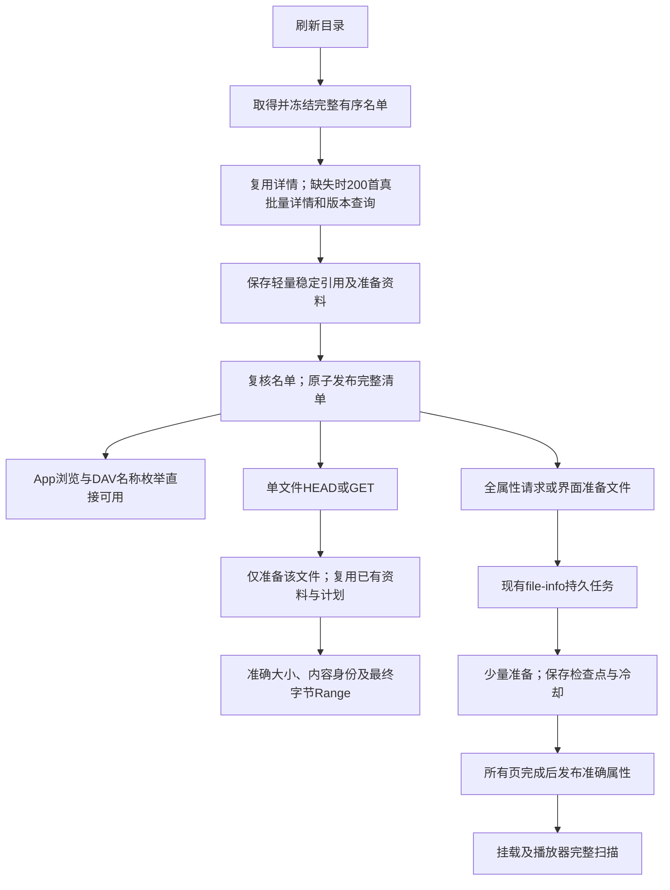

# 大目录刷新：当前设计与性能证据

日期：2026-10-21。当前候选为应用 `0.1.0-dev.6`、API `0.1.8`、schema 9、网易云 `alpha.13`、QQ `alpha.13`。较早发行包身份保持原样，交付入口见[发行说明](../release.md)。

桌面网易云“喜欢的音乐”约 4,000 首、一个音质是本轮实际瓶颈。此前只有缓存有效的离线吞吐证据，漏掉了首次全库歌词、图片与音频结构准备，导致真实 4,159 首等待近 13 分钟。此次把**完整清单可用**和**每个音频的完整文件表示**分开，既删除无关工作，也保留扫描客户端需要的准确属性。

## 实际结果与范围

| 场景 | 结果 | 证据边界 |
|---|---|---|
| 真实本机新实例、空派生缓存 | 4,159 首 **24.945 秒、87 次来源请求**；1,915 文件完整发布 | 只重建清单，不取全库歌词、封面、音频头尾 |
| 真实单文件首次 HEAD | **306.74ms**，只准备一首 | 标签内容齐全，大小对应最终字节 |
| 同曲重复 HEAD / 尾 1KiB | 2.62ms / 87.15ms，尾 Range 206 与原 ETag 一致 | 不代表完整播放延迟或全库入库时间 |
| 真实名称枚举 | 24.71ms、207、1,916 个资源 | 名称与目录本身，不要求整层文件大小 |
| 实际打包 SDK、本地 workerd/D1 | 清单一页 26 SQL；文件准备最多 **38 SQL/步**；准备后 24 个准确大小 | 受控 24 首，不代替真实免费云端 CPU 或账单 |

原基线 778.202 秒、9,266 次请求先完成了全库补标签；新清单约快 31 倍、请求少约 99%，但不把不同交付范围的差异说成补标签吞吐提高 31 倍。详细范围、旧运行的干扰因素与匿名数据见[两阶段验证](../verification/deferred-catalogue.md)及[旧真实基线](../verification/real-netease-cold-dev5.md)。

## 从用户操作到来源工作

默认网易云清单每页推进 200 **首**，不再被冷标签文件数或音质数截小；目标音质/完整可用文件仍由来源版本确认，不用歌曲 ID 虚构可读文件。普通清单命中准备索引时直接携带 `info`；未命中只保存 compact seed，发布稳定 v3 引用和显式 `deferredInfo:true`。不在清单阶段读取逐曲歌词、专辑补充、图片和音频布局。上表真实24.945秒来自alpha.12的100首批次；后续200首没有再扫真实整库，不声称实测时间减半。

单文件 `stat` 从同一 seed 调用原来的准备入口，`open(expected)` 使用匹配的不可变计划，而不是可变化的最新指针。补完标签不改引用，HEAD/GET/Range 的内容身份一致；mtime 按实际计划保存，不随热刷新变化。旧 v2 和原始透传引用保留兼容。

这没有增加音乐专用核心 API。插件仍决定透传、自带补标签或使用可选工具。`deferredInfo` 是 API 0.1.8 的通用可选合同；旧插件缺 `info` 时仍实时 stat，不被强制迁移。[插件合同](plugin-interface.md)

## 扫库与后台推进

WebDAV 整层 allprop 往往同时要求每个文件的准确大小。随包 rclone 把缺失大小解为 0，因此不能先报原音频大小、未知值或 0，再在 GET 输出额外标签。

显式延迟条目遇到批量属性读取时，library 复用现有 durable refresh，范围为 `file-info`；sources 只把 `ctx.fileInfo:'required'` 传入同一个 list。插件以原分页准备准确信息。协议层在生成 XML 前返回整体 `503`、`Retry-After`、操作 ID，不返回看似成功但属性错误的 207。

准备期间，已发布完整清单及单首读取持续可用；成功后原子替换同一目录快照。取消、失败、实例变化、持久租约、进度和 429 冷却沿用原机制，没有另建歌曲库、数据库表或队列。

桌面后台在页面关闭后仍推进；Worker 每次请求后台最多推进一页，管理页或原有 Cron 负责后续，不能假定一次 waitUntil 会跑完整库。界面提供“准备文件”，rclone 等需要全属性的客户端应先准备后扫描；有限重试可能不会等完大目录。缓存完成后的扫库使用快照属性，仍要承担播放器实际读取标签的工作。

## SDK 与上游请求减法

“完整歌单”主要是有序 ID 集合，不代表每首的完整资料、权益或媒体位置。锁定 SDK `NeteaseCloudMusicApi 4.32.0` 的 `playlist_detail` 请求 `n:100000`，`playlist_track_all` 也在内部补歌曲详情，不是一个免后续请求的万能入口。

- 每轮冻结 `trackIds/trackCount`，复用有效响应字段，发布前再确认一次名单。分页不反复拉全歌单，保留顺序与重复出现位置。
- 原 SDK v3 详情缺部分专辑资料；使用其通用 `api` 模块调用 `/api/song/detail/`，沿用相同加密、Fetch、取消和限流处理，alpha.11每批100 ID，alpha.13每批200 ID。真实200/200返回完整；缺失字段才回补专辑，已知缺字段不重复查询。[SDK调查与真实样本](../verification/netease-cold-request-reduction.md)
- 播放版本同样按 200 首原生批量查询。缓存按曲目/音质，而不是分页位置；新增只补新曲，删除不准备旧曲。
- 已知封面 CDN 分片按同一资源路径及参数共享，保留原请求 URL；不按专辑 ID 盲目合并图片。
- MP3 头尾两个小范围可合成一次 CDN 多 Range，固定 `@remix-run/multipart-parser 0.16.5` 负责 MIME 解析。工具只声明可选 `readMany`，来源决定支持程度；不支持时取消响应并回原单 Range，版本/区段不符仍失败。FLAC/M4A 不加无关尾预取。

SDK `/api/batch` 以路径为键包装业务调用，不能把同一路径的多首歌词当成已证实的真批量。每首歌词目前仍有独立成本，HTTP 打包不等于平台只做一次工作；不尝试无证据的路径变体或增加并发探测阈值。

200首富详情/版本的两次真实请求分别约322/421ms，返回全部200个ID；compact缓存块约72/57KiB，低于1MiB单值合同，SQL仍用json_each固定绑定参数。离线4,000首已验证20页、43次基础调用；同一4,159首可推算45次，耗时未重新验证。实际200首本地workerd清单一页26SQL、冷文件准备最多38SQL/步，准确属性与Range通过。[批次证据](../verification/data/netease-sdk-batch-200-2026-10-21.json)、[200首Worker证据](../verification/data/deferred-catalogue-worker-200-2026-10-21.json)。不继续放大到SDK v3注释的1000上限：实际使用的是另一富详情端点，更大响应/处理粒度尚无与本次收益相称的必要性证据。

## 缓存、粒度与免费基准

不同事实独立到期，命中不延长期限：成员每次刷新确认；基本详情 24 小时；临时播放地址不超过来源有效期且最多 5 分钟，无可用版本 30 秒；稳定辅助资料 7 天、缺失辅助资料 24 小时。实例、代际、插件修订隔离不变。辅助资料可能延迟体现，换取未变化的数千首不每日重做。

小准备索引先于大计划/图片读取；批量 `getMany/putMany` 减少 SQL 往返。轻量 seed 仅保存本页已接受的前缀，不随小准备页反复写剩余 200 首；大封面按摘要共享，不复制进每个计划。不保存整曲或长期签名 URL。

网易云精确文件准备使用同一算法：热文件可大页，冷工作约 32 文件/2 秒软边界、最多两项并发；Worker 结合 50 次来源与 32 次插件缓存查询提示及实际余量提前结束。提示不是完整 SQL 或 CPU 证明。默认清单不做冷标签工作，可统一按 200 首推进；不因免费账号名称固定每页 8 首。`p-limit` 只管并发，不当作 QPS 限流。

真实 429 保存 `retryAt` 和已接受游标、释放租约，到期续跑；暂时失败按原页有界续试，取消会停止后续安排。没有进程内长睡眠、无界重试或新通用请求框架。

## 已有公共热路径优化

| 所有者 | 当前行为与已有证据 |
|---|---|
| library / published-views | 来源戳和 snapshot ID 核对后复用命名/路径 Map；固定 lru-cache 限定 32 视图、估算 8MiB。4,000 文件下 5 次 HEAD 装载 20,005→4,001 行，后续 GET/Range 不重复整载 |
| library / FileInfo | 单项与批量共用准确已发布信息、弱引用 ETag；标准 SHA256 Adapter 保持双宿主字节一致。离线 4k 元数据冷段约 380→6.1ms，热段 2—4ms；XML 输出约 57ms、2MB 另计 |
| sources | 规范化配置和最终私态等价时不写库/失效；真实变化仍保留原 CAS 规则 |
| 持久存储 / 桌面 runner | 以本页为外层按完整 identity 索引去重，消除累计比较；步间原生让步。4k 热检查点约 7.5s→47ms、前台等待约 4ms；不等同真实平台时间 |
| QQ 示例 | 热小索引避免反复读取封面和大计划，20 首热刷新 5→1 页；只复用原生候选内 CDN 路由偏好，每次仍核对文件与新 vkey，四 CDN 播放/seek 来源 18→10 |
| Worker host | 按 D1 binding 复用不含请求上下文的 runtime；请求凭据、assets、waitUntil 保持逐请求，重启回持久数据 |

这些历史受控证据的范围见[旧验证汇总](../verification/data/performance-round2-2026-10-21.json)、[真实冷基线](../verification/real-netease-cold-dev5.md)和[实施计划](../../outputs/musicfs-implementation-plan.md)，不反复追加全矩阵测试。

## 剩余取舍

不默认改变有序文件名；插入到首位仍可能让后续路径变化，这是产品语义取舍。未变快照快路径、跨插件升级缓存迁移、本地 rclone 长 TTL 通知、QQ 大图 codec 等，按实际频率与已证实开销决定是否重开；不为了统一先造新框架。全部候选、停止依据与重开条件保存在[ROI台账](../../outputs/musicfs-implementation-plan.md)。

首次真实全库补标签和第三方完整入库仍未重新计时。当前证明的是清单首次可用、单文件按需读取、准确属性异步推进与受控客户端协议，不把它们写成所有播放器或真实免费 Worker 已完成整库验收。
