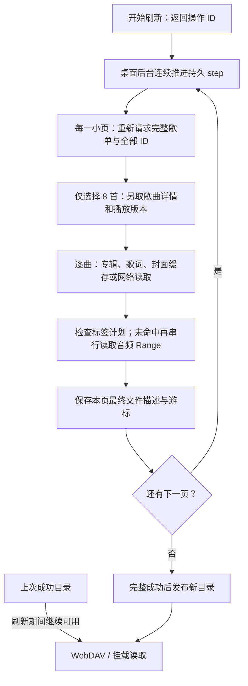
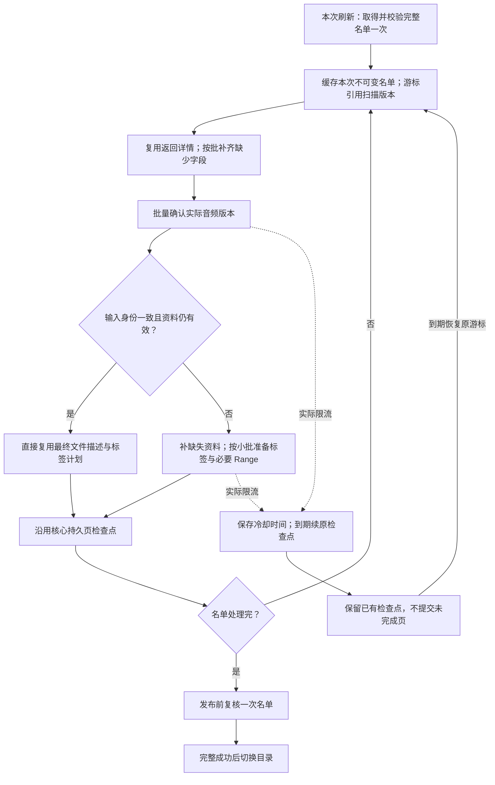

# 大目录刷新性能评估

日期：2026-10-21。基线：`80c38f2`，桌面版 `0.1.0-dev.3`、网易云插件 `alpha.9`、SDK `NeteaseCloudMusicApi 4.32.0`。本文区分当前实现、已有证据与建议方案；**优化尚未实现**，不改变已冻结发行包。

用户场景：本地桌面版，网易云“喜欢的音乐”，约 4,000 首，单个目标音质。目标是缩短刷新等待、减少平台请求，同时保留基础音乐资料、封面、歌词，以及准确的文件大小和 Range 读取。并非高并发服务，不以提高平台请求压力换取测速结果。

## 结论与证据边界

优先做网易云插件内部的局部重构：**一次取得本次曲目名单，批量补齐缺少的详情，复用已准备的文件，只为需要更新的部分准备标签**。保留核心现有持久分页、取消和完整目录发布，不另建任务系统。

已确认的请求放大足以解释为何大目录值得优化；尚未取得用户这次 4,000 首刷新的分阶段计时或 429 记录，不能断言平台限流是主因，也不能承诺具体加速倍数。当前证据排序如下：

1. **已确认：完整名单被逐小页重复请求。** 单音质每页 8 首，4,000 首需要约 500 页；每页重新取得完整歌单并散列全部 ID。
2. **已确认：目录准备串行承担大量文件准备工作。** 取得详情、可用音质后，逐曲等待专辑、歌词、封面，再探测音频头尾，生成最终标签计划。
3. **已确认：缓存复用点偏晚。** 即使最终标签计划仍在，也先读取、必要时重新下载资料并解码封面，才检查能否复用计划。
4. **尚未证实：实际平台限流或网络异常占主导。** 代码识别部分 429，但缺少持久冷却；本次离线复现没有真实平台流量，不能提供实际限流证据。

默认每目录预算为 1,000 页，本次单音质约 500 页**没有触及上限**。多音质会进一步缩小歌曲页，属于另一个规模边界；提高页数上限不能解决请求放大。

## “完整歌单”到底包含什么

当前 SDK 的 `playlist_detail` 请求 `/api/v6/playlist/detail`，参数中固定 `n: 100000`。这个较大的请求参数并不保证所有歌曲的完整资料都在响应中。SDK 随包文档明确区分完整 `trackIds` 与可能不完整的 `tracks`；其 `playlist_track_all` 实现也是先取名单，再调用歌曲详情，并不是平台一次返回全部所需信息的新接口。[上游文档](https://binaryify.github.io/NeteaseCloudMusicApi/)

| 数据 | 歌单详情能否直接解决 | 当前处理与减少请求的方法 |
|---|---|---|
| 曲目 ID、出现顺序、曲目数 | 以返回结果校验为准；当前检查 `trackIds.length === trackCount` | 每次刷新冻结一次名单；不在每个 8 首小页重新拉全量 |
| 歌名、歌手、专辑等歌曲字段 | `tracks` 可能只包含一部分歌曲；字段也需逐项检查 | 复用已有有效详情，只批量查询缺少的 ID；按 ID 重组，不假定响应顺序 |
| 专辑艺术家、发行日期、原专辑曲号等 | 一部分可来自歌曲字段，缺少时仍需来源资料 | 字段足够就不请求专辑；否则按专辑复用 |
| 完整音频是否可用、实际音质、格式、大小、音频身份 | 不能仅凭歌单字段确认 | 仍经可批量的播放版本接口确认，不将临时 URL 当内容身份 |
| 封面 | 通常是地址，不是内嵌标签所需图片字节 | 同一地址/版本复用图片；不是每首、每音质重新下载 |
| 原文、译文、罗马音歌词 | 当前歌曲/歌单接口不能替代歌词接口 | 按歌曲缓存，保留来源已有时间轴 |
| 原文件标签与容器区段 | 歌单不提供 | 首次生成对应表示时读取必要 Range；已有有效计划不重探测 |

上表不意味着必须为每首歌分别请求所有接口。当前 `musicTags` 已能在字段足够时省略专辑请求，也按专辑/歌曲缓存；问题在于名单和详情的复用不足，以及缓存与准备流程的组合方式。

本次没有保存该用户当前歌单的原始详情响应，因此不宣称其中 `tracks` 的实际条数，也不把上游文档中的历史固定条数当作当前平台保证。具体检查点是返回 ID 是否完整、哪些字段可直接复用。

## 当前流程及放大位置

刷新已经异步化：管理入口返回 `202 + operationId`；SQLite/D1 保存进度和分页条目；桌面后台在页面关闭后继续推进。音频读取本身也已经使用 Stream。重新“加异步”或改为 SSE，不会消除上图中的平台工作量。

前端轮询进度并发起串行 step，桌面后台也会推进，但同一持久任务由租约认领，不能仅凭这两个驱动就认定存在两倍平台调用。每页追加暂存条目，最后切换发布指针，也不是每页重写整份已发布目录。

### 离线机制复现

使用真实 `catalog.list → musicTags → tagFile → audio-tags.prepare`，在客户端传输 seam 注入本地数据；不经过真实 HTTP、SDK 加密或数据库。输入名单为 4,000 首，但**只执行前两页 16 首**，全部为单音质可用 MP3，每首属于不同专辑。结果是请求数量证据，不是网络耗时或用户的专辑分布。

| 前两页的受控场景 | 名单/详情/播放等基础调用 | 专辑/歌词/封面 | 音频 Range | 合计 |
|---|---:|---:|---:|---:|
| 冷缓存 | 7 | 48 | 48 | **103** |
| 资料与标签计划均命中 | 7 | 0 | 0 | **7** |
| 资料 TTL 过期，但标签计划保留 | 7 | 48 | 0 | **55** |

7 次基础调用包括定位喜欢歌单 1 次、完整名单 2 次、歌曲详情 2 次、播放版本 2 次。样本 MP3 每个准备需 3 个 Range；不同真实格式和原标签布局会不同。

结果保存在[离线计数数据](../verification/data/refresh-cost-2026-10-21.json)。本机诊断脚本保存于忽略目录 `.musicfs/refresh-evaluation/probe.ts`，运行 `bun .musicfs/refresh-evaluation/probe.ts --assert-efficient` 可让“第二页再次拉全名单”的当前行为报 `BASELINE_RED`。它是临时机制探针，不加入正式测试或发布工具。

在上述“单目标全部可用、没有额外音质回退”的模型下，全目录即使资料和计划全命中，基础调用仍为 `1 + 500 × 3 = 1501` 次；累计处理约 200 万个名单 ID。**这是代码路径推算，不是实际对用户账号发出的请求计数**。不可将 103 次简单乘以 250 当作真实冷刷新请求量：专辑复用、未导出曲目、格式与音质回退都会改变数量。

已有[两首真实歌曲的本地记录](../verification/metadata-implementation.md#最新插件的本地限定测速)中，冷准备 1,516 ms / 22 次请求，热准备 254 ms / 5 次请求；冷准备约 90% 墙钟用于来源 fetch 和响应体等待，SQLite 插件缓存不足 1%。该历史样本使用三个目标音质和固定名单输入，不覆盖本次完整歌单，也不足以排除大数据库的其他成本。

## 建议流程与模块责任

本次扫描版本属于插件的工作数据，核心继续只理解游标、条目和文件。歌曲详情批量大小、一次补标签处理量、核心发布粒度是三件不同的事；不能用一个 `pageSize` 同时控制全部成本。

| 所有者 | 负责的改变 | 保持的边界 |
|---|---|---|
| 网易云 `catalog` | 本次名单、顺序、详情批量、游标和扫描版本 | 不操作核心快照表，不导入 SQLite/D1 |
| 网易云 `metadata/tagged/media` | 资料新鲜度、实际版本、标签计划的快速复用 | 不把来源字段、音质或歌词规则上移核心 |
| 可选 `audio-tags` | 减少同次准备的重复/相邻 Range，保留精确区段映射 | 不认识账号、歌单、平台限速；不缓存整曲 |
| `library.refreshes` | 现有检查点、取消、完整发布；后续增加通用冷却时间 | 不实现网易云重试规则，不另建任务状态机 |
| 宿主与 WebUI | 到期唤醒、公开进度与取消 | 不在页面另建持久队列；音频流不进入目录准备队列 |

### 第一批：先减少平台工作量

1. **名单一次获取，结束复核一次。** 缓存本次冻结的有序 ID，后续页通过游标引用它。重复曲目的出现位置仍保留。旧实现每页检查变化；新方案调整为扫描开始和发布前检查，若发生变化则保留旧完整目录，已经准备的文件计划可供下次复用。上游和本地之间本来没有事务快照，不声称结束复核能锁定平台数据。
2. **直接复用有效 `tracks`，只补缺少详情。** 详情查询先以约 100 首的有界批次作为候选，与 8 首标签准备页解耦；SDK 源码注释的“不要超过 1000”仅是工具提示，不作为平台承诺，更不直接一次提交 4,000 首。保留现有缺失 ID、顺序与完整性处理。
3. **复用现有插件缓存，不缓存一个巨大的原始响应。** 4,000 个有序 ID 可以紧凑保存；详情按需要的字段分块。宿主当前单条缓存上限为 1 MiB，不能把整份歌曲详情盲目写成一个值。本次扫描缓存的寿命必须覆盖可恢复分页，不能机械照搬每日推荐的 30 分钟 TTL。

仅将名单调用从 500 次减为 2 次，前述理想热模型就从 1,501 次减到 1,003 次；再将详情从 500 个小批减为最多 40 个 100 首批次，变成约 543 次。这个模型**仍保留原来的 500 次播放版本调用**，也未计入实际详情复用；说明无需增加并发就能减少大量基础调用，不是完整实现后的性能承诺。

### 第二批：准备结果复用及剩余串行等待

- 将可复用的最终文件描述/计划索引查找前移。输入至少覆盖本次基本资料指纹、实际音频内容身份、标签编码版本和资料新鲜度；不能只按歌曲 ID 命中，也不能因为名单没变就断言音质权益、歌词和文件字节都没变。
- 有效计划直接返回，避免每次命中前反复解析大 JSON、解码封面并重新计算同一标签输入。当前 24 小时内的资料缓存可先保持语义不变，优化查找顺序。
- 分开处理名单、歌曲资料、可用版本、封面、歌词与不可变计划的寿命。封面按 URL/版本标识长期复用、歌词独立校验周期是候选策略；这会改变“何时看到来源修订”，需随实现明确记录，不能将“刷新”悄悄变成永远读旧资料。
- 音频播放版本本来支持多个 ID；详情批量与播放批量可以各自调整。临时 URL 的有效期、首次冷准备耗时和来源实际支持决定能否跨小页复用；不把短期地址写入长期文件引用，不直接套用歌曲详情的批次上限。优先降低热刷新时的版本解析往返，再处理冷准备的地址复用。
- Range 读取做同次准备内的有界读前取和已读区间复用，减少“读 10 字节，再读同一个头”等往返。分别比较请求数和读取字节，避免为省请求而给所有歌曲预读大量无用音频。

首次冷准备仍可能逐首获取歌词并探测文件，不能承诺 4,000 首瞬间完成。长期缓存和增量复用主要改善后续刷新及小范围变更；不把标签完整性默认降级掉。

### 第三批：真实限流冷却与进度

目前 API HTTP/body 429 与部分封面 429 会产生 `rate_limited`，但 `Retry-After` 没有传递；音频读取的 429 还会落为一般暂时失败。核心目录刷新直接终止，实例刷新可能转而处理下一个目录，未持久等待。

应由插件将实际来源限流映射为已有 `rate_limited + retryAfterSeconds`。核心记录通用 `retryAt`，保留原检查点并释放租约；桌面到期唤醒，Worker 按既有宿主安排续步。前端轮询/重复 step 也要遵守此时间，防止等待期间继续产生上游请求。没有有效等待提示时使用有界退避；达到重试预算才报告失败，不无限重试，不把进程内 sleep 当持久调度。

先完成请求减法，再评估少量并发，例如从两项准备任务开始。并发上限与单位时间请求额度是不同约束；没有公开且可信的安全速率，不能声称某个固定 QPS 不会触发限流，也不做逐步加压找阈值。请求队列须停止安排后续工作并收拢已启动任务，成功资料可保留，失败小页不部分发布。

界面沿用现有轮询，优先显示已处理曲目、已知总量、缓存复用和实际冷却剩余时间。新增总量/等待投影时保持通用合同，不让核心解释“网易云歌词”；不为了进度动画先引入 SSE 或 WebSocket。

## SDK 可以修改，如何选择

用户已明确允许修改 SDK。原样使用 SDK 不是架构约束；应比较**真实平台工作量、正确性、可维护性和限流影响**。

| 候选 | 评估 |
|---|---|
| 插件扫描/准备重组，复用既有原生批量接口 | **首选。** 已确认能减少重复请求，改变范围小；需要的局部 SDK 适配一起做 |
| 定制歌单请求，减少不使用的返回字段 | 可作为 SDK 局部改动；先确认仍有完整有序 ID，不能假定调小 `n` 会保留所需数据 |
| 换用 `likelist` 取得喜欢 ID | SDK 注明无序；不能直接替换有序喜欢歌单，否则文件序号与顺序改变。只有接受排序语义变化才考虑 |
| 改用 `playlist_track_all` | 锁定 SDK 内部仍是名单 + 歌曲详情；逐页调用会继续重复取名单，不是独立解法 |
| `/api/batch` 合并多种接口 | SDK 有 wrapper 不等于减少平台内部工作或限流计数；当前按路径键组织，也不能直接视作任意数量同路径歌词的批处理。暂不作为主方案 |
| 替换/维护整个 SDK fork | 现有加密和少量端点已工作，尚无证据表明整体替换优于局部适配；不为此下载或打包整套上游源码 |

必要变更应保存在插件本地适配模块或可追踪的依赖补丁，保留固定版本与相应许可；不手改 `node_modules` 或生成文件作为唯一成果。继续复用现成请求编码/加密能力，具体端点参数可以修改；若改到加密或登录协议，则单独核对实际兼容性，而不是扩大本轮性能改造范围。

## 其它路线与第三方依赖

| 路线 | 选择及原因 |
|---|---|
| 单纯增加异步后台 | 当前已经具备；保留现有实现 |
| 缓存、批量、按输入复用 | **主要路线**，直接减少平台请求和重复准备 |
| 小并发与速率控制 | 请求减法之后按剩余瓶颈采用；不并发提交 4,000 个 Promise |
| 流式音频 | 已实现；继续使用准确 Range 与 Stream |
| 流式列表/部分目录立即发布 | 能改善首屏，但涉及顺序、删除、失败及新旧目录语义，不是本轮默认调整；必要时先做管理界面预览，不发布不完整文件事实 |
| 首次播放才补标签 | WebDAV Depth:1 `allprop` 会先取每个文件的大小等属性，成本可能转移到整目录 `stat`；不能保证只播放一首才准备一首，也不能先报原大小再输出带标签字节 |
| 整曲下载、转码、额外对象存储 | 当前工具只需要元数据区段，没有必要作为默认方案 |
| 新任务队列服务、Redis、通用调度框架 | 已有 SQLite/D1 检查点和宿主 runner，增加另一所有者收益低 |

若确需进程内请求队列，[p-queue](https://github.com/sindresorhus/p-queue) 已提供并发上限、时间窗额度、暂停和取消支持，优于手写完整限速器。但它不代替持久检查点，也不提供跨 Worker 调用的一致性。

只需限制同时执行数时，[p-limit](https://github.com/sindresorhus/p-limit) 更小；它不能单独提供平台请求速率控制。[p-retry](https://github.com/sindresorhus/p-retry) 可处理进程内退避，但本项目应只有核心持久操作拥有跨页重试，避免叠加两层重试。此评估没有安装新依赖；如采用，先做一次双宿主导入/打包检查。

桌面是当前优化对象。Worker 仍有独立请求生命周期和执行预算，不能把桌面连续处理循环直接搬进去；共用数据准备逻辑，保留宿主自己的有界推进。[Worker 官方限制](https://developers.cloudflare.com/workers/platform/limits/)

## 实施与必要验证粒度

建议分三次可审查提交：

1. 名单扫描缓存、复用已有详情、有界详情批量；先不提高并发，不改核心公开合同。
2. 标签计划快速复用、资料寿命整理与 Range 请求减法；按测得收益选择播放版本批量，保留旧引用的精确字节语义。
3. 持久限流冷却和必要进度；若剩余等待仍值得优化，再加入成熟库支持的小并发。

每步采用能区分前后行为的离线检查：两页不再重复拉名单，缺少详情才请求，计划命中不重新读取资源字节，来源 429 不继续推动同一操作，取消/重启后沿原检查点恢复。文件侧复用既有代表格式的大小、Range 和音频不变回归，不新增不受支持格式或平台压力测试。

真实来源只需一次小批兼容确认；随后在用户正常刷新时汇总阶段耗时、请求分类、缓存命中和限流等待，不额外重复刷新 4,000 首来跑基准。计数覆盖单次操作而非长期开启逐请求日志。若真实结果显示数据库或 UI 渲染占主导，再按该证据处理，不提前建设另一套缓存/可观测系统。

## 本次核对入口

- [网易云列表与小页](../../plugins/netease/catalog.ts)、[资料缓存](../../plugins/netease/metadata.ts)、[标签计划](../../plugins/netease/tagged.ts)、[播放解析与 Range](../../plugins/netease/media.ts)、[请求与错误](../../plugins/netease/client.ts)。
- [核心持久刷新](../../src/core/library/refresh.ts)、[追加页与完整发布 SQL](../../src/infrastructure/persistence/refresh-sql.ts)、[插件缓存](../../src/core/sources/cache.ts)、[桌面 runner](../../src/hosts/desktop/background.ts)、[页面续步与进度](../../src/web/components/refresh.tsx)。
- [格式准备](../../packages/audio-tags/src/prepare.ts)、[独立插件构建](../../scripts/build-netease.ts)；SDK 随包 `module/playlist_detail.js`、`playlist_track_all.js`、`song_detail.js`、`likelist.js`、`batch.js` 及 `public/docs/home.md`。
- [持久分页 ADR](../adr/0007-durable-paged-refresh.md)、[可选补标签设计](audio-tags.md)、[已有本地小样计时](../verification/metadata-implementation.md)。
