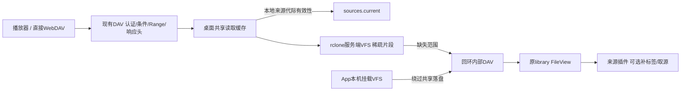

# 桌面WebDAV共享读取缓存

状态：dev.11正式接线，Worker保持原流式路径。模块为`src/hosts/desktop/read-cache.ts`；使用随包rclone1.75.2的`serve/start`及VFS full，没有新字节存储依赖或自制分块引擎。

## 所有权与调用

对外仍使用原MusicFS DAV，不替换为rclone对外协议。目录/HEAD/条件请求及错误映射继续由原DAV处理，字节读取由桌面Adapter替换。来源插件和插件API无需变更，缓存最终表示字节而非平台原始URL，现有格式共用机制。内部HTTP服务无需WinFsp/FUSE；仅App磁盘挂载继续依赖相应系统驱动。

内部缓存键为来源实例、epoch、插件身份/revision/generation、fileRef与最终contentId/size/mediaType的SHA256。键路径本身不可变，固定内部mtime仅用于该身份的VFS；外部mtime/ETag保持原值。同路径、大小和mtime不变但contentId变更时仍进入新键。换号/配置/插件修订后核对既有来源代际，缓存命中不需要为了核验再解析一次CDN URL。

回环入口只在内存保留有界8192项定位及活动读取；恢复读取前由原文件视图重新登记，不持久化第二套目录事实。256个固定桶减少每个新键的目录枚举范围，新键只forget所属桶；没有从平台枚举全部文件。App内部直读保留原`statMany`批量路径，避免绕过共享落盘时退化为逐首取属性。

## 容量与操作

- 直接DAV：默认16GiB软上限、未访问7天淘汰；默认按需启动原生VFS，不预分配容量、不预下载整曲。128KiB内存预读、1MiB起步递增、ReadAhead0、HandleCaching0s。共享Adapter的LowLevelRetries为1，避免在插件既有重试/限流之上再叠原生多次低层重试。
- App挂载：原每挂载8GiB/7天及已有设置保留；本机挂载的同一次读取不会再写共享层。远程挂载仍自行缓存。两类缓存有独立管理入口及容量，需要按实际使用预算合计磁盘。
- `GET /api/desktop/read-cache`：配置、实际模式、原生路径、bytesUsed/files和采样时间；未启用原生服务时不启动rclone或扫描磁盘，统计可能滞后。
- `PUT`同一路径：保存maxMiB/maxAgeHours，0分别关闭新缓存/禁用时间淘汰；关闭不删除旧片段。
- `DELETE`同一路径：仅正常停止共享serve、删除该固定remote的vfs/vfsMeta；保留音乐资料/标签计划及挂载缓存，下次读取懒启动。

设置、清理和退出需要当前共享读取结束。流完成、取消或请求AbortSignal释放活动计数；退出准备先拒绝新增直接读取，正常卸载失败则恢复接收。挂载和共享服务使用同一受管理RC进程，先卸载、再停止共享服务、最后退出RC；未用共享服务的关闭不删除remote或启动rclone。没有自动重启循环、额外常驻音乐任务或对平台的定时字节预取。

## 证据和实际限制

`bun run scripts/probe-shared-dav-cache.ts`通过正式模块、Library/DAV/SQLite、标签工具、生成的120秒MP3和实际FFprobe完成有限验证。相同/重叠已缓存范围、原生VFS真实重建后的头尾读取均0次源请求；同路径/大小/mtime更新取得新标签；旧来源拒绝；清理/关闭后正常重新取源；活动读取不清理，退出门闩可恢复。

开放GET的客户端会在自行决定的时刻取消，两轮可能读到不同的尾端，rclone还存在有限内存缓冲和区段对齐。因此“重复打开”不等于每次请求完全相同，后一次新增范围仍可取源；不保证FFprobe第二次整个请求零网络，也不把单曲回环耗时外推为真实4000首速度。[匿名计数](../verification/data/shared-dav-cache-2026-10-21.json)

容量应匹配常用扫描工作集。已测Shell单曲约3MiB最终范围，若4000首类似约需12GiB，是默认共享16GiB的取舍依据，仍不是实际用户占用测量。App已有8GiB上限未被静默修改，容量不足时仍可能循环淘汰，需要按实际设置。

首次资料准备、首次/新增范围和淘汰后仍需取源。源HTTP“发送/排队字节”和读取器“实际消费字节”分别记录，不当作精确公网流量。当前受控源计数不是新SDK/平台限流证明；沿用原生递增取流及原插件验证，没有每个缓存存储块都手写一次SDK请求。

Worker没有此磁盘Adapter，未新增R2/KV/D1音频、未部署或测试付费账号。架构共用文件表示和DAV合同，存储差异留在桌面宿主。最终Windows dev.11包（精确构建身份见发行清单）已在现有VM通过：安装仅代理生成音频的离线测试插件，源标签计划可复用、Windows VFS初始为空；首次3MiB及尾部读取后，同范围重读0次源DAV GET；正常退出并重新启动整个App后仍0次；清理后重新取源；本机WinFsp挂载读取字节正确且共享层保持inactive，证明没有同次双层落盘；后台正常退出。[Windows匿名结果](../verification/data/windows-shared-dav-cache-2026-10-21.json)。测试目录与账号隔离，不操作Windows宿主或平台，不将此结果扩成4000首GUI计时或全格式矩阵。

有界Windows样本还暴露有限范围末端的额外预读。仅做128KiB与0内存缓冲对照，两者源正文请求均2次，实际消费约2.47MB/2.38MB，零缓冲并未消除额外请求，未显示值得改变既有播放取舍的收益，保留128KiB。该模型的传输/排队与取消时机不同，不能以其耗时承诺真实播放。已有片段命中不保证未消费的HTTP/内存缓冲也已落盘。[负结果与停止依据](../verification/data/shared-dav-buffer-2026-10-21.json)

三套TypeScript与依赖方向检查通过；桌面启动/网络/HTTPS/挂载25项基础检查通过，随后新增退出门闩、未用不启动和批量元数据路径检查通过（共享管理与Module共7项/20断言）。最初默认执行环境禁止回环监听返回EPERM，改用允许回环的执行环境后通过，没有为环境报错改产品或操作宿主。
