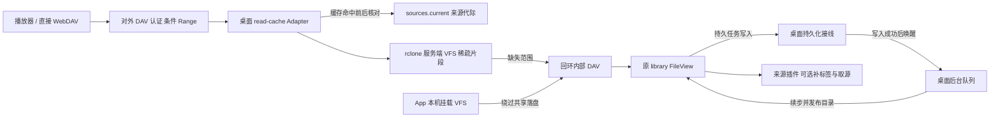

# 桌面 WebDAV 共享读取缓存

桌面 `src/hosts/desktop/read-cache.ts` 复用随包 rclone 的服务端 VFS，缓存直接 DAV 客户端已读取的最终表示片段。对外协议仍由 MusicFS DAV 负责，Worker 沿用来源流；无需新增插件 API、字节存储依赖或自制分块引擎。实测范围与版本见[验证记录](https://github.com/shengyusi-SYS/musicfs/blob/b637d4d19da97e3473942be9ad7925b740afd47a/docs/verification/shared-read-cache.md)。

## 所有权与调用

目录、HEAD、ETag、条件请求和错误映射仍走原文件视图与协议层，只包装 `open`。缓存保存最终表示字节，不保存临时 URL。服务端 VFS 本身无需 WinFsp/FUSE，系统驱动只用于本机磁盘挂载。

内部 DAV 是独立回环监听器，不经过对外管理服务的响应中间件。桌面宿主在持久任务及周期策略写入成功后统一唤醒执行器，不再按 HTTP 路径或响应头决定是否运行任务。公开 DAV、内部挂载、文件属性准备和管理操作共用这条持久化接线；协议层仅返回 `503 / Retry-After` 等读取结果。任务使用后台自身的生命周期，不依赖当前目录请求或 Web 页面继续打开。

内部键由实例/代际、插件身份/修订/代际、文件引用和最终 `contentId/size/mediaType` 组成。不以路径、大小或 mtime 单独判断表示；相同路径和大小的新内容身份进入新键。键不可变，内部固定 mtime 只服务该键，外部 mtime/ETag 保持原值。命中前后沿原 `current` 核对来源有效性，无需仅为验证缓存重新解析 CDN URL。

内部定位使用有界 LRU 与活动读取引用，文件视图在打开前重新登记；不持久化第二套目录。新键只失效所属固定桶的清单。App 内部直读保留原 `statMany`，不退化成逐首查属性。

## 设置与容量

默认容量、期限和各层区别统一在[缓存策略](cache-policy.md)维护。共享层与每挂载缓存独立管理、合计磁盘预算；App 本机挂载同一次读取不再写共享层。原生上限为软上限，统计可能滞后，容量须能容纳常用扫描工作集。

共享 VFS 使用 full 稀疏缓存：128KiB 内存缓冲、1MiB 起步递增、额外 ReadAhead 为零、关闭句柄立即保存范围记录。`LowLevelRetries: 1` 避免在来源插件重试与限流之上叠加原生多轮重试。不开启额外整曲下载。

管理路由为 `/api/desktop/read-cache`：GET 查询，PUT 保存 `maxMiB/maxAgeHours`，DELETE 清理共享片段。容量零关闭新缓存但不删除旧片段，期限零关闭按时间淘汰。查询未运行的服务不启动 rclone 或扫描磁盘；清理只删除该固定 remote 的 `vfs/vfsMeta`，不删除资料、标签计划或挂载缓存。完整接口见[管理 API](../management-api.md)。

## 生命周期

流完成、取消或请求中止均释放活动读取；保留背压、实际范围和长度检查，内部 rclone 错误映射回原领域错误。配置及清理只在共享读取空闲时执行。

容量为零只关闭字节缓存，仍从`open`准备阶段跟踪在途读取，直至流完成、失败或取消后释放。退出/清理门禁在两种模式下相同；关闭缓存不计算缓存键、不启动rclone，复用同一流生命周期处理。

挂载和共享服务复用同一受管理 RC 进程，由装配层拥有进程关闭权。退出准备先拒绝新增直接读取，再正常卸载、停止共享服务、关闭 RC；卸载失败恢复接收。未曾启用共享服务的关闭不创建或删除 remote；异常遗留服务仅核对并停止本模块拥有的 remote，不引入自动重启框架。

## 能力边界

首次资料准备、新范围、版本变化和淘汰后仍可能取源。开放 GET 的取消时机、预读及区段对齐可使再次打开取得不同范围，不能承诺任意第二次打开零网络。HTTP 源排队、读取器消费和 VFS 实存是不同计数；已缓存一段不代表整曲已保存。

不将单曲回环或 VM 结果外推为真实全库 GUI 耗时，也不将桌面磁盘收益外推为免费 Worker 成本。候选比较及重开条件见[缓存决定](https://github.com/shengyusi-SYS/musicfs/blob/b637d4d19da97e3473942be9ad7925b740afd47a/docs/planning/cache-optimization.md)。
