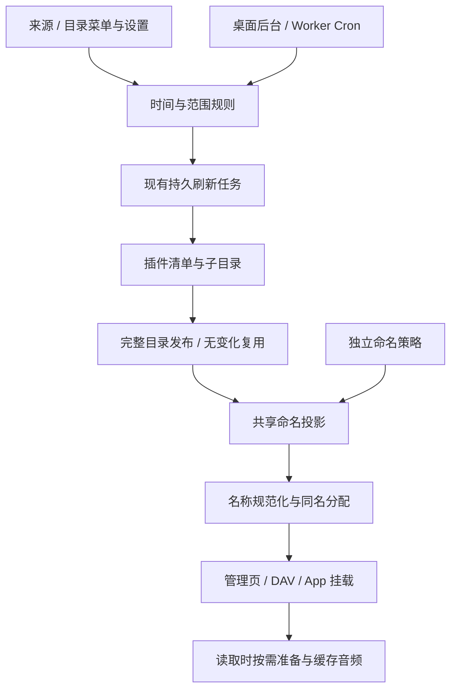

# 自动更新与文件命名

更新规则、目录执行、命名展示和实际音频各有独立所有者。桌面与 Worker 使用相同领域逻辑，宿主只负责唤醒和执行预算。

## 模块与职责

| Module | 拥有的行为 | 不承担的行为 |
|---|---|---|
| `library/update-timing` | 校验时间安排，用 Croner 计算下次时间 | 不注册原生计时器、不执行平台请求 |
| `library/schedules` | 管理范围、启停、到期和完成后的下一次安排 | 不另建分页、重试或发布系统 |
| `library/refresh` | 持久分页、完整遍历、限流等待、取消、完整目录发布 | 不解释模板和 UI 格式选项 |
| `library/file-naming` | 校验 Mustache 模板、资料填充、继承、预览和稳定命名身份 | 不取得歌词、封面或音频，不修改来源配置 |
| `published-views` / `names` | 目录投影、跨平台名称及同名分配、按预算复用索引 | 不修改不可变来源快照与文件引用 |
| SQLite / D1 Adapter | 同一套条件 SQL、规则与任务的持久关联、展示配置 CAS | 不持有宿主定时器 |

## 时间、范围与任务

时间安排支持自定义间隔、每天时刻、指定星期及时区。间隔从上次任务终态时间起算；日历安排保持选定时刻。退出后台期间错过的安排合并补一次，计划开始不等于完成时间。

范围区分入口清单、单目录、目录及全部后代、整个来源实例。全实例和递归目录包含本轮新发现的目录，并复用待处理/已见集合避免循环；普通目录刷新仍只更新本层。音乐资料强制刷新、文件准备仍是已有的独立操作。

迁移 `0013.sql` 将旧周期规则转为新规则，保留更新范围和第一次待执行时间。旧实例规则仍是入口清单，升级不扩大为全库。规则到期的消费和任务关联在同一条件提交中完成，不能先推迟下次时间再尝试建队。

同实例只有一个活动刷新。完整实例任务可覆盖目录规则，同目录递归任务可覆盖该目录单层规则，匹配时持久关联同一工作；其他不透明目录引用不猜测祖先关系，等待现有工作结束。任务冷却、失败和重试继续由刷新模块拥有，界面单独显示部分目录失败数。

桌面规则写入后唤醒已有 runner，关闭网页不影响执行。Worker 原生 Cron 每次推进一项工作，规则与页面共用持久队列，不增加付费基础设施。相同内容继续保留原发布身份与索引。

## 模板与插件合同

API `0.1.11` 增加可选的 `SourcePlugin.naming.fields` 字段说明和文件 `Entry.naming = { identity, fields }`。网易云、QQ 从现有清单提供这些资料，插件无须为命名增加网络请求。旧插件及没有命名资料的旧快照继续保留原名；`originalName` 可独立用于旧文件的名称主体。

用户填写 `{{title}} - {{artist}}` 等模板，Mustache 负责变量和条件块语法。渲染使用普通文本，不进行 HTML 实体转义；真实扩展名自动追加，之后进入现有 `sanitize-filename` 与完整目录同名分配。缺失字段为空，整体为空回退原名。

实例默认和单个真实目录覆盖存放在 `file_naming_policies`（迁移 `0014.sql`）。清除目录设置恢复继承，保留修订号，旧表单仍不能覆盖新设置。相同设置不写入。命名配置不进入插件内容配置、来源 epoch 或最终音频身份。

同名后缀使用来源媒体/音质身份及同曲出现次序，不依赖全歌单位置；不用 `index` 时，无关前部增删不再改变这些后缀。实际新同名、资料更正或相同重复项变化仍可能改名，不维护永久别名数据库。

## 预览、缓存与界面

来源和目录菜单打开共用编辑器，规则集中在设置页管理。命名支持自由模板、字段插入、可编辑预设和折叠格式选项；不增加首次使用步骤或顶层导航。

一个来源的同一范围共用一条更新规则。编辑器按所选来源与范围载入时间安排：已有规则直接编辑，没有则新建；切换范围不迁移或删除原规则。不再额外选择规则、显示重复范围警告或要求重开编辑器。后端用 `update_rule_exists` 及已有规则 ID 表达重复创建，界面重新载入该范围的规则，不将其解释为来源状态过期。

预览只读取已发布快照。实例预览选择一个已加载且继承实例设置的文件目录，不展开全来源，也不把已有目录覆盖算成将要改名。目录预览使用明确的当前目录。修改前与修改后均使用完整目录名称分配，界面只显示有限行；没有资料时提示当前没有可预览内容，不自动请求来源。

展示策略随现有快照头查询取得，SQLite/D1 使用两个索引关联，不为每个条目新增配置查询。路径索引键包含有效策略，变更只重建受影响目录的投影，不改变快照、文件引用、属性或音频 ETag。

桌面改名通过已有布局/快照定位实际可见路径，再通知本机挂载清单失效；定位也使用相同命名投影，保持同名目录正确。按路径缓存的 rclone/播放器可能重新识别，按最终表示键的缓存可保留。外部 DAV 客户端重列目录仍服从其自身缓存策略。

实现范围与离线证据见[验证记录](../verification/updates-and-naming.md)。
