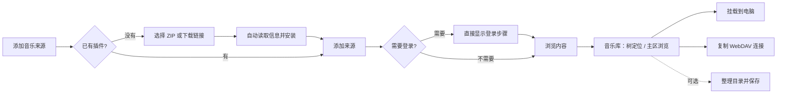
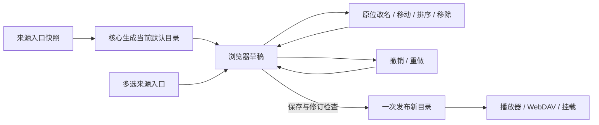

# 共用管理界面

## 交互方向

面向个人用户的音乐文件服务，沿用已确认的 Ant Design、浅色、青绿色和左侧导航。来源管理、内容浏览与播放器目录合并为“音乐库”树形工作区；连接、插件和设置保留独立入口。插件 ID、接口版本、缓存目录等信息按需展开。

Design Read：保留视觉体系、重构信息架构；视觉变化 3、动效 1、信息密度 7、素材依赖 1、品牌延续 9。树导航、紧凑列表和上下文设置增加每屏有效信息，动效只承担状态切换。沿用 MusicFS 文字标识、系统中文字体与既有配色，不引入外部素材、字体或新组件库。

色彩保持工作区 `#f4f6f5`、面板 `#fff`、正文 `#1d302e`、辅助文字 `#60716e`、边界 `#dce4e1`、主操作 `#147d74`。8px 间距基线，控件圆角 8px、面板 12px，状态色由 Ant Design 承担。移除重复顶栏、面包屑式页面标题和固定说明段落。

## 形态比较与选择

| 方向 | 收益与代价 | 决定 |
|---|---|---|
| 保留两个页面，改善互相跳转 | 改动小，但浏览内容、管理来源和导出布局仍反复切换 | 不采用 |
| 只保留播放器目录树，将来源设置挂在目录上 | 表面最少，但无法管理未导出的来源，也容易混淆移除入口与删除账号 | 不采用 |
| 一个工作区，树中区分来源与播放器目录 | 一处浏览与配置，保留自定义导出布局和全部来源的独立身份 | 采用 |

参考 [VS Code](https://code.visualstudio.com/docs/editing/getting-started/userinterface) 的左侧资源树与主内容分工、[DBeaver](https://github.com/dbeaver/dbeaver/wiki/database-navigator) 的连接/子对象层级，以及 [Nextcloud](https://docs.nextcloud.com/server/stable/user_manual/en/files/access_webgui.html) 的内容列表与详情侧栏。借鉴其交互分工，不复制命令面板、多编辑器、版本历史等与 MusicFS 当前任务无关的能力。

## 用户流程

| 页面 | 默认呈现 | 按需操作 |
|---|---|---|
| 音乐库 | 来源与播放器目录树、当前目录文件 | 上下文设置侧栏、登录、更新、整理目录 |
| 连接与挂载 | 桌面默认挂载，Worker 默认 WebDAV | 远程挂载、缓存、Windows 原生映射 |
| 插件 | 名称、版本、添加来源 | 更新、移除、技术信息 |
| 设置 | 登录账号；桌面另含启动、自动挂载与局域网 | 修改密码、两种启动的页面行为 |

新增来源使用侧栏，创建后进入插件登录或来源节点。只有一个插件时自动选择；显示名称直接填写且有默认值，插件表单仍由其 Schema 决定。

树中“播放器目录”对应对外路径，“音乐来源”对应完整来源内容。来源不在导出布局中也可浏览；展开只读取当前层，歌曲留在主列表，不把数千文件塞进树。树与主区使用同一 Query key；普通浏览不逐入口查询统计，也不读取音频属性。URL 与浏览器历史保存当前位置，前进、后退和重载可回到目录；旧 `?page=sources` 仍进入音乐库。

默认布局可直接浏览。整理在同一入口切换为左侧目录树、右侧内容选择，窄屏使用两栏切换；批量添加、拖动、原位改名、撤销和统一保存保留。未保存草稿在页面切换时保留；保存后才改变对外目录，并回到新布局根目录。完整名称和顺序由后台提供，主列表每页50项；名称筛选只处理当前目录，不发送额外请求。

来源/目录“设置”共用一个侧栏，页签为来源设置、自动更新和文件命名。字段和预览内容与外层呈现分离；同一份规则表单也用于设置页。侧栏不遮罩整个工作区，选择另一目录时关闭旧上下文；新增来源和扫码登录保留聚焦窗口，移除来源只保留一次确认。命名未变化的条目只显示一次，缺字段以预览说明呈现，不额外加警告块。

插件文件选中后自动检查，下载链接在离开输入框或点击继续时检查。默认只展示名称和版本；不兼容时展示原因，安装仍由后端重新校验。后台安装保留原有持久操作跟踪；失效的操作记录不会永久锁住页面。

正常界面展示内容与必要状态；完成提示不反复占据目录页面。进行中的任务显示可理解的处理量和重试时间，失败保留可执行的恢复入口。插件仍拥有登录步骤的具体说明，界面不预设全部来源都采用二维码。

Windows 挂载可留空位置，复用既有自动盘符能力；其他系统填写挂载目录。每个挂载项直接显示自动挂载开关，手动卸载只影响本次。低频操作放入更多菜单，缓存统计与设置使用独立弹窗。局域网集中在设置中，Windows 原生映射保留在 WebDAV 连接下。

## 目录整理

`GET /api/layout/default` 返回当前自动目录的可编辑副本，不保存布局。名称直接使用核心已生成的导出名称，因此同名消歧和可移植路径不由前端重写；每个入口仍有独立节点身份。只读取来源的内容入口，不递归读取歌曲或音频信息。尚无快照时复用既有持久刷新机制。

树操作只改浏览器草稿。一次批量添加保留来源清单顺序，同一内容可出现在不同文件夹中。查找保留上级上下文，移动目标排除自身及下级。当前整理会话保留最近 50 步撤销记录；跨页面保留草稿，关闭页面不额外建立一份前端持久目录库。

## 模块和状态

`src/web` 仅依赖浏览器库、公开插件 DTO 与管理合同，不导入核心或宿主。

- `shell.tsx` 管浏览器会话、四个主入口、退出与跨页面布局草稿；`workspace-navigation.ts` 保留页面 URL 和浏览器前进后退。
- `music-workspace.tsx` 组织音乐库与来源操作；`music-navigation.ts` 区分来源引用与导出路径、保存浏览位置、定义共用查询；`music-tree.tsx` 管展开和筛选，`music-browser.tsx` 管主列表与刷新。
- `music-inspector.tsx` 拥有设置侧栏；`source-editor.tsx`、`update-rule-editor.tsx`、`file-naming.tsx` 各管对应表单与数据。`authentication.tsx` 保留通用登录状态机。
- `layout-editor.tsx` 管草稿、撤销/重做和保存；`layout-sources.tsx` 读取入口并批量选择；`layout-tree.tsx` 负责改名、拖动和显式移动；`layout-draft.ts` 保存纯树操作规则。
- `plugins.tsx` 管理安装后的列表和后台变更；`plugin-installer.tsx` 管理包选择、检查和提交。
- `connection.tsx` 区分挂载与 DAV；`dav-connection.tsx` 管理读取凭据与播放器导入二维码；`mounts.tsx` 管理挂载；`cache-settings.tsx` 复用缓存表单和统计展示；网络与 HTTPS 保留各自模块。
- `settings.tsx` 管理账号和桌面偏好；`phone-access.tsx` 展示已启用的局域网地址与一次性二维码。

TanStack Query 管理服务器状态，普通查询保留30秒新鲜期，显式变更失效相关查询；折叠后不再自动请求隐藏子树。后台快照继续采用原缓存期限；浏览器查询新鲜期不等于平台缓存期限。活动任务维持原轮询和串行推进。来源浏览新增浅目录管理接口，复用核心已发布视图与命名投影，不改变布局、插件协议、认证或挂载机制。RJSF 继续承载插件 Schema。

桌面入口与手机二维码经 URL fragment 传入一次性 ticket，兑换 HttpOnly Cookie 后清除链接片段；旧令牌入口可换取同一会话。退出保留访问状态查询的观察者，清理其余工作区缓存，再重新查询登录入口。账号与会话均由后台保存，前端不另建长期凭据库。完整流程见[管理访问](management-access.md)。

本轮走查和截图见[音乐库工作区核对](../verification/music-workspace.md)；早期界面与目录整理的证据分别保留在[界面重构记录](../verification/ui-redesign.md)、[目录整理工作区](../verification/directory-workspace.md)。
