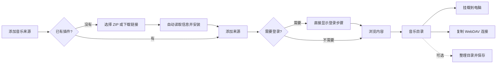

# 共用管理界面

## 交互方向

面向个人用户的音乐文件服务，沿用已确认的 Ant Design、浅色、青绿色和左侧导航。此次重构调整信息架构和使用流程：让用户先连接音乐、浏览目录，再选择播放器或本机挂载。插件 ID、接口版本、缓存目录等信息按需展开。

Design Read：既有产品的整体交互重构；视觉变化 3、动效 1、信息密度 6、素材依赖 1、品牌延续 8。主要面向桌面浏览器，窄屏保留完整操作。沿用 MusicFS 文字标识、系统中文字体与既有配色，不引入外部素材、字体或新组件库。

色彩保持工作区 `#f4f6f5`、面板 `#fff`、正文 `#1d302e`、辅助文字 `#60716e`、边界 `#dce4e1`、主操作 `#147d74`。8px 间距基线，控件圆角 8px、面板 12px，状态色由 Ant Design 承担。移除重复顶栏、面包屑式页面标题和固定说明段落。

## 用户流程

| 页面 | 默认呈现 | 按需操作 |
|---|---|---|
| 音乐来源 | 来源名称、浏览内容 | 来源设置、登录、退出登录、删除 |
| 音乐目录 | 当前可用文件夹、目录导航 | 整理目录、更新、定时更新 |
| 连接与挂载 | 桌面默认挂载，Worker 默认 WebDAV | 远程挂载、缓存、局域网、Windows 原生映射 |
| 插件 | 名称、版本、添加来源 | 更新、移除、技术信息 |

来源创建后直接进入插件登录或内容浏览。只有一个选项时自动选择；显示名称有默认值，插件表单仍由其 Schema 决定。配置返回失败时展示实际错误，不把 HTTP 成功误当成配置成功。

默认布局即可浏览，无需先创建自定义布局。布局编辑在抽屉中完成，未保存修改与当前浏览路径在页面切换时保留；保存后才改变对外目录。完整目录和顺序仍由后台提供，列表每页 50 项。超过 10 项时可按名称本地筛选，不发送额外请求、不改变原顺序。

插件文件选中后自动检查，下载链接在离开输入框或点击继续时检查。默认只展示名称和版本；不兼容时展示原因，安装仍由后端重新校验。后台安装保留原有持久操作跟踪；失效的操作记录不会永久锁住页面。

正常界面展示内容与必要状态；完成提示不反复占据目录页面。进行中的任务显示可理解的处理量和重试时间，失败保留可执行的恢复入口。插件仍拥有登录步骤的具体说明，界面不预设全部来源都采用二维码。

Windows 挂载可留空位置，复用既有自动盘符能力；其他系统填写挂载目录。缓存参数采用已有默认值。低频操作放入更多菜单，缓存统计与设置使用独立弹窗。局域网和 Windows 原生映射位于 WebDAV 连接下，只有展开后才加载相应设置。

## 模块和状态

`src/web` 仅依赖浏览器库、公开插件 DTO 与管理合同，不导入核心或宿主。

- `shell.tsx` 管理工作区、服务切换、退出，以及跨页面的浏览位置与布局草稿；`workspace-navigation.ts` 处理四个页面的 URL 和浏览器前进后退。
- `sources.tsx` 组织来源列表；`source-editor.tsx` 管理创建和配置；`source-content.tsx` 负责内容与刷新；`authentication.tsx` 负责通用登录状态机。
- `library.tsx` 浏览当前目录；`layout-editor.tsx` 编辑布局；既有 `layout-draft.ts` 保留树操作规则。
- `plugins.tsx` 管理安装后的列表和后台变更；`plugin-installer.tsx` 管理包选择、检查和提交。
- `connection.tsx` 区分挂载与 DAV；`mounts.tsx` 管理挂载；`cache-settings.tsx` 复用缓存表单和统计展示；网络与 HTTPS 保留各自模块。

TanStack Query 管理服务器状态，普通查询保留 30 秒新鲜期，显式变更继续失效相关查询；活动任务维持原轮询和串行推进。状态 DTO、插件协议、后端刷新、认证与挂载机制未改变。RJSF 继续承载插件 Schema，字段说明折叠展示，后端校验是权威。

管理令牌继续经 URL fragment 导入并立即移除，当前标签使用 sessionStorage。切换服务清空查询与工作区草稿。真实来源、账号、音质与缓存内容由后台保存，前端不另建一套持久模型。

各环节的备选方案与取舍见[UI / UX 决定](../../outputs/musicfs-ui-ux-decisions.md)，实际走查范围和截图见[界面重构记录](../verification/ui-redesign.md)。
