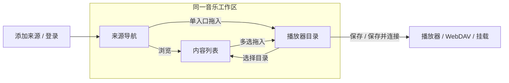
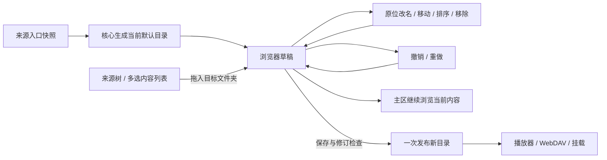

# 共用管理界面

## 交互方向

面向个人用户的音乐文件服务，沿用已确认的 Ant Design、浅色、青绿色和左侧导航。来源管理、内容浏览与播放器目录合并为“音乐库”树形工作区；连接、插件和设置保留独立入口。插件 ID、接口版本、缓存目录等信息按需展开。

界面支持简体中文和英文，首次跟随浏览器语言，可在登录页和工作区切换。组件、校验、日期及插件显示资料的统一处理见[国际化设计](i18n.md)。

Design Read：保留视觉体系、重构信息架构；视觉变化 3、动效 1、信息密度 7、素材依赖 1、品牌延续 9。树导航、紧凑列表和上下文设置增加每屏有效信息，动效只承担状态切换。沿用 MusicFS 文字标识、系统中文字体与既有配色，不引入外部素材、字体或新组件库。

色彩保持工作区 `#f4f6f5`、面板 `#fff`、正文 `#1d302e`、辅助文字 `#60716e`、边界 `#dce4e1`、主操作 `#147d74`。8px 间距基线，控件圆角 8px、面板 12px，状态色由 Ant Design 承担。移除重复顶栏、面包屑式页面标题和固定说明段落。

## 形态比较与选择

| 方向 | 收益与代价 | 决定 |
|---|---|---|
| 独立主导航，再并排来源、内容、播放器树 | 四块横向区域，常用来源在中等窗口被藏起，内容区域窄 | 移除独立来源列 |
| 一棵树切换来源与播放器目录 | 占用小，但整理时看不到来源和目标，拖拽需要来回切换 | 不采用 |
| 左侧合并导航，中间浏览，右侧按需整理 | 日常浏览保留宽列表，整理时来源与目标同时可见 | 采用 |

参考 [VS Code](https://code.visualstudio.com/docs/editing/getting-started/userinterface) 的左侧资源树与主内容分工、[DBeaver](https://github.com/dbeaver/dbeaver/wiki/database-navigator) 的连接/子对象层级，以及 [Nextcloud](https://docs.nextcloud.com/server/stable/user_manual/en/files/access_webgui.html) 的内容列表与详情侧栏。借鉴其交互分工，不复制命令面板、多编辑器、版本历史等与 MusicFS 当前任务无关的能力。

## 用户流程

| 页面 | 默认呈现 | 按需操作 |
|---|---|---|
| 音乐库 | 左侧来源导航、当前目录文件 | 展开右侧播放器目录、原位编辑、批量添加、上下文设置 |
| 连接与挂载 | 桌面默认挂载，Worker 默认 WebDAV | 远程挂载、缓存、WebDAV 读取访问与凭据、播放器扫码、Windows 原生映射 |
| 插件 | 名称、版本、添加来源 | 更新、移除、技术信息 |
| 设置 | 登录账号；桌面另含启动、自动挂载与管理页面访问 | 修改密码、两种启动的页面行为、管理范围与端口 |

新增来源使用侧栏，创建后进入插件登录或来源节点。首次接入缺少插件时先安装，成功后直接接着填写来源；普通插件安装仍停在插件页。异步安装将接续意图与操作 ID 一起保存在当前会话中，重载后仍可继续。只有一个插件时自动选择；显示名称直接填写且有默认值，插件表单仍由其 Schema 决定。

音乐库左栏合并主导航与来源树：页面入口为紧凑的两行导航，下面直接选择账号和歌单，添加来源也在此处。中间只保留内容浏览；右侧播放器目录初次默认收起，点击顶部「播放器目录」展开，记住当前浏览器的开合选择和调整后的宽度。两侧栏独立滚动，不再让主导航额外占据一列。

宽度不少于992px时，右栏与内容通过 Ant Design Splitter 调整宽度。768—991px 保留左侧来源树，播放器目录按需打开抽屉；更窄时来源也用抽屉打开。来源抽屉发起添加时先关闭导航，再呈现表单。内容浏览器在面板开合与宽度变化时保持挂载，收起的树停止查询。

来源入口可从来源树、入口标题或主列表拖进播放器文件夹；列表勾选多项后拖动其中一项，一次加入所选入口。布局节点在同一区域拖动移动；文件夹中部表示移入，上下边缘表示排序，分别显示目标高亮或插入线。拖拽预览区分「添加」和「移动」，按钮与显式移动菜单保留相同操作。来源入口和具体歌单、专辑等子目录均可添加，嵌套目录沿用同一套多选与拖拽；歌曲保持只读。

树的展开与内容选择分开：点击箭头只展开当前层，点击名称才切换中央内容。拖拽在播放器文件夹中部停留600ms会展开其子项，离开或结束拖拽时取消计时；只展开本地布局文件夹，不借拖拽扫描来源内容。「添加到…」显示所选名称，并允许在选定位置直接新建文件夹；新建与添加共同提交为一步草稿操作，取消弹窗不留下空文件夹。添加完成后展示播放器目录，窄窗口直接打开结果抽屉，保存入口随结果呈现。

新建文件夹在播放器栏标题中，立即原位输入名称；编辑排列时保留来源列表和勾选，拖入后展开目标。拖动、改名只展开必要的父文件夹，不顺带请求整个来源内容。树与主列表共用改名、移动、排序及移除命令，不设单独整理页。保存、撤销与重做固定在播放器目录底部；放弃修改收在其更多菜单中，不另占整页提示栏。保存后才改变播放器目录，并保持浏览位置。有草稿时主操作变为「保存并连接」，成功保存后才进入连接页；失败保留草稿和当前页面。跨主页面保留草稿和撤销记录。桌面添加后自动展开目标，列表发起改名时也会显示需要输入的目录树。添加位置沿用最近选择的播放器文件夹。

展开只读取当前层，歌曲留在主列表，不把数千文件塞进树。树与主区共享 Query key，普通浏览不逐入口查询统计或读取音频属性；主列表每页50项，名称筛选只在当前目录处理。URL 与浏览器历史保存当前位置及来源入口身份，主导航不会清掉目录历史。音乐工作区用 React Activity 保留状态与 DOM，离开时清理 Effects，返回时恢复树展开和浏览位置。两棵树的展开、筛选与选择归当前工作区所有，分栏切换和抽屉重开也能恢复。最近40个目录的搜索、选择、页码和滚动位置由现有 lru-cache 在本次会话内保留，不另持久化一份目录数据。前进、后退、重载可回到目录，旧 `?page=sources` 仍进入音乐库。

来源/目录“设置”共用一个侧栏，页签为来源设置、自动更新和文件命名。字段和预览内容与外层呈现分离；同一份规则表单也用于设置页。侧栏不遮罩整个工作区，选择另一目录时关闭旧上下文；新增来源和扫码登录保留聚焦窗口，移除来源只保留一次确认。命名未变化的条目只显示一次，缺字段以预览说明呈现，不额外加警告块。

设置侧栏内首次访问的页签按需挂载，同一侧栏会话中切换页签保留表单输入；关闭侧栏后释放，不另建表单状态仓库或增加离开确认。

插件文件选中后自动检查，下载链接在离开输入框或点击继续时检查。默认只展示名称和版本；不兼容时展示原因，安装仍由后端重新校验。后台安装保留原有持久操作跟踪；失效的操作记录不会永久锁住页面。

正常界面展示内容与必要状态；完成提示不反复占据目录页面。进行中的任务显示可理解的处理量和重试时间，失败保留可执行的恢复入口。插件仍拥有登录步骤的具体说明，界面不预设全部来源都采用二维码。

Windows 挂载可留空位置，复用既有自动盘符能力；其他系统填写挂载目录。每个挂载项直接显示自动挂载开关，手动卸载只影响本次。低频操作放入更多菜单，缓存统计与设置使用独立弹窗。设置页只配置管理页面的范围与端口；WebDAV 的读取范围、独立端口、凭据、播放器导入和 Windows 原生映射集中在连接页。两种表单分别保存自己的字段，地址与二维码取对应的实际入口，详见[管理访问](management-access.md#桌面访问范围)。

## 同一工作区中的目录草稿

`GET /api/layout/default` 返回当前自动目录的可编辑副本，不保存布局。名称直接使用核心已生成的导出名称，因此同名消歧和可移植路径不由前端重写；每个入口仍有独立节点身份，自动目录按来源及入口身份稳定生成，重新读取不会重新分配。只读取来源的内容入口，不递归读取歌曲或音频信息。尚无快照时复用既有持久刷新机制。

树操作只改浏览器草稿。一次批量添加保留来源清单顺序，同一内容可出现在不同文件夹中。查找保留上级上下文，移动目标排除自身及下级。当前工作区保留最近 50 步撤销记录；跨页面保留草稿，关闭页面不额外建立一份前端持久目录库。

草稿导航使用节点身份，来源内容使用 `instanceId/sourceId/directoryRef`。虚拟文件夹直接列出草稿子项；来源别名保存 `instanceId/sourceId`，具体子目录额外保存可选 `directoryRef`；整组入口继续跟随插件当前的根引用，子目录直接定位所选引用。核心解析和发布失效路径同时识别这两种引用，再读取同一来源快照，因此未保存的改名、移动不依赖尚不存在的导出路径。嵌套浏览的面包屑随草稿重新定位，已发布路径由核心继续负责。

来源分支与多个布局别名共用来源快照的 Query key；导航目标和面包屑由每个观察者的 `select` 生成，不把某个别名的位置写进共享数据。自动目录查询归入音乐库失效范围，来源更新后会刷新默认树；已有草稿不会被后台刷新替换。

## 模块和状态

`src/web` 仅依赖浏览器库、公开插件 DTO 与管理合同，不导入核心或宿主。

- `shell.tsx` 管浏览器会话、四个主入口、退出、来源导航容器与跨页面布局草稿；`workspace-navigation.ts` 保留页面 URL 和浏览器前进后退。
- `music-workspace.tsx` 装配树、主区和上下文操作，借助 React createPortal 把来源导航呈现在 Shell 左栏，数据与事件仍归工作区所有；`music-navigation.ts` 管节点/来源定位、面包屑与浏览历史；`music-listing.ts` 解析草稿节点并共享来源查询，虚拟文件夹不发送目录请求。
- `music-tree.tsx` 共用树的展开与筛选，分别呈现来源和播放器目录；`music-browser.tsx` 管主列表、批量选择与刷新。两处复用同一份目录操作。
- `music-panes.tsx` 只负责内容与可选播放器栏的尺寸和宽度记忆，不拥有来源导航或音乐草稿；工作区决定何时并排、何时采用抽屉；`music-drag.tsx` 将来源添加和布局移动映射到同一拖拽机制，树操作规则仍在 `layout-draft.ts`。
- `music-inspector.tsx` 拥有设置侧栏；`source-editor.tsx`、`update-rule-editor.tsx`、`file-naming.tsx` 各管对应表单与数据。`authentication.tsx` 保留通用登录状态机。
- `use-library-layout.ts` 管草稿、撤销/重做和保存；`use-layout-actions.tsx` 共用编辑命令；`music-layout-controls.tsx` 只负责原位改名与目标选择；`layout-draft.ts` 保存纯树操作。原独立编辑页与重复内容选择面板已移除。
- `plugins.tsx` 管理安装后的列表和后台变更；`plugin-installer.tsx` 管理包选择、检查和提交。
- `connection.tsx` 区分挂载与 DAV；`dav-connection.tsx` 管理读取凭据与播放器导入二维码；`mounts.tsx` 管理挂载；`cache-settings.tsx` 复用缓存表单和统计展示；网络与 HTTPS 保留各自模块。
- `settings.tsx` 管理账号和桌面偏好；`phone-access.tsx` 展示已启用的局域网地址与一次性二维码。

TanStack Query 管理服务器状态，普通查询保留30秒新鲜期，显式变更失效相关查询；折叠后不再自动请求隐藏子树。后台快照继续采用原缓存期限；浏览器查询新鲜期不等于平台缓存期限。活动任务维持原轮询和串行推进。来源浏览使用浅目录管理接口，复用核心已发布视图与命名投影。布局增加可选子目录引用，SQLite/D1 继续使用原 JSON 存储，无需数据库迁移；插件协议、认证和挂载机制不变。RJSF 继续承载插件 Schema。

页面状态保留复用 [React Activity](https://react.dev/reference/react/Activity)，不手写隐藏页面的常驻订阅或引入另一套路由框架。分栏复用 Ant Design Splitter，避免另装尺寸控件。跨栏添加和布局移动统一使用 [Pragmatic drag and drop 元素适配器](https://atlassian.design/components/pragmatic-drag-and-drop/core-package/adapters/element/about)，它负责原生拖拽、预览与目标生命周期；MusicFS 只决定添加/移动身份、允许落点和树变更。替换 Tree 内建拖拽，避免跨栏添加与目录移动使用不同的落点规则；不引入另一套树组件或手写全局鼠标循环。

桌面入口与手机二维码经 URL fragment 传入一次性 ticket，兑换 HttpOnly Cookie 后清除链接片段；旧令牌入口可换取同一会话。退出保留访问状态查询的观察者，清理其余工作区缓存，再重新查询登录入口。账号与会话均由后台保存，前端不另建长期凭据库。完整流程见[管理访问](management-access.md)。

本轮走查和截图见[音乐库工作区核对](../verification/music-workspace.md)；早期界面与目录整理的证据分别保留在[界面重构记录](../verification/ui-redesign.md)、[目录整理工作区](../verification/directory-workspace.md)。
