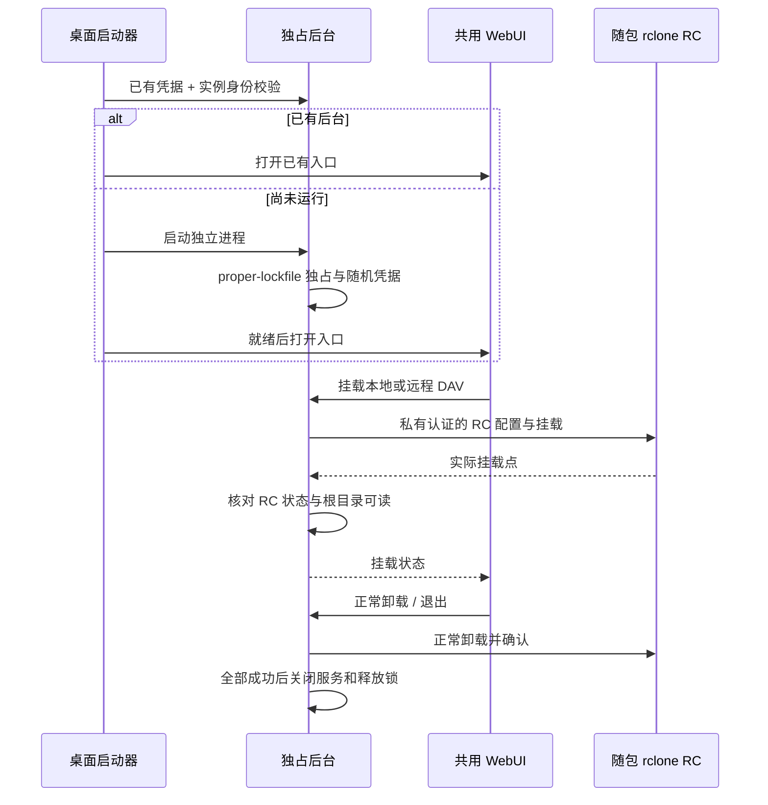

# MusicFS 桌面后台与挂载

桌面入口复用共享服务、管理页面、SQLite 与插件安装器。当前实现与适用目标的验证统一见[桌面宿主记录](verification/p2-desktop-host.md)，本页说明使用与运行关系；交叉编译不替代目标系统运行。

## 使用旅程

从对应系统的完整发行目录启动：Windows 点击 `MusicFS.exe`，Linux 运行有执行权限的 `musicfs`，macOS 打开对应架构的 `MusicFS.app`。启动器打开默认浏览器；重复启动会验证并打开同一后台。关闭页面后，后台与挂载继续运行。管理页面使用独立随机凭据，启动器经 URL fragment 传入，页面立即移除 fragment。

“本机挂载”页面提供“退出 MusicFS 后台”，调用受管理凭据保护的退出入口；文件仍被占用时显示失败并保留后台。占用时先关闭使用挂载文件的程序，再重试。

在页面安装来源插件、配置目录后，可选择本地 DAV 或填写远程 HTTP/HTTPS DAV 的地址、用户名、密码及本机挂载位置。挂载只读。rclone 确认实际挂载后，后台还要能读取挂载根目录，才报告成功；进程存在不等于挂载可用。卸载和退出后台采用正常卸载，路径忙时保留后台和错误状态，关闭占用文件的程序后再试。系统注销后的自动恢复不在当前范围。

首次安装及数据结构不变的插件更新立即完成。配置/私有状态结构升级会显示后台进度，先准备所有实例的新数据，再同时切换；转换失败保留旧插件和实例。关闭页面不会停止升级，后台重启会恢复原操作。升级期间配置或授权变化会使候选作废，可在原操作失败后重新安装。合同和验证见[插件迁移](verification/p2-plugin-migration.md)。

| 系统 | 挂载实现 | 首次系统依赖 |
|---|---|---|
| Linux x64 | 随包 rclone RC `mount` | `/dev/fuse` 与 `fusermount3` / `fusermount`、相应用户权限 |
| Windows x64 | 随包 rclone RC `cmount` | WinFsp；空闲盘符或尚不存在的目录挂载点 |
| macOS Intel / Apple Silicon | 随包 rclone RC `nfsmount` | 系统 NFS 挂载工具与权限，按目标系统实测确认 |

Windows 的 `*` 表示由 rclone 分配盘符，后台保存其返回的实际盘符。Unix 使用空目录，拒绝非空目录和符号链接。远程连接同时支持 HTTP 与 HTTPS，包括局域网 WebDAV；用户名和密码在独立字段填写。[rclone 挂载文档](https://rclone.org/commands/rclone_mount/)、[RC 接口](https://rclone.org/rc/#mountmount-create-a-new-mount-point)

## 模块与生命周期



`src/contracts/mounts.ts` 是管理边界的 JSON 合同；返回状态不含连接密码。`mounts.ts` 保存私有定义、串行协调同一路径操作和正常卸载；`rclone-control.ts` 复用真实 RC 进程、校验控制端身份与私有运行记录。进程中断后只依据认证成功且 PID 相符的 RC 握手复用实例，不依据磁盘里的 PID 杀进程。挂载定义保留，未运行的挂载不在启动时自动恢复。

后台异常中断留下同一实例的运行记录时，重启优先复用原本机端口，保持已有本地挂载的 DAV 连接。如果端口被占用，后台可在新端口打开管理页面；读取挂载状态时，将 rclone 实际配置的 URL 与当前本机 DAV 地址核对。旧地址对应的本地挂载显示“需要重新挂载”，保留正常卸载操作，不把 rclone 进程仍存活当作连接已恢复。远程 DAV 挂载不受本机端口变化影响。[固定版本 config/get](https://github.com/rclone/rclone/blob/v1.75.2/fs/config/rc.go)

macOS 的固定 rclone 1.75.2 `nfsmount` 已注册 RC，但其内置卸载调用带强制选项。本项目先调用系统正常 `umount`，再等待 rclone 确认外部卸载；不调用该强制路径。该路径仍需真实 macOS 验收。[固定版本 NFS 实现](https://github.com/rclone/rclone/blob/v1.75.2/cmd/nfsmount/nfsmount.go)、[固定版本 RC 实现](https://github.com/rclone/rclone/blob/v1.75.2/cmd/mountlib/rc.go)

## 数据与浏览器

用户目录由 `env-paths('MusicFS', {suffix: ''})` 决定，包含 SQLite、不可变插件修订、随机凭据、后台身份、挂载定义及诊断日志。Unix 数据目录权限为 `0700`，凭据和挂载配置为 `0600`；Windows 使用当前用户目录及其 ACL。连接凭据不会出现在挂载返回对象、进程命令行或浏览器查询字符串中。私有目录和日志不进入发行包或版本控制。

跨平台浏览器打开交给 `open`，路径选择交给 `env-paths`，单实例文件锁交给 `proper-lockfile`；仅宿主使用这些依赖。Linux 发行环境仍需要桌面的浏览器打开设施，编译产物可以使用 `open` 的系统 `xdg-open` 回退。[open 官方说明](https://github.com/sindresorhus/open)、[env-paths 官方说明](https://github.com/sindresorhus/env-paths)、[proper-lockfile](https://github.com/moxystudio/node-proper-lockfile)

前台启动、参数解析或打开浏览器失败时，先尽力写入本机 `startup.log`，再显示错误与日志位置：Windows 调用系统 PowerShell COM 弹窗，macOS 调用 `osascript`，Linux 使用已安装的 `zenity` 或 `kdialog`。动态消息通过环境变量或独立参数传递；不拼进脚本源码。缺少可用图形设施时保留 stderr 和日志，后台模式只记录错误，不弹窗。`--no-open` 同时关闭开发模式的自动弹窗。这些平台弹窗分支目前仅完成代码和类型检查，实际界面仍待对应系统验证。[AppleScript 环境变量](https://developer.apple.com/library/archive/documentation/AppleScript/Conceptual/AppleScriptLangGuide/reference/ASLR_cmds.html)、[KDE 对话框](https://develop.kde.org/docs/administration/kdialog/)

## 构建与开发验证

开发者使用项目锁定的 Bun。普通用户使用发行物，不要求安装 Bun 或 rclone。

```sh
bun run scripts/build-desktop.ts
bun run scripts/build-desktop.ts --target windows-x64
bun run scripts/build-desktop.ts --all
bun test tests/desktop-launcher.test.ts tests/desktop-mounts.test.ts
bun scripts/probe-desktop-product.ts --mount
```

构建先产出共享 WebUI 和示例插件，再按目标编译。输出在 `dist/desktop/<target>/`，含应用、页面、固定 `rclone v1.75.2`、校验与版本记录、示例插件 ZIP、依赖锁文件与许可。rclone 从官方固定版本下载，核对该发布的 SHA-256；已有缓存复用前核对二进制摘要。`--skip-web` 仅用于复用已构建的页面。跨系统编译不能替代运行验收，`release.json` 保持 `targetRuntimeVerified: false`，实际证据记入验收台账。[Bun 独立可执行程序](https://bun.sh/docs/bundler/executables)

需要从源码检查启动器时，可显式指定完整资源目录：

```sh
bun src/desktop.ts --resources dist/desktop/linux-x64/resources
```

`--data /tmp/musicfs-desktop-test` 可选择独立测试数据，`--no-open` 避免自动打开浏览器，`--background` 是启动器内部的后台模式。诊断时保留数据目录；不要将含凭据的文件贴入问题记录。后台的 `POST /api/desktop/quit` 需要管理凭据，忙挂载返回409并继续运行；正常卸载后返回202，随后结束在途请求并退出。

## 证据边界

2026-10-20定向测试7项/52断言通过，包含真实后台/RC、端口复用与回退及受控挂载。随后已构建四目标产物，并从实际Linux发行物验证分离后台、外置sample安装、页面、DAV、重复启动和真实FUSE本地挂载；16,044字节WAV全文/前后偏移一致。通过发行物页面又挂载独立HTTP服务，读取网易云真实7,734,765字节MP3及前后五个偏移，与DAV下载逐字节相同。

端口恢复测试重建异常退出后的持久记录，不替代真实挂载恢复验收。后续已统一文件锁过期、重试和前台等待时间，并以实际 SIGKILL 后立即重开验证：约32秒恢复、原端口及凭据保留；仍未覆盖崩溃时的活动挂载恢复，详见[桌面记录](verification/p2-desktop-host.md)。

实际浏览器验证了远程表单、两种挂载状态、失败保留表单，以及退出流程：真实打开文件时拒绝正常卸载并保持后台，关闭句柄后可正常退出。真实忙卸载还发现rclone错误含fusermount名称，原映射误报缺依赖；已优先识别busy，并让页面按具体错误显示而非把所有409都提示重新载入。最终原生探针对此作实际回归。

此前“缺少/dev/fuse”的判断来自受限环境视图；允许本地进程的宿主实际具备FUSE，已补做上述挂载。Windows/macOS仍只有交叉编译产物，默认浏览器打开、平台弹窗、异常退出恢复和播放器仍待各自验收。完整证据见[桌面记录](verification/p2-desktop-host.md)和[总台账](verification.md)。
