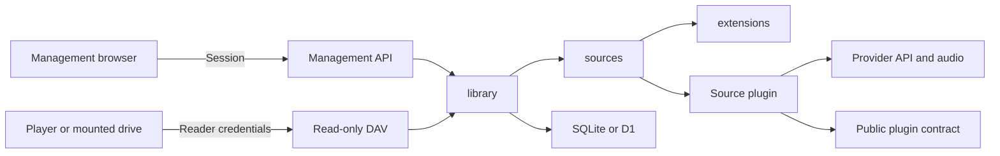

# Architecture

[简体中文](../architecture/README.md)

MusicFS is a plugin-based, read-only file service. Desktop and Worker are independent deployments sharing the core, management interface and DAV protocol. NetEase and QQ are example source plugins.

## Ownership

| Owner | Responsibility |
|---|---|
| `extensions` | Packages, compatibility, installed revisions and installation generations |
| `sources` | Instance config, authorization, private state, generation checks and plugin calls |
| `library` | Complete snapshots, exported paths, layout, refresh and update rules |
| Source plugin | Provider protocol, categories, quality, rights, metadata and final representations |
| Management authentication | One administrator, browser sessions and one-time entry links |
| Desktop host | Listeners, processes, tray, mounts, restore and byte-cache lifecycle |
| Worker host | D1 adapter, executable module registry, publishing and bounded continuation |

The core does not import provider SDKs, React, HTTP frameworks or tagging tools. Plugins use the public API rather than private core modules. Host adapters implement interfaces owned by their consumers. `dependency-cruiser` checks import directions.

Hosts and adapters own [IO diagnostics](logging.md), including WebDAV request correlation, source connections, stream failures and log limits. Domains do not depend on the logging library.

## Files and persistence

The library exposes list/stat/statMany/open. A file's `contentId`, size, media type and range describe its final exported bytes, including any plugin-added tags. Song occurrences, actual audio and final representations have distinct identities.

Directory pages are staged. Only a complete successful page sequence publishes a directory; failures retain its last successful contents. No-change refreshes preserve the content version, indexes and timestamps. User layouts are independent of provider refreshes.

Network work runs outside SQL transactions. SQLite transactions and D1 batches condition commits on captured generations, revisions and operation identity. An installation update prepares candidates before switching all affected instances together.

Desktop continues persistent tasks in the background. Worker advances bounded work in fresh HTTP/scheduled invocations. The shared algorithm can adapt to cache hits and available budget.

## Access, cache and language

Desktop management and WebDAV use independent ports and access scopes. Management sessions, player credentials and music-provider authorization are separate. App-local mounts acquire an internal loopback read connection on restore; remote mounts retain their configured URL.

Directory snapshots, metadata, immutable representation plans, temporary media URLs and read audio fragments are different caches. Desktop direct DAV and app mounts use rclone VFS with separate ownership, avoiding double disk caching for a local mount. Worker streams audio without a server disk cache.

Each browser remembers its display language. Terminal and tray language belongs to the running machine. i18next/react-i18next, component locale packs and ajv-i18n handle presentation. Plugins may provide display dictionaries; config values, songs, paths and cache identities remain unchanged.

## Extend or change

For a provider, use the [plugin author guide](plugin-authoring.md) and [public contract](plugin-interface.md). For application changes and releases, use [development](development.md). Management automation uses the [HTTP API](management-api.md).

Detailed topic diagrams and implementation decisions are maintained in the [Chinese architecture index](../architecture/README.md), including tagging, refresh, cache, desktop mounts, access and UI. See [compatibility and verification scope](verification.md) for platform and format evidence.
