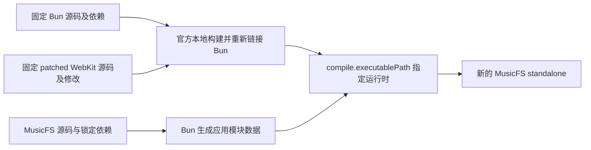

# Bun 1.4.3 运行时资料、固定 WebKit 与重新构建入口

调查日期：2026-10-20。范围：MusicFS 桌面 standalone executable 中的 Bun 运行时、官方 patched WebKit/JSC、可取得的正文与源码、重新构建和重新组装入口。依据固定版本的官方源码、官方发布 API 与本仓库代码；没有构建 Bun/JSC、下载大型 JSC 二进制包或修改发行物。本报告记录工程事实与建议，不判断某种材料安排在法律上是否充分。

## 1 结论与本仓库起点

官方存在一条可复用的工程路径：取得固定 Bun 与 patched WebKit 源码，通过 Bun 的本地 WebKit 构建入口重新链接 Bun，再用 `compile.executablePath` 将这个运行时装入 MusicFS standalone。**本轮只确认入口和输入，没有完成这条重建旅程。** 官方 JSC 库包和运行时下载包也不能直接当作 Bun 完整对象包。[官方本地构建说明](https://github.com/oven-sh/bun/blob/c6da4a4d3010e5553438c60f6bd76d981976867c/CONTRIBUTING.md#building-webkit-locally--debug-mode-of-jsc)、[standalone 类型合同](https://github.com/oven-sh/bun/blob/c6da4a4d3010e5553438c60f6bd76d981976867c/packages/bun-types/bun.d.ts#L3572-L3576)

调查起点为本仓库 `a6a553e4694fc3760c90235390484e76ee8224fb`：

- [桌面构建器](../../scripts/build-desktop.ts)用 `Bun.build({compile:{target,outfile}})` 生成四目标程序，单独复制页面、rclone 和插件包；当时未传入 `executablePath`。只记录 `Bun.version` 还不足以描述另行修改的运行时来源。
- [现有 Bun 原文](../../third-party/bun-1.4.3-LICENSE.md)与固定官方 `LICENSE.md` 一致，SHA-256 为 `056696884250b0d682365260cf1487a6501b1665a343ec60e23a1e647043c572`。它提供运行时、静态链接库和 polyfill 的说明及链接，没有汇总所有相关许可正文；开头的 MIT 声明也不是 MIT 正文。[固定官方文件](https://github.com/oven-sh/bun/blob/c6da4a4d3010e5553438c60f6bd76d981976867c/LICENSE.md)
- [npm 正文收集器](../../scripts/helpers/bundle-licenses.ts)读取应用的 Bun 构建清单，范围是应用实际打包的 npm 输入；它不枚举 Bun 原生运行时、JSC 或 Rust crate。Vite 的页面许可、rclone 原始 README、插件原许可各有单独交付路径，不能相互代替。
- [发行记录](../verification/p4-release-artifacts.md)已经证明项目源码包可在仓库外重建 Linux 应用；这仍使用现成 Bun 运行时，不是修改 JSC 后重新链接 Bun 的证明。Worker 交付 ESM，不包含本项目的 Bun standalone 运行时。

## 2 固定身份与源码分发入口

| 对象 | 固定值 | 官方一手来源 |
|---|---|---|
| Bun | `bun-v1.4.3`，提交 `c6da4a4d3010e5553438c60f6bd76d981976867c`；本机 `bun --revision` 为 `1.4.3+c6da4a4d3` | [固定发行](https://github.com/oven-sh/bun/releases/tag/bun-v1.4.3)、[完整提交](https://github.com/oven-sh/bun/commit/c6da4a4d3010e5553438c60f6bd76d981976867c) |
| patched WebKit | `WEBKIT_VERSION = 0c06faadf65bf8e8c8ad3a5a8aca83e1e9ed653f` | [Bun 固定 pin](https://github.com/oven-sh/bun/blob/c6da4a4d3010e5553438c60f6bd76d981976867c/scripts/build/deps/webkit.ts#L1-L5) |
| WebKit 发布标签 | `autobuild-0c06faadf65bf8e8c8ad3a5a8aca83e1e9ed653f`，标签指向同一提交 | [官方标签 API](https://api.github.com/repos/oven-sh/WebKit/git/ref/tags/autobuild-0c06faadf65bf8e8c8ad3a5a8aca83e1e9ed653f) |
| Bun 源码归档 | 上述完整提交的自动归档 | [tar.gz](https://github.com/oven-sh/bun/archive/c6da4a4d3010e5553438c60f6bd76d981976867c.tar.gz)、[ZIP](https://github.com/oven-sh/bun/archive/c6da4a4d3010e5553438c60f6bd76d981976867c.zip) |
| WebKit 源码归档 | 上述 patched fork 提交的自动归档 | [tar.gz](https://github.com/oven-sh/WebKit/archive/0c06faadf65bf8e8c8ad3a5a8aca83e1e9ed653f.tar.gz)、[ZIP](https://github.com/oven-sh/WebKit/archive/0c06faadf65bf8e8c8ad3a5a8aca83e1e9ed653f.zip) |

WebKit 的这份源码包含该 fork 提交内的 Bun 改动，例如 `JSGlobalObject.cpp` 的 Bun additions；不能用系统 WebKit 或任意 upstream WebKit release 替代。源码自动归档是可取得源文件的机制，不含本地构建生成物，也不等于已经准备好脱网重建的全部依赖材料。[固定 fork 代码](https://github.com/oven-sh/WebKit/blob/0c06faadf65bf8e8c8ad3a5a8aca83e1e9ed653f/Source/JavaScriptCore/runtime/JSGlobalObject.cpp#L31-L43)、[Bun 本地 JSC 参数](https://github.com/oven-sh/bun/blob/c6da4a4d3010e5553438c60f6bd76d981976867c/scripts/build/deps/webkit.ts#L309-L335)

原 `LICENSE.md` 中指向 WebKit 仓库、BoringSSL master、ICU main 等地址有浮动链接；这些链接说明来源，但没有锁住本次二进制的全部版本或保留正文。随包材料应从固定提交取得，并保存原文件、相对路径和摘要；本报告的链接用于溯源，不能替代这些实际文件。

## 3 已定位、可原样交付的 WebKit 正文

以下五个文件已从固定提交读取并核对字节，四个 WTF 文件位于 `Source/WTF/` 根目录。它们是具体可收集的输入，**不是整个 WebKit/Bun 的完整许可清单**。

| 固定原始文件 | 字节数 | SHA-256 |
|---|---:|---|
| [JavaScriptCore/COPYING.LIB](https://raw.githubusercontent.com/oven-sh/WebKit/0c06faadf65bf8e8c8ad3a5a8aca83e1e9ed653f/Source/JavaScriptCore/COPYING.LIB) | 25,584 | `5094ecb9c9dcd0eadc34f3c11511d9b5535063032bc150164ecd1a5d5a445547` |
| [WTF/LICENSE-LLVM.txt](https://raw.githubusercontent.com/oven-sh/WebKit/0c06faadf65bf8e8c8ad3a5a8aca83e1e9ed653f/Source/WTF/LICENSE-LLVM.txt) | 12,263 | `f72b120d1385408e9e380acc020756eb6ba1b461d66c328ea67327ba08d7dcfd` |
| [WTF/LICENSE-dragonbox.txt](https://raw.githubusercontent.com/oven-sh/WebKit/0c06faadf65bf8e8c8ad3a5a8aca83e1e9ed653f/Source/WTF/LICENSE-dragonbox.txt) | 13,858 | `9bb1036ef8dcb42c59e2a23c9e465f43e75003e06898faf0edd18de662f3ecb8` |
| [WTF/LICENSE-libc++.txt](https://raw.githubusercontent.com/oven-sh/WebKit/0c06faadf65bf8e8c8ad3a5a8aca83e1e9ed653f/Source/WTF/LICENSE-libc++.txt) | 3,493 | `c1938c0e9e90639d1e8f5a7f6bebaab83a3642e0ee44295a4c69934686d0bda8` |
| [WTF/LICENSE-simde.txt](https://raw.githubusercontent.com/oven-sh/WebKit/0c06faadf65bf8e8c8ad3a5a8aca83e1e9ed653f/Source/WTF/LICENSE-simde.txt) | 1,077 | `75ce0a8c5a7bff42fbd6f8f3b469b518132132c4f4948fb8d02b1ccb5d0df9d8` |

`COPYING.LIB` 是 GNU **Library** GPL v2（1991）正文，不能按名称猜成 v2.1。固定源码还有各文件自己的许可及著作权头：`Parser.cpp`、`JSGlobalObject.cpp`、`Assertions.h` 的文本不同，不能用一份通用 SPDX 模板或单独的 `COPYING.LIB` 改写、覆盖它们。对应源码归档保留这些原始文件头。[Parser.cpp](https://github.com/oven-sh/WebKit/blob/0c06faadf65bf8e8c8ad3a5a8aca83e1e9ed653f/Source/JavaScriptCore/parser/Parser.cpp#L1-L21)、[JSGlobalObject.cpp](https://github.com/oven-sh/WebKit/blob/0c06faadf65bf8e8c8ad3a5a8aca83e1e9ed653f/Source/JavaScriptCore/runtime/JSGlobalObject.cpp#L1-L29)、[Assertions.h](https://github.com/oven-sh/WebKit/blob/0c06faadf65bf8e8c8ad3a5a8aca83e1e9ed653f/Source/WTF/wtf/Assertions.h#L1-L24)

## 4 官方对象／库包的实际边界

固定 Bun release 有 38 个上传资产：36 个平台 runtime/profile ZIP，以及校验和、签名；页面另列自动源码 ZIP/tar.gz。公开清单中没有单独的 Bun 绑定对象、Rust rlib 或完整重链接对象包。本轮未拆检每个 profile ZIP，不能只凭名字把它当作重链接材料。[Bun release API](https://api.github.com/repos/oven-sh/bun/releases/tags/bun-v1.4.3)、[展开资产](https://github.com/oven-sh/bun/releases/expanded_assets/bun-v1.4.3)

固定 WebKit release 则有 42 个平台／ABI／构建模式库包。Bun 消费的主要静态库包括 JavaScriptCore、WTF、bmalloc，Linux/Windows 包还带所需 ICU 库；这是 WebKit/JSC 部分，不是 Bun 整体对象包。[WebKit release API](https://api.github.com/repos/oven-sh/WebKit/releases/tags/autobuild-0c06faadf65bf8e8c8ad3a5a8aca83e1e9ed653f)、[Bun 消费库列表](https://github.com/oven-sh/bun/blob/c6da4a4d3010e5553438c60f6bd76d981976867c/scripts/build/deps/webkit.ts#L99-L135)

按固定 Dockerfile 与 CI 的生产清单，WebKit tar 收录静态库、头、工具及生成脚本，没有追加 Bun 仓库自己的绑定对象。Bun 最终链接还另有自身 C/C++ 对象、Rust rlib、目标资源和其他依赖。因此，现有 JSC tar 不能独立证明可以给官方 Bun 成品直接换库重链接。该结论来自生产／消费脚本互证，未下载大 tar 逐文件查验。[Linux 输出清单](https://github.com/oven-sh/WebKit/blob/0c06faadf65bf8e8c8ad3a5a8aca83e1e9ed653f/Dockerfile#L430-L448)、[WebKit CI 打包](https://github.com/oven-sh/WebKit/blob/0c06faadf65bf8e8c8ad3a5a8aca83e1e9ed653f/.github/workflows/ci.yml#L240-L291)、[Bun 最终链接输入](https://github.com/oven-sh/bun/blob/c6da4a4d3010e5553438c60f6bd76d981976867c/scripts/build/bun.ts#L409-L443)

四个 MusicFS 目标的官方 JSC LTO 库包均有对应资产：`bun-webkit-linux-amd64-lto.tar.gz`、`bun-webkit-windows-amd64-lto.tar.gz`、`bun-webkit-macos-amd64-lto.tar.gz`、`bun-webkit-macos-arm64-lto.tar.gz`。普通 release 与 `release-local` 的 LTO 默认值不同，应让固定构建器选择匹配配置，而非随意拼接这些库。[固定发布资产](https://github.com/oven-sh/WebKit/releases/expanded_assets/autobuild-0c06faadf65bf8e8c8ad3a5a8aca83e1e9ed653f)、[固定 profiles](https://github.com/oven-sh/bun/blob/c6da4a4d3010e5553438c60f6bd76d981976867c/scripts/build/profiles.ts#L129-L144)

## 5 可复用的重建与 standalone 流程



### 5.1 官方构建入口

固定 Bun 已是 Rust 与 C/C++ 构建链。官方资料要求相匹配的 LLVM 23.1.1，`rust-toolchain.toml` 固定 `nightly-2026-09-15`；环境按对应版本的构建说明准备，不套用旧 Zig 教程。[固定构建说明](https://github.com/oven-sh/bun/blob/c6da4a4d3010e5553438c60f6bd76d981976867c/CONTRIBUTING.md)、[固定 Rust 工具链](https://github.com/oven-sh/bun/blob/c6da4a4d3010e5553438c60f6bd76d981976867c/rust-toolchain.toml)、[Windows 指南](https://github.com/oven-sh/bun/blob/c6da4a4d3010e5553438c60f6bd76d981976867c/docs/project/building-windows.mdx)

以下是官方现有脚本的组合，**本轮没有执行**：

```sh
git clone https://github.com/oven-sh/bun.git bun-runtime-src
cd bun-runtime-src
git checkout c6da4a4d3010e5553438c60f6bd76d981976867c
bun install --frozen-lockfile
git clone https://github.com/oven-sh/WebKit vendor/WebKit
bun run sync-webkit-source
# 在固定 WebKit 源码上应用并保存需要验证的修改。
bun run build:release:local
```

`sync-webkit-source` 取固定 pin；`build:release:local` 在本地构建 JSC 并链接 Bun，输出目录是 `build/release-local`。只需单独构建 JSC 时也已有 `jsc:build`。对象、库与链接 response file 由官方 Ninja 构建生成，不需要 MusicFS 另写 Bun/JSC 链接器。[同步脚本](https://github.com/oven-sh/bun/blob/c6da4a4d3010e5553438c60f6bd76d981976867c/scripts/sync-webkit-source.ts)、[固定 package scripts](https://github.com/oven-sh/bun/blob/c6da4a4d3010e5553438c60f6bd76d981976867c/package.json#L41-L58)、[链接规则](https://github.com/oven-sh/bun/blob/c6da4a4d3010e5553438c60f6bd76d981976867c/scripts/build/compile.ts#L176-L190)

### 5.2 将自定义 Bun 用于应用程序

固定官方类型及文档提供 `Bun.build` 的 `compile.executablePath`；本机 `bun build --help` 也列出 `--compile-executable-path`。MusicFS 可复用原有构建器，在某一目标原 `compile` 参数上指定对应自定义 Bun 路径，继续使用原应用入口、`MUSICFS_COMPILED` 定义及随包资源。它是工程构建入口，不改变普通用户安装流程。[固定类型](https://github.com/oven-sh/bun/blob/c6da4a4d3010e5553438c60f6bd76d981976867c/packages/bun-types/bun.d.ts#L3572-L3576)、[固定 standalone 文档](https://github.com/oven-sh/bun/blob/c6da4a4d3010e5553438c60f6bd76d981976867c/docs/bundler/executables.mdx)

固定实现的 `target_executable` 顺序是：显式路径优先；未指定时，宿主目标用当前 Bun 进程，其他目标从缓存／下载取得。`to_executable` 随后把应用模块数据注入该运行时。**只用改过 JSC 的 Bun 执行四目标构建，不证明跨目标也用了那个运行时**；应按目标显式指定并记录实际运行时文件与摘要。上述代码证明支持入口，不证明任意版本／架构的 Bun 可以混用。[运行时选择及组装实现](https://github.com/oven-sh/bun/blob/c6da4a4d3010e5553438c60f6bd76d981976867c/src/standalone_graph/StandaloneModuleGraph.rs#L2594-L2733)

## 6 有限的交付缺口与下一步

| 项目 | 已有事实 | 最小可执行工作／仍不确定之处 |
|---|---|---|
| 固定运行时身份 | 已有 Bun commit、WebKit pin、官方源码入口 | 在运行时资料中记录这组映射及各目标实际运行时来源、摘要；自定义运行时另记录修改出处，不能只写编译器版本 |
| 原始正文资料 | 现有 Bun 说明文件；本报告定位五份 WebKit/WTF 原文 | 实际复制固定原文并保存出处／摘要，结合各实际输入补资料；本轮未定位另一个固定 Bun 官方完整 MIT 正文文件，不用项目 GPL 正文或猜写的通用文本代替 |
| 运行时依赖清单 | 固定 native 构建脚本可提取 21 个源码 repo/commit；固定 `Cargo.lock` 共 286 个包，180 个 registry、106 个本地 | Bun 根 LICENSE 表不是完整 Rust 清单。按四个 release 目标的入口、feature 与构建／链接输入确认参与部分，再取得对应原文；锁文件只是候选集，不能宣称全部 180 个 registry 包都进入最终二进制，也不能只补根表就宣布完整 |
| 源码／对象取得 | 固定 Bun 与 patched WebKit 源码可取；官方有 JSC 库包 | 记录可实际取得的源码材料与构建说明；当前公开资产检查未找到完整 Bun 重链接对象包。本轮不把源码 URL 清单、JSC tar 或 profile ZIP 宣称为已交付完整对象材料 |
| 可选重新构建验证 | 官方本地 JSC／Bun 构建与应用自定义运行时入口存在 | 如以后确需验证上游源码重建，再执行一个实际目标的“固定源码＋可识别 JSC 修改 → 自定义 Bun → MusicFS standalone → 运行”。当前停止扩展这条调查，不将其自动升级为产品开发或FR16门禁；必要发行材料仍单独核实 |

依赖计数对应固定 [Cargo.lock](https://github.com/oven-sh/bun/blob/c6da4a4d3010e5553438c60f6bd76d981976867c/Cargo.lock) 与 [native 构建定义目录](https://github.com/oven-sh/bun/tree/c6da4a4d3010e5553438c60f6bd76d981976867c/scripts/build/deps)。这是一组有明确输入和输出的发行资料任务，不增加诊断服务、扫描框架、系统组件全盘调查或新的应用打包体系。
