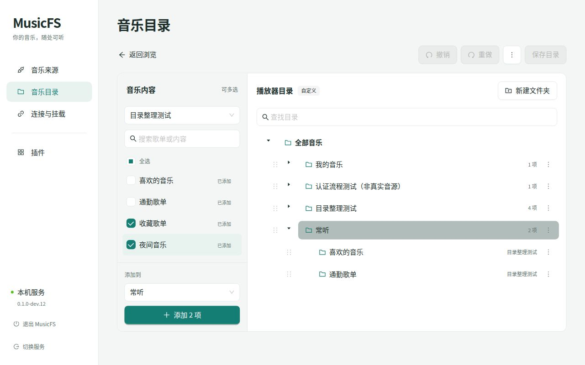

# 目录整理工作区

2026-10-22，当前源码与 Vite 正式构建，使用独立 WSL 桌面服务和临时数据。四入口来源由仓库 sample 派生，只提供本地 WAV，不连接音乐平台。交互取舍见[目录整理方案](../planning/ui-ux-decisions.md#目录整理的进一步取舍)。

## 实际走查

| 场景 | 结果 |
|---|---|
| 从默认目录开始 | 进入整理后直接显示已有来源与入口。新建自定义文件夹时，原目录保留。 |
| 添加多个内容入口 | 选中两个歌单入口，目标明确显示为“常听”，一次加入两项，顺序与来源清单一致。保存前读取管理 API，已发布布局仍为自动排列。 |
| 命名和移动 | 新建后原位命名；通过节点菜单选择目标文件夹完成跨组移动，撤销后恢复原位置。 |
| 移除和恢复 | 移除含两个入口的分组，撤销后分组与两个入口一起恢复；回到已保存状态时保存按钮禁用。 |
| 找到目录 | 搜索“通勤”，同时展示两个匹配入口及各自的上级，保持来源分组和自定义分组可区分。 |
| 发布和读取 | 保存后实际目录出现“常听”；打开其中的“通勤歌单”，继续显示来源的 `440 Hz.wav`。 |
| 桌面与窄屏 | CSS 1280×800 使用并列工作区；约 389×843 切换两栏后，多选状态和目标位置保留，页面可滚动到添加按钮，无横向溢出。 |

## 模块检查

- 三套 TypeScript 检查、前端构建通过。
- 模块边界通过：254 个模块、1,050 条依赖。
- 目录草稿、核心目录与管理 API 的定向回归：33 项通过，327 个断言。默认布局副本覆盖同名来源、重复入口名称、路径保留，以及只读取入口、不扫描歌曲；树操作覆盖批量顺序、独立入口身份、跨组移动与查找上下文。

本轮没有新增依赖或改变插件协议。新增只读 `GET /api/layout/default`，保存继续使用既有修订检查与一次发布。未请求真实平台、操作 Windows 或部署 Worker；本轮界面与源码已随 dev.13 打包，产物身份见[发行页](../release.md)。
