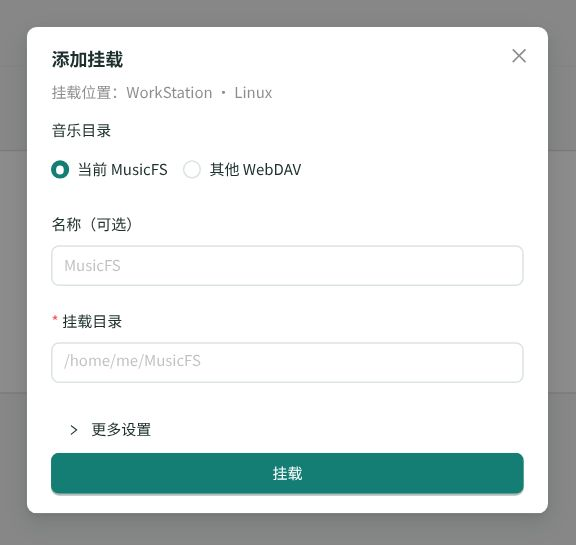

# 无桌面与远程入口核对

2026-10-24，基于 dev.30 之后的源码改动；当前发行包仍见[发行页](../release.md)。

## 范围与结果

WSL 内使用独立临时数据、空音乐库和真实 HTTP 监听器，验证以下用户链路：

- `--help` 不启动后台或创建数据；SSH/无 Linux 图形会话正确识别。
- `--foreground` 无浏览器、无托盘启动，输出实际管理/DAV地址、登录链接和 SSH 转发命令；链接可兑换 Cookie 并访问管理 API。
- 再次 `--headless` 复用同一 PID，签发新链接；CLI 只开放管理页时，DAV 仍为本机访问且原端口不变。
- 重复前台启动不创建第二进程；SIGTERM 正常退出并清理运行记录。
- 原启动器的浏览器入口、静默自启偏好、重复启动、端口恢复、独立监听与旧配置迁移的受影响回归通过；跳过无关的长时间崩溃恢复测试。

内置浏览器实际打开新页面：挂载列表及添加弹窗显示后台设备与系统；无桌面设置只显示自动挂载偏好，不出现桌面自启和打开浏览器选项。端口跳转的代码判定也已调整：仅在浏览器原本使用后台实际端口时自动换端口，保留代理自有端口；未部署第三方代理做实测。

## 复用与边界

定向入口：`tests/desktop-cli.test.ts`；启动器与网络回归只选择 `tests/desktop-launcher.test.ts` 的点击/重用/端口恢复以及 `tests/desktop-network.test.ts`，未重复长锁等待。三套类型检查、依赖方向及 WebUI 构建通过。

本轮核对终端、会话和页面，不请求音乐平台、不操作 Windows 宿主、不部署 Worker，也未新增目标平台二进制、真实 SSH 隧道或第三方反向代理部署的运行结论。
