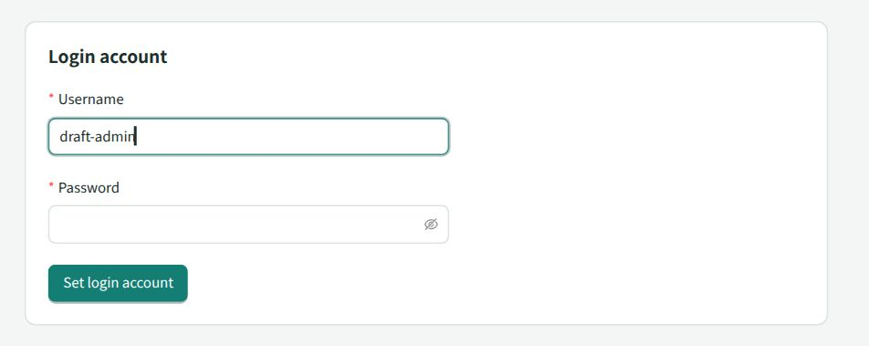
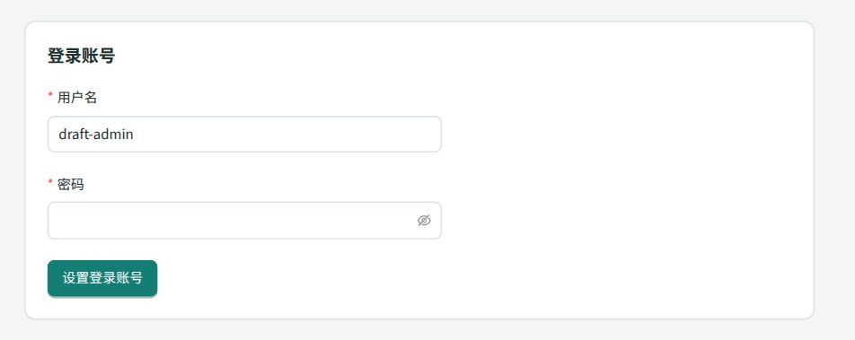
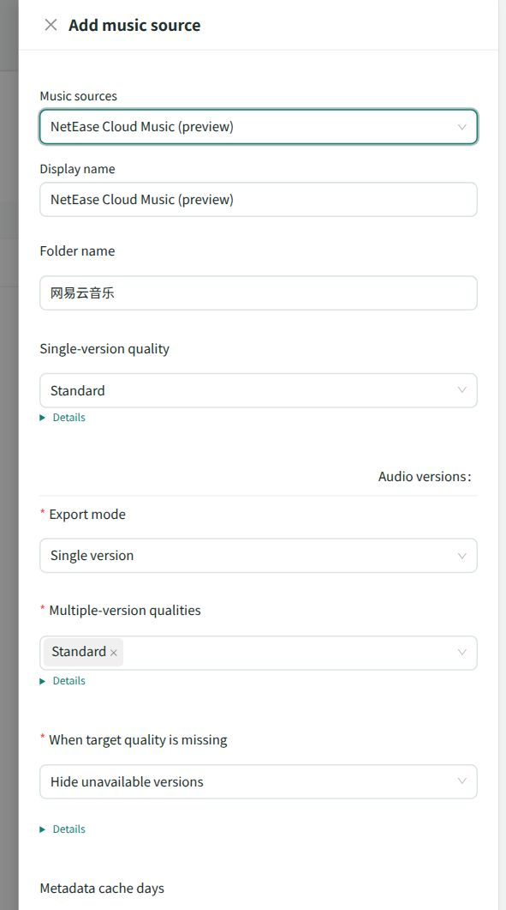

# dev.31 中英文核对

2026-10-24，WSL、本地临时数据和内置浏览器。此记录对应源码改动，尚未重打正式发行归档。

## 已核对

| 入口 | 结果 |
|---|---|
| 词典检查 | 中英文键与插值一致，插件 Schema 显示注释有英文，未登记的界面中文由 `check:i18n` 报出 |
| 翻译运行时 | 插值、单复数、数字格式、Mustache 字面模板、旧错误显示、插件命名空间及 Schema 数据值保持通过定向测试 |
| 终端 | `--help --language en/zh-CN` 两种输出通过，无桌面启动和独立访问入口的受影响回归通过 |
| 管理与挂载 | 管理API、命名错误、挂载状态/重启、独立网络及原生桥接的定向离线回归通过 |
| 示例插件 | 两示例原有离线夹具通过；本轮补正缓存期限和API下限的旧断言，没有改变对应业务行为 |
| 作者包 | 新翻译文件与类型进入最小作者包；在包内安装其最小依赖后，示例构建与类型检查通过 |
| 静态/构建 | 三套类型、依赖方向、WebUI及三个插件构建通过；Rust Windows目标使用既有缓存离线检查通过 |

## 实际界面

在同一管理表单填入测试值，英文切回中文后输入仍保留，页面和菜单更新；重新打开同一服务地址仍使用选定的英文。歌曲/来源的测试名称保持原文，英文数量使用正确单复数。英文导航不再溢出原有紧凑栏。

QQ、网易云的配置表单字段、音质选项、折叠说明和提交按钮均切换为英文；最终插件清单也使用英文显示名。目录默认值仍作为配置数据原样保留。授权提示使用插件词典的离线样本验证，没有创建真实扫码挑战。

退出管理登录后，英文登录页及其语言切换入口仍可用。浏览器退出会话未停止后台。

## 验证范围

本轮没有请求真实音乐平台、部署付费 Worker、访问 Windows 宿主或重复 Windows VM 矩阵。托盘菜单文本由桥接夹具确认传入，Windows Rust检查确认目标代码可编译，不据此声称已点击真实英文托盘菜单。第三方自行返回、未提供翻译的诊断保留原文。

现行职责和维护方式见[国际化设计](../architecture/i18n.md)，已打包下载见[发行页](../release.md)。
