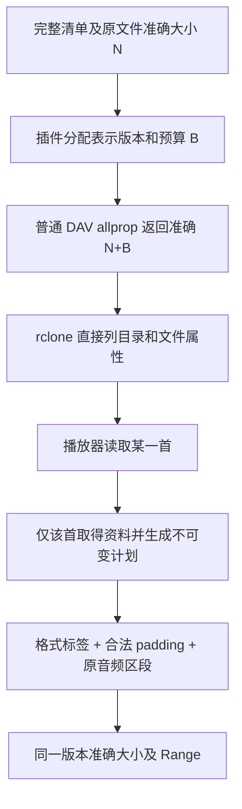

# 真正按需挂载：有界可行性验证

日期：2026-10-21。用户反馈 App 创建的 rclone/FUSE 磁盘直接进入网易云大目录仍卡住，必须先在管理页准备文件。用户明确选择优先验证真正按需，而不是仅给整目录准备增加进度提示。本轮不访问音乐平台、不部署云端、不调用 Windows 宿主；Windows 测试 VM 一次 SSH 超时后不扩展网络排障。

**结论：保持现有 rclone、WebDAV 和准确文件合同，有一条可行路线：来源插件提前公布带合法预留空间的最终大小，首次读取单曲时才生成其标签计划。** MP3 已通过真实 Linux FUSE 小样本；FLAC/M4A 各通过一个离线文件布局试验。它们不是生产接线或 Windows Explorer 验收，不能把原型结果写成 dev.6 已修复。

## 原因与方案比较

当前 rclone WebDAV `List` 一次要求整层属性；MusicFS allprop 需要最终补标签文件的准确大小。旧实现遇到延迟资料时返回 503 并启动整目录 file-info 任务。根目录只有子目录，所以 App 根目录探测成功不代表进入歌曲目录会顺畅。此前 rclone CLI 的准备后读取证据没有覆盖用户这条冷挂载旅程。

| 方向 | 本轮结果 | 判断 |
|---|---|---|
| App 自动整目录准备 | 可以改善提示，仍先处理整目录 | 不符合本次优先方向 |
| HTTP 后端 `--no-head` | 名称立即可见，但文件显示 0；同句柄跳读失败 | 不直接采用 |
| 修改 rclone/自行开发挂载实现 | 能调整属性取得时机，但未知可变长文件仍要定义大小语义 | 当前没有必要承担这条维护路线 |
| 来源插件提供预定大小的标签表示 | 音频合法 padding，准确大小与单曲延迟处理可兼得 | 推荐继续；预算、版本冻结与缓存需接线 |
| 原音频及外置资料 | 原音频大小可直接用；播放器是否使用外置资料不同 | 用户效果不同，保留为取舍而非静默替代 |

### 为什么不能仅换 rclone 参数

固定版本 rclone v1.75.2 的 HTTP `no_head` 跳过逐文件 HEAD，将未知大小交给 VFS。[HTTP 后端源码](https://raw.githubusercontent.com/rclone/rclone/v1.75.2/backend/http/http.go)、[VFS 文件源码](https://raw.githubusercontent.com/rclone/rclone/v1.75.2/vfs/file.go)。

单次原生 Linux FUSE、六个离线 WAV：目录 2.4ms，仅一次目录 GET；全部 stat=0。open 不读时 fstat/SEEK_END 仍为 0。首次顺序读取 64 字节正确；属性缓存到期后该文件显示 524,332 字节，但**同一打开句柄尾部 pread 返回 0**，没有 Range 请求。关闭重开后可读尾部。冷文件 ffprobe 无时长、size=0，同源普通文件能正确报告时长。

读取句柄初始化把未知大小记为 0，首次 GET 更新后端对象而没有同步该句柄；非连续读取按旧大小提前 EOF。[读取句柄源码](https://raw.githubusercontent.com/rclone/rclone/v1.75.2/vfs/read.go)。Windows cmount 的目录枚举还填充每项 stat 信息，不能假定仅给名字即可。[cmount 源码](https://raw.githubusercontent.com/rclone/rclone/v1.75.2/cmd/cmount/fs.go)。当前 MusicFS 目录 GET 也不是 HTTP 后端所需的 HTML 名称列表。其他缓存选项没有被当作已验证的修复，不扩展无价值组合矩阵。

## 预定大小如何工作

平台批量响应已提供原音频精确大小 `N`。插件给其文件表示分配固定额外预算 `B`，目录立即声明**真实最终大小 `N+B`**。读取该首时，复用现有标签库与 prepare/open，取得歌词、封面、原文件布局并生成标签；剩余部分填为格式允许的 padding。移除旧标签释放的字节也可供新标签使用，不需要假设上游没有原标签。

这是建议接线图，尚未进入产品。当前原型调用原 audio-tags prepare/open，格式序列化仍由 `node-taglib-sharp@6.0.3` 负责。MP3 在库输出后调整 ID3 长度及填充；FLAC/M4A 使用库公开的 PADDING/free box 工具，不增加新的标签库或重写音频编码。

### 真实 MusicFS → DAV → rclone → FUSE

六个不可变离线 MP3，预算 64KiB；包含既有 ID3v2、ID3v1、封面、歌词和副标题，不是假音频。源 18,895 字节，导出每首 84,431 字节。

| 操作 | 实测 |
|---|---|
| 冷目录 readdir 加六个 stat | **26.6ms**，全部大小准确 |
| 列目录期间资料准备/源 Range/封面/歌词 | **全部 0** |
| open 不读 | 大小准确，没有准备歌曲 |
| 首次读 64 字节 | 14.6ms，只准备选中的一首 |
| 同句柄尾读、反向跳读、重读 | 均正确，与完整表示切片相同 |
| 完整读取和 ffprobe | 字节、大小、1秒时长、中文标题/歌手/专辑正确 |
| 其余五首 | 完全没有准备 |

实验正常卸载。这里的 64KiB 仅用于小夹具；不能据此选择真实歌曲预算。耗时是离线 localhost 结果，不是大歌单、真实平台或 Windows Explorer 的性能承诺。rclone 可以预读被打开歌曲的数据；证明的是不因枚举而处理其他歌曲，不是禁止读取所选歌曲。

## 格式与实际预算

| 格式 | 一个有效样本的结果 | 需要保留的边界 |
|---|---|---|
| MP3 | 合法 ID3 padding；标签/三路歌词/封面、原音频字节、完整和 seek PCM 相同 | ID3 长度有限；解析器对完整日期、多位专辑艺术家仍有既有差异 |
| FLAC | 合法 PADDING；标签与音频字节、完整 PCM 相同 | 单块长度为24bit；填充块头也需空间，实际布局需处理边界 |
| M4A | 沿现有旧 moov→free、尾部新 moov，再补 free；mdat位置、音频字节和PCM相同 | 预算包含完整新 moov，长曲 sample table 也占预算；不为统一强制套用 |

MP3/FLAC/M4A 样本准备读取 6,607/4,096/1,002 字节；原标签或 moov 较大时会更多，这不是读取上限。只验证网易云已有三格式；未新增平台没有的格式或把 QQ APE 算作通过。

另对**已有磁盘缓存**做一次只读聚合，无新平台请求：1,915份历史计划（MP3 1,914，M4A 1），补标签后增加字节的中位数136,275、95分位519,441、最大671,235。

| 每曲额外预算 | 缓存样本可容纳 | 超预算 |
|---|---:|---:|
| 64KiB | 460 | 1,455 |
| 256KiB | 1,342 | 573 |
| 512KiB | 1,821 | 94 |
| 1MiB | 1,915 | 0 |

**1MiB 是有现有使用数据支持的候选，不是任意歌曲都够的保证。** 未打开文件不需要存储这一份空白；完整下载/缓存则真实多出1MiB/首，本账号1,915文件约1.87GiB。支持 Range 的解析器可跳过 padding，顺序读取或读取整个标签的客户端可能传输它。播放器如果主动扫每首标签，就会触发每首准备；这与只枚举目录不同。

## 正式接入前的必要设计

1. **职责不变。** 来源插件拥有预算/文件表示/资料快照，audio-tags 处理格式及区段；核心仍只认识准确 FileInfo。优先网易云 MP3，再分别评估 FLAC、M4A。不是所有第三方插件都必须补标签，也不新增全局音质或音乐资料系统。
2. **填充按需生成。** 不把1MiB空白编码为 base64 存在每曲计划中。原型这样做产生1,400,448字节前缀，超过现有1MiB JSON单值合同；生产应使用紧凑的填充区段，维持流式及范围读取，不存整曲、不增加云存储。
3. **版本与字节同时稳定。** 目录期分配明确的表示版本，首次解析后以该版本冻结资料和计划。当前 plan digest 依赖最终字节，不能仅更换 size 就沿用它；辅助资料TTL更新、并发首读及缓存清理要沿同一版本责任处理，不能同 contentId/ETag 返回不同字节。优先小范围的持久首写确定语义，不造第二套任务系统。
4. **超预算是产品取舍。** 不能静默截断歌词/降封面、临时增长同一表示或报原文件大小。可以对该首单独准备并更新表示版本后重新枚举，或明确采用资料范围不同的方式；其用户体验要先说明。实验已确认大歌词超1MiB时明确拒绝，没有伪造成功。
5. **最小后续验收。** 接线后用冷清单、一个真实首读和现有Windows VM的App挂载入口确认；保留准确大小、同句柄seek与未选歌曲零准备。无需重刷/补全真实整库、压力测试或再部署付费云端。

本轮满足“先验证可行性”，不代表上述持久接线已完成。不修改 dev.6 发行包。候选和当前出口记录在[PERF21](../../outputs/musicfs-implementation-plan.md)。

## 原始证据与复现

[匿名汇总](data/lazy-mount-feasibility-2026-10-21.json)包含两个实际 FUSE 结果、格式/PCM检查和既有缓存预算统计。实验脚本留在本机忽略目录，不进入发行物：

- `.musicfs/lazy-mount-evaluation/http-nohead/probe.py`：现成 unknown-size 路线及清理。
- `.musicfs/lazy-mount-evaluation/tag-padding-prototype.ts` 与 `mp3-fixed-budget.ts`：格式、预算和音频保持；默认离线。
- `.musicfs/lazy-mount-evaluation/probe-sized-fuse.ts`：正式 Library/DAV加真实rclone挂载。先运行标签原型生成含既有标签的离线源，再运行此探针；需要当前WSL的真实 `/dev/fuse` 和 `fusermount3`，受限沙箱不可见不代表WSL没有FUSE。

没有下载新依赖或上游源码仓库。没有从本次小样本推导所有播放器支持或Windows验收通过。
