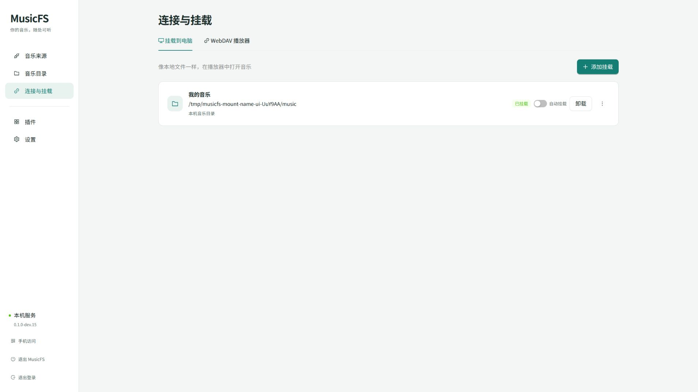
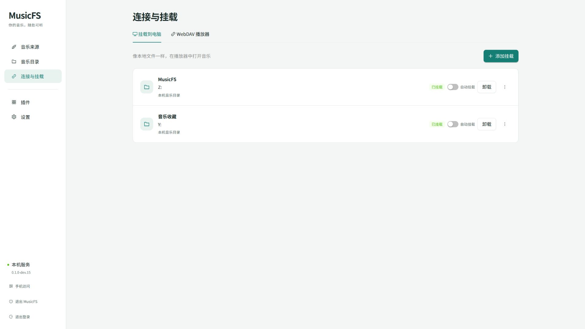

# 挂载名称与启动检查

2026-10-22。范围是桌面启动是否等待自动挂载，以及资源管理器卷标与自定义名称；不请求音乐平台。

## 启动核对

使用现成 dev.14 Linux 正式程序、一个隔离挂载定义与 WSL 回环 WebDAV。刻意保持来源 PROPFIND 不返回，在原生挂载请求等待期间检查启动器退出、管理状态、ticket 与挂载列表。实测启动器约265ms返回，管理检查约20ms，挂载显示 starting；释放后正常退出并清理。

该样本证明现有自动挂载不等待完成才开放管理入口，未发现需要另加后台调度的问题；不是 Windows 整机启动或自然登录计时。后台恢复的重试与手动操作接管复用原有定向回归。

## 名称行为

原请求没有设置 rclone VolumeName，原生系统默认使用内部 remote 标识。现复用挂载名称，默认 MusicFS，并增加重命名入口。定向回归覆盖默认/自定义卷标、重命名保留 ID 与缓存命名空间、持久恢复、忙卸载保留原名、停止项改名不启动原生挂载。Windows 上游 32 字节裁切用中文样本核对完整 UTF-8 前缀；不增加无实际来源的边界矩阵。

名称是显示属性，盘符、来源、凭据和缓存身份保持原职责。rclone 1.75.2 的原生字段由本机 options/get 和[固定版本定义](https://github.com/rclone/rclone/blob/v1.75.2/cmd/mountlib/mount.go)共同核对；[卷标处理](https://github.com/rclone/rclone/blob/v1.75.2/cmd/mountlib/utils.go)及[Windows接线](https://github.com/rclone/rclone/blob/v1.75.2/cmd/cmount/mount.go)由依赖实现。

## 集成结果

18 项挂载/恢复定向回归、三套类型和模块边界通过。WSL 实际 FUSE 的管理页走通默认 MusicFS → 更多菜单 → 重命名 → 保存并重新挂载，页面显示「我的音乐」及已挂载；见下图。临时挂载与后台随后正常关闭。

Windows dev.15 正式程序从干净提交 b738314 构建。离线 Worker、作者包和源码保留一致版本输入，未部署云端。

## Windows VM 续验

2026-10-22，复用现有 Windows 11 VM 与已安装的 WinFsp，正式 ZIP 的 SHA-256 与发行清单一致。在当前用户桌面会话使用隔离空库，禁用此次程序的系统集成和自动打开；没有调用 Windows 宿主、音乐平台或改动网络。

内置浏览器经仅回环 SSH 转发操作 VM 的正式后台；卷标另由同一 Windows 桌面会话的 `DriveInfo.VolumeLabel` 读取，不以管理页名称代替原生结果。

| 操作 | Windows 实际结果 |
|---|---|
| 不填写名称创建 | Z: 的管理名称与原生卷标均为 MusicFS，根目录可访问 |
| 管理页创建中文名称 | Y: 的管理名称与原生卷标均为「我的音乐」，根目录可访问 |
| 更多菜单 → 重命名 → 保存并重新挂载 | Y: 的管理名称与原生卷标均变为「音乐收藏」，保持原 ID、盘符；新名称写入挂载定义，根目录仍可访问 |

本轮未发现产品问题，无需改代码或重新打包。验收工具的 PowerShell 5.1 JSON 读取改为显式 UTF-8，避免其默认解码误报中文名称。未重复 dev.14 托盘、自启、登录或音乐读取验收，也未扩展长名称矩阵。

正常退出后核对后台和 rclone 结束、两个测试盘符消失、runtime 移除；临时任务、包、隔离数据、浏览器标签及 SSH 转发均已清理。无凭据回执保留在本机忽略目录 `.musicfs/windows-dev15/`。

