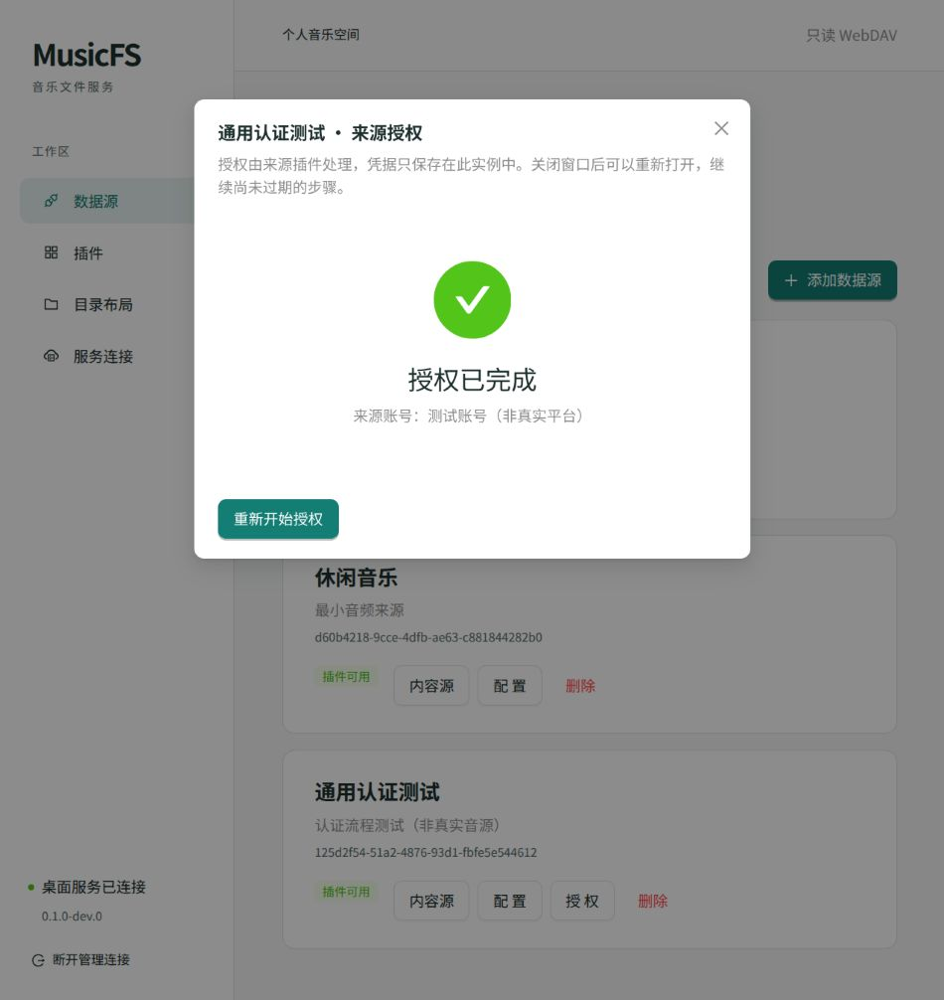

# 通用来源认证首轮验证

日期：2026-10-20。范围：来源实例的交互认证协调、SQLite/D1、正式管理 HTTP 和共用 WebUI。测试插件明确标注“非真实音源”，本记录不证明网易云或 QQ 登录已实现。

## 实现与检查

`sources` 持有认证操作 ID、修订、来源代际及当前公开步骤；插件解释二维码、授权链接、输入、完成和私有流程状态。管理端只取得操作 ID、步骤和结构化错误，不取得插件私有状态。插件仍使用公开 `AuthAction` 的 challengeId，不需要知道核心操作 ID。

开始新操作先增加实例代际；确认完成再次增加代际，防止等待期间产生的旧账号目录继续发布。取消先持久化并增加代际，再尝试插件清理；失败不能撤销取消，清理中声称完成的结果也不能写回凭据。普通步骤与私有状态在一个 SQL 条件写入中接受，检查操作修订、状态 CAS、实例代际和插件安装代际。

SQLite 新增 `0003.sql`，应用数据库版本升至 3；v1/v2 迁移均保留原实例、配置、私有状态和布局。D1 探针按顺序执行相同的三份迁移。

| 检查 | 实际结果 |
|---|---|
| `bun run check` | 65 项测试、261 次断言；Bun/Worker/Web 类型检查；68 个模块、202 条导入，无违规 |
| 认证回归 | 18 项：无认证来源、挑战/实例绑定、失败状态保存、取消/新认证/配置/更新/移除/删除后的迟到结果、过期、并发 CAS、请求取消、旧内容拒绝、错误步骤拒绝及 HTTP 私有字段过滤 |
| `bun run probe:worker:authentication` | 本地 workerd/D1 经正式管理路由运行双实例，输入错误保存、引擎重建后续接、完成后访问内容；真实延迟 HTTP 上游在取消后返回成功时，旧轮询得到 409，旧凭据未写回 |
| 既有宿主回归 | `probe:worker`、`probe:worker:dav`、`probe:compiled` 通过；既有实例、目录/DAV 和编译产物工作 |
| `bun run build:web` | 共用页面构建成功，认证窗口延迟加载；Schema 块仍有约 558 kB 体积提示，性能预算未验收 |

真实上游探针暴露并修复 `ctx.fetch()` 的原生接收者问题：注入的 Fetch 函数现在绑定全局接收者。原来的跨请求全局 Promise 测试替身已改成真实回环 HTTP 延迟响应，没有增加兼容开关掩盖错误。运行机制对照 [Cloudflare 接收者和请求上下文说明](https://developers.cloudflare.com/workers/observability/errors/#illegal-invocation-errors)。本地 workerd 不替代真实云部署证据。

## 浏览器实际旅程

通过正式安装接口装入 `dist/p0/authentication-fixture.zip`，在通用页面创建实例。这个 ZIP 是开发测试产物，不计作真实音源示例。

1. 无认证的最小音源实例不显示“授权”；测试插件按能力声明显示入口，未添加来源专用前端。
2. 开始后显示本地生成的测试二维码；自动检查两次后进入 Schema 输入步骤，不请求外部二维码图片。
3. 错误测试码得到来源消息及字段错误，修正后完成，显示“测试账号（非真实平台）”。重新开始后可取消，显示已取消。
4. 再建立未完成操作，保存公开操作 ID 后重启桌面服务。重启后保留同一 ID；重载页面并打开窗口可继续原步骤并完成。
5. 正式内容源入口显示“测试授权目录”，证明已保存状态被后续插件调用消费。

## 尚未完成

真实网易云/QQ 协议、会话续期合并/失效重登、真实授权链接、Worker 云端、所有目标系统及客户端仍待验证。下一步接入真实示例认证、内容和取流，同时推进 Worker 模块发布。本轮的通用流程证据不能替代真实扫码或平台验收。
