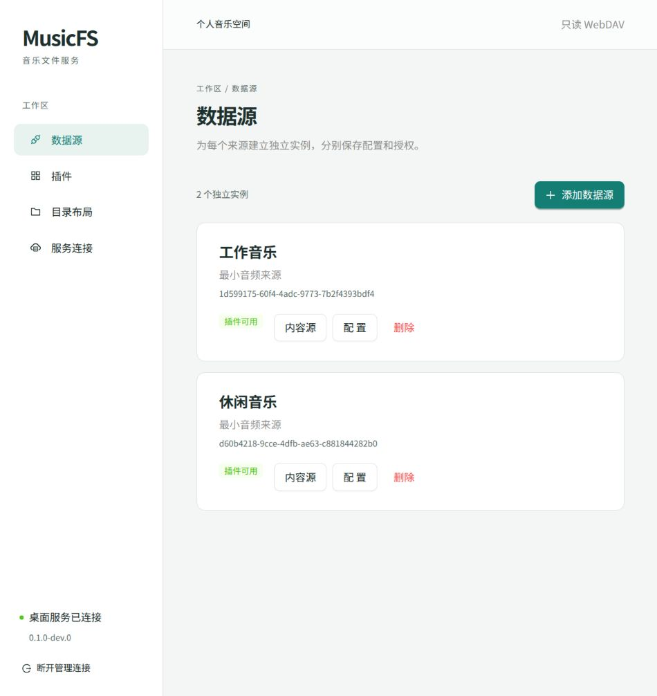

# 共用 WebUI 首轮接线验证

日期：2026-10-20。范围：React/Vite 共用管理页面，连接桌面服务的正式 HTTP 与静态资源入口。使用独立最小插件和开发测试凭据，未使用真实音乐账号，也未发布 Worker。

这是首轮基础页面的历史快照；后续通用认证实现和验证见[认证记录](p1-authentication.md)，当前总进度见[台账](../verification.md)。本页保留当轮测试数量及覆盖范围。

## 实现与检查

- [页面](../../src/web/shell.tsx)使用 Ant Design、TanStack Query；按页面延迟加载，Schema 表单另行延迟加载。RJSF Ant Design 主题与 Ajv 承载配置，来源校验仍在后台执行。
- [管理数据合同](../../src/contracts/management.ts)独立于后台实现；HTTP 端的对应返回类型检查保证字段一致，前端没有导入领域或宿主代码。插件的有限 UI 提示只在表单适配处翻译。
- [桌面服务](../../src/hosts/desktop/service.ts)通过官方 `@hono/bun` 静态适配器提供 `dist/web`。这里只证明生产前端构建可经服务运行，尚未提供点击启动器或嵌入四端发行包。
- `bun run check`：46 项测试、194 次断言通过；Bun、Worker、Web 三组类型检查通过；dependency-cruiser 扫描 63 个模块、177 条依赖，无违规。
- `bun run build:web` 成功，输出 `dist/web`。Schema 延迟块仍有约 558 kB 的构建体积提示；资源预算与后续优化未验收，不把构建成功视为性能通过。
- `bun run probe:compiled` 再次通过：外置插件、双实例、SQLite 重启及正式管理/DAV 调用没有因新静态适配器回归。编译探针尚未覆盖内嵌 WebUI。

实际依赖版本：React/React DOM 19.3.1、Vite 8.3.4、Ant Design 6.6.6、RJSF 6.11.0、validator-ajv8 6.11.0、TanStack Query 5.104.5、react-error-boundary 6.1.6、`@hono/bun` 1.0.1。其他版本以锁文件为准。视觉基线与责任见[界面设计](../architecture/web-ui.md)。

## 实际浏览器旅程

使用应用内浏览器，页面通过本机回环地址连接开发服务；持久状态位于被忽略的 `dist/dev-data`，凭据只用于本次开发测试。

| 操作 | 观察到的结果 |
|---|---|
| 从空状态进入插件管理，上传 `org.musicfs.sample.zip` 并安装 | 实际安装清单出现“最小音频来源” 0.1.0、桌面/Worker 声明及可用状态；没有编译核心或前端 |
| 同插件创建“工作音乐”和“休闲音乐” | Schema 自动呈现“目录名称”，两个实例分别保存“专注时刻”和“轻松时刻” |
| 修改第一个实例的 Schema 配置 | 第一个入口显示“专注时刻 · 新名称”；第二个实例仍显示“轻松时刻”，刷新内容源成功 |
| 创建自定义布局和“我的音乐”分组，添加工作实例的内容源 | 未发布草稿与当前已发布目录分别显示，内容引用使用稳定 sourceId |
| 保存并发布 | 修订从 0 变为 1；已发布目录切换到“我的音乐 / 专注时刻 · 新名称”，进入后列出 `440 Hz.wav` |
| 创建临时分组并实际拖动 | 目录树的可见顺序发生变化；放弃测试草稿后恢复已发布布局，修订仍为 1。跨组身份保留及禁止循环另有单元测试 |
| 重启服务进程并重载页面 | 两个实例及修订 1 的布局保留；对该发布路径发起真实 DAV 范围请求得到 206 和 `RIFF` 四字节 |
| 查看服务连接 | 展示当前来源无关的 DAV 地址、用户名和掩码密码；凭据由受保护接口提供，管理令牌不进入媒体地址 |

发现并修复：开发代理误匹配前端 `/api.ts`；首次延迟导入导致开发依赖优化重载（显式预优化依赖）；配置响应可能携带 `nextPrivateState`（HTTP 层只返回公开结果）。成功及失败配置都已有私有状态不泄漏、状态仍被正确持久化的回归测试，管理响应设置 `no-store`。

## 范围与下一步

上传安装、创建/配置双实例、查看/刷新内容源、布局发布与实际拖动、连接信息和进程重启经过本次浏览器操作。发布地址安装、移除/重装和实例删除已有后台集成测试及页面入口，但本轮未逐项进行相同浏览器旅程。Schema 表单渲染错误由组件边界隔离；窄屏样式已实现，尚未做多视口专项验收。

本轮未覆盖通用来源认证，后续结果见[认证记录](p1-authentication.md)。真实网易云/QQ、候选迁移/失败恢复、Worker 自动发布、系统挂载、发行物与全部真实客户端仍按主线推进。这是 P0/P1 接线成果，不能据此认定 P1 真实来源旅程或全部产品完成。
