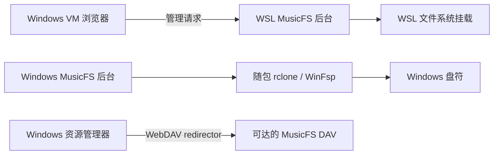

# Windows 虚拟机挂载诊断与限定验收

日期：2026-10-21。用户重新开放 Windows 验证范围，并提供测试虚拟机；全部操作从 WSL 经 SSH 进入该虚拟机，没有调用物理 Windows 宿主。此记录补充 [桌面宿主记录](p2-desktop-host.md)，不把原来跳过的全部 Windows 图形、恢复及客户端测试改写为通过。

后续PERF21的**真正按需挂载原型**已在同VM完成限定验收：正式dev.6 App远程挂载到WSL离线Library/DAV，6个带1MiB预留的MP3冷目录30.3ms/零准备，打开仅处理所选一首，同句柄seek、完整字节及Shell/WMP字段通过，正常卸载退出并清理。未修改网易云生产插件，也不算资源管理器可见窗口或实播验收；方法、原始回执和边界见[按需挂载Windows记录](lazy-mount-feasibility.md#windows-vm实际-appwinfsp-路径)。

随后补FLAC/M4A同入口：四文件冷枚举39.1ms/零准备，每格式只准备所选一首，Windows同句柄随机读/完整文件与音频payload/完整和seek PCM均保持；Shell/WMP基本字段通过，但WMP Lyrics为空，M4A Shell只返回第一位歌手，不宣称全部展示兼容。APE未验本轮路线。[格式记录](lazy-mount-feasibility.md#flacm4a后续windows格式验证)

## 环境与实际入口

- Windows 11 企业版 LTSC，系统版本 `10.0.26100.1742`，PowerShell `5.1.26100.1591`。
- 使用既有 `0.1.0-dev.0` Windows ZIP，在独立临时目录解压；先运行原程序复现，再仅替换修复后的程序。随包 rclone `v1.75.2`，sample `0.1.3`，Bun `1.4.3`。
- 通过 `MusicFS.exe --no-open --data <独立测试目录>` 启动真实后台，经正式管理 HTTP 安装 sample、创建实例和准备目录。没有安装 Bun 或复制任何音乐平台会话；唯一音频为 sample 的 16,044 字节合成 WAV。
- 本轮程序由 SSH 会话启动，未验证文件管理器双击、默认浏览器、图形错误弹窗或交互桌面的盘符可见性。

原最终 Windows ZIP 的 SHA-256 仍为 `fd920427d557b7e0085218b1d7c61a64702b4bf6d8a07100111f50870da12c7a`，没有覆盖该归档。最后一次测试程序 SHA-256 为 `b2d665f09566a908fb40e13efef805dac2b74321092c274572636a1eab962d50`；输入为 `4532f16` 加本次工作区补丁，源码摘要 `406ad18754f71c5ce61348640bf8aa9498339cd2c487c407698628cd47da7cdd`，`dirty: true`。它是限定回归产物，不冒充原冻结发行物。

## 本机挂载：三个独立原因

| 观测与单变量反馈 | 原因及处理 |
|---|---|
| 正式 `POST /api/mounts` 输入 `M:`，返回位置变成 `M:.`；rclone 报 `parent of mountpoint directory does not exist: M:\` | Windows `path.normalize('M:')` 会得到驱动器相对目录 `M:.`。保留交给 rclone 的裸盘符，其他路径按目标平台语义判断绝对路径并规范化 |
| 同一 RC/remote 仅将目标改回 `M:`，进入下一步并报 `cgofuse: cannot find winfsp` | 测试 VM 确实缺少 WinFsp。随后才安装官方稳定 WinFsp `2.1.25156` 的 `F.User`、`F.Main` 运行组件；安装器退出码 0，无重启，未安装开发或测试组件 |
| WinFsp 挂载已存在；.NET 能列出根目录，但同版本 Bun 对 `readdir('M:')` 报 `ENOENT`，`readdir('M:\\')` 成功，文件读取也成功 | rclone 挂载标识与文件系统绝对根路径职责不同。保留 RC 标识 `M:`，就绪检查使用 `M:\`，没有增加等待重试或关闭实际可读性检查 |

WinFsp 安装器来自[官方稳定发布](https://github.com/winfsp/winfsp/releases/tag/v2.1)，2.1 MB 文件的 SHA-256 为 `073a70e00f77423e34bed98b86e600def93393ba5822204fac57a29324db9f7a`，与发布页一致。没有将该依赖打进 MusicFS 发行包。

生产修复位于 `src/hosts/desktop/mounts.ts`；回归位于 `tests/desktop-mounts.test.ts`。回归经真实挂载协调入口，检查裸盘符、自动分配和 Windows 绝对目录传给 `cmount` 的值；原代码失败，修复后通过。Bun 对已存在 WinFsp 挂载的根路径差异另由同版本编译的小型只读探针实际证实，没有以 Linux 受控测试代替 Windows 内核行为。

## 最短正式回归结果

| 操作 | 结果 |
|---|---|
| 原生程序启动与正式 sample 安装 | 管理页 HTTP 200，sample 目录列出 `440 Hz.wav` |
| 正式管理 API 挂到 `M:` | 返回 `state: mounted`、`mountPoint: M:`、`error: null` |
| 从挂载文件系统读取完整小文件 | 16,044 字节，`RIFF` 文件头；SHA-256 `37fc52d4555f31bd7fc8b9d7546226e5aaa6f923562ec5d98cb971f621e7583f`，与同服务 DAV 下载摘要相同 |
| 正式 `DELETE /api/mounts/:id` | 本轮测试记录均返回 `stopped`，正常卸载成功 |
| 正式 `POST /api/desktop/quit` | 正常退出请求接受，随后 `runtime.json` 实际移除，SSH 正常结束 |
| 相关自动回归及类型检查 | `bun test tests/desktop-mounts.test.ts` 为 7 pass、0 fail、60 次断言；主 `tsc --noEmit` 通过 |

去敏机器结果及临时 PowerShell 探针保存在执行机器的 `/tmp/musicfs-windows-mount-diagnostic/`。凭据仅由测试 VM 内部读取到请求内存，不写入记录或 Git。

## 资源管理器原生 WebDAV：HTTPS 目录映射通过，HTTP 未通过

这条路径使用 Windows WebDAV redirector，与 MusicFS 管理的 rclone/WinFsp 挂载独立，不能用缺少 WinFsp 解释。

本轮以同 VM 的 HTTP sample DAV 为目标，通过 Windows `WNetAddConnection2` 尝试临时映射，返回 Win32 `1203`。WebClient 原为 `Stopped/Manual`；只启动现有服务、不改变启动方式后，同一参数仍返回 `1203`。WebDAV 提供程序、`davclnt.dll`、`webclnt.dll` 和 MRxDAV 均存在，不能宣称缺少系统组件或服务启动已经解决问题。

最后只补两项判别：Windows [`DavGetHTTPFromUNCPath`](https://learn.microsoft.com/en-us/windows/win32/api/davclnt/nf-davclnt-davgethttpfromuncpath)返回 0，转换结果精确等于当前 VM 的 DAV 地址；明确指定已注册的 `Web Client Network` 提供程序后，映射返回 50（不支持该请求）。同一端点无凭据 HEAD 返回 401 和 Basic 挑战，说明不是把管理页地址或错误的 UNC 转换当作 DAV。

机器现有 `BasicAuthLevel=1`，按 [Microsoft 文档](https://learn.microsoft.com/en-us/iis/publish/using-webdav/using-the-webdav-redirector#webdav-redirector-registry-settings)只允许 HTTPS 的 Basic 认证；当前 HTTP fixture 不满足该默认认证条件。本轮没有修改此全局策略，1203/50 也不足以把全部失败唯一归因于这一设置。

用户随后授权继续最小对照。复用已有 HTTPS Worker、已发布的 `Cloud acceptance/First` sample 子目录，保持同一 Windows API、SSH 用户上下文和 `CONNECT_TEMPORARY=4`；该参数是 [WNetAddConnection2 官方支持的选项](https://learn.microsoft.com/en-us/windows/win32/api/winnetwk/nf-winnetwk-wnetaddconnection2w)。只执行一次原生目录映射与正常断开：

| HTTPS 对照 | 真实结果 |
|---|---|
| 同一 VM 对 sample 目录的认证 HEAD | 204，证实目录、凭据与 HTTPS 可达；没有音频响应体 |
| Windows HTTP→UNC 转换 | 返回 0 |
| `WNetAddConnection2` 自动提供程序映射 | 返回 0，操作成功 |
| 从原生映射盘符列目录 | 唯一文件为 `440 Hz.wav`，没有读取文件内容 |
| `WNetCancelConnection2` 正常断开 | 返回 0 |
| 系统与云端配置 | WebClient Running，`BasicAuthLevel=1` 保持；无防火墙、证书、云端发布或资源变更 |

这条对照证明当前 VM 的原生 API 和 SSH 执行上下文本身可用，受信任 HTTPS DAV 的目录映射已实际通过。HTTPS 对照同时改变了协议和目标主机，因此不把本机回环或认证策略单独宣称为 1203/50 的唯一根因。本机 HTTP 继续使用上节已验证的 rclone/WinFsp 路径；原生映射使用可达且证书受信任的 HTTPS DAV、读取凭据和已准备目录。

本次只用了两个管理 GET 确认现有 sample/布局、一个 sample 目录 HEAD 及一次原生映射的有限 DAV 交互；没有刷新来源、读取音频、安装插件或创建资源。临时 DAV 凭据文件在 WSL 与 VM 均已删除，去敏结果为 `/tmp/musicfs-windows-mount-diagnostic/result-https-map-once.json`。没有截图、播放或拖动验收，也没有为了原生映射本机 HTTP 放宽全局认证策略或引入证书框架。

## 宿主边界

“本机挂载”在运行 MusicFS 后台的电脑执行。在 Windows VM 浏览器打开 WSL 后台，管理请求仍在 WSL 执行，网页不会把挂载移到 VM。Windows 盘符需要运行 Windows 发行程序；资源管理器直接映射则需要 VM 可达的 DAV 地址。另一个系统的 `127.0.0.1` 指向该系统自身。

未覆盖 Windows 忙卸载、崩溃恢复、默认图形启动、远程 rclone 挂载、原生映射后的音频读取或播放/拖动；本轮没有音乐平台请求、重复扫码、压力测试或新的云端部署。

## dev.2：挂载项生命周期与本机自签名 HTTPS

2026-10-21，用户要求补齐挂载项移除、重新挂载、WinFsp 检测/安装引导和 App 内 HTTPS 方案。仅使用同一 Windows VM（用户提供新地址 `192.0.2.74`），全部从 WSL 经 SSH 操作；未调用 Windows 宿主、音乐平台、Cloudflare 或真实账号。最终程序输入为干净提交 `05347ff1eca9f2e1bc7fbb1bbb4a389342867396`，源码摘要 `fcce70848a975561c0590812d28736f22e3fd06e13687bbac1c35dabf86121ad`，页面摘要 `f096cbc3e1c328c79a208e8280ef2e8040ac69aa8b11f70c301c5e52f7e417a6`。

| 正式 App 操作 | 实际结果 |
|---|---|
| WinFsp 检测、安装入口复用 | 返回 ready；已安装运行时的产品版本显示为 `2025`，安装请求直接复用，没有重复安装或重启 |
| 添加本地挂载并读取 sample | 自动分配盘符，读取 16,044 字节 WAV，文件头 RIFF |
| 卸载后通过保存 ID 重新挂载 | 原 ID 保持，音频再次读取成功，无需重填连接和凭据 |
| 移除活动挂载 | 正常卸载并删除记录，随后挂载列表为空 |
| 启用本机 HTTPS、App 完成系统连接设置 | 专用自签名叶证书进入 LocalMachine Root；正式入口返回 trusted=true、webClient=running |
| WebClient 停止时的正式设置入口 | 单独将本轮测试启动的服务恢复为 Stopped，再调用 App 设置；返回 running，未改变服务启动类型或全局 BasicAuthLevel |
| 原生 Windows HTTPS HEAD | 正常验证证书，返回 200，没有跳过 TLS 校验 |
| 原生临时盘符映射与读取 | WNetAddConnection2 返回 0；完整 sample 为 16,044 字节，RIFF 头；WNetCancelConnection2 返回 0 |
| 正常退出及测试证书清理 | 后台 runtime.json 移除；本轮专用临时系统信任移除，未清理其他证书 |

虚拟机中最终 `MusicFS.exe` 的 SHA-256 为 `9e36ced3fcbfd307d63166099cb0d474f84e90296cb1af92e0d9379e733b536b`，与发行构建一致。WinFsp 官方 `2.1.25156` MSI 已随 Windows 包提供，仅运行组件；当前 VM 已有该组件，因此没有为覆盖安装分支而卸载驱动。缺失、取消、重启要求及重复安装请求通过窄进程 seam 检查，不能冒充缺组件机器的交互安装实测。

一次必要的同端点对照明确了服务因素：在同一受信任的本机 HTTPS 端点，WebClient 为 Stopped 时原生映射返回 1203；仅启动服务后返回 0，完整小文件可读。最终 App 已承担启动现有服务这一步。所有测试保持 `BasicAuthLevel=1`，不为本机 HTTP 放宽全局策略。

当前 SSH 上下文对 CurrentUser Root 的 .NET 和 certutil 写入均返回 ERROR_NOT_SUPPORTED；同证书写入 LocalMachine Root 成功，并被 Windows 原生客户端接受。这不推导所有交互用户上下文都不能使用 CurrentUser 信任。产品收敛为一次系统连接设置，不让用户选择证书存储技术细节，也不引入本地 CA 或代理。

## dev.3：原生映射文件上限与恢复

2026-10-21，正式 App 设置入口增加 `FileSizeLimitInBytes=4294967295`，保留原 DWORD 或原先未配置的状态；提供独立恢复入口。提高/恢复仅在需要时重启正在运行的 WebClient，不修改 BasicAuthLevel、服务启动类型或其他设置；退出 App 不自动恢复。Windows 配置提取到 `windows-webdav.ts`，HTTPS 模块继续只承担证书与监听生命周期。

构建输入为干净提交 `4fe2297f8e2fee12a55c52429671766653bc489b`。本轮定向检查 9 项/64 次断言通过，覆盖原值缺失/自定义值/预先已提高上限、取消与未完成设置的重试、非 Windows 边界、TLS 和启动器。三组类型检查通过；依赖图 204 模块/778 依赖无违规。

实机验收初期受 VM 连接阻塞，未将当时未执行的检查记为通过。WSL 到既有 VM `192.0.2.74` 的邻居解析为 FAILED/INCOMPLETE，SSH 未进入认证阶段；用户确认 IP 未变。只读诊断确认真实 WSL 网卡与同网段路由存在，当时尚不能在 VM 网络链路和 WSL 网络过滤之间定因，没有重置网络或调用 Windows 宿主。准备了不访问音乐平台的临时小插件，以流式生成的 64MiB WAV 验证提高上限后的原生读取与原值恢复；该 fixture 不进入发行包。

后续用户在 VM 确认 `.74` 绑定 ifIndex27，MAC 为 `00:15:5d:0a:08:21`；VM 对 WSL 地址 `.2` 的邻居 MAC 与 WSL eth0 一致。WSL 旧目标 MAC 与 VM 不同。工具没有免密 sudo，用户仅临时指定这一条正确邻居；只读检查确认条目已为正确 MAC/STALE，但一次 SSH 仍连接超时，未进入认证。因此不能把故障仅归因于旧 ARP，仍无法区分镜像/虚拟交换转发过滤与 VM 入站 TCP 路径。停止重复探测，用户已确认删除人工条目、恢复动态解析；未重置网络、防火墙或服务。该诊断不替代 dev.3 原生文件读取/恢复的实际验收。

### 连接恢复与诊断结论

用户要求继续后，确认 VM 的 sshd 正常监听所有地址，相关 Public/Private 防火墙均已关闭；WSL 为 mirrored 模式，nft 规则没有丢弃项。经现有网关的单目标临时路由未恢复连接，随后准确删除；临时 HTTP 标记监听亦已停止。VM 用自带 pktmon 完成一次有大小上限的网卡捕获，停止时无事件丢失。记录显示 WSL 的 ARP 请求到达 VM，VM 发出对应回应，而 WSL 未收到；同时 VM 反复询问网关 `.1`，其邻居状态为 Unreachable。因此故障不应仅归因于 WSL，已定位到 VM 外部网卡与上联网段的连通路径。

由代理安排、用户执行的一次 VM“以太网 5”重启触发原 `.74` 地址丢失，DHCP 未重新取得租约，回落到 `169.254.85.103`；这次操作前没有记录完整租约，是本轮诊断的不足。另一张内部网卡保持。后续只读确认 DHCP 仍启用，未改成静态地址。用户维持禁止访问 Windows 宿主，并自行在 VM 重连网络后确认 `.74` 恢复；随后同一 WSL 的 SSH 正常认证、文件传输及验收均成功。没有执行准备的宿主只读脚本，不把恢复归因为未经检查的宿主配置。

### 最终程序：跨阈值读取与原值恢复

使用最终 dev.3 Windows ZIP 中的程序，在 VM 的独立临时目录安装只生成本地 WAV 的小型测试插件，通过正式管理 HTTP 入口准备目录和 HTTPS。没有音乐平台、Cloudflare 或高并发请求。仅以 64MiB 文件跨越原 50MB 阈值，不为验证注册表最大值读取数 GiB。

| 步骤 | 实际结果 |
|---|---|
| 原值 `50,000,000` 字节 | 原生映射成功，打开文件报 `0x800700DF`，未读出内容；正常断开成功 |
| App 完成 Windows 连接设置 | 实际 DWORD 为 `4,294,967,295`，可恢复标志为 true |
| 再次原生映射并完整读取 | 映射、正常断开均返回 0；读取 `67,108,864` 字节，SHA-256 与生成器一致 |
| App 恢复原文件上限 | DWORD 准确恢复 `50,000,000`；原值记录移除，HTTPS 与证书信任保持 |
| 其他配置及退出 | BasicAuthLevel 始终为 1；WebClient 原为 Running；后台正常退出，本次临时证书信任移除 |

VM 实际程序 SHA-256 为 `26ff1bacf65be07e10935eac277a8be1bcd77a723df1a5e2fdb34c1515f3b683`，与正式 Windows ZIP/构建元数据一致。64MiB 文件的 SHA-256 为 `08a40da0249d19315117560607059934950cd890c400663864a90e4535de23f9`。去敏回执保存于本机忽略目录 `.musicfs/windows-mount-dev3/result.json`，网络文本证据亦保存在该目录；VM 上本轮临时包、生成数据和抓包文件已删除。原生大文件读取与原值恢复验收完成。

测试脚本的 PowerShell `Start-Process -Wait` 会等待后代后台，最初使探针停在启动阶段；已改为只等待启动器进程退出，并在同一 SSH 会话内完成验收和正常退出。辅助转换函数的 DLL 入口在此系统不可用，最终直接使用标准 `\\127.0.0.1@SSL@端口\DavWWWRoot\dav\Sample` 路径。两项均属验收工具问题，没有增加产品等待重试或更改 WebDAV 协议。

本轮没有压力测试、真实来源刷新或新的云端资源。未增加播放/拖动、macOS 原生运行或普通用户交互桌面的 UAC 点击验收。本次验收恢复原值后，VM 保留 Windows 默认 50,000,000 字节传输上限；再次读取大文件可由 App 重新应用连接设置，或使用不受此值限制的 WinFsp 挂载。去敏回执位于本机忽略目录 `.musicfs/windows-mount-dev2/`。
