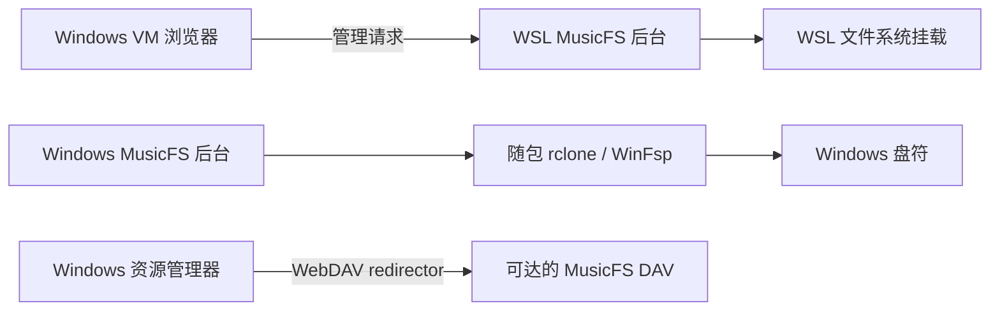

# Windows 虚拟机挂载诊断与限定验收

日期：2026-10-21。用户重新开放 Windows 验证范围，并提供测试虚拟机；全部操作从 WSL 经 SSH 进入该虚拟机，没有调用物理 Windows 宿主。此记录补充 [桌面宿主记录](p2-desktop-host.md)，不把原来跳过的全部 Windows 图形、恢复及客户端测试改写为通过。

## 环境与实际入口

- Windows 11 企业版 LTSC，系统版本 `10.0.26100.1742`，PowerShell `5.1.26100.1591`。
- 使用既有 `0.1.0-dev.0` Windows ZIP，在独立临时目录解压；先运行原程序复现，再仅替换修复后的程序。随包 rclone `v1.75.2`，sample `0.1.3`，Bun `1.4.3`。
- 通过 `MusicFS.exe --no-open --data <独立测试目录>` 启动真实后台，经正式管理 HTTP 安装 sample、创建实例和准备目录。没有安装 Bun 或复制任何音乐平台会话；唯一音频为 sample 的 16,044 字节合成 WAV。
- 本轮程序由 SSH 会话启动，未验证文件管理器双击、默认浏览器、图形错误弹窗或交互桌面的盘符可见性。

原最终 Windows ZIP 的 SHA-256 仍为 `fd920427d557b7e0085218b1d7c61a64702b4bf6d8a07100111f50870da12c7a`，没有覆盖该归档。最后一次测试程序 SHA-256 为 `b2d665f09566a908fb40e13efef805dac2b74321092c274572636a1eab962d50`；输入为 `4532f16` 加本次工作区补丁，源码摘要 `406ad18754f71c5ce61348640bf8aa9498339cd2c487c407698628cd47da7cdd`，`dirty: true`。它是限定回归产物，不冒充原冻结发行物。

## 本机挂载：三个独立原因

| 观测与单变量反馈 | 原因及处理 |
|---|---|
| 正式 `POST /api/mounts` 输入 `M:`，返回位置变成 `M:.`；rclone 报 `parent of mountpoint directory does not exist: M:\` | Windows `path.normalize('M:')` 会得到驱动器相对目录 `M:.`。保留交给 rclone 的裸盘符，其他路径按目标平台语义判断绝对路径并规范化 |
| 同一 RC/remote 仅将目标改回 `M:`，进入下一步并报 `cgofuse: cannot find winfsp` | 测试 VM 确实缺少 WinFsp。随后才安装官方稳定 WinFsp `2.1.25156` 的 `F.User`、`F.Main` 运行组件；安装器退出码 0，无重启，未安装开发或测试组件 |
| WinFsp 挂载已存在；.NET 能列出根目录，但同版本 Bun 对 `readdir('M:')` 报 `ENOENT`，`readdir('M:\\')` 成功，文件读取也成功 | rclone 挂载标识与文件系统绝对根路径职责不同。保留 RC 标识 `M:`，就绪检查使用 `M:\`，没有增加等待重试或关闭实际可读性检查 |

WinFsp 安装器来自[官方稳定发布](https://github.com/winfsp/winfsp/releases/tag/v2.1)，2.1 MB 文件的 SHA-256 为 `073a70e00f77423e34bed98b86e600def93393ba5822204fac57a29324db9f7a`，与发布页一致。没有将该依赖打进 MusicFS 发行包。

生产修复位于 `src/hosts/desktop/mounts.ts`；回归位于 `tests/desktop-mounts.test.ts`。回归经真实挂载协调入口，检查裸盘符、自动分配和 Windows 绝对目录传给 `cmount` 的值；原代码失败，修复后通过。Bun 对已存在 WinFsp 挂载的根路径差异另由同版本编译的小型只读探针实际证实，没有以 Linux 受控测试代替 Windows 内核行为。

## 最短正式回归结果

| 操作 | 结果 |
|---|---|
| 原生程序启动与正式 sample 安装 | 管理页 HTTP 200，sample 目录列出 `440 Hz.wav` |
| 正式管理 API 挂到 `M:` | 返回 `state: mounted`、`mountPoint: M:`、`error: null` |
| 从挂载文件系统读取完整小文件 | 16,044 字节，`RIFF` 文件头；SHA-256 `37fc52d4555f31bd7fc8b9d7546226e5aaa6f923562ec5d98cb971f621e7583f`，与同服务 DAV 下载摘要相同 |
| 正式 `DELETE /api/mounts/:id` | 本轮测试记录均返回 `stopped`，正常卸载成功 |
| 正式 `POST /api/desktop/quit` | 正常退出请求接受，随后 `runtime.json` 实际移除，SSH 正常结束 |
| 相关自动回归及类型检查 | `bun test tests/desktop-mounts.test.ts` 为 7 pass、0 fail、60 次断言；主 `tsc --noEmit` 通过 |

去敏机器结果及临时 PowerShell 探针保存在执行机器的 `/tmp/musicfs-windows-mount-diagnostic/`。凭据仅由测试 VM 内部读取到请求内存，不写入记录或 Git。

## 资源管理器原生 WebDAV：仍未闭合

这条路径使用 Windows WebDAV redirector，与 MusicFS 管理的 rclone/WinFsp 挂载独立，不能用缺少 WinFsp 解释。

本轮以同 VM 的 HTTP sample DAV 为目标，通过 Windows `WNetAddConnection2` 尝试临时映射，返回 Win32 `1203`。WebClient 原为 `Stopped/Manual`；只启动现有服务、不改变启动方式后，同一参数仍返回 `1203`。WebDAV 提供程序、`davclnt.dll`、`webclnt.dll` 和 MRxDAV 均存在，不能宣称缺少系统组件或服务启动已经解决问题。

最后只补两项判别：Windows [`DavGetHTTPFromUNCPath`](https://learn.microsoft.com/en-us/windows/win32/api/davclnt/nf-davclnt-davgethttpfromuncpath)返回 0，转换结果精确等于当前 VM 的 DAV 地址；明确指定已注册的 `Web Client Network` 提供程序后，映射返回 50（不支持该请求）。同一端点无凭据 HEAD 返回 401 和 Basic 挑战，说明不是把管理页地址或错误的 UNC 转换当作 DAV。

机器现有 `BasicAuthLevel=1`，按 [Microsoft 文档](https://learn.microsoft.com/en-us/iis/publish/using-webdav/using-the-webdav-redirector#webdav-redirector-registry-settings)只允许 HTTPS 的 Basic 认证；当前 HTTP fixture 不满足该默认认证条件。本轮没有修改此全局策略，1203/50 也不足以把全部失败唯一归因于这一设置。资源管理器直接映射至少需要现有 WebClient 服务运行、可达且使用受信任证书的 HTTPS DAV、正确读取凭据及已准备的目录；这些是使用条件，不是本轮已证明的 HTTPS 成功结果。

当前确定可用的替代是上节已验证的 MusicFS rclone/WinFsp 本机挂载，可读取 HTTP DAV，得到同样的 Windows 盘符与文件读取效果。没有为了原生映射同一内容而放宽全局认证策略或引入证书框架；没有宣称资源管理器映射成功，也没有截图或播放器验收。

## 宿主边界

“本机挂载”在运行 MusicFS 后台的电脑执行。在 Windows VM 浏览器打开 WSL 后台，管理请求仍在 WSL 执行，网页不会把挂载移到 VM。Windows 盘符需要运行 Windows 发行程序；资源管理器直接映射则需要 VM 可达的 DAV 地址。另一个系统的 `127.0.0.1` 指向该系统自身。

未覆盖 Windows 忙卸载、崩溃恢复、默认图形启动、远程 rclone 挂载、资源管理器成功映射或播放/拖动；本轮没有音乐平台请求、重复扫码、压力测试或新的云端操作。
