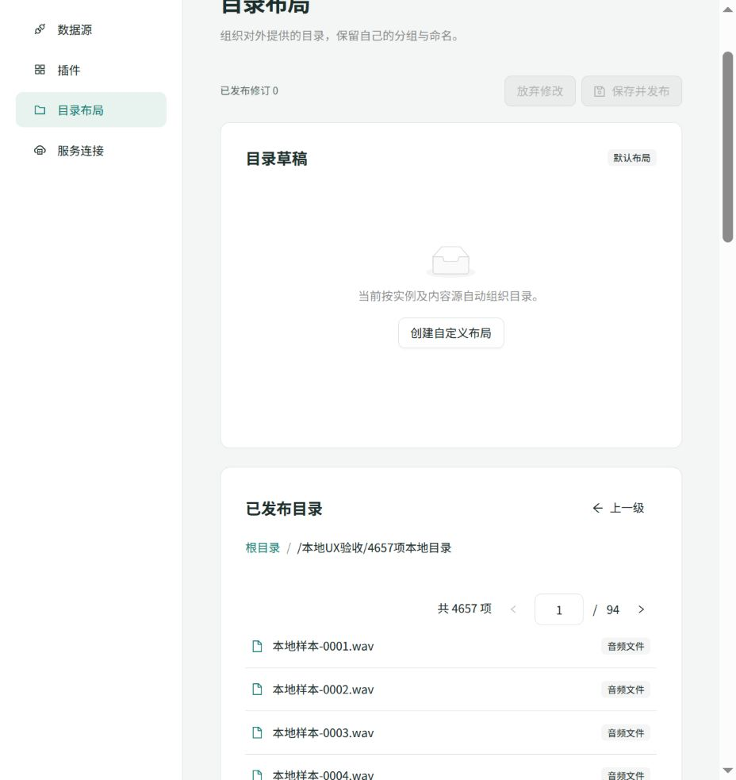

# 本地大目录与取消操作验收

日期：2026-10-20。范围：不涉及音乐平台、影响实际体验的共用WebUI。基线为`b2434c3`，本轮修改后使用Vite生产构建。测试在WSL内启动独立SQLite/正式桌面HTTP服务，Codex内置浏览器操作；未安装QQ/网易云，没有真实来源请求，也未修改8787开发服务或云端。

## 复现与修正

按已出现过的实际目录规模，以本地插件提供4,657个带完整描述的合成WAV条目，名称从`本地样本-0001.wav`到`本地样本-4657.wav`。通过正式安装、创建实例和目录准备入口建立快照，再从“目录布局 → 已发布目录”进入，未用浏览器网络替身或直接注入页面数据。

原页面一次渲染4,657个按钮。在951×1006的实际CSS视口中，文档高度260,547像素，靠后的内容需要滚动数百屏；这是一项普通大目录体验问题，不是高并发容量问题。

现复用已安装Ant Design的List及内建Pagination，每页展示50项，顶部提供总数、前后页及跳页输入。List负责切片和页数收敛，路径作为组件key，在进入另一个目录时重置页码。后端仍返回同一份完整目录，顺序、路径、来源分页、快照与DAV均不变；没有新增依赖或公开接口。小目录隐藏分页。

## 实际结果

| 操作 | 结果 |
|---|---|
| 打开4,657项目录 | 首屏50个条目，0001—0050，总数4,657、94页；文档约3,900像素 |
| 输入94并回车 | 末页7个条目，4651—4657，顺序及末项正确 |
| 返回父目录 | 两个来源目录可见，小目录不显示分页 |
| 再次进入大目录 | 回到第1页及0001—0050 |
| 窄屏检查 | 实际CSS视口582×1260，文档宽560，无横向溢出，分页控件位于可用宽度内；未据此声称390 CSS像素手机验收通过 |
| 本地慢目录双击刷新并取消 | 使用1,200项、每页200项、每页1.2秒的合成来源。双击只产生1次POST刷新，取消产生1次DELETE并成功；页面显示“刷新已取消”，刷新按钮恢复可用，随后可继续浏览原大目录 |
| 浏览器日志 | 本轮页面没有error/warn日志 |

请求记录来自独立正式服务：修正后这一轮共31次应用请求，其中30个200、1个202；刷新提交和取消分别只有1次。夹具不进行外部Fetch。没有高并发、持续负载或真实平台故障注入；不把这些结果替代真实来源、目标OS或免费计划证据。

## 检查与收尾

- 三组TypeScript检查、162模块/589依赖边界检查通过，生产Web构建通过；Schema表单既有大分块提示仍在，不增加体积整改或重复全套后台测试。
- 独立服务最终exit0并保存请求记录；临时浏览器页关闭，视口覆盖已恢复，临时夹具/数据/构建清理，仅保留小型摘要与此截图。
- 本轮只修改页面及样式。后续[核心/WebUI必要升级](p4-worker-cloud.md#核心与webui升级保留现有插件)已将同一生产页面纳入开发8787静态产物和真实Worker，并核对云端入口JS与本地产物一致；桌面归档仍留到统一发行时纳入，不重复交叉构建。

复测条件为相同规模的本地合成完整快照、一个有延迟的本地分页来源，以及上述浏览器操作。正式入口和现有资源夹具可复用，不建立新的浏览器测试框架；仅在相关代码变化或新失败出现时复测。
