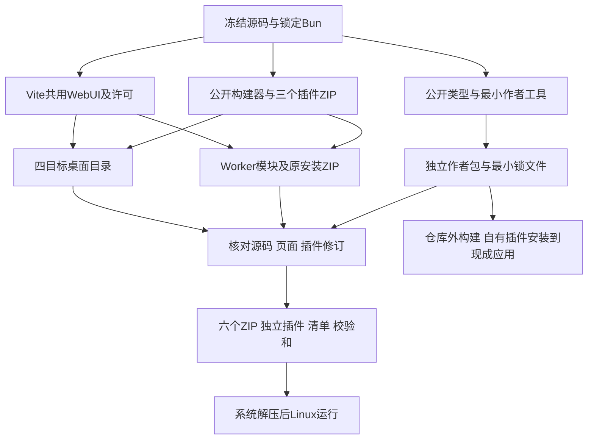

# P4 统一发行与独立插件作者验收

日期：2026-10-20。环境：Linux x86_64、Bun1.4.3、Node24.19.0。前半记录`9a7c80b`统一归档首检查点，后续GPL/source包结果见文末。范围是开发预览归档、作者交付和本地运行，不代表四系统、真实Cloudflare或完整许可已验收。

## 变更与责任

- `build-sample.ts`复用现有`build-plugin.ts`，不再单独维护ZIP算法；生成Ajv原许可。sample因此升为0.1.2，QQ仍alpha.9、网易云仍alpha.7，API0.1.5、数据库schema7不变。
- 桌面和Worker共用构建身份与npm许可收集。身份包含应用/API版本、Git基线/dirty标志、实际源码内容摘要、页面摘要及插件ID/版本/ZIP摘要。
- `package-release.ts`只处理指定的生成目录，检查实际输入一致后生成版本化ZIP、独立插件、`release-manifest.json`和`SHA256SUMS`。保留Unix文件权限，用现有zip.js流式写出。
- Worker原本只有注册模块，随包说明却要求用户上传ZIP。现额外保留`plugin-packages/`原ZIP，不增加Worker模块，也不自动激活安装；归档前核对这些ZIP与注册修订一致。
- 作者包使用本地公开API包、最小插件和原构建器，独立锁文件仅有13个依赖包，不带应用源码、WebUI或来源SDK。SDK未发布到npm。

首检查点流程如下；后续GPL交付增加独立项目源码包，当前共七个归档，以文末记录和发行清单为准。

身份记录的基线为`2963d94d8b1207461c5c3576fafe81e0042672f1`，`dirty: true`，源码内容摘要为`e843cd8713e4cca41e31f966e59c0c42a67e07832fac9bdf3217b33f3162112f`。它是该基线上的实际工作区构建，不冒充干净提交。页面摘要为`f61e7ec1d2116109aab5c6de9e6765b68dcfad2350acca5ef0914f53a7563757`。本页等验收文档不参与构建输入摘要，避免记录自身哈希的循环。

## 首检查点产物

首检查点`dist/releases/`内应用版本为0.1.0-dev.0，以下字节为当时结果，当前产物以发行清单为准：

| 归档后缀 | 字节 | 实际证明范围 |
|---|---:|---|
| linux-x64.zip | 74,756,832 | 系统解压后原生运行通过，挂载沿用此前独立证据 |
| windows-x64.zip | 77,691,379 | 交叉构建/归档通过，原生运行待验 |
| macos-x64.zip | 69,321,817 | 同上，保留完整.app |
| macos-arm64.zip | 65,114,987 | 同上，保留完整.app |
| worker.zip | 1,683,152 | 19模块、三个插件、七份迁移、页面及原ZIP；正式本地workerd链路通过 |
| plugin-author-kit.zip | 29,409 | 仓库外构建/类型检查及安装现成应用通过 |

三个独立ZIP为sample0.1.2（4,768字节）、QQalpha.9（133,539字节）、网易云alpha.7（245,724字节）。完整文件名、摘要和插件修订以同目录清单为准，不在多份文档重复维护。`sha256sum -c SHA256SUMS`十项全部通过。

## 已执行旅程

1. `bun run check`：216 pass/0 fail、2,614断言；三组类型、154模块/551依赖边界通过。最终构建器补充原ZIP后再次执行三组类型检查及本地Worker探针。没有为文档改动新增机械测试。
2. 用作者包复制到仓库外空目录，仅将sample的ID/名称/版本改为`org.musicfs.author-proof`、自有名称、0.1.0。`bun install --frozen-lockfile --ignore-scripts`、`bun run build`、`bun run typecheck`全部通过，输出4,764字节ZIP。最初强制离线安装因本机依赖缓存不足失败；正常锁定安装成功。最终包中的API、构建器、示例源码/Schema与该实测输入逐字节相同；23个本地文档链接均指向实际随包文件。
3. 用`probe-desktop-product.ts --plugin-archive … --plugin-id org.musicfs.author-proof`在现成编译应用安装该ZIP，检查兼容预览、两个实例及配置隔离，修改第一实例不影响第二实例，HEAD为16,044，范围为RIFF，重复启动复用后台、正常退出通过。探针不调用构建器。结束后主程序摘要仍为`c3dbf7130e2786423e3b176c06b1b2965215e27e8a814340f60e7f899385c224`，页面仍与发行身份一致。
4. 最终Linux ZIP用系统`unzip`解压到新的临时目录，未执行chmod；主程序和随包rclone均为0755。`probe-desktop-product.ts --directory …`的页面、兼容检查、外置sample安装、16,044字节HEAD/RIFF范围、后台复用及正常退出全部通过。没有重复FUSE全文/偏移矩阵。
5. `probe:worker:service`复验共用页面/API、未激活注册表、缺发布凭据诊断、D1重启及HEAD/RIFF。探针故意损坏模块产生一次预期初始化错误后以0退出。随后按正式入口及三个插件重新构建，归档检查确认入口为`src/worker.ts`，不是探针入口。

原生应用和页面没有加入作者来源专用分支。以上作者证明使用最小WAV来源，不等于任意第三方来源或真实云端作者安装已验。

## 许可与尚未覆盖的范围

原桌面许可路径递归复制整个node_modules，约1,924文件/21MiB，包含未参与产品构建的内容。现Bun构建清单收集桌面核心27包、Worker核心9包的原许可/NOTICE及索引，Vite内建功能生成页面许可；Linux的整个licenses目录约372KiB，Worker约220KiB。插件各自保留原许可。

`truncate-utf8-bytes@1.0.2`发布包声明WTFPL但缺正文，按该确切版本在`third-party/npm/`保留固定SPDX原文与出处，不按通用SPDX名称自动推断许可。Bun1.4.3固定原始LICENSE.md随桌面保存；该文件是说明与来源链接，不是全部嵌入库正文及重新链接材料。根项目代码许可尚未确定，不能从sample的MIT推断核心和工具同样采用MIT。这两项仍是正式许可收口缺口。

其他OS原生启动/系统挂载、Linux活动挂载异常恢复、代表性其他格式客户端、来源自然续期/失效重登及完整示例、真实Cloudflare发布/状态与绑定保留/免费资源仍分别待验。本轮产物只作为可审阅开发预览，不标记FR16、FR24或主线全部完成。

## 后续：GPL-3.0-only与同版本项目源码

用户明确选择GPL-3.0-only后，根LICENSE、根包/公开API/示例工作区metadata、作者包及三个示例的自有代码声明均已统一；GNU GPLv3正文保持原文，仅在正文前添加项目版权和GPL-3.0-only声明。第三方许可不改写，Bun运行时完整资料仍未收口；前述“根许可尚未确定”仅是首检查点事实。

sample0.1.3、QQalpha.10、网易云alpha.8已统一重建四目标、Worker及作者包。发行器新增`source.zip`，因此为**七个归档、三个独立插件ZIP**；它只取Git登记或未忽略的指定项目目录与根构建文件，排除安装目录、产物及私有状态。`SOURCE.md`记录原发行身份和解压后建立本地Git输入快照的步骤，不创建新的身份协议。完整文件名、大小和摘要以当前`release-manifest.json`为准。

实际系统解压源码ZIP到仓库外，按[源码构建步骤](../development.md#从源码发行包构建)执行Git初始化/快照、锁定依赖安装、原生Linux发行构建（包含WebUI及三个插件）、三组类型检查，全部通过。重建所得源码输入摘要与原发行一致，**本次Linux二进制也逐字节一致**；不由此承诺所有目标/以后版本都确定性复现。源码包不包含第三方运行时全部重新链接材料，不能把项目源码ZIP当作全部许可验收完成。

## 后续：目录失败状态与宿主诊断冻结

2026-10-20构建输入冻结于`2eb81fe`，应用/API、插件版本和数据库schema保持。新增目录error投影及已发布嵌套目录浏览、磁盘不足错误归类；四目标桌面、正式三插件Worker和作者包已从同一输入重建，再交给原统一归档入口。当前身份与校验值以发行清单为准；先前源码重建证据保留其原检查点，本轮不重复安装依赖或全套作者旅程。

- 最终`bun run check`为224 pass/0 fail、2,699断言；三组类型及155模块/560依赖边界通过。
- 正式本地workerd页面/API、未激活注册表、兼容检查、缺发布凭据、D1重启和DAV样本通过；坏插件初始化错误为预期拒绝。随后恢复`src/worker.ts`与三个正式插件的发行构建，不将探针入口打包。
- 最终Linux程序的目录`{entries,status}`接口、外置sample、HEAD 16,044字节/RIFF范围、后台复用、真实FUSE全文/五偏移、忙卸载及正常退出通过。本轮不重复此前两次30秒活动挂载崩溃恢复，其证据及对应程序检查点见[桌面记录](p2-desktop-host.md)。
- 开发8787服务已重开加载新接口；页面及新目录根接口均200。重启前后4个安装、6个实例（含私有列）与1份布局的逐行摘要相同；没有刷新来源或修改账号。

完整许可、Windows/macOS原生和真实Worker仍分别待验；构建成功不抵扣这些义务。

## 后续：固定运行时声明与发行资料边界

构建输入冻结于`1200f28`。保留固定Bun/WebKit来源的22组、36份原始许可和NOTICE，构建器核对固定提交及各文件SHA-256后保存到桌面`licenses/bun-runtime/`。索引仍为`complete:false`；已收集份数不代表完整许可通过。简单的`--runtime`入口复用官方`compile.executablePath`，不维护自制运行时组装器。

本轮四目标桌面、正式三插件Worker、作者包和源码已统一生成，源码内容摘要为`df307ea7af106b26551da06346f690ae10495bf4c93f90b4ce4b3fb5e47f18f8`。四目标均恢复`runtime.kind: default`，不是此前带标记的实验输入；每个桌面目录的36份正文摘要全部匹配。三组类型检查及发行清单11项校验通过。应用代码未变，不重复账号、挂载和全部故障回归；本轮不新增原生系统或真实云端通过结论。

应用包保留必要声明、原文和来源索引；项目对应源码为独立附件。调研文档、依赖分析及实验材料不进入应用包，也未把大型上游源码下载塞入程序ZIP。具体发行所需的源码或对象材料仍按许可单独核实，可与程序分开提供；完整上游Bun/JSC源码重建是可选工程验证。已停止扩大该调查并删除新增的常规标记探针，避免把开放源码误当成可以省略声明，也避免把所有调查材料都当成应用运行依赖。

## 后续：授权恢复界面

`3586730`已修复[失效后的页面恢复](p2-session-lifecycle.md#后续失效提示直达重新授权)。三组类型、155模块/560依赖边界及独立测试插件的浏览器旅程通过；随后冻结输入，统一构建四目标、正式Worker/作者包和七份归档。当前源码内容摘要为`eefe397ac3352aaf40e7dd96de32c6c58b32bb103ae0ffb01a519147960c96d7`，构建输入干净，四目标使用默认运行时，三个插件修订保持。`SHA256SUMS`11项通过。仅页面和使用说明变化，不重复原生挂载或账号验证；临时浏览器页、服务及测试目录已清理，原开发账号未修改。

## 后续：退出授权与桌面局域网设置

`6751e7a`补共用退出授权，`d2db5c8`补桌面局域网监听；输入在`c19832c`冻结，源码摘要`3d05e50b6d339e8c1eb3eda08dd992d650f3809cbc40dea390361601c9bddffe`、WebUI摘要`6f7207f074522e2255b92229079ba9d08d977803d2f5a87b702a3f6bebc9a383`，dirty=false。应用0.1.0-dev.0、API0.1.5、schema7和三个插件版本/修订保持。四目标、19模块/七迁移的Worker、作者包及源码已统一生成七个归档，连同三个插件ZIP和清单的11项SHA256SUMS全部通过。完整文件身份以`dist/releases/release-manifest.json`为准。

全量228 pass/0 fail、2,770断言，三组类型与160模块/586依赖边界通过；本地workerd/D1正式管理入口的退出→重建→needs_auth→重登恢复另经现有认证探针通过。浏览器在独立临时后台完成授权→退出→重登，以及网络设置保存→正常退出→同一数据重启生效。

从本轮实际Linux发行目录运行编译程序，使用自有认证夹具验证退出204、重启后认证仍为空且实例/配置保留；局域网/固定端口设置保存后重启生效，非回环DAV为207，最后正常退出并清理测试数据。未重复音频字节、FUSE或崩溃矩阵，其他OS仍只有交叉构建。本轮LinuxZIP为74,921,375字节，SHA-256`a6c7a7bd2fc1af585236d9370062def5f5b17a23aeab7f4c5b559334b9e0c736`；WorkerZIP为1,771,676字节，SHA-256`3f34171d5d00232528f0a7db740dd19735a20576a14700213cd67303809db924`。

旧开发服务句柄已确认exit0且监听表为空后，使用原数据重开8787；启动前后4安装、6实例（含私有列）、1布局的逐行摘要相同。只对不存在实例核对新增退出路由返回missing_instance，没有退出或刷新真实账号。当前开发服务仍只监听本机；桌面网络设置属于发行启动器。完整运行时材料、真实云端及其余原生系统继续待验。

## 后续：分页页面与安全升级入口统一发行

构建输入冻结于`735b31c06c89d573f903d3a2161c2a7620767651`，dirty=false，应用0.1.0-dev.0、API0.1.5、schema7不变。源码摘要`47fbc5a95a80ab887578d4069fe7928c14e52294e5373be6e5477b870b5ec34c`，页面摘要`f82e940ed795405b38aecaeed5d35cf9c58b18afadf74af8e58fedd494d06734`；当前分页页面、核心升级组装工具及说明已纳入统一产物。

复用现有页面和本地依赖/四目标运行时缓存，执行一轮`build:desktop --all --skip-web`、正式三插件`build:worker`、`build:author-kit`和`package:release`。四桌面使用默认Bun1.4.3和rclone1.75.2；Worker为19模块/七迁移，三个正式插件为sample0.1.3、QQalpha.10、网易云alpha.8。没有使用含临时sample/作者验收插件的云端升级目录替代正式发行输入。

七个归档、三个独立插件及清单的`SHA256SUMS`共11项全部通过。最终Linux ZIP用系统unzip解压，主程序和rclone均保持0755，无手工chmod；对实际解压物运行一次`probe-desktop-product`，页面、外置sample安装、目录状态、16,044字节HEAD/RIFF范围、后台复用和正常退出通过。临时解压/探针数据已清理，没有重跑挂载、崩溃、扫码或云端探针。作者包最初遇到沙箱缓存只读，允许同一构建使用既有WSL缓存后成功，不修改产品代码。

| 当前归档 | 字节 | SHA-256 |
|---|---:|---|
| Linux x64 | 74,924,813 | `71065c70d0f3a1b1a9db1a964f486ee630cd2b3d70db5813df34aa081bf1aa0d` |
| Worker | 1,775,078 | `8652a7b18bfb29113f2998058db91e1b219e859fddef529c7c9b88796b91f831` |
| 作者包 | 53,896 | `57dc551b943b8de36bd2ff6d1b03586e0c08b9219076ba99f0fb390d43ae577b` |
| 项目源码 | 1,264,518 | `9cc8696a0eb0feee76c40518358720d60c6cf5bfdf23b32f3c92f5c1cdc7160b` |

完整四目标/七归档及插件身份见`dist/releases/release-manifest.json`。Windows/macOS仍只有交叉构建；本次Linux证明WSL下基础运行，其他原生系统、图形入口及必要运行时材料继续单列。验收记录不参与构建输入摘要，后续补充本轮结果无需反复重建归档。
