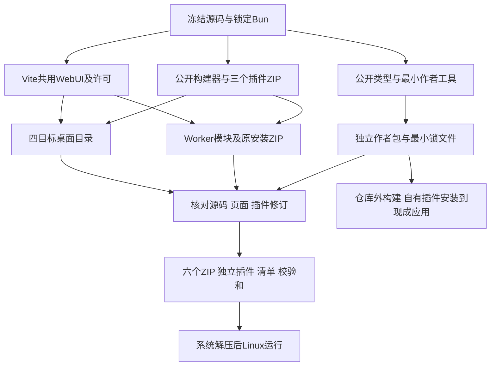

# P4 统一发行与独立插件作者验收

日期：2026-10-20。环境：Linux x86_64、Bun1.4.3、Node24.19.0。范围是当前开发预览的归档、作者交付和本地运行，不代表四系统、真实Cloudflare或完整许可已验收。

## 变更与责任

- `build-sample.ts`复用现有`build-plugin.ts`，不再单独维护ZIP算法；生成Ajv原许可。sample因此升为0.1.2，QQ仍alpha.9、网易云仍alpha.7，API0.1.5、数据库schema7不变。
- 桌面和Worker共用构建身份与npm许可收集。身份包含应用/API版本、Git基线/dirty标志、实际源码内容摘要、页面摘要及插件ID/版本/ZIP摘要。
- `package-release.ts`只处理指定的生成目录，检查实际输入一致后生成版本化ZIP、独立插件、`release-manifest.json`和`SHA256SUMS`。保留Unix文件权限，用现有zip.js流式写出。
- Worker原本只有注册模块，随包说明却要求用户上传ZIP。现额外保留`plugin-packages/`原ZIP，不增加Worker模块，也不自动激活安装；归档前核对这些ZIP与注册修订一致。
- 作者包使用本地公开API包、最小插件和原构建器，独立锁文件仅有13个依赖包，不带应用源码、WebUI或来源SDK。SDK未发布到npm。

身份记录的基线为`2963d94d8b1207461c5c3576fafe81e0042672f1`，`dirty: true`，源码内容摘要为`e843cd8713e4cca41e31f966e59c0c42a67e07832fac9bdf3217b33f3162112f`。它是该基线上的实际工作区构建，不冒充干净提交。页面摘要为`f61e7ec1d2116109aab5c6de9e6765b68dcfad2350acca5ef0914f53a7563757`。本页等验收文档不参与构建输入摘要，避免记录自身哈希的循环。

## 实际产物

`dist/releases/`内应用版本为0.1.0-dev.0：

| 归档后缀 | 字节 | 实际证明范围 |
|---|---:|---|
| linux-x64.zip | 74,756,832 | 系统解压后原生运行通过，挂载沿用此前独立证据 |
| windows-x64.zip | 77,691,379 | 交叉构建/归档通过，原生运行待验 |
| macos-x64.zip | 69,321,817 | 同上，保留完整.app |
| macos-arm64.zip | 65,114,987 | 同上，保留完整.app |
| worker.zip | 1,683,152 | 19模块、三个插件、七份迁移、页面及原ZIP；正式本地workerd链路通过 |
| plugin-author-kit.zip | 29,409 | 仓库外构建/类型检查及安装现成应用通过 |

三个独立ZIP为sample0.1.2（4,768字节）、QQalpha.9（133,539字节）、网易云alpha.7（245,724字节）。完整文件名、摘要和插件修订以同目录清单为准，不在多份文档重复维护。`sha256sum -c SHA256SUMS`十项全部通过。

## 已执行旅程

1. `bun run check`：216 pass/0 fail、2,614断言；三组类型、154模块/551依赖边界通过。最终构建器补充原ZIP后再次执行三组类型检查及本地Worker探针。没有为文档改动新增机械测试。
2. 用作者包复制到仓库外空目录，仅将sample的ID/名称/版本改为`org.musicfs.author-proof`、自有名称、0.1.0。`bun install --frozen-lockfile --ignore-scripts`、`bun run build`、`bun run typecheck`全部通过，输出4,764字节ZIP。最初强制离线安装因本机依赖缓存不足失败；正常锁定安装成功。最终包中的API、构建器、示例源码/Schema与该实测输入逐字节相同；23个本地文档链接均指向实际随包文件。
3. 用`probe-desktop-product.ts --plugin-archive … --plugin-id org.musicfs.author-proof`在现成编译应用安装该ZIP，检查兼容预览、两个实例及配置隔离，修改第一实例不影响第二实例，HEAD为16,044，范围为RIFF，重复启动复用后台、正常退出通过。探针不调用构建器。结束后主程序摘要仍为`c3dbf7130e2786423e3b176c06b1b2965215e27e8a814340f60e7f899385c224`，页面仍与发行身份一致。
4. 最终Linux ZIP用系统`unzip`解压到新的临时目录，未执行chmod；主程序和随包rclone均为0755。`probe-desktop-product.ts --directory …`的页面、兼容检查、外置sample安装、16,044字节HEAD/RIFF范围、后台复用及正常退出全部通过。没有重复FUSE全文/偏移矩阵。
5. `probe:worker:service`复验共用页面/API、未激活注册表、缺发布凭据诊断、D1重启及HEAD/RIFF。探针故意损坏模块产生一次预期初始化错误后以0退出。随后按正式入口及三个插件重新构建，归档检查确认入口为`src/worker.ts`，不是探针入口。

原生应用和页面没有加入作者来源专用分支。以上作者证明使用最小WAV来源，不等于任意第三方来源或真实云端作者安装已验。

## 许可与尚未覆盖的范围

原桌面许可路径递归复制整个node_modules，约1,924文件/21MiB，包含未参与产品构建的内容。现Bun构建清单收集桌面核心27包、Worker核心9包的原许可/NOTICE及索引，Vite内建功能生成页面许可；Linux的整个licenses目录约372KiB，Worker约220KiB。插件各自保留原许可。

`truncate-utf8-bytes@1.0.2`发布包声明WTFPL但缺正文，按该确切版本在`third-party/npm/`保留固定SPDX原文与出处，不按通用SPDX名称自动推断许可。Bun1.4.3固定原始LICENSE.md随桌面保存；该文件是说明与来源链接，不是全部嵌入库正文及重新链接材料。根项目代码许可尚未确定，不能从sample的MIT推断核心和工具同样采用MIT。这两项仍是正式许可收口缺口。

其他OS原生启动/系统挂载、Linux活动挂载异常恢复、代表性其他格式客户端、来源自然续期/失效重登及完整示例、真实Cloudflare发布/状态与绑定保留/免费资源仍分别待验。本轮产物只作为可审阅开发预览，不标记FR16、FR24或主线全部完成。
