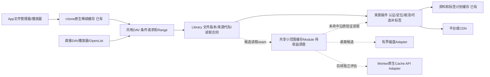

# MusicFS 缓存与重复读取优化规划

日期：2026-10-21。状态：用户已授权实施A—D，dev.10实现及有界离线调查已完成，Windows消费端定向验收已通过，Windows更新与对应源码已按dev.10归档并通过摘要校验。未新增依赖或请求音乐平台。原评估基线为dev.9。事实见[现行缓存策略](../docs/architecture/cache-policy.md)、[挂载证据](../docs/architecture/desktop-mounts.md#文件头扫描与读取范围)，外部能力依据见[主源调查](../docs/research/shared-read-cache-options.md)。本文件持有本轮候选和实施顺序，主实施计划只保留入口。

## dev.11实施结果（本轮当前）

用户已授权实施补充评估。已选用rclone serve/start服务端VFS，保持外部DAV与library合同，通过不可变最终身份键处理同路径/大小/mtime更新；App本机挂载绕过共享落盘并保留原statMany。共享默认16GiB/7天、原生状态/设置/清理、共用RC所有权及正常退出已接线。没有实现自有分块/窗口引擎或引入字节缓存依赖。当前正式模块已通过有界WSL回环消费验证，Windows最终包待本轮验收与归档。[设计与精确证据](../docs/architecture/shared-read-cache.md)

下面补充评估是实施前的候选记录，未实施措辞只指当时状态；当前以上述结果为准。

## 直接WebDAV共享读取：补充方案评估（2026-10-21，尚未实施）

用户进一步要求解决直接DAV重复取源并评估方案。本节更新之前对候选E/F的粗粒度判断，A—D已交付事实保持。先前只证明“完整短Range响应缓存”无法覆盖FFprobe开放GET，并未排除“流式读取时保存已读前缀”，也不足以判定所有rclone服务端复用方案ROI低。下面是新增候选与实施建议，不表示批准或完成了新缓存实现。

**建议：先核对缓存容量，再用0.5—1人日验证现有rclone能否承担直接DAV的共享缓存。** 验证通过，采用复用方案，总计约3—5人日；若保持现有文件版本与协议合同需要大量胶水代码，则结束此路线，改评估5—8人日的共享分块缓存。两条是替代路线，不同时建设。流式首尾窗口是3—4人日的缩小范围选项，适合只优先解决重复扫库；若要同时覆盖播放与任意seek，不建议先做窗口再立即重写。

### 容量也是实际场景的一部分

Windows原生Shell已测样本会读取约1MiB标签区、2MiB后续区和约62KiB尾部，合计约3.06MiB最终文件范围。若4000首都具有相似读法，工作集约12GiB，可能超过当前每挂载8GiB软上限；原生淘汰后按同样顺序重扫，可能反复驱逐和回源。该数字是单曲样本的容量模型，不是实际4000首占用或用户卡顿根因证明，也没有把稀疏文件的逻辑全长当作物理占用。

优先核对是否开启、实际占用、保留期和容量是否足以留住常用库；现有App已经支持配置，不需要新缓存实现。界面原生占用会滞后，不能因一次为0就判定未存储。新增共享缓存要明确全局容量归属，避免App VFS和服务端各默默叠加8GiB。长期保留也不能替代足够容量，首次未缓存扫描仍有必要来源读取。

### 可选方案与投入

以下为单人有效开发人日，约8小时/日；含设计、实现、有限正常旅程验证和文档，不含用户协助/环境等待。都是工程估算，非实测工期。替代方案不相加；rclone总量含最初验证，Worker单列。

| 方案 | 对重复扫库 / 播放与seek的效果 | 总投入 | 主要代价或不确定性 | ROI与选择 |
|---|---|---:|---|---|
| 容量及双重存储梳理 | 已有挂载避免因工作集放不下而反复淘汰；不能补直接DAV缺失的服务端缓存 | 0.25—0.5 | 需要占用依据，不能直接认定8GiB是根因或盲目扩大默认值 | 高，先做；已有配置足够时不新增功能 |
| 客户端缓存/条件请求微调 | 配合支持缓存的客户端减少正文；部分播放器不会使用 | 0.25—0.5 | URL路径可变，随意延长新鲜期会推迟更新；无法承诺开放GET复用 | 低到中，只作为补充 |
| 只保存完整短Range响应 | 命中完全匹配的小范围；开放GET扫描仍反复读源 | 2—4 | 请求形态覆盖不足，重叠范围仍可能不命中 | 当前低，不选 |
| 流式首尾窗口缓存 | 开放GET边读边保留前缀，提前取消后仍可复用；少量尾部范围另存。长音频中段重播不覆盖 | 3—4 | 需要部分数据提交、流拼接和容量回收；不同格式/播放器可能超出窗口 | 扫库优先时中高；不是全面播放缓存 |
| 复用rclone服务端VFS | 成熟稀疏缓存可服务多个直接DAV客户端，覆盖开放读取、重叠范围和seek | 3—5，含0.5—1验证 | 路由/生命周期、精确表示身份、条件响应及正常更新需接入验证；不能直接替换现有DAV就宣布兼容 | 潜在最高，优先验证 |
| 项目内共享持久分块缓存 | 所有客户端复用已缓存最终字节；开放GET、取消后继续、seek可统一支持 | 5—8 | 范围协调、合并源请求、容量回收及Windows发行维护由本项目承担 | 功能ROI高、投入中高；rclone不适合时的完整替代 |
| 完整读完才存整曲 | 完整听完后的重播受益；扫描提前取消通常不形成可用缓存 | 1—2 | 对当前重复扫库主要路径无效；不能为填缓存强制补下载整首 | 当前低，不先做 |
| 免费Worker内部块缓存 | 同机房命中可减少来源读取；桌面缓存不能直接搬过去 | 0.5—1验证；产品化另估2—4 | CPU/调用预算、缓存可淘汰与分机房；没有区域命中或免费CPU通过证据 | 延后，独立决定，不增加付费存储作为前提 |

### 复用rclone：要验证的具体设计

rclone的`serve webdav`本身具有VFS full、容量/保留期及稀疏范围复用；`serve/start`可通过既有RC管理。已在现有固定1.75.2二进制上只读执行`rc --loopback rc/list`，确认该调用及`vfsOpt`参数存在；本轮未启动缓存服务器。能力出处：[官方serve说明](https://rclone.org/commands/rclone_serve_webdav/#vfs-file-caching)、[RC serve/start](https://rclone.org/rc/#serve-start)。

候选是在桌面宿主内增加受管理的回环缓存读取路径，由现有HTTP/DAV和library继续决定对外文件身份、权限、状态、Range及响应头。内部rclone负责已读范围、落盘与淘汰，缺失范围才进入既有来源插件。内部直读入口与外部缓存路径必须分开，防止回环请求再次进入缓存路径。用户继续使用原DAV地址，不要求自己安装代理或挂载盘；这里是HTTP/VFS服务，不以WinFsp/FUSE驱动作为直接DAV客户端的前提。

不能仅凭rclone的Size/ModTime指纹代替最终表示身份：同路径同大小但标签/音质变化时，必须映射到新缓存身份或准确失效。优先用已有内容身份、来源代际与插件修订；若必须复制完整目录模型、重写外部DAV语义或在每次缓存命中前再开平台流才能正确，视为该路线失败，而不是不断加补丁。实际复用同一个RC/VFS及与既有App缓存是否可合并，要在小样本中确认，不能默认两个实例共用目录就可安全复用。

### 自有缓存：职责与可控范围

- 核心library拥有身份、范围和来源代际判断；缓存命中仍执行已有本地有效性检查，不为了命中去解析一次CDN地址。临时URL不作缓存键。
- 只缓存插件交付的最终文件字节，通用于现有音频格式；不在核心解释ID3、FLAC或M4A，不强制插件新增音乐资料或缓存能力。
- 桌面缓存Module隐藏索引、落盘、缺失范围和回收；外部Interface保持一次按身份/范围读取和必要管理操作，不向DAV泄漏分块细节。
- App本机挂载继续使用既有VFS时应绕过重复落盘；直接DAV客户端共享服务端缓存。若最终决定统一缓存所有权，要同时替换旧写入路径及设置归属，不能保持两层默认重复写同一批字节。
- 流式窗口候选只保留实际经过的首部连续前缀及尾部已读范围，例如首4MiB/尾256KiB是待样本确认的上限，不为凑满窗口额外下载。取消时保存已提交的真实长度，后续读取从缺失位置续取。开放GET不需要等整首完成才可产生缓存。
- 完整分块方案按有限块存储，但连续缺失块合并成较大的源读取流，沿用递增读取思路；不能把一个缓存块机械变成一次SDK地址解析和CDN请求。缓存写入不能触发无人消费的整曲后台下载。
- 容量按实际已存字节控制；不为每首建立定时刷新任务。内容身份稳定时可长期复用，仍受用户容量/保留策略限制。

第三方优先复用现有rclone。`cacache`仅可作为字节存储候选；它提供内容寻址与流式读写，范围协调、容量LRU和物理回收仍要设计，且删除索引不等于释放内容。若有限窗口用标准文件接口更简单，不能只为“用了依赖”再增加一层。Bun/Windows实际版本适配只在选中路线后做一次。[cacache官方API](https://github.com/npm/cacache)

### 收益、风险与执行粒度

收益以同一文件表示的重复扫描/播放为主：单一播放器自身已有持久缓存时新增收益较小；NAS/手机/不同播放器重复扫描或不保存正文时，服务端共享缓存价值高。新库首次扫描、读取新范围和明确更新仍需取源，不能承诺首次4000首零请求或固定耗时。

最值得防止的是实际性能退化：容量过小导致循环淘汰、双层写盘挤掉工作集、分块过细使SDK/CDN调用暴增、流缓存吞掉取消造成继续下载，以及同路径更新仍命中旧表示。这些均来自当前真实读取合同，不扩展高并发、分布式锁或通用缓存平台。

建议实施顺序与停止条件：

1. 0.25—0.5人日完成容量及所有权核对，复用已有占用/管理能力，不为此重刷真实整库。
2. 最多0.5—1人日完成rclone回环垂直样本：相同FFprobe开放GET重复读取、取消后继续、一次尾部/重叠范围及同路径同大小正常更新。统计源字节和SDK调用，排除只降低接口耗时但请求数上升。
3. 通过则在3—5人日总量内接入现有桌面管理与生命周期；不通过则记录具体失败点，转5—8人日的共享分块路线，不同时维护两个新引擎。窗口方案仅在明确收缩为扫库优先时选择。
4. 使用生成音频和既有标签证据；验证一次重启复用、清理/容量淘汰后重新取源、正常播放与seek。Windows只在选定实现后用现有VM做一次必要消费验收，不恢复历史全格式/客户端矩阵。
5. Worker继续独立流式路径。其Cache API不接受直接保存206，块对象需另作完整对象协调；没有必要为桌面方案上线额外部署/存储或测试付费账号。[Cloudflare Cache API](https://developers.cloudflare.com/workers/runtime-apis/cache/)

当前推荐桌面路线约**3.5—5.5人日**（容量核对加rclone总量，取整预算）；若rclone验证失败后才采用完整分块，约**6—9.5人日**含前期探索，不能把被否决路线的整段产品化工期相加。以上为工程估算，尚未实现，也不保证真实客户端的命中率。本轮仅做方案与依赖能力核对，不改产品、不构建、不请求音乐平台。

## dev.9—dev.10既往阶段的决定

**执行结论：** B已将初始块从256KiB调至1MiB，受控播放SDK/CDN请求7次降至4次，预留标签小读仍为0次源请求；C已提供原生缓存状态和定向清理；D的实际FFprobe开放GET仍消费约1.3MiB源音频，小范围缓存不能覆盖主要读法，因此E不进入实现，F继续延后。A已用最终Windows包验证原生Shell/FileStream消费、重挂零源读取及清理后重新取源。证据集中见[缓存消费记录](../docs/verification/cache-consumption-2026-10-21.md)。下面候选估算保留为决策依据，并非全部必做工作。

1. 保留共用核心、插件职责和现有缓存；先收口dev.9的真实消费旅程与播放成本。不推倒架构，不重写SDK，不因“所有入口统一”立即增加第二套磁盘缓存。
2. 将直接WebDAV/播放器扫描纳入明确需求。现在就安排一次有结束条件的读取模式与命中收益调查，而非无限等待用户报告；依据实际请求形态决定共享缓存范围。
3. 桌面共享小范围缓存作为下一候选；任意范围持久稀疏缓存与Worker音频缓存均不提前承诺。若小范围方案不能覆盖真实客户端，就明确比较完整方案成本，不能将局部命中宣传为通用解决。

## 用户效果与范围

- 再次打开同一目录，使用最近成功清单；不因浏览先刷新平台或准备全部歌曲。已准备的资料/标签继续共用。
- 对同一文件表示、已经取得且未淘汰的片段，重复读取应优先复用；不能把“有缓存”只解释为目录或歌词缓存。
- 普通播放器/WebDAV客户端能受益是目标，不以用户更换播放器、手动先准备整库为默认解决办法。具体缓存路径可以因客户端能力不同而不同。
- 首次未缓存读取、读取新范围、明确更新及缓存淘汰允许取源。平台身份/临时地址核对与音频正文下载分开统计，不要求任意情况下完全零网络。
- 正常播放、seek、最终大小/字节/Range和取消不退化；冷目录速度不能靠增加整曲预取或平台请求获得。
- 缓存可查看启用情况、控制容量/保留期、清理；稳定音频片段不另建逐首刷新定时器。音乐资料和目录的周期更新沿用已有机制。
- 优先桌面；Worker以免费约束评估，复用语义和读取合同，不要求同一存储实现，不预设R2、KV、额外代理或付费服务。

不是本轮目标：公共多人服务、高并发、跨账号去重、全库离线下载管理、统一任意HTTP缓存平台、预先缓存全部音乐或恢复历史全平台验收矩阵。

## 规划基线与原有缺口（dev.9）

| 对象/旅程 | 已有能力 | 尚不能声称 |
|---|---|---|
| 目录、FileInfo/ETag | SQLite/D1快照、进程内发布视图；本机发布后通知挂载 | 所有第三方目录缓存立即更新 |
| 音乐资料、封面歌词、固定标签计划 | 来源实例持久缓存，可跨客户端复用 | 所有GET都不会请求源音频 |
| App挂载已读片段 | dev.9原生rclone full，默认每挂载8GiB/7天；有界离线FUSE/HTTP跨重挂重读0次GET | Windows资源管理器十多秒等待全部消失，所有实际音频格式/播放网络已重验 |
| 直接DAV重复音频Range | ETag/304与准确Range；没有通用服务端片段存储 | 客户端不保存字节时仍能自动复用CDN数据 |
| 连续播放的请求成本 | 本地生成65MiB完整读准确，分块递增 | 新分块下SDK地址解析次数、真实延迟与播放连续性已经验证 |

近期主要原因是缓存职责与验收范围遗漏：原设计已经建议VFS full，但此前实际CacheMode off；目录枚举探针禁止open，因此没有覆盖文件管理器读取音乐信息。默认预读放大又提高了每次失配成本。已有证据不能将这些等待统一归为平台限流；不通过扩大并发解决。

## 模块与层级

- 插件继续拥有认证、音乐语义、定位和最终表示；不强制插件自行实现音频磁盘缓存。插件自带缓存能力仍兼容。
- DAV继续拥有HTTP条件、Range解析和响应，不加入网易云/QQ判断，也不解释标签计划。
- 若共享缓存进入实现，候选seam在`library.files.open`内既有来源代际/范围检查之后、已验证读取的调用处；不能在外层缓存命中时绕过原检查。一个小Interface隐藏范围复用与宿主存储，先有实际需要的Adapter才拆分，不先新增插件API。
- 缓存键使用来源实例/代际、插件修订及最终文件表示身份，不以目录路径或临时CDN URL作为唯一身份。只复用同一最终表示，不承诺不同标签版本或不同实例自动去重。
- 首版候选只处理足够小且完整的已验证Range；取消/短读不将不完整条目记为命中。真实客户端若主要使用开放GET再提前关闭，这个范围不足，不能用命中小样本代替用户场景。
- 不为命中率建立常驻监控平台。使用有界计数区分清单、资料、URL解析、源音频请求/字节与命中，调查完成即停止采集；界面仅保留能帮助用户控制缓存的状态。

## 方案比较

以下工作量为单人有效开发人日（约8小时），含必要接线、定向验证及文档；不含VM/用户协助等待。是剩余增量估算，不重复计算dev.9已完成工作。

| 方案 | 能解决什么 | 代价/风险 | 估算 | 决定与ROI |
|---|---|---|---|---|
| 保留rclone/播放器原生缓存 | 单客户端的重复扫描、播放和重开；App已交付 | 其它客户端不自动共享，仍需实际消费端收口 | 见下面A/B，不再重复实现 | **当前最高ROI，保留** |
| 桌面服务端小范围缓存 | 重复头尾/短Range可跨DAV客户端复用，不依赖播放器落盘 | 范围形态不同时命中有限；开放GET取消不必然受益；需要有限磁盘策略 | 收益调查通过后 **2—4人日** | **条件性高ROI，优先候选** |
| 完整读完才缓存整文件 | 后续完整重播；可以边转发边落盘，不必先下载才返回 | 只读头尾后取消不会形成完整文件，不能解决当前扫库问题；占用更大 | **1—2人日**，非当前关键路径 | **当前低ROI，不先做** |
| 完整持久稀疏缓存 | 相同/重叠范围、开放GET和seek均尽可能复用片段 | 自有范围索引/缺块读取/流拼接/回收与取消明显更复杂，需维护 | **5—8人日**，替代上面的局部方案，不是叠加预算 | **待请求形态证据，不默认做** |
| 让rclone/反向代理再统一承接DAV缓存 | 借现成VFS/代理存储 | 增加内部路径/生命周期，需保持ETag、错误及目录合同；Worker无法照搬 | **3—5人日**，含可行性确认 | **补充评估改为优先验证**，见本文新节；历史低ROI判断不继续作为排除依据 |
| Worker内部完整块对象缓存 | 命中可减少来源读取，无需额外付费存储产品 | Cache API不能直接put 206；分机房、可淘汰，新增查块/写块调用与CPU，收益不保证 | 桌面语义稳定后 **1—2人日可行性与最小接线**，不含区域化实测 | **当前不进入必做清单** |

小范围缓存的2—4人日以复用成熟字节存储为前提；若必须再建设完整持久索引或流拼接，停止套用该估算，改按5—8人日完整方案评估。

现行需求§9约定优先VFS、不另做第二套音频磁盘缓存。A—D沿用此约定；E若经调查证明必要，应先将直接DAV新增范围、容量归属及与VFS的关系回写需求和设计，再接线，不能在两个入口各静默增加一套大缓存。

## 依赖选择

- 现阶段继续使用rclone、现有`lru-cache`与标准Web Streams，不因规划就安装新库。
- 普通HTTP缓存库不能直接解决任意音频206片段。`http-cache-semantics`当前实现不理解206/Range；`make-fetch-happen`依赖这套策略。替换fetch不会补出范围索引，还可能引入另一套重试/流装配。
- `cacache`可作为桌面内容寻址、流式字节存储候选，但**不自带本业务的磁盘容量LRU/TTL**；它不能把剩余工作量变成零。只在有界收益样本通过后，固定版本并验证Bun/Windows发行适配，再决定采用。
- Worker原生Cache API拒绝put(206)，可从完整缓存对象返回Range；存小块需要将每块作为独立完整200对象并自行协调，不是透明缓存原响应。其机房局部和可淘汰性质只影响性能，不能承载正确性状态。不能把音频放入D1来追求形式统一。

以上能力与来源引用集中在[研究记录](../docs/research/shared-read-cache-options.md)，不为本轮下载上游源码或扩大依赖调查。

## 原投入估算与执行结论

| 顺序 | 具体工作与交付 | 剩余工作量 | 风险 | ROI/停止条件 |
|---|---|---|---|---|
| A / P0 | 现有Windows VM验证dev.9真实重进/重挂复用，核对实际启用的VFS策略；用少量已有有效音频夹具，复用4k清单证据 | **0.25—0.5人日** | 低到中，依赖VM可达；不恢复宿主/交换机排障 | **高**；不把离线FUSE等同资源管理器结果。不可达记录边界并继续其它独立项 |
| B / P0 | 对递增分块核对SDK地址解析/CDN请求数；一个有代表性的延迟/码率样本验证完整播放与seek，必要时调整原生参数 | **0.25—0.5人日** | 中，缓冲过小可能减少流量但增加等待或平台调用 | **高**；稳定后停止调参，不跑音质/平台排列矩阵 |
| C / P1 | 缓存状态与清理入口：复用原生RC统计，明确配置值/实际值；清理只作用所选挂载，复用正常卸载/重挂 | **0.25—0.5人日** | 低；原生占用统计可能滞后，需标明范围/取样 | **中高**；让用户判断是否生效和释放磁盘，不做带宽仪表盘 |
| D / P1 | 一种常用直接DAV客户端的有界读取记录，重放相同/重叠头尾Range及开放GET提前取消；评估小范围共享命中与字节节省 | **0.5—1人日** | 低到中，客户端读法未确定；只做能改变决策的样本 | **信息ROI高**；已有资料不再重新请求；未覆盖主要读法或净收益小则结束，不顺势造完整缓存 |
| E / 条件P1 | D通过才实施桌面共享小范围缓存，含容量/生命周期与同版本跨客户端复用 | **额外2—4人日** | 中；必须证明库适配和容量回收，不重复建全局数据库 | **条件性高**；保持旧流式路径可用。与VFS容量统一预算，不默认再叠8GiB |
| F / 延后 | 免费Worker边缘缓存或完整稀疏方案 | 按上表独立估算 | 中到高，来源节省可能被新增调用/CPU抵消 | 只在明确收益出现后做，不作为桌面修复完成条件 |

原估算先投入 **约1—3人日完成A—D**。现A—D均完成：Windows消费端、播放成本、缓存管理与共享缓存收益已有边界清晰的结论。E不实施，F延后，没有额外增加2—4人日的局部缓存或5—8人日的完整引擎。

本轮缓存管理、参数调整和有界探针以`a69ffbf`提交，随后统一构建一次Windows发行物；VM证据与发行归档记录单独收口。不重打Worker或其它桌面目标。管理能力和播放探针按独立文件委派，主代理整合架构/直接DAV调查及验收。未来E若进入开发，Module与真实调用者一起接线，不先提交一组无人使用的Interface。

## 主要风险与控制

| 风险 | 会影响什么 | 控制方式 |
|---|---|---|
| 把目录/标签命中当音频字节命中 | 看似有缓存，重进仍下载 | 按层统计同一次真实消费旅程；已读源字节与本机传输分开 |
| 新分块增加SDK解析/网络等待 | 连续播放变差、平台调用反而增多 | B同时看字节、URL解析、CDN请求和播放等待；保留递增，按证据调参 |
| 路径/临时URL代替表示身份 | 更新后旧字节，或换签后整批冷失效 | 复用现有内容与来源代际合同；同路径同大小正常更新需验证 |
| 缓存只在进程/句柄存活时命中 | 重启/重挂后体验反复 | 明确区分内存、原生稀疏磁盘和边缘临时缓存；只对选定承诺做一轮验证 |
| 两层磁盘副本叠加、回收只删索引 | 磁盘增长，界面容量与实际释放不一致 | 共享缓存若实施必须指定主要容量所有者；核对所用库的真实回收行为，不新建全局巡检服务 |
| 强行统一免费Worker存储 | 新增子请求/CPU及复杂度，未必更省 | 统一读取语义、按宿主选择Adapter；命中可丢失，原流式路径兜底，不增加D1音频库或默认付费资源 |

## 验证粒度与完成依据

- 不重复真实4k整库冷刷新；不做平台压力、高并发、异常输入枚举或所有格式/客户端/宿主组合。
- 复用已有目录与标签证据；A检查实际资源管理器消费，B检查新参数引出的播放代价，D只回答是否值得共享缓存，三者不互相冒充。
- 对决定实现的缓存范围，同版本热读不重复获取已缓存源正文；版本变化取得新字节，容量/清理后可正常重新获取，原有范围长度与取消合同保持。
- 无需人工预热才能进入目录；首次必要资料准备仍可能取源，不承诺首次全库扫描零请求或固定秒数。
- 若已有原生缓存满足主要使用，或共享样本收益小/代价高，允许停止在A—D。若证据证明主要客户端仍反复付出明显下载成本，则进入E或重估完整方案，不以“客户端自己处理”作为一概拒绝的理由。
- 本轮完成是用户旅程与缓存职责清楚、已知高ROI缺口收口、候选有可复核的做/不做依据；不是增加缓存种类、依赖数量或测试数量。
