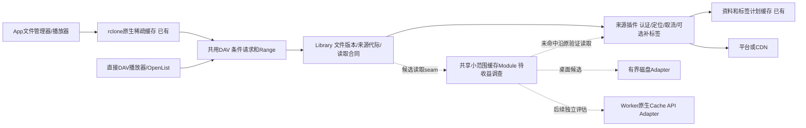

# MusicFS 缓存与重复读取优化规划

日期：2026-10-21。状态：方案评估，仅记录候选及估算，尚未实施新增功能；本轮不安装依赖、不改功能、不重建发行物、不请求音乐平台。当前代码与发行基线为dev.9。事实见[现行缓存策略](../docs/architecture/cache-policy.md)、[挂载证据](../docs/architecture/desktop-mounts.md#文件头扫描与读取范围)，外部能力依据见[主源调查](../docs/research/shared-read-cache-options.md)。本文件持有本轮候选和实施顺序，主实施计划只保留入口。

## 建议决定

1. 保留共用核心、插件职责和现有缓存；先收口dev.9的真实消费旅程与播放成本。不推倒架构，不重写SDK，不因“所有入口统一”立即增加第二套磁盘缓存。
2. 将直接WebDAV/播放器扫描纳入明确需求。现在就安排一次有结束条件的读取模式与命中收益调查，而非无限等待用户报告；依据实际请求形态决定共享缓存范围。
3. 桌面共享小范围缓存作为下一候选；任意范围持久稀疏缓存与Worker音频缓存均不提前承诺。若小范围方案不能覆盖真实客户端，就明确比较完整方案成本，不能将局部命中宣传为通用解决。

## 用户效果与范围

- 再次打开同一目录，使用最近成功清单；不因浏览先刷新平台或准备全部歌曲。已准备的资料/标签继续共用。
- 对同一文件表示、已经取得且未淘汰的片段，重复读取应优先复用；不能把“有缓存”只解释为目录或歌词缓存。
- 普通播放器/WebDAV客户端能受益是目标，不以用户更换播放器、手动先准备整库为默认解决办法。具体缓存路径可以因客户端能力不同而不同。
- 首次未缓存读取、读取新范围、明确更新及缓存淘汰允许取源。平台身份/临时地址核对与音频正文下载分开统计，不要求任意情况下完全零网络。
- 正常播放、seek、最终大小/字节/Range和取消不退化；冷目录速度不能靠增加整曲预取或平台请求获得。
- 缓存可查看启用情况、控制容量/保留期、清理；稳定音频片段不另建逐首刷新定时器。音乐资料和目录的周期更新沿用已有机制。
- 优先桌面；Worker以免费约束评估，复用语义和读取合同，不要求同一存储实现，不预设R2、KV、额外代理或付费服务。

不是本轮目标：公共多人服务、高并发、跨账号去重、全库离线下载管理、统一任意HTTP缓存平台、预先缓存全部音乐或恢复历史全平台验收矩阵。

## 已有结果与缺口

| 对象/旅程 | 已有能力 | 尚不能声称 |
|---|---|---|
| 目录、FileInfo/ETag | SQLite/D1快照、进程内发布视图；本机发布后通知挂载 | 所有第三方目录缓存立即更新 |
| 音乐资料、封面歌词、固定标签计划 | 来源实例持久缓存，可跨客户端复用 | 所有GET都不会请求源音频 |
| App挂载已读片段 | dev.9原生rclone full，默认每挂载8GiB/7天；有界离线FUSE/HTTP跨重挂重读0次GET | Windows资源管理器十多秒等待全部消失，所有实际音频格式/播放网络已重验 |
| 直接DAV重复音频Range | ETag/304与准确Range；没有通用服务端片段存储 | 客户端不保存字节时仍能自动复用CDN数据 |
| 连续播放的请求成本 | 本地生成65MiB完整读准确，分块递增 | 新分块下SDK地址解析次数、真实延迟与播放连续性已经验证 |

近期主要原因是缓存职责与验收范围遗漏：原设计已经建议VFS full，但此前实际CacheMode off；目录枚举探针禁止open，因此没有覆盖文件管理器读取音乐信息。默认预读放大又提高了每次失配成本。已有证据不能将这些等待统一归为平台限流；不通过扩大并发解决。

## 模块与层级

- 插件继续拥有认证、音乐语义、定位和最终表示；不强制插件自行实现音频磁盘缓存。插件自带缓存能力仍兼容。
- DAV继续拥有HTTP条件、Range解析和响应，不加入网易云/QQ判断，也不解释标签计划。
- 若共享缓存进入实现，候选seam在`library.files.open`内既有来源代际/范围检查之后、已验证读取的调用处；不能在外层缓存命中时绕过原检查。一个小Interface隐藏范围复用与宿主存储，先有实际需要的Adapter才拆分，不先新增插件API。
- 缓存键使用来源实例/代际、插件修订及最终文件表示身份，不以目录路径或临时CDN URL作为唯一身份。只复用同一最终表示，不承诺不同标签版本或不同实例自动去重。
- 首版候选只处理足够小且完整的已验证Range；取消/短读不将不完整条目记为命中。真实客户端若主要使用开放GET再提前关闭，这个范围不足，不能用命中小样本代替用户场景。
- 不为命中率建立常驻监控平台。使用有界计数区分清单、资料、URL解析、源音频请求/字节与命中，调查完成即停止采集；界面仅保留能帮助用户控制缓存的状态。

## 方案比较

以下工作量为单人有效开发人日（约8小时），含必要接线、定向验证及文档；不含VM/用户协助等待。是剩余增量估算，不重复计算dev.9已完成工作。

| 方案 | 能解决什么 | 代价/风险 | 估算 | 决定与ROI |
|---|---|---|---|---|
| 保留rclone/播放器原生缓存 | 单客户端的重复扫描、播放和重开；App已交付 | 其它客户端不自动共享，仍需实际消费端收口 | 见下面A/B，不再重复实现 | **当前最高ROI，保留** |
| 桌面服务端小范围缓存 | 重复头尾/短Range可跨DAV客户端复用，不依赖播放器落盘 | 范围形态不同时命中有限；开放GET取消不必然受益；需要有限磁盘策略 | 收益调查通过后 **2—4人日** | **条件性高ROI，优先候选** |
| 完整读完才缓存整文件 | 后续完整重播；可以边转发边落盘，不必先下载才返回 | 只读头尾后取消不会形成完整文件，不能解决当前扫库问题；占用更大 | **1—2人日**，非当前关键路径 | **当前低ROI，不先做** |
| 完整持久稀疏缓存 | 相同/重叠范围、开放GET和seek均尽可能复用片段 | 自有范围索引/缺块读取/流拼接/回收与取消明显更复杂，需维护 | **5—8人日**，替代上面的局部方案，不是叠加预算 | **待请求形态证据，不默认做** |
| 让rclone/反向代理再统一承接DAV缓存 | 借现成VFS/代理存储 | 增加端口/代理路径/生命周期，可能改变ETag、错误及目录合同；Worker无法照搬 | **3—5人日**，仍需可行性确认 | **当前低ROI，不选** |
| Worker内部完整块对象缓存 | 命中可减少来源读取，无需额外付费存储产品 | Cache API不能直接put 206；分机房、可淘汰，新增查块/写块调用与CPU，收益不保证 | 桌面语义稳定后 **1—2人日可行性与最小接线**，不含区域化实测 | **当前不进入必做清单** |

小范围缓存的2—4人日以复用成熟字节存储为前提；若必须再建设完整持久索引或流拼接，停止套用该估算，改按5—8人日完整方案评估。

现行需求§9约定优先VFS、不另做第二套音频磁盘缓存。A—D沿用此约定；E若经调查证明必要，应先将直接DAV新增范围、容量归属及与VFS的关系回写需求和设计，再接线，不能在两个入口各静默增加一套大缓存。

## 依赖选择

- 现阶段继续使用rclone、现有`lru-cache`与标准Web Streams，不因规划就安装新库。
- 普通HTTP缓存库不能直接解决任意音频206片段。`http-cache-semantics`当前实现不理解206/Range；`make-fetch-happen`依赖这套策略。替换fetch不会补出范围索引，还可能引入另一套重试/流装配。
- `cacache`可作为桌面内容寻址、流式字节存储候选，但**不自带本业务的磁盘容量LRU/TTL**；它不能把剩余工作量变成零。只在有界收益样本通过后，固定版本并验证Bun/Windows发行适配，再决定采用。
- Worker原生Cache API拒绝put(206)，可从完整缓存对象返回Range；存小块需要将每块作为独立完整200对象并自行协调，不是透明缓存原响应。其机房局部和可淘汰性质只影响性能，不能承载正确性状态。不能把音频放入D1来追求形式统一。

以上能力与来源引用集中在[研究记录](../docs/research/shared-read-cache-options.md)，不为本轮下载上游源码或扩大依赖调查。

## 推荐执行顺序与投入

| 顺序 | 具体工作与交付 | 剩余工作量 | 风险 | ROI/停止条件 |
|---|---|---|---|---|
| A / P0 | 现有Windows VM验证dev.9真实重进/重挂复用，核对实际启用的VFS策略；用少量已有有效音频夹具，复用4k清单证据 | **0.25—0.5人日** | 低到中，依赖VM可达；不恢复宿主/交换机排障 | **高**；不把离线FUSE等同资源管理器结果。不可达记录边界并继续其它独立项 |
| B / P0 | 对递增分块核对SDK地址解析/CDN请求数；一个有代表性的延迟/码率样本验证完整播放与seek，必要时调整原生参数 | **0.25—0.5人日** | 中，缓冲过小可能减少流量但增加等待或平台调用 | **高**；稳定后停止调参，不跑音质/平台排列矩阵 |
| C / P1 | 缓存状态与清理入口：复用原生RC统计，明确配置值/实际值；清理只作用所选挂载，复用正常卸载/重挂 | **0.25—0.5人日** | 低；原生占用统计可能滞后，需标明范围/取样 | **中高**；让用户判断是否生效和释放磁盘，不做带宽仪表盘 |
| D / P1 | 一种常用直接DAV客户端的有界读取记录，重放相同/重叠头尾Range及开放GET提前取消；评估小范围共享命中与字节节省 | **0.5—1人日** | 低到中，客户端读法未确定；只做能改变决策的样本 | **信息ROI高**；已有资料不再重新请求；未覆盖主要读法或净收益小则结束，不顺势造完整缓存 |
| E / 条件P1 | D通过才实施桌面共享小范围缓存，含容量/生命周期与同版本跨客户端复用 | **额外2—4人日** | 中；必须证明库适配和容量回收，不重复建全局数据库 | **条件性高**；保持旧流式路径可用。与VFS容量统一预算，不默认再叠8GiB |
| F / 延后 | 免费Worker边缘缓存或完整稀疏方案 | 按上表独立估算 | 中到高，来源节省可能被新增调用/CPU抵消 | 只在明确收益出现后做，不作为桌面修复完成条件 |

建议先投入 **约1—3人日完成A—D**，得到Windows消费端结论、播放请求成本、缓存管理和共享缓存的实施判断。如果D证明高收益，再增加2—4人日；不能把所有候选相加说成必须完成一周以上。

实施按一个可回退的用户行为提交：先收口A/B参数与证据，再提交C管理能力，D探针/研究单独提交；E若进入开发，Module与真实调用者一起接线，不先提交一组无人使用的Interface。构建与版本目录打包只在可用行为形成后进行，不每个小改动重打所有平台。后台资料调查已完成，后续子代理按管理界面、共享缓存Module、主代理集成分文件负责；只有相互独立的工作才并行。

## 主要风险与控制

| 风险 | 会影响什么 | 控制方式 |
|---|---|---|
| 把目录/标签命中当音频字节命中 | 看似有缓存，重进仍下载 | 按层统计同一次真实消费旅程；已读源字节与本机传输分开 |
| 新分块增加SDK解析/网络等待 | 连续播放变差、平台调用反而增多 | B同时看字节、URL解析、CDN请求和播放等待；保留递增，按证据调参 |
| 路径/临时URL代替表示身份 | 更新后旧字节，或换签后整批冷失效 | 复用现有内容与来源代际合同；同路径同大小正常更新需验证 |
| 缓存只在进程/句柄存活时命中 | 重启/重挂后体验反复 | 明确区分内存、原生稀疏磁盘和边缘临时缓存；只对选定承诺做一轮验证 |
| 两层磁盘副本叠加、回收只删索引 | 磁盘增长，界面容量与实际释放不一致 | 共享缓存若实施必须指定主要容量所有者；核对所用库的真实回收行为，不新建全局巡检服务 |
| 强行统一免费Worker存储 | 新增子请求/CPU及复杂度，未必更省 | 统一读取语义、按宿主选择Adapter；命中可丢失，原流式路径兜底，不增加D1音频库或默认付费资源 |

## 验证粒度与完成依据

- 不重复真实4k整库冷刷新；不做平台压力、高并发、异常输入枚举或所有格式/客户端/宿主组合。
- 复用已有目录与标签证据；A检查实际资源管理器消费，B检查新参数引出的播放代价，D只回答是否值得共享缓存，三者不互相冒充。
- 对决定实现的缓存范围，同版本热读不重复获取已缓存源正文；版本变化取得新字节，容量/清理后可正常重新获取，原有范围长度与取消合同保持。
- 无需人工预热才能进入目录；首次必要资料准备仍可能取源，不承诺首次全库扫描零请求或固定秒数。
- 若已有原生缓存满足主要使用，或共享样本收益小/代价高，允许停止在A—D。若证据证明主要客户端仍反复付出明显下载成本，则进入E或重估完整方案，不以“客户端自己处理”作为一概拒绝的理由。
- 本轮完成是用户旅程与缓存职责清楚、已知高ROI缺口收口、候选有可复核的做/不做依据；不是增加缓存种类、依赖数量或测试数量。
