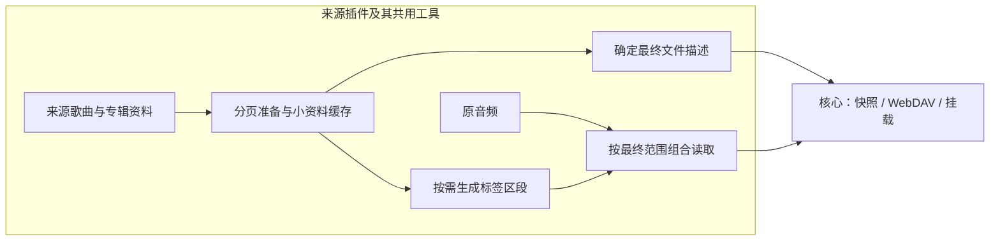

# 需求澄清记录

日期：2026-10-21（原记录始于 2026-10-18）

状态：原需求及插件 Q1—Q11 的澄清保留在下方，相关实现已形成开发预览。当前新增音乐资料扩展讨论；已确认的目标与后续待决事项分开记录，尚未启动这项扩展的产品实现。

## 音乐资料扩展（讨论中）

| 问题 | 用户决定 | 状态 |
|---|---|---|
| 元数据 Q1：主要目标 | 通过WebDAV或挂载使用时，优先让播放器正确识别歌曲的基本音乐信息 | 已确认 |
| 元数据 Q2：信息范围 | 基础资料、封面和歌词都做；基础资料包括歌名、多位歌手、专辑、专辑艺术家、发行日期、原专辑曲号与碟号；来源缺失的字段留空 | 已确认 |
| 元数据 Q3：是否调整音频标签 | 允许仅补写或修正导出音频的标签，保持音频编码和音质不变；具体处理路线待可行性确认，整曲缓存与新增云存储不作为默认前提 | 已确认 |
| 元数据 Q4：歌词展示目标 | 来源有时间轴时保留并支持逐行同步，只有纯文本时提供全文；不自行生成或猜测时间轴，播放器实际同步展示取决于其支持 | 已确认 |
| 元数据 Q5：原标签合并提议 | 用户质疑原标签存在与冲突的前提，提出应按插件源区分；撤回统一“来源优先、缺失保留”规则的提议，沿用已确认的来源职责边界，按具体来源事实设计 | 原提议撤回 |
| 元数据 Q6：交付方向 | 目标是补全音乐资料，使读取音频时自动携带这些信息；优先验证内嵌输出，只有不可行或成本过高时再比较其他方案，不默认同时导出一套伴随文件 | 方向已确认，实现待验证 |
| 元数据 Q7：歌词语言版本 | 保留来源已有译文、罗马音；来源缺失时留空，不自行生成或跨平台搜索匹配 | 已确认 |

本次“音乐资料”指歌名、歌手、专辑等音乐内容信息，区别于当前文件接口中的内容身份、精确大小与媒体类型，术语见[GLOSSARY.md](GLOSSARY.md)。当前两个示例仅把部分资料拼进文件名，并原样转发上游音频；没有面向宿主的结构化音乐资料或补写标签能力。[完整文件检查](../docs/verification/metadata-current-file-tags.md)已确认：QQ 代表 MP3 可读到歌名、歌手、专辑，网易云代表 MP3 仅可读到编码器标签；两者均未检出本次范围内的其他字段、内嵌封面和歌词。每源仅一个样本，不推断所有曲目和格式相同。

```text
已确认：优先播放器识别音乐信息
├── 已确认：基础资料、封面和歌词
│   ├── 已确认：保留来源已有时间轴，纯文本歌词也可提供
│   ├── 已确认：保留来源已有译文、罗马音
│   └── 已确认：优先随音频读取自动携带；其他交付路线在不可行或成本过高时比较
├── 已确认：允许仅调整导出音频标签，保持编码与音质不变
│   └── 职责收敛：沿用来源插件负责来源语义的边界，不预设统一原标签合并策略
└── 后续：依产品选择与技术事实确定格式覆盖、导出身份与缓存、双宿主实现方案及兼容重点
```

继续沿用来源资料归插件、核心保持通用、两个示例覆盖桌面与Worker的既有边界。具体范围与方案待本轮澄清完成后再进入实现；当前不修改已完成的发行物。

2026-10-21 已开展用户授权的有限离线技术验证，结果见[补标签可行性验证](../docs/verification/metadata-tagging-feasibility.md)：MP3 流式标签前缀在 Bun 与实际 workerd 通过；通用 Wasm 库在 Bun 三格式通过、在 Worker 失败；纯 TypeScript 备选在 Worker 的单个 MP3 内存写入通过。尚未完成其他格式的 Worker 成本与消费端验收，不将这些局部结果写成整个扩展已实现。

已补 Windows 虚拟机原生字段/WMP COM 读回：基础资料可读，但两种编码方案在封面/歌词方面有消费端差异；可见播放器及逐行滚动尚未验收。另确认资料准备时机尚未收敛：当前 PROPFIND allprop 对缺少最终 `info` 的文件逐项 `stat`，封面/歌词若影响最终长度，则不能在首次 `open` 时悄悄改变文件。下一步先比较分页准备与小资料缓存、以及未知属性目录行为的实际兼容性，再定产品实现；不预设缓存整曲或新云存储。

### 可行思路收敛（建议，尚未接入产品）

推荐优先复用现有分页准备与最终文件合同：来源插件取得音乐资料，去重缓存小体积资料，准备确定的导出文件信息；读取时由共用工具组合标签与原音频区段。客户端读取时自动携带资料，不要求把获取资料也延迟到播放器首次打开文件。

| 职责 | 建议边界 |
|---|---|
| 网易云/QQ 及其他来源插件 | 解释来源接口与字段，决定需要补哪些资料及何时更新；来源确实缺少的字段保持缺失 |
| 共用音频文件工具 | 调用现成库编码标签，组合最终文件区段，计算最终长度与身份，映射读取范围；不理解账号、歌单或平台接口 |
| 核心 | 继续负责分页准备、快照、通用文件访问和挂载；如补充插件缓存能力，只提供通用存储，音乐资料语义仍归插件 |



缓存按歌曲/专辑资料身份复用，不按歌单出现位置或每个音质重复取得歌词、封面。首先复用列表/详情已返回的字段，只为缺少的资料增加请求。最终文件描述直接进入既有快照，不另建一套并行文件目录；音频本体优先透传。首次冷准备仍会增加来源请求，这是需要用小目录给出量级的真实成本，不能靠标签库或缓存名称消除。

现有公开 `Context` 只有配置、私有状态、取消信号和 fetch，没有独立持久缓存接口。因此跨请求的小资料缓存不是现成能力；建议基于已有 SQLite/D1 补一个小而通用的插件存储接口，避免把封面、歌词塞入授权私有状态，也不默认新增缓存服务或云存储。具体接口与更新策略在小目录验证后确定，不先建完整缓存框架。

库优先考察 `node-taglib-sharp`，因为已有 Worker MP3 写入证据，且包公开了独立 ID3v2、XiphComment、FlacBlock 和 APE 标签 render 接口。后面三类接口仅说明可复用编码能力，尚不等于 FLAC/APE 流式文件重组已经通过。MP3 先闭合真实插件链路；FLAC、APE 继续评估标签区段重组；M4A 的容器调整不能套用 MP3 前缀，需比较通用库整文件处理与额外流式适配成本。优先复用第三方格式编码，不同时维护多套重复 MP3 实现。

备选仅在成本或可行性确有差距时比较：整曲处理后提供最终文件会增加等待及存储/内存；目录中省略未知大小需要另验 OpenList/挂载行为；伴随文件依赖客户端查找规则，不能等同于音频本身已带完整资料。当前不把这些备选提前改为主方案，也不预设压缩/转码、第三方资料搜索或新的音乐库产品。

### Q5 复盘与职责收敛

原 Q5 在没有确认音乐字段是否存在的情况下，先让用户决定全局标签合并规则，扩大了问题。当前需要区分：插件已从接口取得的曲目资料、音频文件中的标签、播放器最终能否识别资料。这三者不是同一件事。

用户要求先验证实际文件后，已用当前本地插件与会话读取两个完整 MP3 并解析标签，见[验证记录](../docs/verification/metadata-current-file-tags.md)。QQ 样本已有部分基础字段，网易云样本缺少这些字段，证实不能预设统一的空标签起点；本次仍未选定写入库或缓存路线。

沿用已确认的插件职责：网易云、QQ 示例插件负责取得各自来源资料，并依据来源与文件格式决定如何补充导出标签；其他插件可按自身来源提供已带资料的文件，无需执行同一补标签流程。是否读取、补充或保留原标签由具体插件实现及已知来源事实确定，不新增所有插件必经的通用合并机制。

多个插件若确有重复的格式处理需求，可复用第三方标签库或小型共用工具；这不构成新增插件类别或核心音乐资料管理领域。现有 `Entry`/`stat`/`open` 为通用文件协议，允许插件提供音频、歌词、封面等文件，不因本次扩展预先新增核心音乐字段。无论插件是否调整标签，返回的文件大小、内容身份与范围读取都必须描述最终导出的字节；这是现有合同，不是新增需求。


### 标签处理路线比较（实现方式尚未选定）

| 路线 | 用户效果 | 主要取舍 |
|---|---|---|
| 原音频加伴随文件 | 音频保持原样，另提供歌词与封面等资料 | 最接近现有流式读取；播放器需要支持相应伴随文件，不能据此保证基础音乐标签齐全 |
| 按需构造带标签的虚拟文件 | 播放器读取到补充资料的音频，音频数据保持不变 | 有保留流式访问的潜力，但需处理格式结构、最终大小、内容身份和范围映射；这轮核查的候选库没有提供完整的远程虚拟文件方案 |
| 整曲处理后提供或缓存 | 先取得完整音频，使用通用库处理标签，再提供最终文件 | 多格式处理可更多交给现有库，但带来首次等待和整文件资源开销；若缓存还要决定存储方式，不能默认新增云存储 |

2026-10-20 只读事实核查：

- [TagLib-Wasm](https://github.com/CharlesWiltgen/taglib-wasm)提供多格式标签、封面和歌词能力；[Worker 平台指南](https://charleswiltgen.github.io/TagLib-Wasm/guide/platform-examples.html)采用 buffer 输入输出。部分读取支持不能推导为流式改写支持；仓库将 Bun 支持标为 Partial，仍需项目内适配确认。
- [browser-id3-writer](https://github.com/egoroof/browser-id3-writer)可单独生成 MP3 的 ID3v2.3 标签，支持封面与歌词；不读原标签，也不提供其他格式或远程文件范围映射，不能直接当作完整补标签方案。
- [music-metadata](https://github.com/borewit/music-metadata)用于读取现有标签，不提供写标签能力。
- [Cloudflare Workers 限制](https://developers.cloudflare.com/workers/platform/limits/)列明免费和付费计划的 isolate 内存均为 128 MB（含 JavaScript 和 WebAssembly）；[Streams 指南](https://developers.cloudflare.com/workers/runtime-apis/streams/)建议避免缓冲完整大响应。因此不应未验证就把整曲内存处理选为 Worker 的通用路径。
- [Navidrome 资料](https://www.navidrome.org/docs/usage/configuration-options/)提供歌词伴随文件及内嵌标签的查找配置，[封面资料](https://www.navidrome.org/docs/usage/library/artwork/)则区分曲目内嵌封面和专辑目录封面。这能说明客户端支持具有具体约定，不能推导任意 WebDAV 播放器都会读取同样的伴随文件。

上述是候选路线和文档证据，不是用户已选择的架构，也不表示已验证本项目双宿主写入能力。用户已允许仅调整标签，并以保留来源已有时间轴、支持逐行同步为歌词目标；写入时间标记与播放器实际同步展示仍需要分别判断。

### 当前问题前沿与已知格式

Q6 已明确优先随音频自动携带资料，当前先验证，不要求用户提前选择伴随文件方案。Q8 的具体播放器仍可由用户补充，作为后续兼容重点，不阻塞格式和运行时可行性验证。Q5 原统一合并提议已撤回，Q7 已确认，不再作为待答复问题。

2026-10-21 用户另提供 Windows 测试虚拟机，授权用于自动化测试；此授权只涉及该虚拟机，保留此前不调用物理 Windows 宿主的约束。用户随后明确该虚拟机用于补齐此前的 Windows 测试，当前 MusicFS 本机挂载与资源管理器映射网络驱动器均失败；此支线已交由后台子代理复用当前仓库独立排查，不创建新工作区，主代理继续元数据。先复用现有 SSH 和软件，不预设安装完整测试套件。首次 SSH 连接在认证前关闭，用户定位为防火墙并自行处理后已正常认证；不再启用 WinRM或修改服务/防火墙。账号密码不写入仓库文档。

现有需求只明确 OpenList 接入，未指定最终播放器；mpv 是既有验收工具，Navidrome 是上述资料中的示例，不能当作用户已选择的客户端。

当前 QQ 文件类型覆盖 MP3、M4A、FLAC、APE（[文件类型](../plugins/qq/file-info.ts)），网易云接受实际返回的 MP3、FLAC、M4A（[媒体实现](../plugins/netease/media.ts)）；音质名称与容器格式分别处理。后续可行性分析应包含 APE，不能仅按前三种格式设计。现有 SDK 已有部分歌词接口，但当前示例插件构建入口尚未接入；SDK 能提供某类资料不代表 MusicFS 已实现，也不代表每首歌都有相应资料。

## 插件式数据源补充（已确认）

| 问题 | 用户决定 | 状态 |
|---|---|---|
| 插件 Q1：交付与安装 | 用户通过 WebUI 安装、更新和移除插件，无需自行重新编译 MusicFS | 已确认 |
| 插件 Q2：来源范围 | 允许其他音乐服务及 HTTP/WebDAV 音频来源；按来源能力提供功能，不要求全部实现扫码、推荐和多音质 | 已确认 |
| 插件角色 | 网易云与 QQ 是示例插件，平台专属业务不作为核心的固定集成能力 | 已确认 |
| 插件 Q3：音质配置职责 | 音质等来源相关配置由数据源插件定义，结合 Q4 按实例独立保存，不作为全局配置；完整职责由 Q6 确认 | 已确认 |
| 插件 Q4：多个实例 | 同一插件可配置多个数据源实例，各自连接服务器或账号；取消原每个平台仅一个账号的限制，不引入多人使用 MusicFS 的权限产品 | 已确认 |
| 插件 Q5：示例交付 | 网易云和 QQ 示例插件需要完整实现并验证原需求中的登录、内容读取、音质与播放能力；仅通过公开插件接口接入，无核心专用分支或特殊接口 | 已确认 |
| 插件 Q6：完整职责 | 插件提供内容入口、目录与音频文件，负责来源专属音质选择、回退、隐藏、实际版本去重、元数据和范围取流；核心负责实例与插件管理、存储设施、布局、合法路径、快照、DAV/HTTP 与挂载 | 已确认 |
| 插件 Q7：配置与认证交互 | 插件声明字段、校验和认证步骤，核心提供通用表单、二维码、链接及验证码等承载；首版不承诺任意插件前端页面 | 已确认 |
| 插件 Q8：宿主兼容 | 第三方插件可声明支持桌面、Worker 或两者，安装时明确兼容性；网易云与 QQ 示例仍按双宿主验证 | 已确认 |
| 插件 Q9：安装来源 | 支持作者提供的已构建插件包上传或发布地址安装；允许自编插件、用户主动更新，首版不要求插件市场 | 已确认 |
| 插件 Q10：移除行为 | 移除插件保留实例配置与布局引用，管理界面标为插件缺失并停止相应读取；重装兼容插件可恢复，彻底删除实例及其数据作为单独操作 | 已确认 |
| 插件 Q11：Worker 安装路线 | 接受安装、更新和移除插件时由后台自动发布普通 Worker 新版本，用户无需手工编译或部署；作为避免付费动态加载前提的 P0 优先验证路线 | 2026-10-20 已确认；免费运行与切换影响待验证 |

```text
插件式数据源
├── 已确定：WebUI 安装、更新、移除，无需用户重新编译
│   ├── 已确定：预构建插件包或发布地址安装，用户主动更新
│   ├── 已确定：可声明桌面/Worker兼容性；移除保留配置和布局引用
│   └── 已确定：Worker 插件变更允许后台自动部署；免费计划兼容与切换影响待 P0
├── 已确定：来源可扩展，网易云/QQ 为示例插件
│   ├── 已确定：同插件支持多个数据源实例
│   ├── 已确定：音质等来源配置由插件定义，按实例独立保存
│   └── 已确定：插件输出目录/文件，核心承载通用配置和认证交互
└── 已确定：示例插件完整可用，通过公开接口接入
    └── 插件包格式、作者工具与兼容性细节由工程设计和 P0 收敛
```

此处记录产品决定，不表示 Worker 动态插件加载已经验证。旧文档中的 API 内嵌方案仅保留为示例插件内部可参考的实现调查，不能据此把平台规则写入核心。

已确认的架构变更见 [ADR 0001](../docs/adr/0001-installable-source-plugins.md) 与 [ADR 0002](../docs/adr/0002-worker-plugin-installation-by-deployment.md)。接受安装路线不代表相关 API、免费配额、更新恢复与音频连续性已经验证。

### 设计与验收核对范围

- 核心目录协议：让没有歌单、扫码或多音质的来源也能接入；将来源语义与通用文件访问语义分开。
- 配置与认证：来源相关配置由插件定义、按实例独立保存；通过声明式字段和步骤承载配置与认证，验证新插件无需重编译 WebUI 即可接入。
- 内容与读取：来源对象、目录中的出现位置、实际文件及临时读取地址分别识别；插件输出的格式、大小、范围读取与失败状态需满足通用协议要求。
- 状态隔离：缓存、刷新、登录挑战与持久状态按实例隔离；退出、删除、更新后的过期结果不得恢复旧状态。
- 生命周期：验证插件包/发布地址安装、兼容声明、更新失败以及已确认的移除与重装恢复行为；首版不引入插件市场。
- 双宿主：插件声明支持桌面、Worker 或两者；验证加载、资源和持久化差异以及示例插件的双端能力，具体运行机制由技术验证确定。
- 验收：除示例插件真实平台流程外，需验证一个无需核心改动的新插件能够被安装并提供来源，避免仅将原固定平台实现改名为插件。

### 当前问题前沿

当前没有待答复的产品问题。用户已接受 Worker 安装、更新、移除插件时由后台自动发布新版本；优先验证预构建核心与插件模块的组装部署，保留其他路线为技术备选。不会将付费 Dynamic Workers 定为首版的必要部署前提。

候选与证据边界见 [Worker 免费插件机制调查](research-worker-free-plugin-loading.md)。2026-10-18 调查因联网失败未完成标准上传接口与免费限额核查；后续 P0 需给出完整运行链路、绑定保留、失败恢复和版本切换影响的证据。若结果确实需要改变已确认的产品范围或部署前提，再带具体差距对齐。

### Worker 动态插件事实核查（2026-10-18）

Cloudflare 的 [Dynamic Workers API](https://developers.cloudflare.com/dynamic-workers/api-reference/)允许主 Worker 通过预置 Loader binding 按 ID 加载代码，代码可从远程存储取得。基于此可推导出后续安装/更新插件无需重新部署核心的候选路线，但本项目尚未实测。代码或配置变化需使用新 ID，不保证请求命中同一 isolate，因此插件持久状态仍需宿主存储。

Dynamic Workers 当前仅限 Workers Paid plan，并按动态 Worker 创建量、请求与 CPU 计费；不能承诺免费计划支持这一动态加载路线。[官方定价](https://developers.cloudflare.com/dynamic-workers/pricing/)

插件作者可发布已经构建的 JavaScript 产物；TypeScript/npm 需要先转译打包，不把“用户无需重新编译”扩成“MusicFS 必须在线构建任意源码”。[官方入门与构建说明](https://developers.cloudflare.com/dynamic-workers/getting-started/)

Worker 与桌面运行时能力不同，Node 兼容层也不提供所有系统能力。插件声明目标宿主、来源网络可达性与实际支持矩阵需要分别验证；不得仅凭 TypeScript 或接口相同推断双端可用。[Worker Node 兼容性](https://developers.cloudflare.com/workers/runtime-apis/nodejs/)

## 已确定的骨干

TypeScript 实现；Windows、Linux、macOS 与 Cloudflare Worker；通过可安装插件接入音乐来源，网易云与 QQ 为完整可用的示例插件；通过 WebDAV 接入 OpenList。用户已取消面向用户的 CLI，改为集成 WebUI；桌面已确认采用可点击启动器、本地后台和 WebUI，由后台管理内置 rclone。两种部署独立运行。

当前任务围绕浏览、访问和播放音乐。继续按只读、自用收敛，允许同一插件配置多个数据源实例；不因多个实例而增加多用户或共享权限需求。

## 第一轮处理结果

| 问题 | 用户回答及当前结果 |
|---|---|
| Q1 目录入口 | 默认按平台分组；WebUI 提供拖拽树，让用户自行构建层级 |
| Q2 音质 | 改为单版本和多版本模式；分别允许选择一个或多个音质，以对应文件展示 |
| Q3 无完整播放权限 | 同意默认隐藏，只在状态中报告数量与原因 |
| Q4 Worker 登录 | 询问能否通过 WebUI；官方部署能力及现有扫码源码说明可以，真实 CF 平台流程仍待验证 |

## 当前决策树

```text
已确定：WebUI + 双端部署 + 可定制目录 + 单/多音质版本
├── 桌面交互
│   └── Q5 已确认：点击启动器打开本地 WebUI，由本地后台管理 rclone
├── 目录拖拽
│   └── Q6 已确认：操作目录和内容源，动态同步来源，仅改变导出层级
└── 音质展示
    └── Q7 已确认：所选音质缺失时可配置隐藏或自动回退
```

平台无完整播放权限或仅提供试听时隐藏。某个目标音质不可用时，由设置选择隐藏或自动回退。网络故障或尚未探测大小单独处理，不混入前述两种情况。

| 问题 | 用户决定 | 状态 |
|---|---|---|
| Q5 桌面入口与挂载 | 可点击启动器 + 本地后台 + WebUI 挂载按钮 | 已确认 |
| Q6 拖拽对象与效果 | 目录与内容源节点，曲目随来源更新，不修改云端歌单 | 已确认 |
| Q7 音质缺失 | 提供隐藏或自动回退设置 | 已确认 |

回退细则在统一草案中采用以下规则供整体审阅：同平台同曲目向下寻找可用完整音频，按实际音质命名，多目标落到同一实际音频时去重。默认模式与策略的初值为可调整建议，不扩展新的配置层级。

## 对上一版方案的修正意见

以下此前由作者补入的过度约束，已从统一方案中移除或改为实现建议：

- 每首歌曲文件名固定携带音频版本；只有实际缓存兼容性验证需要时才选择这种实现，不能先改变用户可见路径。
- 打开目录前必须为整张歌单逐首探测音频并准备全部表示；应先验证平台元数据与客户端需求，再确定大小探测的时机。
- 因尚未取得大小或临时解析失败，就把歌曲判为不可播放；这些是技术状态，需要与明确的播放权限区分。
- 默认提供不可播 JSON、封面和歌词旁车文件；用户已选择隐藏无完整播放权限曲目，后两者没有首版需求依据。
- 多组可撤销读取凭据、按导出划分权限、系统密钥库集成与密钥轮换流程；基本认证和避免泄漏凭据属于实现责任，上述扩展不能自动变为首版门槛。
- 强制所有发行包完成签名和 macOS 公证；具体发行方式及其实际安装要求验证后确定。
- 缓存 2 GiB、24 小时、目录 TTL 等数字；属于可调整的初始参数，不需要用户逐项决定。

## 技术验证，不转交为用户决策

网易云必要接口在 Worker 中的适配、QQ 接口能力、真实 CF 出口取流、WebDAV 与 Range、rclone 三端挂载、登录持久化和大歌单分页，都由技术验证给出事实。验证尚未完成不等于需求不明确，也不构成添加外部 API 服务或额外部署组件的授权。

术语见 [GLOSSARY.md](GLOSSARY.md)。WebUI 技术依据与示例见 [变更评估](musicfs-webui-design-evaluation.md)。后续以 [统一需求与技术方案](musicfs-requirements-and-technical-design.md) 为准。
