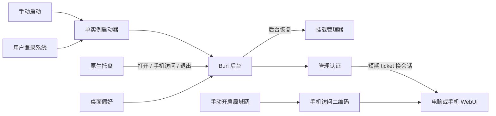

# MusicFS 桌面常驻与管理访问

2026-10-22：本轮用户确认的行为已接入。当前产品说明见[桌面使用](../docs/desktop.md)，认证和存储合同见[管理访问架构](../docs/architecture/management-access.md)，实施证据见[本轮核对](../docs/verification/desktop-access.md)。本页只保存决定与范围。

## 用户行为与默认值

| 场景 | 行为 |
|---|---|
| 手动启动 | 默认打开管理页，可关闭；再次启动复用现有后台。 |
| 用户登录系统 | 默认自启，默认静默；“自启时打开页面”单独设置。 |
| 常驻入口 | 托盘提供打开管理页、手机访问、退出。关闭网页后后台和挂载继续运行。 |
| 启动自动挂载 | 全局及逐项开关默认开启；后台恢复已保存的启用项，不阻塞管理页。 |
| 手动卸载 | 只影响本次会话；关闭该项自动挂载才改变下次启动。 |
| 暂时挂载失败 | 有限延迟重试，可关闭；依赖缺失等需用户处理的错误不自动重试。 |
| 手机访问 | 先在设置手动开启局域网，再展示管理页二维码；多网卡可选择地址。 |
| 首次桌面进入 | 程序直接打开已登录管理页；按需设置账号密码。 |
| 书签与普通浏览器 | 用户名、密码、记住登录及明确退出。 |
| Worker 首次进入 | 沿用部署管理凭据，再设置管理员账号。 |

这里的自启指当前桌面用户登录，不是系统服务。解压新版后启动会更新自启目标位置。

## 职责与依赖

继续采用 Bun 后台与浏览器 WebUI。薄原生辅助程序只处理托盘菜单和当前用户自启注册，业务状态、单实例、浏览器打开和正常退出留在后台。托盘使用 tray-icon；Windows/macOS 用 tao 事件循环，Linux 用 KSNI。自启分别复用 auto-launch、windows-registry 和 plist/dirs，具体取舍见[系统集成调查](research-desktop-integration.md)。

桌面偏好归桌面宿主，每项自动挂载开关归挂载定义，恢复策略复用挂载管理器。手动操作取消当前会话对该项的后台恢复；退出准备若被活动挂载拒绝，可恢复后台工作，不提前永久关闭协调器。

管理认证采用 Better Auth。账号密码、桌面入口和手机二维码汇入独立浏览器会话；DAV 凭据、来源授权、后台身份握手仍由各自领域负责。桌面用独立 auth.sqlite，Worker 用 D1 认证表。无需增加注册、邮箱、第三方身份服务或多人权限。

## 交付边界

Windows、Linux、macOS 共用行为及平台适配代码。当前 WSL 已构建 Linux/Windows 原生辅助程序；Linux 协议启动退出、Bun 及本地 workerd 登录接线和浏览器流程已有证据。macOS ARM64 仅完成编译检查，缺 Apple SDK，未生成新可运行包；Windows VM 暂不可达，托盘和登录自启实机证据未补齐。Linux 显示托盘依赖桌面提供 SNI 宿主。

监听切换采用显式生命周期：释放旧监听、保留正在传输的响应，再绑定新范围；不依赖无法修改地址端口的 Bun server.reload。免费 Worker 的真实密码 CPU 仍未测量，不将本地原生 scrypt 通过等同于免费额度通过。
