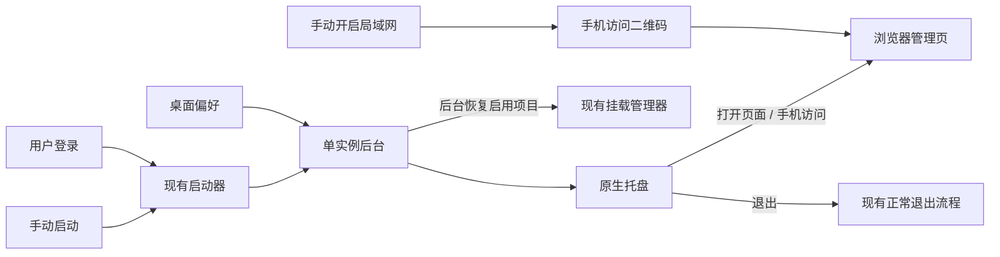

# MusicFS 桌面常驻与启动体验

需求澄清记录：2026-10-22。依据本轮用户确认；依赖候选与第一方证据见[调查报告](research-desktop-integration.md)。本文件记录用户行为和职责，不代表功能已经实现。

## 已确认的行为

| 场景 | 行为与默认值 |
|---|---|
| 支持平台 | Windows、Linux、macOS 一并支持；复用业务与设置语义，系统集成按平台实现。 |
| 常驻入口 | 托盘菜单提供“打开管理页面”“手机访问”“退出 MusicFS”。再次运行启动器继续复用已有后台。 |
| 手动启动 | 默认打开 WebUI，可在设置关闭。托盘的“打开管理页面”始终是明确的打开操作。 |
| 登录系统后自启 | 默认开启；自启时默认静默驻留托盘。“自启时打开 WebUI”有独立设置，默认关闭。 |
| 关闭网页 | 后台与挂载继续运行；从托盘重新进入。 |
| 启动自动挂载 | 全局默认开启，每个挂载项另有默认开启的开关；只处理已保存且启用的项目。 |
| 手动卸载 | 停止本次挂载，保留该项自动挂载设置。移除挂载项后不再恢复它。 |
| 挂载暂时失败 | 页面与托盘先可用，后台有限退避重试，可在设置关闭；仍失败则在原挂载列表显示原因并提供重试。 |
| 手机访问 | 扫码打开 MusicFS 管理页，无需手填管理令牌；不在本轮提供播放器导入二维码。 |
| 局域网开关 | 用户先在设置中手动开启。未开启时，“手机访问”引导至设置，不自动改变访问范围。已开启时提供实际可用地址；多网卡可切换。 |

“开机自启”指当前桌面用户登录后启动，适合托盘和该用户的挂载会话。解压新版后正常启动，应把自启入口更新到该版本的位置。

## 设计方向

- **桌面偏好**保存自启、两种启动的页面行为、自动挂载和重试设置；逐挂载开关归挂载定义。已有局域网设置继续由桌面网络模块负责。
- **系统集成**只负责托盘与系统登录入口。托盘动作交给现有后台处理，后台继续拥有单实例、浏览器打开、挂载和正常退出。
- **挂载恢复**复用现有挂载管理器，在后台按已启用项目执行；重新打开 WebUI 不重复触发整批恢复，不自动扫描音乐库。
- **手机访问面板**复用 WebUI 与 Ant Design QRCode，展示已经启用的局域网入口。登录方案与本轮新增的鉴权需求一起确定。

## 管理页登录

已确认本轮改进 **MusicFS 管理页登录**：单管理员，提供账号密码与记住登录，并支持桌面启动后自动进入、手机扫码进入。本轮没有第三方账号登录需求。

| 入口 | 用户体验 |
|---|---|
| 启动器、托盘 | 打开管理页时自动进入，不要求复制令牌。 |
| 普通浏览器、书签 | 可用账号密码登录，支持记住登录和明确退出。 |
| 手机访问 | 用户先手动开启局域网，再从已登录的管理页显示二维码；扫码进入。 |
| Worker | 提供同一套账号密码和登录状态体验，存储适配 D1。 |

首次启动桌面版直接进入，账号密码在设置中按需创建，不阻碍本机使用和手机扫码。云端首次沿用部署凭据进入后设置账号。

目前 WebUI 使用长期管理令牌与 `sessionStorage`，普通浏览器没有完整的登录、退出和持久会话。新方案由独立的管理鉴权模块统一服务通用 API 与桌面 API；宿主提供存储和启动入口。WebDAV 读取凭据、来源插件授权、启动器后台身份确认各自保留职责。

依赖选择与首次进入、重设密码、扫码换取登录状态的接入成本一起评估，见[鉴权调查](research-management-authentication.md)。

## 后续实施顺序

1. 以 Better Auth 最小配置为首选，先验证双宿主的密码与会话接入、桌面免输入进入，以及扫码后建立手机自己的会话。免费 Worker 的密码成本是选型验证，不通过时再比较轻量会话方案；不同时引入两套体系。
2. 接通账号设置、登录与退出，再让启动器、托盘和手机访问复用这些入口。局域网仍由用户手动开启；首次本机使用保持直接进入。
3. 实现三端托盘与用户登录自启，接通全局及逐项自动挂载、有限后台重试。系统集成不阻塞 WebUI 与现有挂载管理。
4. 用必要的用户旅程验收首次启动、重新打开页面、扫码、重启后挂载恢复和退出；随发行包交付平台辅助程序。未实现的行为不写成已发布能力。

## 实施前需要核实的事实

首选小样本比较 `tray-icon` 与 `auto-launch` 的轻量 Rust 辅助程序，Fyne 托盘路线保留为备选；不先迁移完整桌面框架。用户无需安装构建工具，平台辅助程序随完整发行包提供。Linux 图标显示取决于桌面环境的 SNI/AppIndicator 支持，macOS 需要匹配的原生产物构建条件；这些事实不能由 Windows/WSL 的编译结果替代。

网络设置的即时生效需单独设计监听生命周期：Bun `server.reload()` 不能修改地址或端口，不能据此承诺切换已完成。来源：[Bun Server.reload](https://bun.com/reference/bun/Server/reload)。
