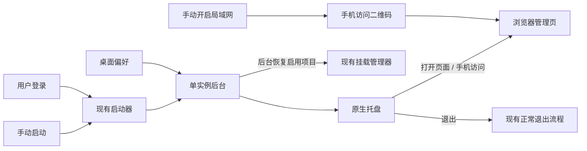

# MusicFS 桌面常驻与启动体验

需求澄清记录：2026-10-22。依据本轮用户确认；依赖候选与第一方证据见[调查报告](research-desktop-integration.md)。本文件记录用户行为和职责，不代表功能已经实现。

## 已确认的行为

| 场景 | 行为与默认值 |
|---|---|
| 支持平台 | Windows、Linux、macOS 一并支持；复用业务与设置语义，系统集成按平台实现。 |
| 常驻入口 | 托盘菜单提供“打开管理页面”“手机访问”“退出 MusicFS”。再次运行启动器继续复用已有后台。 |
| 手动启动 | 默认打开 WebUI，可在设置关闭。托盘的“打开管理页面”始终是明确的打开操作。 |
| 登录系统后自启 | 默认开启；自启时默认静默驻留托盘。“自启时打开 WebUI”有独立设置，默认关闭。 |
| 关闭网页 | 后台与挂载继续运行；从托盘重新进入。 |
| 启动自动挂载 | 全局默认开启，每个挂载项另有默认开启的开关；只处理已保存且启用的项目。 |
| 手动卸载 | 停止本次挂载，保留该项自动挂载设置。移除挂载项后不再恢复它。 |
| 挂载暂时失败 | 页面与托盘先可用，后台有限退避重试，可在设置关闭；仍失败则在原挂载列表显示原因并提供重试。 |
| 手机访问 | 扫码打开 MusicFS 管理页，无需手填管理令牌；不在本轮提供播放器导入二维码。 |
| 局域网开关 | 用户先在设置中手动开启。未开启时，“手机访问”引导至设置，不自动改变访问范围。已开启时提供实际可用地址；多网卡可切换。 |

“开机自启”指当前桌面用户登录后启动，适合托盘和该用户的挂载会话。解压新版后正常启动，应把自启入口更新到该版本的位置。

## 设计方向

- **桌面偏好**保存自启、两种启动的页面行为、自动挂载和重试设置；逐挂载开关归挂载定义。已有局域网设置继续由桌面网络模块负责。
- **系统集成**只负责托盘与系统登录入口。托盘动作交给现有后台处理，后台继续拥有单实例、浏览器打开、挂载和正常退出。
- **挂载恢复**复用现有挂载管理器，在后台按已启用项目执行；重新打开 WebUI 不重复触发整批恢复，不自动扫描音乐库。
- **手机访问面板**复用 WebUI 与 Ant Design QRCode，展示已经启用的局域网入口。登录方案与本轮新增的鉴权需求一起确定。

## 尚在澄清

用户新增“完善鉴权、提供其它登录方式、优先成熟方案”。先确认改进对象是 MusicFS 管理页、音乐来源账号授权，还是两者；再确定具体方式。管理会话、WebDAV 读取凭据和来源插件授权各有职责，不以其中一种凭据替代全部登录。

## 实施前需要核实的事实

首选小样本比较 `tray-icon` 与 `auto-launch` 的轻量 Rust 辅助程序，Fyne 托盘路线保留为备选；不先迁移完整桌面框架。用户无需安装构建工具，平台辅助程序随完整发行包提供。Linux 图标显示取决于桌面环境的 SNI/AppIndicator 支持，macOS 需要匹配的原生产物构建条件；这些事实不能由 Windows/WSL 的编译结果替代。

网络设置的即时生效需单独设计监听生命周期：Bun `server.reload()` 不能修改地址或端口，不能据此承诺切换已完成。来源：[Bun Server.reload](https://bun.com/reference/bun/Server/reload)。
