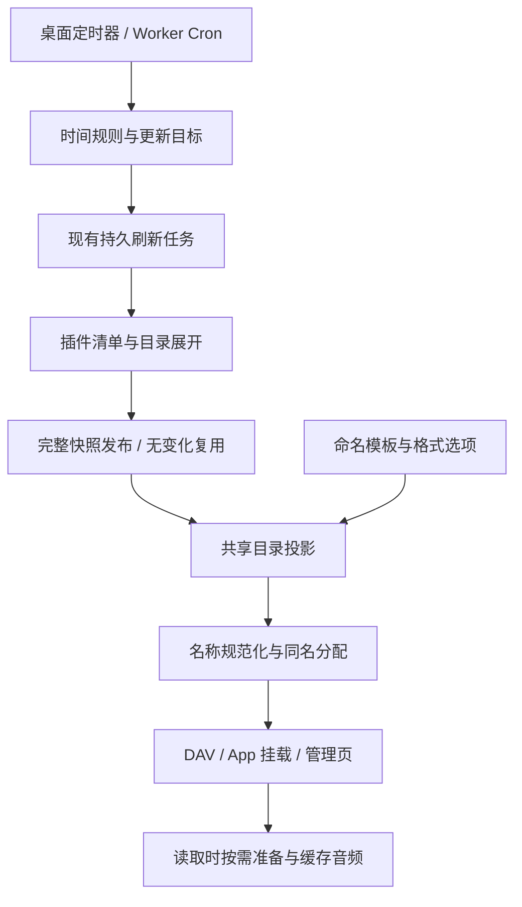

# 自动更新与文件命名模板方案

状态：待实施。2026-10-23，根据当前代码及用户确认整理；本文不表示功能已经交付。

## 用户目标

- 能按每天固定时间、指定星期或自定义间隔自动更新，范围可选整个来源实例。
- 音乐文件名支持用户自行填写模板，由歌曲资料自动填充。预设仅用于快速开始。
- 桌面、Worker、DAV 和 App 挂载采用相同语义；更新继续使用已有缓存和持久后台任务。

## 当前限制与改进取舍

| 当前行为 | 改进 |
|---|---|
| 定时设置只有若干固定间隔；来源实例上的设置实际只刷新入口清单 | 显式区分时间规则与更新范围，增加日历时间及完整实例范围 |
| 手动整实例刷新也只展开已知的部分后代目录 | “全部内容”必须包含本轮发现的新歌单及后代，不能沿用“已访问”含义 |
| 网易云和 QQ 在插件中拼接文件名，包含序号、歌名、歌手和音质 | 插件可选提供命名资料，共享展示层套用用户模板 |
| 同名后缀依赖条目 ID，示例插件的条目 ID 含歌单位置 | 模板去掉序号时，碰撞身份也要脱离全歌单位置，减少无关增删造成的改名 |

保留既有来源、清单刷新、文件准备、最终表示与挂载领域。不另建任务系统，也不把改名当作音质或音频内容变更。

## 自动更新

### 时间与范围

时间表单支持：关闭、每隔一段时间、每天某时、每周指定几天某时。固定时间使用明确的时区，默认采用用户所在时区；例如每天 08:00、Asia/Shanghai。界面不要求填写 Cron 表达式。

| 范围 | 具体含义 |
|---|---|
| 此目录 | 只更新当前真实目录的清单 |
| 此目录及子目录 | 从当前目录展开，包括本轮新发现的子目录 |
| 整个来源实例 | 更新入口及其全部后代，包括新发现的歌单 |

这里的“来源实例”指已经配置和授权的一个网易云、QQ 或其他插件实例，不等于插件下所有账号。虚拟目录的多个别名指向同一真实目录时，共用同一更新目标。

普通自动更新只更新清单，读取时仍按需准备文件。以 4,000 首喜欢音乐为例，到点更新歌曲名单和已有清单所需属性，不因为设置定时而预下载 4,000 首音频、封面或歌词。

自动更新与手动刷新一样需要取得当前来源清单，不能只重读长期缓存就显示“已更新”；稳定歌曲资料和未变化文件仍按原缓存策略复用。开启每日更新不会把全部资料期限一起缩短到一天。

### 操作体验

在来源或目录菜单中选择“自动更新”，预填当前范围；另提供统一列表，显示目标、时间、上次结果、下次计划以及运行进度。支持暂停、立即执行、编辑和删除，不要求逐个目录寻找已有规则。

规则仍在后台执行，关闭管理网页不影响桌面后台。后台退出期间错过的时间合并为一次补更，不逐次重放。固定时间表示计划开始时间；任务完成时间受内容量和来源响应影响。

间隔模式建议从本次任务结束后计时，避免耗时大目录连续重刷；日历模式仍锚定用户选定的时钟时间，运行中错过的时点合并处理。迁移保留旧规则的范围、间隔和首次待执行时间，后续起算规则在编辑器中明确显示，不能将旧“入口清单”规则静默扩大为全库。

### 模块与成本

- 调度模块只计算下次时间并把目标交给现有刷新模块；分页、发布、冷却、取消和重试仍由刷新模块拥有。
- 将触发记录与持久任务关联，保证没有在任务落盘前消耗一次调度。重叠范围复用或合并已有工作，不能把另一个目录的任务当成本次任务已完成。
- 完整遍历以持久待处理目录推进，并复用已有已访问集合；新增范围不默认增加平台并发。
- 桌面后台定时器与 Worker 原生 Cron 唤醒同一套规则。Worker 根据免费版资源边界推进，允许计划触发到完成有延迟；不依赖新增付费队列。
- 有变化才发布新内容版本并通知对应挂载；无变化继续保留索引和文件缓存。第三方直接 DAV 客户端何时重列目录由客户端决定。

日历计算优先考虑 [Croner](https://github.com/Hexagon/croner)：跨运行时、支持时区与下次执行时间计算。使用暂停模式仅计算时间，实际唤醒和持久执行由 MusicFS 管理，避免两套调度器。备选 [cron-parser](https://github.com/harrisiirak/cron-parser) 也支持时区和迭代，但引入 Luxon；当前表单需求不需要同时引入两者。

## 自定义命名模板

### 输入、填充与预览

用户编辑的是模板，例如：

| 模板（不含扩展名） | 自动生成示例 |
|---|---|
| `{{title}} - {{artist}}` | `晴天 - 周杰伦.flac` |
| `{{artist}} - {{title}} [{{quality}}]` | `周杰伦 - 晴天 [无损].flac` |
| `{{index}}. {{title}}` | `0001. 晴天.flac` |
| `{{#track}}{{track}} - {{/track}}{{title}}` | 有曲号时为 `02 - 晴天.flac`，缺失时为 `晴天.flac` |

字段面板可点击插入；预设填入编辑框后仍可任意修改。相同规则逐首自动填充，不要求逐首改名。

拟提供的音乐字段：`title` 歌名、`artist` 多位歌手合并、`album` 专辑、`albumArtist` 专辑艺术家、`track` 原专辑曲号、`disc` 碟号、`index` 当前目录顺序、`quality` 音质、`id` 来源歌曲标识。`originalName` 为插件原文件名的主体，不含扩展名。可选字段以插件实际提供的资料为准；编辑器显示当前来源支持哪些字段。

多位歌手的分隔符、序号/曲号补零位数作为简单格式选项。缺失字段为空，条件块可一并隐藏旁边的分隔文字；整个结果为空时保留原名。扩展名始终跟随真实格式自动追加，避免将 MP3 误命名成 FLAC。

预览直接使用已有目录资料，显示修改前后及同名处理结果；不为预览读取音频或补齐全库资料。已有快照没有新命名字段时，提示先更新目录，不从旧拼接名称反向猜歌名和歌手。

### 配置归属与兼容

采用“来源实例默认模板＋单个真实目录覆盖”，没有覆盖则继承实例设置。先不增加更深层级的递归继承规则。DAV 和 App 挂载都消费同一命名结果。

命名策略单独存储，不放入插件的内容配置。插件 API 可选提供字段说明、每个文件的命名资料及稳定命名身份；其他插件保留原名即可，核心不要求所有来源实现音乐元数据。网易云、QQ 先接入现有清单已经取得的字段，缺失字段不会自动引入新的平台请求。

既有实例默认使用插件原命名方式，用户应用模板才改路径。修改模板不改变音质、授权、音频标签、文件引用或最终字节身份；单独更新展示策略版本，并使对应目录投影及挂载清单失效。热文件读取不逐首查询命名配置。

### 名称稳定性与实际影响

继续复用现有 `sanitize-filename`、跨平台名称长度处理和同名分配模块。同名身份基于来源媒体、音质及同曲重复出现身份，避免使用全歌单位置作为唯一碰撞后缀依据；重复歌曲仍保留。

不用 `index` 的模板可以减少歌单前部增删、换序带来的路径变化。真正出现新同名、歌曲资料更正或不可区分的重复出现变化时，相关名称仍可能调整；不为这些少见情况先建设永久别名数据库。

首次应用模板会改变实际路径，播放器的按路径索引和 rclone 路径缓存可能需要重新识别。MusicFS 以最终表示为键的音频缓存仍可复用；不能把这种复用等同于外部客户端完全不重新扫描。界面在应用前以预览说明影响，无需增加多轮确认。

模板渲染优先考虑 [Mustache.js](https://github.com/janl/mustache.js)：变量和条件块已经覆盖当前需求。按非 HTML 文本渲染，避免歌名中的 `&` 变成 HTML 实体；UI 预览与后台共用同一渲染及名称分配模块。相比自行维护正则替换或引入完整脚本/复杂 helper 体系，这个范围更容易保持一致。实施前核对打包兼容及维护状况，不在方案阶段安装依赖。

## UI / UX 影响与范围收敛

两个功能都作为现有使用流程的可选配置，不增加首次使用步骤。来源与目录菜单打开同一编辑器；统一规则列表放在现有设置页，不新增顶层导航或另一个任务中心。

| 环节 | 用户效果与设计选择 | 需要处理的实际影响 |
|---|---|---|
| 查找入口 | 来源菜单设置整个来源，目录菜单设置当前目录，自动预填目标 | 表单明确显示账号/来源名和范围，避免把“入口清单”误当“全部内容” |
| 选择时间 | 每天时间、间隔和星期使用普通表单，摘要如“每天 08:00 · 北京时间” | 计划时间和实际完成分开；不要求理解 Cron，也不新增间隔起算方式开关 |
| 管理规则 | 在设置中查看、暂停、编辑、删除，运行记录复用现有刷新状态 | 运行中可查看旧内容；重叠工作合并推进，不给同一范围展示重复任务 |
| 写模板 | 编辑框、字段插入、几个起始预设、实时预览；格式选项按需展开 | 自由模板始终保留，不把用户限制在预设；曲号与歌单序号分别标明 |
| 预览与应用 | 使用当前目录快照，界面只显示有限行；同名结果仍按完整当前目录分配 | 当前目录预览不代表已扫描全部来源；设置实例默认模板不为统计改名数量遍历全库 |
| 目录覆盖 | 默认继承来源，修改后显示“此目录自定义”，可恢复继承 | 避免多层递归继承、逐文件例外配置，以及重复维护同一模板 |
| 播放与挂载 | 后台自动更新减少手动维护；各入口使用相同新名称 | 去掉序号有助于路径稳定，但首次改名仍可能使播放器重扫；不能承诺第三方客户端即时重列目录 |
| 手机管理 | 同一表单纵向排列，模板和预览列表换行显示 | 不另做一套手机配置或要求手机横向比较大表格 |

当前主要结构问题是调度目标绑定单个快照键，以及命名事实与插件内拼接格式耦合。本次仅拆开时间/范围、持久执行、命名资料、展示策略四个职责，继续复用发布索引和最终文件表示。无需整体重写管理界面或音频处理链路。

首版优先每天固定时间、自定义间隔、明确范围及来源实例的自由模板。每周指定日、目录模板覆盖和独立格式控制的增量 ROI 为中等，可沿共享模块补入；若明显扩大界面或工期，则后置，不阻塞核心交付。模板条件块保留在语法中，普通用户通过示例使用，不增加单独的可视化规则编排器。

## 数据流

## 实施顺序、工作量与 ROI

以下为单人有效开发日粗估，包含定向验证，不含外部环境等待。

| 顺序 | 交付范围 | 工作量 | 主要风险 / ROI |
|---|---|---|---|
| 1a | 时间与范围模型、完整遍历、持久任务关联 | 1.25—2 日 | 全实例遍历会增加真实更新量，需要合并重叠范围并沿用冷却。直接满足固定时间和整来源更新，ROI 高 |
| 1b | 自动更新编辑器、设置中的规则列表及状态 | 0.75—1 日 | 主要是目标和状态表达，避免增加独立操作流程；减少重复设置，ROI 中高 |
| 2a | 可选插件命名字段、共享模板渲染、稳定同名身份与展示版本 | 1.25—2 日 | API/快照兼容、保持音频身份；去掉序号时才有对应路径稳定性收益，ROI 高 |
| 2b | 模板编辑、字段插入、预览及简单目录覆盖 | 0.75—1 日 | 预览与实际结果一致、说明应用范围；模板及预览 ROI 高，目录覆盖的增量 ROI 中等 |
| 3 | 迁移与跨入口集成核对、文档 | 0.5—1 日 | 聚焦 SQLite/D1 调度一致性和名称投影/缓存身份，ROI 高 |

合计约 **4.5—7 个有效开发日**。按调度与命名两个行为单元安排提交，再集中集成；不逐个页面单独打包。

必要验证使用可控时钟和小型离线目录：固定时间与时区、重启错过一次、全实例发现新子目录、重叠工作复用；模板预览与实际路径一致、缺字段/重名、无序号时少量增删不改无关文件、改名不重取音频。跨入口验证共用表示，不恢复全平台压力或大库反复扫描矩阵。

暂不扩展脚本命名语言、按模板创建目录、定时整库强制补标签或新的下载系统；这些都不是本次明确需求。
