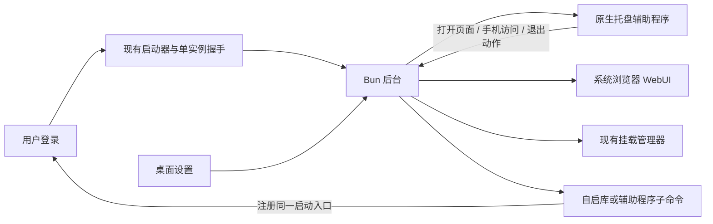

# 桌面常驻能力：依赖调查

调查日期：2026-10-22。范围是 MusicFS 现有 Bun 后台、浏览器 WebUI 的托盘和登录自启；没有安装依赖、下载源码包或操作 Windows 宿主。以下是选型证据与建议，尚未确定最终依赖，也未完成三端运行验收。

用户已确认：三端同时支持；手动启动默认打开 WebUI，登录自启默认不打开，两项分别可设；登录自启和启动自动挂载默认开启，每个挂载项有默认开启的自动开关，手动卸载只停止本次；手机访问先由用户在设置开启局域网，不自动开放。

## 结论

现有架构可以保留。值得优先比较的是「随包附带的小型原生托盘程序」与「直接加载原生 Node-API 模块」；仅为三个托盘菜单引入完整桌面框架，当前收益不足。辅助程序是 App 内部资源，用户不需要另装 Go、Rust 或 Node。

结合已确认的“手动启动/登录启动分别控制页面”语义，**优先验证 tray-icon 0.26.1 + auto-launch 0.6.0 的薄 Rust 辅助程序**：三端托盘与自启集中在同一程序，稳定版自启库支持参数数组，可明确传递登录启动标记；Linux 选 KSNI 后不需要 GTK。**fyne.io/systray v1.12.2** 是托盘备选：三端接口一致、Linux 已采用无 GTK 的 D-Bus 实现，但还需解决自启参数的稳定接入。两者都需要构建和分发各平台产物，且 macOS 仍需原生构建条件；这些工作不会因换成 npm 包自动消失。[Fyne 固定版本](https://github.com/fyne-io/systray/tree/v1.12.2)、[tray-icon 正式文档](https://docs.rs/tray-icon/0.26.1/tray_icon/)、[auto-launch 正式文档](https://docs.rs/auto-launch/0.6.0/auto_launch/)

**Linux 的限制在桌面环境，不只在库。** SNI/AppIndicator 需要用户桌面提供托盘宿主。KDE 等支持相应协议；GNOME 的扩展入口明确负责补充 AppIndicator/KStatusNotifierItem 支持，因此不能承诺所有原生 GNOME 安装都会显示图标。应保留“再次启动打开 WebUI”的现有入口，而不是为了覆盖所有 Linux 环境自行实现另一套桌面面板。[GNOME 扩展说明](https://extensions.gnome.org/extension/615/appindicator-support/)、[Fyne 平台说明](https://github.com/fyne-io/systray/tree/v1.12.2#platform-notes)

## 托盘方案对比

| 方案 | 已核实能力与发布状态 | Bun / 发行接入 | 判断 |
| --- | --- | --- | --- |
| **fyne.io/systray v1.12.2** | Windows/macOS/Linux；Fyne 团队维护；2026-06-09 的 v1.12.2 修复 Cinnamon/Xfce/GNOME 的空子菜单。Apache-2.0。 | 没有 Bun 绑定，编译薄 Go 程序，以标准输入输出或现有本机接口传递少量菜单动作。macOS 使用 Cocoa/cgo；Windows 可用 GUI 子系统避免控制台。Linux 源码走 D-Bus，没有 GTK。 | **可采用的托盘备选**，自启另行接入。 |
| **tauri-apps/tray-icon 0.26.1** | 正式版本 0.26.1；Windows/macOS/Linux。MIT OR Apache-2.0；Linux 可选 KSNI。 | 使用 Rust 辅助程序，不必采用整个 Tauri。Windows 需要事件循环，macOS 创建和事件循环在主线程；KSNI 后台线程不依赖 GTK。可与 Rust auto-launch 合用。 | **优先做小样本的组合路线**，适合统一三端托盘和带参数自启。 |
| **systray2 2.1.4** | Node 封装 + systray-portable Go 程序；MIT。API 足以实现菜单、点击和退出，支持模板图标。 | 源码使用 child_process/readline/fs；Bun 适配理论负担较低，但没有本次已验证的 Bun 1.4.3 证据。必须把真实 traybin 文件随包分发，不能把 Bun 虚拟文件路径直接当可执行文件。 | **需小样本验证的快捷方案**。发布较旧；当前 ARM64 预编译覆盖、Linux 原生库版本未核实，不作为三端完成的依据。 |
| **tray-icon-node 0.1.2** | Rust NAPI 模块，声明 Bun >=1.0；MIT；仓库规模小。Cargo 使用 tray-icon 0.21.3、napi9；Linux 显式依赖 gtk 0.18。 | 声明构建目标包含 Windows x64/x86、macOS x64/ARM64、Linux x64/ARM64；声明目标不等于每项已正式发布并可用。加载器、原生事件循环与 Bun 编译产物需验证。 | **需小样本验证，优先级低于前两项**；不能直接把最新 tray-icon 的无 GTK 特性算到旧封装上。 |
| **gogpu/systray v0.3.0** | 宣称三端纯 Go、零 cgo；MIT；Go 1.25+。有连续正式版本，近期修复 macOS 启动/退出、菜单竞态。 | 作为辅助程序有利于交叉编译，Linux 使用 D-Bus SNI；macOS 通过纯 Go FFI。实际产物体积和三端稳定性本次未知。 | **候补**。可解决构建麻烦，但不为省一个工具链直接换到较新的平台实现。 |
| **完整 Electron / Tauri** | Electron 有三端 Tray，macOS/Windows 登录项 API；Tauri 有托盘、自启插件和打包工具。项目本体分别为 MIT、MIT OR Apache-2.0。 | 都不是可直接 import 到现有 Bun 后台的托盘库。需要新常驻宿主和构建流程；Bun 后台可保留为子程序，或进行更大迁移。Electron 还要分发其运行时；Tauri 用系统 WebView。 | **本轮不采用**。若将来确实需要内嵌窗口、系统对话框与安装更新体系，再整体比较。 |

表格证据：

- Fyne：[v1.12.2 标签与修复](https://github.com/fyne-io/systray/tags)、[固定版本 README](https://raw.githubusercontent.com/fyne-io/systray/v1.12.2/README.md)、[Linux 实现](https://raw.githubusercontent.com/fyne-io/systray/v1.12.2/systray_unix.go)、[macOS 实现](https://raw.githubusercontent.com/fyne-io/systray/v1.12.2/systray_darwin.go)、[许可](https://github.com/fyne-io/systray/blob/v1.12.2/LICENSE)。该仓库有版本标签，GitHub Releases 页面没有单独发行包；不能误判为没有版本。
- Rust tray-icon：[0.26.1 正式文档](https://docs.rs/tray-icon/0.26.1/tray_icon/)、[正式发布记录](https://github.com/tauri-apps/tray-icon/releases)、[仓库与许可](https://github.com/tauri-apps/tray-icon)。
- systray2：[作者 README](https://raw.githubusercontent.com/felixhao28/node-systray/master/README.md)、[Node 实现](https://github.com/felixhao28/node-systray/blob/master/index.ts)、[辅助程序协议](https://github.com/felixhao28/systray-portable)、[npm 元数据](https://www.npmjs.com/package/systray2?activeTab=code)。本次能读取文档和源码，但未获得完整预编译目录清单；架构覆盖保持未知。
- tray-icon-node：[作者声明](https://github.com/nglmercer/tray-icon-node)、[package.json](https://raw.githubusercontent.com/nglmercer/tray-icon-node/main/package.json)、[Cargo.toml](https://github.com/nglmercer/tray-icon-node/blob/main/Cargo.toml)。
- gogpu：[作者实现说明](https://github.com/gogpu/systray)、[v0.3.0 发行记录](https://github.com/gogpu/systray/releases)。
- 框架：[Electron Tray](https://www.electronjs.org/docs/latest/api/tray)、[Electron app](https://www.electronjs.org/docs/latest/api/app)、[Electron 许可](https://github.com/electron/electron/blob/main/LICENSE)、[Tauri 架构与许可](https://github.com/tauri-apps/tauri)、[Tauri 自启插件](https://v2.tauri.app/plugin/autostart/)。

## 用户登录自启

这里对应桌面用户登录后运行。无需 Windows 系统服务、Linux 开机级 daemon 或管理员权限；使用系统服务会额外引入“系统会话与桌面会话不同”的问题。Windows Run 与 XDG Autostart 的正式定义都是用户登录后启动。[Microsoft Run 文档](https://learn.microsoft.com/en-us/windows/win32/setupapi/run-and-runonce-registry-keys)、[XDG 规范](https://specifications.freedesktop.org/autostart/latest/)

| 依赖 | 已核实行为 | 接入取舍 |
| --- | --- | --- |
| **npm auto-launch** | MIT；稳定版标记为 5.0.6，6.0.0-rc2 仍为预发布。Windows HKCU Run；Linux .desktop；macOS 默认 AppleScript，可选 LaunchAgent。API 有 enable/disable/isEnabled。 | 5.0.6 Windows 源码证实 isHidden 实际追加 `--hidden`，不是系统替应用隐藏页面；当前 MusicFS strict parser 不接受它。任意 args 不在 5.x 公开 API；RC 的传参改进不计入稳定版。官方未给 Bun 承诺。暂不作为已满足两种启动语义的方案。 |
| **Rust auto-launch 0.6.0** | MIT；正式文档支持参数数组；Linux XDG 或用户 systemd；macOS 有 LaunchAgent 等模式；Windows 必须显式选择 CurrentUser，默认会先尝试系统范围再回退。 | 采用 Rust 托盘程序时可复用同一个程序处理注册操作。优先考虑当前用户登录注册；不必启用更广的系统范围。 |
| **emersion/go-autostart** | MIT；Linux XDG、macOS launchd、Windows Startup 快捷方式。 | 与 Go 托盘组合是可行方向，但现有 Windows 实现以 ANSI C 字符串传路径，参数直接空格拼接；含中文路径/带空格参数属于 MusicFS 普通用户的实际场景，需先解决，不建议直接选为默认。 |
| **user-startup** | MIT；支持命令参数；Windows 通过 Startup 目录里的 VBS，Linux .desktop、macOS plist。 | 能少写代码，但 VBS 增加一层脚本依赖，当前不优先于前两项。 |

证据：[node-auto-launch API/机制](https://github.com/Teamwork/node-auto-launch)、[5.0.6 Windows 源码](https://github.com/Teamwork/node-auto-launch/blob/5.0.6/src/AutoLaunchWindows.coffee)、[稳定/RC 发布记录](https://github.com/Teamwork/node-auto-launch/releases)、[Rust 0.6.0 文档](https://docs.rs/auto-launch/0.6.0/auto_launch/)、[Rust Cargo 许可](https://raw.githubusercontent.com/zzzgydi/auto-launch/main/Cargo.toml)、[Go 库](https://github.com/emersion/go-autostart)、[Go Windows 路径和参数源码](https://raw.githubusercontent.com/emersion/go-autostart/master/autostart_windows.go)、[user-startup 作者说明](https://github.com/typicode/user-startup)。

自启库解决的是向系统注册命令，不解决 MusicFS 的“哪个版本路径仍有效”。当前按版本解压发行包，升级后需要让注册项指向用户实际启动的新版本。npm auto-launch 5.0.6 Windows 的 isEnabled 只检查同名值存在，不能当成“指向最新路径”的证据。这是实际发行流程的接缝，应复用现有启动器和单实例握手；不需要因此先引入自动更新框架。[5.0.6 源码](https://github.com/Teamwork/node-auto-launch/blob/5.0.6/src/AutoLaunchWindows.coffee)

本次未找到可证实的 `@napi-rs/auto-launch` 官方仓库或正式包，不将猜测的包名列入可选依赖。Node 库的 Linux/macOS 稳定版具体参数实现也未完整读取成功，因此不作“三端同样追加 --hidden”的推断。

## 建议的职责边界

这是架构建议，不是已实现方案：托盘只负责图标、菜单与动作；后台继续负责唯一服务、退出和挂载，避免在两个进程复制业务状态。托盘打开 WebUI/手机访问页可复用现有 `open` 依赖；手机二维码直接使用已有 Ant Design `QRCode`，无需另加二维码包。[Ant Design QRCode](https://ant.design/components/qr-code/)

Bun 正式文档说明“多数”Node-API 模块可用，并非所有原生模块保证兼容；编译模式支持直接嵌入 `.node` 文件，但动态加载器可能要改成直接引用。原生辅助程序则要有真实文件路径，适合当前已经随包分发 rclone/resources 的结构。[Bun Node-API](https://bun.sh/docs/runtime/node-api)、[Bun 编译原生模块说明](https://bun.sh/docs/bundler/executables#embed-n-api-addons)

## 接入工作量与最小验证

下面是基于当前结构的工程估算，不是上游性能数据；不包含等待三端设备、签名或发布渠道的时间。

| 工作 | 估算 | 主要不确定性 |
| --- | --- | --- |
| 首选托盘/自启组合小样本 | 0.5—1 人日 | macOS GUI 主线程、Linux SNI 实际宿主、登录标记参数 |
| Fyne 薄辅助程序 + Bun 生命周期 + 三端构建 | 2—4 人日 | macOS 原生构建入口、不同架构产物；实际大小待产物产生后量取 |
| Rust 托盘/自启合并辅助程序替代路线 | 3—5 人日 | 三端事件循环和交叉构建，不计完整框架 |
| 已选自启依赖 + 设置 + 升级路径衔接 | 1—2 人日 | 两种启动标记的实际传递、版本路径更新 |
| 手机访问入口与 QR | 0.5—1 人日 | 复用现有 LAN 设置与地址，网络可达性不由 QR 库解决 |
| 自动挂载设置接入现有挂载管理器 | 1—2 人日 | 全局/逐挂载两级设置与现有手动卸载状态接缝；无需新挂载依赖 |

验证粒度：每端各验证一次菜单显示/打开页面/退出；自启启用与禁用各一次，并检查真实注册目标；一个现有挂载恢复流程；手机扫本机实际 LAN 地址一次。只验证这些用户可见路径，不做平台请求、并发/压力测试或广泛桌面环境矩阵。

三类建议：

- **可采用**：保留 Bun + 浏览器 WebUI；原生辅助程序的职责分工；已有 `open` 与 Ant Design QRCode；复用现有挂载管理器。
- **需小样本验证后落定**：优先验证 Rust tray-icon 0.26.1 + auto-launch 0.6.0，只核实三端菜单、启停和带参数自启；Fyne v1.12.2 是托盘备选。systray2/npm auto-launch 仅在其稳定能力满足已定语义时再考虑。
- **本轮不适合**：为托盘迁移完整 Electron/Tauri、手写三端 FFI/托盘协议、采用未实现 macOS 托盘的 Bun 框架。后者可见 [bundesk 官方平台表](https://github.com/liooil/bundesk#system-tray)，当前明确 macOS 托盘未实现。
